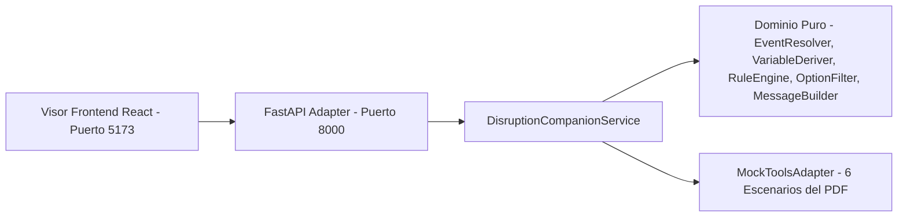

# Disruption Companion — Entregable 1 (Vertical Slice V0)

## 1. Track elegido y justificación (`SRC-05-02`)

- **Track elegido**: **Opción A — Backend / Integración**, complementado con un **visor Frontend mínimo en React** que consume el backend en vivo y muestra toda la estructura recibida.
- **Por qué**: El riesgo principal del caso está en las decisiones de negocio y de confiabilidad bajo datos imperfectos (fuentes operacionales degradadas o en conflicto, propagación de retrasos sobre conexiones, evaluación segura de reglas versionadas, filtrado de opciones candidatas con vigencia TTL, idempotencia ante `503 UPSTREAM_TIMEOUT` indeterminado y protección de PII). Esas invariantes pertenecen al dominio de backend.



---

## 2. Alcance implementado y organización de Specs (`V0`, `V1`, `V2`)

Para respetar el límite de **3 horas efectivas de trabajo** (`SRC-01-02`, `SRC-06-01`) manteniendo trazabilidad completa con SDD (`sdd-workflow`), los 104 specs funcionales originales (`sdd/specs/functional_all/`) se dividieron en tres etapas evolutivas:

1. **`sdd/specs/V0/` y `sdd/specs/functional/` (15 specs — Implementados en esta entrega)**:
   - Evaluación completa del caso base `ABC123` y sus variantes (`F-01`, `SF-01.2`, `SF-01.4`, `SF-01.5`, `SF-01.6`, `SF-01.7`, `SF-01.8`, `SF-01.9`, `SF-01.11`, `SF-01.14`).
   - Ejecución de la acción controlada (`F-02`: `create_rebooking_request` con llave idempotente y hasta 2 reintentos ante `503` indeterminado antes de derivar a humano, o `create_human_case` directo cuando la decisión es `PENDIENTE_APROBACION` o `BLOQUEADA`).
   - Catálogo de 6 escenarios simulados (`F-06`) fieles a los contratos JSON del PDF (`SRC-01-16`).
   - Visor Frontend sencillo (`FE-02`) con estilos propios alineados con `DESIGN_CONTRACT.md`.
   - Requisitos transversales de privacidad/seguridad/calidad (`X-01`) y entregables de documentación (`X-02`).
2. **`sdd/specs/V1/` (34 specs — Siguiente iteración de endurecimiento)**:
   - Cabeceras de sesión simulada y rate-limiting en aplicación (`S-V0-1`), validación de cadenas de segmentos corruptas (`S-V0-2`), persistencia SQLite y endpoint `GET /decisions/{id}` (`S-V0-3`), revalidación cuádruple previa a escritura y diálogo separado de 3 motivos (`S-V0-4`).
3. **`sdd/specs/V2/` (55 specs — Evolución futura)**:
   - Modo `caller = "system"` con `notify_passenger` proactivo, barrido perezoso de expiración, comandos CLI de purga a 30 días y métricas, y 24 sub-specs de micro-interacciones avanzadas de UI.

---

## 3. Instrucciones de ejecución y verificación (`SRC-05-02`)

### 3.1 Ejecutar pruebas automatizadas y verificación de cobertura + AST (Python 3.13)

```bash
cd solucion/backend
C:/Users/maste/anaconda3/envs/companion313/python.exe -m pytest --cov=app --cov-report=term-missing
```

Resultado verificado: **19 passed**, **93 % de cobertura total**, y **0 violaciones AST** (todas las funciones en `backend/app/` cumplen `<= 10 líneas`, `<= 3 parámetros` y cero uso de `eval`/`exec`).

### 3.2 Levantar el Backend y el Visor Integrado (FastAPI en Python 3.13)

```bash
cd solucion/backend
C:/Users/maste/anaconda3/envs/companion313/python.exe -m uvicorn app.api.main:app --host 127.0.0.1 --port 8000
```

Endpoints disponibles:
- `GET http://127.0.0.1:8000/` → **Visor Web Interactivo** dividido en **Vista Limpia del Pasajero** (arriba) y **Panel Gris de Soporte/Debug Operacional** (abajo) (`FR-114`)
- `GET http://127.0.0.1:8000/ping` → `pong`
- `GET http://127.0.0.1:8000/api/dev/scenarios` → lista los 6 escenarios del PDF y variantes
- `PUT http://127.0.0.1:8000/api/dev/scenario` → `{"scenario_id": "BASE_TC01"}`
- `POST http://127.0.0.1:8000/api/v1/trips/ABC123/evaluate` → `{"caller": "user"}`
- `POST http://127.0.0.1:8000/api/v1/trips/ABC123/options/O1/accept` → `{"decision_id": "<uuid>"}`

### 3.3 Levantar el Visor Frontend (React + Vite)

```bash
cd solucion/frontend
npm install
npm run dev
```

Abrir `http://localhost:5173` para cambiar entre los escenarios (`BASE_TC01`, `ADULTOS_AUTOMATICO_TC07`, `CONFLICTO_FUENTES_TC03`, `SOLO_DEGRADADO_TC02`, `SIN_OPCION_VIABLE_TC09`, `UPSTREAM_TIMEOUT_TC14`), inspeccionar la respuesta del backend y ejecutar la acción controlada.

---

## 4. Limitaciones conocidas en V0 (`SRC-05-02`)

- **Almacenamiento en memoria (`InMemoryDecisionStore`)**: las decisiones, llaves de idempotencia y casos humanos viven en memoria del proceso durante la ejecución (persistencia SQLite diferida a `V1`).
- **Tiempo mínimo de conexión (MCT) no provisto en el contrato**: se asume `0 min` rotulado explícitamente como supuesto (`A2`), declarando `missed_connection = None` (incierto → `BLOQUEADA`) cuando el margen cae en `[0, 45) min`.
- **Confirmación de `PENDING_CONFIRMATION`**: `create_rebooking_request` devuelve `201 PENDING_CONFIRMATION`; el mensaje informa claramente que la solicitud está pendiente y sujeta a disponibilidad sin afirmar que el vuelo ya fue cambiado.

---

## 5. Índice de Entregables Obligatorios (`SRC-06-02`)

1. **Entregable 1 (Vertical Slice + Instrucciones)**: este `README.md`, código en `backend/` y `frontend/`, y diseño técnico en `sdd/reports/RFC_TECHNICAL.md`.
2. **Entregable 2 (README de Ingeniería ≤ 2 págs.)**: `docs/README_INGENIERIA.md`.
3. **Entregable 3 (AI Usage & Decision Note ≤ 1 pág.)**: `docs/AI_USAGE_NOTE.md`.
