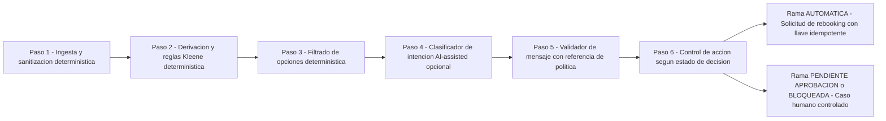

# README de Ingeniería — Disruption Companion (Entregable 2, máx. 2 páginas)

## 1. Problema entendido y outcome esperado (`SRC-05-03`)

Cuando un vuelo sufre una modificación operacional, el pasajero enfrenta incertidumbre sobre el impacto en su itinerario (especialmente en vuelos con conexión) mientras los sistemas internos pueden reportar eventos desactualizados o contradictorios entre fuentes (`SRC-04-04`).  
**Outcome esperado (`SRC-01-11`)**: reducir la incertidumbre del pasajero y los contactos evitables al call center entregando una explicación verificada y una acción controlada (reprogramación automática cuando es segura, o escalamiento a un especialista con contexto estructurado cuando requiere aprobación o existe ambigüedad), garantizando **cero afirmaciones sin evidencia**, **control de acciones de alto impacto** y **trazabilidad completa**.

### Resolución del Caso Base (`ABC123`, `SRC-04-21`)
1. **Eventos (`SF-01.4`)**: para `S1` (`LA500 SCL→LIM 14:30–17:55`), se excluye `E-1012` (`ON_TIME`) porque su fuente `MONITORING_FEED` figura en `_meta.sources_degraded`. Quedan validados `E-1001` (`DELAY` de `160 min`, nueva salida `17:10`, fuente sana `OPS_CORE`) y `E-1007` (`GATE_CHANGE` a puerta `24`, `AIRPORT_FEED`). Para `S2` (`LA2410 LIM→MEX 19:05`), `E-2003` (`SCHEDULED`) no afirma retraso (`NO_EVENTS`).
2. **Variables derivadas (`SF-01.7`)**: propagando los `160 min` sobre la llegada programada `17:55` (supuesto `A1`), la nueva llegada estimada a Lima es `20:35`, dejando un margen de `-90 min` frente a la salida de `S2` (`19:05`) → `missed_connection = true`. Con `SCL→LIM` (`CL≠PE`) → `international = true`; con `P2` de tipo `CHILD` → `group_includes_minor = true`; `compensation_requested = false`.
3. **Reglas de política (`SF-01.8`, `POL-DELAY-2026-03`)**: `R1` (`160 >= 180`) = `FALSE`; `R2` (`160 >= 240`) = `FALSE`; `R3` (`missed_connection == true`) = `TRUE` (otorga `REBOOK_NO_FEE`, `requires_human_approval: false`); `R4` = `FALSE`; `R5` (`group_includes_minor == true`) = `TRUE` (`PRIORITY_HANDLING`, `requires_human_approval: true`). Al cumplirse `R3` (derecho de remedio) y `R5` (exige aprobación humana), el estado de la decisión es **`PENDIENTE_APROBACION`**.
4. **Opciones candidatas (`SF-01.9`)**: `O1` (`LA2412`, 16-sep `08:15`, 4 asientos ≥ 2 pax, `fare_difference = 0`, `POL-DELAY-2026-03`) es **viable y propuesta**. `O2` se descarta por `INSUFFICIENT_SEATS` (1 asiento < 2 pax) y `FEE_CONFLICT` (`180.000 CLP > 0`). `O3` (`REFUND`) se descarta como opción automática por `UNVERIFIED_POLICY` (`POL-REFUND-2025-09` no recuperada), mencionándose solo como orientación no afirmativa.
5. **Acción controlada (`F-02`)**: como la regla `R5` de la política recuperada (`POL-DELAY-2026-03`) se activó y exige `requires_human_approval: true`, **no** se invoca `create_rebooking_request` (si la política no tuviera una regla con `requires_human_approval: true`, sería `AUTOMATICA`); el clic del pasajero invoca `create_human_case` (`HC-4471`, cola `DISRUPTION_L2`, SLA `45 min`) adjuntando `O1` y la traza validada sin PII.

---

## 2. Supuestos explícitos y alcance V0 (`SRC-07-10`)

- **A1 (Propagación íntegra)**: el retraso de salida de `S1` se propaga íntegro a su llegada (`17:55 + 160m = 20:35`).
- **A2 (MCT no provisto)**: el contrato de `get_trip_context` no informa el tiempo mínimo de conexión en `LIM`. Si el margen es `< 0` la conexión se pierde con certeza; si el margen cae en `[0, 45) min` sin MCT provisto, se declara `missed_connection = UNKNOWN` y se bloquea la automatización para evitar un falso negativo riesgoso.
- **A3 (No retención de `S2`)**: no se asume que el vuelo de conexión `LA2410` espere al vuelo retrasado.
- **S-V0-1..6 (Acotación de 3 horas y separación visual `FR-114`)**: autenticación/rate-limiting delegados al Gateway (`S-V0-1`), trazabilidad e idempotencia en memoria (`S-V0-3`), y visor dividido en dos zonas (`FR-114`): arriba la **Vista Limpia del Pasajero** (lenguaje claro y amable, sin códigos técnicos) y abajo el **Panel Gris de Soporte y Debug Operacional** (`completeness: PARTIAL`, reglas `R1..R5`, `POL-DELAY-2026-03`, opciones descartadas y JSON completo).

---

## 3. Decisiones principales y alternativas descartadas (`SRC-05-03`)

| Decisión adoptada | Alternativa descartada | Por qué se descartó (trade-off: costo, riesgo, reversibilidad) |
|-------------------|------------------------|----------------------------------------------------------------|
| **1. Runtime 100 % determinístico (sin LLM en el camino crítico)** | Agente LLM decidiendo elegibilidad o redactando mensajes libres | Un LLM en runtime introduce riesgo de alucinación sobre derechos tarifarios/montos (`SRC-04-05`), latencia `> 2 s`, costo por request y riesgo de fuga de PII. Las reglas de `get_policy_rules` son expresiones formales que deben evaluarse de forma determinística. |
| **2. Precedencia estricta por salud de fuente y `recorded_at` UTC** | Tomar el último evento del arreglo o confiar en `ON_TIME` degradado | `E-1012` proviene de `MONITORING_FEED` degradada; usarlo ocultaría un retraso real de 160 min. Ante empate de timestamp entre dos fuentes sanas con estados opuestos, se bloquea y escala a humano (`SOURCE_CONFLICT`). |
| **3. Evaluador de reglas con lista blanca y lógica trivaluada de Kleene** | Usar `eval()` de Python o lógica booleana binaria | `eval()` expone inyección de código (`FR-031`). La lógica booleana binaria forzaría `None → False`, ocultando incertidumbre cuando falta un dato crítico (como MCT en margen estrecho). |
| **4. Idempotencia + 2 reintentos ante `503` y derivación a humano** | Reintentar indefinidamente o informar error pidiendo re-ejecutar | `503 UPSTREAM_TIMEOUT` es un resultado **indeterminado** (`SRC-04-01`): el cambio pudo haberse creado aguas arriba. Reusar la misma `idempotency_key` evita duplicados y, si persiste el `503`, escalar a `create_human_case` protege al pasajero. |

---

## 4. Clasificación de pasos y diseño para consulta ambigua (`SRC-04-22`, `SRC-05-05`)

Para manejar una **consulta ambigua o compleja** (Tarea 2, p. ej. pasajero pregunta *"¿Si acepto el vuelo de mañana me cubren hotel y qué pasa con mi equipaje si viajo con mi hijo?"*), el trabajo se descompone separando estrictamente la **resolución de derechos/acciones** (determinística) de la **interpretación de intención** (AI-assisted en V2):

| Paso | Clasificación | Razón | Riesgo | Control / Fallback |
|------|---------------|-------|--------|--------------------|
| **1. Ingesta y sanitización de contexto (`get_trip_context` + `get_operational_events`)** | **Determinístico** | Reglas exactas de frescura, exclusión de `sources_degraded` y remoción de PII. | Fuentes caídas o empatadas en conflicto. | 1 re-consulta; si hay conflicto entre fuentes sanas → estado `BLOQUEADA` y derivación a humano. |
| **2. Derivación de variables y evaluación de políticas (`get_policy_rules`)** | **Determinístico** | Cálculo aritmético de conexión y parser con lógica trivaluada de Kleene sobre reglas versionadas. | Variable indispensable desconocida (ej. margen `[0, 45) min` sin MCT) o regla corrupta. | Si una regla de remedio da `UNKNOWN` o `RULE_ERROR` → `BLOQUEADA` (nunca automatiza). |
| **3. Filtrado de opciones (`get_eligible_options`)** | **Determinístico** | Verificación dura de asientos ≥ grupo, `fare_difference == 0`, `policy_ref` no superada y vigencia TTL (`120 s`). | Ninguna opción cubre a todo el grupo junto. | No separar al grupo; marcar `NO_OPTION_COVERS_GROUP` y escalar a humano. |
| **4. Clasificación de intención en consulta libre / multi-pregunta (Diseño Tarea 2)** | **AI-assisted** *(solo diseño, no activo en V0)* | Un clasificador acotado puede mapear texto libre del pasajero a intenciones cerradas (`OVERNIGHT_DOUBT`, `BAGGAGE`, `COMPENSATION`) leyendo solo el contexto anonimizado. | El modelo intenta prometer montos, hotel o causas no presentes en la evidencia. | El LLM **no** genera la respuesta final ni invoca tools de escritura: solo selecciona plantillas pre-aprobadas o dispara escalamiento si la confianza es `< 0.95`. |
| **5. Validación de salida y comunicación (`MessageBuilder`)** | **Determinístico** | Validador verifica que toda recomendación lleve `policy_ref` vigente (`SRC-04-03`) y no contenga frases prohibidas. | Intento de emitir afirmación sin respaldo (`422 UNVALIDATED_CONTENT`). | Bloqueo del mensaje antes de responder. |
| **6. Aprobación de casos con menor, pernocte, compensación o anomalía** | **Human-controlled** | Acciones de alto impacto regulatorio/financiero o con datos inciertos (`R2`, `R4`, `R5`, `503` persistente). | Demora de atención en cola humana. | `create_human_case` entrega toda la evidencia estructurada (`decision_id`, reglas, opción pre-seleccionada) y SLA (`45 min`). |

---

## 5. Riesgos, próximos pasos y validación (`SRC-05-03`)

- **Riesgos principales y mitigación**: (1) *Desfase entre vista y clic (TTL 120 s)* → mitigado con `offer_deadline` y revalidación en `V1`; (2) *Falta de campo `cause` (clima vs operacional)* en los contratos → mitigado con redacción neutral sin afirmar ni negar compensaciones que dependan de la causa; (3) *Reembolso parcial (`O3`)* sin política cargada → expresado como orientación no afirmativa.
- **Próximos pasos (`V1` y `V2`)**: activar persistencia SQLite y revalidación en vuelo (`sdd/specs/V1`), e incorporar notificaciones proactivas `caller="system"` y comandos operativos (`sdd/specs/V2`).
- **Cómo se validó**: suite automatizada con `pytest` en Python 3.13 (`19 passed`, **93 % de cobertura**), cubriendo el caso base `TC-01`, exclusión de degradados `TC-02`, conflicto de fuentes `TC-03`, rebooking automático sin menor `TC-07`, menor sin regla de aprobación en política (`test_minor_without_policy_approval_rule_is_automatic`), falta de asientos `TC-09`, reintentos y escalamiento ante `503` indeterminado `TC-14`, rechazo de duplicados `TC-15`, bloqueo de mensajes sin `policy_ref` `TC-16`, separación entre Vista del Pasajero y Panel Gris de Soporte/Debug (`FR-114`), y verificación AST de Clean Code (`<= 10 líneas`, `<= 3 parámetros`, cero `eval`).
