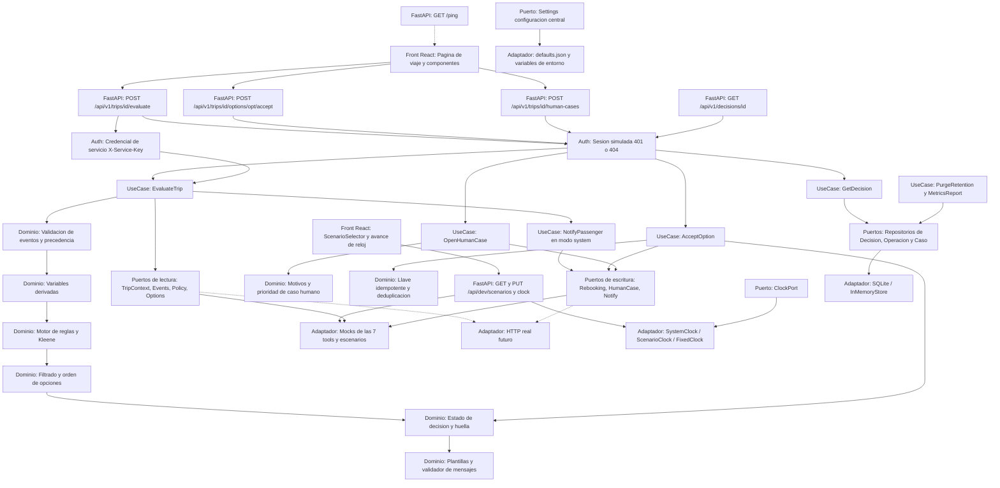
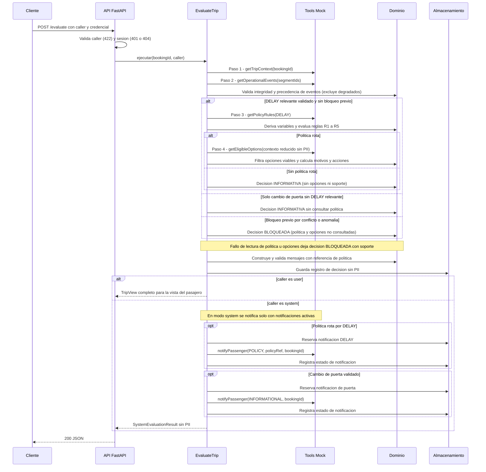

# Arquitectura — Disruption Companion

**Versión:** v1.6 (candidata, paso A1, ronda 7 con la purga que aplica vencimientos primero; ronda 5 con las resoluciones de A2: `INDETERMINADA` vence, huella del aviso `DELAY`, titular adulto, límite de tasa, SQL parametrizado; ronda 4: estado `NO_EVENTS`, huella de la notificación de puerta, actualización condicional, purga que conserva operaciones vigentes) · **Fecha:** 2026-10-19 · **Proyecto:** nuevo, sin código previo.
**Fuentes:** `docs/REQUERIMIENTOS_V1.md`, `sdd/reports/EXTERNAL_CONTRACTS.md`, `sdd/reports/FLOW_INVENTORY.md`.
La arquitectura definitiva se confirma en el paso de diseño técnico (RFC técnico, DOC-004); este documento fija el candidato y los riesgos iniciales.

## 1. Propósito del proyecto

Un **acompañante para pasajeros ante disrupciones de vuelo** (retrasos que pueden hacer perder una conexión). Dada una reserva, el sistema combina tres fuentes —contexto del viaje, eventos operacionales y reglas de política— para mostrar al pasajero qué cambió, qué implica y, solo cuando una **política se rompe**, qué opciones **viables** tiene y qué acciones puede autorizar con un clic: aceptar una opción de cambio o hablar con una persona. Un retraso que no rompe ninguna política solo se informa (estado `INFORMATIVA`). La misma evaluación la puede pedir *otro sistema* (`caller = "system"`), que recibe un resultado sin PII y dispara notificaciones fijas: una por política rota (`DELAY`) y otra por un cambio de puerta validado (`GATE_CHANGE`, aviso informativo sin política). En la Fase 1 solo `DELAY` consulta política.

Principios que gobiernan el diseño (todos trazan a los requisitos):

- **Determinístico y sin IA en runtime** (NFR-001): mismo reloj y mismas lecturas ⇒ misma huella y mismos mensajes.
- **El sistema propone; el pasajero decide** (FR-050): ninguna escritura externa sin clic explícito. **Única excepción:** con `caller = "system"` puede enviarse `notify_passenger` sin clic, solo con la plantilla fija de FR-122 (sin URL ni contacto) y como máximo una vez por motivo (`DELAY`, `GATE_CHANGE`); ninguna otra acción se ejecuta en modo `system` (FR-121).
- **Configurable, no fijo** (NFR-012): los parámetros de los supuestos S-09…S-19 viven en una configuración central validada al arrancar; ninguno está fijado en la lógica.
- **Nunca afirmar sin evidencia** (FR-080…FR-084): plantillas con evidencia por afirmación y validador propio.
- **Privacidad por diseño** (NFR-002, FR-091): sin PII hacia otras tools, logs ni base; solo el nombre de pila se muestra.
- **Fallar seguro** (FR-008, FR-038, FR-102): ante datos desconocidos, conflicto o error, se degrada a caso humano; nunca a «sin novedad».
- **Alcance v1:** backend de decisión (evidencia principal) + front React de prueba; las 7 tools del PDF se simulan con *mocks* (DEC-04, H-05).

## 2. Flujo de datos de punta a punta



**Secuencia de la evaluación (F-01 y F-11). La cadena de lecturas es SECUENCIAL; no hay llamadas en paralelo (FR-009, NFR-004). Solo `DELAY` consulta política (FR-068); `GATE_CHANGE` nunca:**



## 3. Stack

| Capa | Tecnología | Versión / nota |
|---|---|---|
| Backend | Python + FastAPI + pydantic + uvicorn | **Python 3.9** (anaconda local). Sin `match`, sin `X \| Y` en tiempo de ejecución, sin `dataclass(slots=True)`; usar `typing.Optional/Union`. `hmac` y `hashlib` de la biblioteca estándar. |
| Pruebas backend | pytest (+ pytest-cov, httpx/TestClient, pytest-asyncio si hay `async`) | Cobertura de líneas del dominio ≥ 85 % (NFR-006). |
| Front | React + Vite + TypeScript | Node **v24** local. Look & feel según `DESIGN_CONTRACT.md`. |
| Pruebas front | Vitest + Testing Library con jsdom | Simulación de DOM (sin navegador). Incluye catálogo de textos, tokens, contraste y PII (§5). |
| Persistencia | SQLite 3 (`sqlite3` de la biblioteca estándar) | Modo WAL, restricciones `UNIQUE` y índices únicos parciales para idempotencia y reserva atómica (FR-053, FR-059). |
| Operación | Variables de entorno, logs estructurados sin PII, venv + npm | Sin Docker obligatorio (NFR-009). |

**Dependencias que se evitan:** ORM, caché, colas, bibliotecas de evaluación de expresiones (`eval`/`exec`/`simpleeval` quedan prohibidas por FR-031), modelos de IA.

## 4. Patrón candidato: arquitectura hexagonal (puertos y adaptadores)

**Propuesta de `propose_architecture`** (entradas: HTTP síncrono, consistencia fuerte, flujo multi-paso, lectura simple, auditoría de historial completo, dominio complejo, bounded context único, monolito): puntuó DDD 4, Event Sourcing 4, Hexagonal 3, Onion 3. **Se elige hexagonal con elementos tácticos de DDD** (objetos de valor, servicios de dominio) y se descarta Event Sourcing: el registro de decisión es una **instantánea de auditoría** sin PII, no un flujo de eventos reproducible, y reconstruir estado desde eventos chocaría con FR-091 (no guardar payloads). Hay un único contexto delimitado, así que no se justifican múltiples bounded contexts.

**Reglas de dependencia:**

1. El **dominio** no importa FastAPI, SQLite, `requests`/`httpx`, `datetime.now()` ni `os.environ`. Solo Python estándar y tipos propios. Los parámetros de configuración le llegan **inyectados** (objeto `Settings`).
2. Los **casos de uso** orquestan dominio + puertos; no conocen HTTP ni SQL.
3. Los **adaptadores** implementan puertos; el cambio mock ⇄ HTTP real no toca el dominio (FR-100).
4. El tiempo entra **solo** por `ClockPort` (NFR-001, FR-018).

### 4.1 Normas de implementación (NFR-007)

| # | Norma | Verificación |
|---|---|---|
| 1 | Funciones de **≤ 10 líneas** y **≤ 3 parámetros**; si hacen falta más datos se agrupan en un **objeto de valor** inmutable (p. ej. `RebookingRequest`, `OperationIdentity`) | Test AST (`backend/tests/quality/test_function_size.py`) y regla de lint del front |
| 2 | **TDD:** test rojo → código mínimo → verde → refactor → revisión WTF de 3 pasadas (comprensión, necesidad, proporcionalidad) | Historial de commits y bitácora; revisión del CTO |
| 3 | **Prohibido `eval`/`exec`** y acceso dinámico a atributos al evaluar condiciones de política (FR-031) | Test AST que falla ante `eval`, `exec`, `compile`, `getattr` sobre datos externos |
| 4 | Lógica de negocio sin conocer persistencia, presentación ni origen del request; interacción por interfaces (puertos) | Test de dependencias: el paquete `domain` no importa `fastapi`, `sqlite3`, `httpx`, `os`, `datetime.now` |
| 5 | Sin placeholders ni valores inventados en contratos; enumeraciones abiertas toleradas (FR-102) | Revisión del Step Reviewer |
| 5b | **Ningún parámetro de S-09…S-19 fijado en la lógica** (NFR-012): umbrales, derechos de remedio y compensación, tablas y límites vienen de `Settings` | Test AST que busca esos literales en `domain/` y `test_config.py` (TC-49) |
| 6 | Un test jamás se modifica para que pase; un spec funcional no cambia sin aprobación del usuario | Revisión del CTO |
| 7 | **Entradas y datos (NFR-013):** todo acceso a la base usa consultas parametrizadas con el SQL en archivos `.sql`; el front muestra los textos del proveedor como texto plano, sin insertar HTML; `evaluate` aplica un límite de tasa por reserva y credencial (`EVALUATE_RATE_LIMIT_PER_MINUTE`, exceso ⇒ `429`) en el adaptador de entrada | Test AST/`grep` de SQL concatenado, test del front con marcado HTML (TC-58) y test de la API |

### 4.2 Puertos (interfaces del dominio; ≤ 3 parámetros)

Los puertos usan objetos de valor para no superar tres parámetros.

| Puerto | Operación (firma) | Tool del PDF / objetos de valor |
|---|---|---|
| `TripContextPort` | `get_trip_context(booking_id)` | `get_trip_context` |
| `OperationalEventsPort` | `get_operational_events(segment_ids)` | `get_operational_events` |
| `PolicyRulesPort` | `get_policy_rules(scenario)` | `get_policy_rules` (solo con `DELAY` relevante validado y sin bloqueo previo) |
| `EligibleOptionsPort` | `get_eligible_options(context)` | `get_eligible_options` (solo con política rota; nunca en `INFORMATIVA`); `context` es el objeto de valor `ReducedTripContext` (sin PII, FR-040) |
| `RebookingPort` | `create_rebooking_request(request)` | `create_rebooking_request`; `request` es `RebookingRequest(option, idempotency_key, booking_id, passenger_ids)` (firma del PDF + extensión FR-065 / DOC-013; los *mocks* verifican que cubre a todo el grupo) |
| `HumanCasePort` | `create_human_case(reason, evidence)` | `create_human_case`; `evidence` es el objeto de valor `HumanCaseEvidence` (sin PII, FR-059) |
| `NotifyPort` | `notify_passenger(message)` | `notify_passenger`, **en uso real** solo con `caller = "system"` y `NOTIFY_ENABLED`, una vez por motivo: `DELAY` con política rota y `GATE_CHANGE` validado; `message` es el objeto de valor `NotificationMessage(template_id, kind, reason, text, policy_ref?, booking_id, idempotency_key)` con `kind = POLICY` (lleva `policy_ref`) o `INFORMATIONAL` (sin `policy_ref`, H-21); plantilla fija, sin URL ni contacto; extensión DOC-013 |
| `ClockPort` | `now()` | UTC; adaptadores `SystemClock`, `ScenarioClock`, `FixedClock` |
| `IdempotencyKeyPort` | `key(identity)` | `identity` es `OperationIdentity(booking_id, flight_number, date, departure, policy_version, generation)` para el rebooking o `NotificationIdentity(booking_id, reason, motive_fingerprint, template_id)` (la huella del motivo `DELAY` es el hash de la versión de política más los `rule_id` de las reglas cumplidas, de modo que un cambio solo de minutos no repite el aviso; la de `GATE_CHANGE` es el hash de la lista ordenada [segmento, puerta validada], de modo que 24 → 25 genera un aviso nuevo) para la notificación; HMAC-SHA256 con `IDEMPOTENCY_SECRET` (FR-053, FR-123), el secreto entra por configuración, no por el dominio |
| `NotificationRepository` | `reserve(attempt)`, `mark(update)`, `sweep(now)` | `attempt` es `NotificationAttempt(key, decision_id, reason)` con estado inicial `EN_CURSO`; `reserve` es **una transacción** que marca `INDETERMINADA` los `EN_CURSO` colgados, marca `VENCIDA` los `QUEUED`/`INDETERMINADA` con el enfriamiento terminado e inserta el intento siguiente, respetando el índice único parcial (si hay un intento vigente, no reenvía y devuelve su estado, incluido `EN_CURSO`); `FALLIDA` y `VENCIDA` permiten una nueva reserva. `mark(update)` recibe el objeto de valor `NotificationUpdate(key, attempt, expected_state, outcome)` y ejecuta **una sola sentencia condicional** sobre la fila (clave, intento) y el estado esperado: `EN_CURSO → QUEUED/FALLIDA/INDETERMINADA` e `INDETERMINADA → QUEUED` (202 tardío del mismo intento); una respuesta fuera de orden afecta 0 filas y nunca modifica otro intento ni sobrescribe un estado final |
| `SettingsLoader` | `load(env)` | devuelve el objeto de valor `Settings` validado (NFR-012); falla con `ConfigError` nombrando el parámetro |
| `DecisionRepository` | `save(record)`, `get(decision_id)`, `purge(before)` | `record` es `DecisionRecord` (instantánea con proyección mínima, sin PII) |
| `OperationRepository` | `reserve(identity, context)`, `mark(update)`, `find_active(booking_id, itinerary_key)`, `sweep(now)`, `purge(cutoff)` | `context` es `OperationContext(decision_id, passenger_ids, itinerary_key)`; `update` es `OperationUpdate(key, expected_state, outcome)` con la misma regla de actualización condicional por identidad exacta y estado esperado; `reserve` es atómica y respeta el índice único parcial (FR-053, FR-064); `purge(cutoff)` **aplica primero los vencimientos de FR-064** (`sweep`), elimina las operaciones finales antiguas (incluidas las que acaban de vencer) y **minimiza sin borrar** solo las que siguen `EN_CURSO`, `INDETERMINADA` no vencida o `CREADA` dentro de su vigencia, para no perder su bloqueo (FR-092, TC-56) |
| `HumanCaseRepository` | `reserve(attempt)`, `mark(update)`, `sweep(now)` | `attempt` es `HumanCaseAttempt(dedup_key, decision_id, reasons)` con estado inicial `EN_CURSO` (FR-059); `update` es `HumanCaseUpdate(dedup_key, attempt, expected_state, outcome)`, condicional por (clave, intento) y estado esperado |

**Adaptadores:** `adapters/mock` (7 tools con `_meta` y errores `409/503/422`, y catálogo de escenarios de `EXTERNAL_CONTRACTS.md`), `adapters/http` (futuro), `adapters/sqlite` (repositorios de decisiones, operaciones, casos y notificaciones), `adapters/config` (carga de `defaults.json` y variables de entorno), `adapters/clock` (`SystemClock` en producción; `ScenarioClock` para desarrollo y demostración: `now = retrieved_at del escenario + offset` que solo avanza con `PUT /api/dev/clock`, de modo que los *mocks* no caducan solos; `FixedClock` para pruebas), `api` (FastAPI: rutas, esquemas pydantic, sesión simulada, manejo uniforme de errores `{error, detail}`).

**Estructura de carpetas candidata:**

```
solucion/
├── backend/
│   ├── app/
│   │   ├── domain/          # eventos, derivadas, reglas (parser), opciones, decisión, huella, mensajes, motivos, llaves
│   │   ├── application/     # casos de uso: EvaluateTrip, NotifyPassenger, AcceptOption, OpenHumanCase, GetDecision, PurgeRetention, MetricsReport
│   │   ├── ports/           # interfaces de las 7 tools, reloj, llave y repositorios
│   │   ├── adapters/        # mock/, http/ (futuro), sqlite/, clock/, config/
│   │   ├── api/             # FastAPI: rutas, esquemas, sesión, errores
│   │   ├── config.py        # objeto Settings (NFR-012): valores por defecto + entorno, validados al arrancar
│   │   └── maintenance.py   # python -m app.maintenance purge | metrics
│   ├── config/defaults.json # valores por defecto documentados de cada parámetro
│   └── tests/
├── frontend/
│   ├── src/                 # components/, pages/, api/, i18n/ (catálogo de textos), styles/ (tokens)
│   └── tests/               # o archivos *.test.tsx junto a cada componente
├── docs/                    # requisitos, decisiones, runbook, README de ingeniería
└── sdd/                     # specs, reports, state, logs (metodología)
```

## 5. Dónde estarán los tests

| Nivel | Ubicación | Qué prueba | Herramienta |
|---|---|---|---|
| Unitarias de dominio | `backend/tests/unit/domain/` | Parser (todas las operaciones y bordes 179/180, 239/240), Kleene, validación de eventos, derivadas (cruce de medianoche), opciones, huella por opción, llave idempotente (HMAC, generación), motivos y prioridad, enmascaramiento de PII, validador de mensajes | pytest |
| Casos de uso | `backend/tests/unit/application/` | Orquestación con puertos falsos y `FixedClock`: reintentos 503, 409, revalidación y refresco de vigencia, concurrencia, reserva atómica de casos humanos, ciclo de vida | pytest |
| Contrato de adaptadores | `backend/tests/contract/` | Los *mocks* devuelven exactamente los 7 JSON del PDF (con datos personales ficticios); el schema de `EXTERNAL_CONTRACTS.md` se cumple en ambos sentidos | pytest |
| Integración | `backend/tests/integration/` | Repositorios SQLite (unicidad de llaves, generaciones, intentos de casos con índice único parcial, purga a 30 días de decisiones, operaciones y casos), API con `TestClient` (401/404/422, errores uniformes, cuerpos 409/502/504) | pytest + httpx |
| E2E del caso base y TC-01…TC-56 | `backend/tests/e2e/` | TC-01 (caso base), TC-21 (`404` idéntico), TC-22 (concurrencia), TC-24 (`STATUS` sano más reciente reemplaza al `DELAY`), TC-31 (huella), TC-33 (matriz de errores), TC-38 (ciclo de vida), TC-39 (integridad de lecturas), TC-40 (contrato de rebooking), TC-41 (parser con `!=`/`NE`), TC-42…TC-44 (notificación: una por motivo, también con BLOQUEADA y política rota; nada sin política rota ni `GATE_CHANGE`; cooldown, nueva reserva tras `FALLIDA` o enfriamiento vencido, exclusión concurrente, `INDETERMINADA`), TC-51…TC-53 (`GATE_CHANGE`: puerta destacada, sin consulta de política, notificación informativa sin `policy_ref`; política vacía de `DELAY` ⇒ BLOQUEADA), TC-54 (segmentos sin eventos ⇒ `NO_EVENTS`), TC-55 (puerta 24 → 25 ⇒ aviso nuevo; misma puerta ⇒ sin reenvío), TC-56 (la purga conserva y minimiza las operaciones vigentes), TC-47 con composición de grupo desconocida sin regla R5 (bloqueo independiente de R5) y la prueba de respuestas fuera de orden de la notificación (`mark` condicional), TC-45 (INFORMATIVA sin llamar a opciones), TC-46 (menú de compensación), TC-47 (menor desconocido), TC-48 (URL/contacto bloqueados), TC-50 (modo `system`). Cada TC usa un escenario o variante de fixture del catálogo de `EXTERNAL_CONTRACTS.md` | pytest |
| Configuración (NFR-012, TC-49) | `backend/tests/unit/test_config.py` | Un test parametrizado recorre la tabla de parámetros: cada cambio altera el comportamiento y cada valor inválido impide arrancar nombrando el parámetro; el test AST confirma que ningún valor está fijado en el dominio | pytest |
| Modo `system` (FR-120…FR-124) | `backend/tests/integration/test_system_mode.py` | Credencial de servicio (sin clave, incorrecta, `SERVICE_API_KEY` ausente), respuesta sin PII ni vista, ninguna llamada a `create_rebooking_request` ni `create_human_case` (espías), registro de notificaciones | pytest + httpx |
| Calidad de código (NFR-007) | `backend/tests/quality/test_function_size.py` | **Test AST** que recorre `backend/app/` y mide líneas por función (≤ 10) y parámetros (≤ 3); además falla ante `eval`/`exec` y ante imports prohibidos en `domain/` | pytest + `ast` |
| Calidad de código del front | `frontend/eslint.config.js` y `frontend/tests/quality/` | Regla `max-lines-per-function` (10) y `max-params` (3) ejecutadas como test | ESLint + Vitest |
| Rendimiento | `backend/tests/performance/` | 50 solicitudes secuenciales del caso base con *upstreams* de 100 ms: p50/p95 (NFR-004: 4 × 100 ms + proceso) | pytest (marcado `slow`) |
| Front: componentes | `frontend/tests/components/` | Componentes por estado (incluida la pantalla informativa sin botones y las pantallas sin soporte), selector, diálogo (`fieldset`/`legend`, foco, menú sin compensación cuando no es elegible), `offer_deadline` y cuenta regresiva, resultados de aceptar (7), segundo clic tras `NEEDS_CONFIRMATION` | Vitest + Testing Library |
| Front: catálogo de textos (FR-113) | `frontend/tests/i18n/test_text_catalog.ts` | Recorre los componentes y falla si hay una cadena visible fuera del catálogo | Vitest |
| Front: tokens y contraste (NFR-011) | `frontend/tests/design/test_tokens.ts` y `test_contrast.ts` | Lee los `.css`: ningún color fuera de `tokens.css`, checklist de tokens y relación de contraste ≥ 4,5 : 1 de cada par texto/fondo | Vitest |
| Front: PII (NFR-002, FR-112) | `frontend/tests/privacy/test_no_pii.ts` | Renderiza los escenarios con datos ficticios y verifica que no aparezcan correo, teléfono, documento, edad, apellido ni nombre completo | Vitest |
| Visual | `sdd/screenshots/design/` (diferido) | No se capturan screenshots en esta etapa (ver `DESIGN_CONTRACT.md`) | — |

## 6. Riesgos arquitectónicos iniciales

| # | Riesgo | Impacto | Mitigación propuesta |
|---|---|---|---|
| AR-01 | **Python 3.9** llegó a fin de vida en octubre de 2025: sin parches de seguridad y con versiones recientes de FastAPI/pydantic que ya no lo soportan. | Dependencias bloqueadas o vulnerables. | Fijar versiones compatibles con 3.9 en `requirements.txt`; documentar la limitación; migrar a ≥ 3.11 en Fase 2. |
| AR-02 | **Cadena de lecturas secuencial** (contexto → eventos → política `DELAY` → opciones, FR-009, NFR-004): sin paralelismo, la latencia es la suma de hasta cuatro lecturas. `GATE_CHANGE` no añade lecturas (no consulta política). | Presupuesto 4 × 100 ms + proceso ≈ 0,5 s < 1,5 s (p95); peor caso con timeouts 16 s. | Medir con el protocolo de NFR-004; el dominio no depende del orden de las llamadas, que decide el caso de uso. |
| AR-03 | **Idempotencia y concurrencia** sobre SQLite: dos aceptaciones simultáneas deben producir una sola escritura (FR-062); lo mismo para intentos de casos humanos. | Duplicar un rebooking (acción de alto impacto) o un caso. | Índices únicos parciales + inserción atómica; reserva `EN_CURSO` antes de llamar; pruebas TC-22/TC-34 con hilos. |
| AR-04 | `create_human_case` **no tiene llave idempotente** en el proveedor. | Casos duplicados si se pierde la respuesta. | Reserva atómica `EN_CURSO` antes de llamar, sin reenvío automático ante timeout (INDETERMINADO), segundo clic explícito, recuperación de `EN_CURSO` colgados y deduplicación local (FR-059, FR-105); riesgo residual documentado en `EXTERNAL_CONTRACTS.md`. |
| AR-05 | **Huella determinista:** cualquier campo volátil que se cuele (marca de tiempo, `option_id`, orden de listas) produce falsos `STATE_CHANGED`; ahora hay una huella por opción. | Aceptaciones bloqueadas sin motivo. | Serialización canónica (claves ordenadas, listas ordenadas) y pruebas TC-31 en ambos sentidos. |
| AR-06 | **Parser de reglas:** una gramática mal acotada reabre inyección (NFR-003) o falsos «no cumple». | Derechos otorgados o negados por error. | Parser descendente recursivo propio con lista blanca; pruebas de borde, de error y de Kleene (TC-41); prohibición de `eval` verificada por el test AST. |
| AR-07 | **Zonas horarias:** las horas locales no traen zona; mezclar aeropuertos distintos da duraciones falsas (DAT-05). | `missed_connection` incorrecto. | Comparar solo dentro del mismo aeropuerto; tabla versionada SCL/LIM/MEX solo para `international`; todo `new_arrival` se rotula ESTIMADA. |
| AR-08 | **PII:** el `trip_context` completo contiene correo, teléfono, documento y edad. | Fuga por logs, base o llamadas a otras tools. | Proyección inmediata a un modelo reducido en el borde del adaptador; lista blanca de campos persistibles; tests de PII en logs, base y front (§5). |
| AR-09 | **Estado global del escenario de desarrollo** (un solo proceso, un solo escenario y un solo reloj activos). | Interferencia entre pruebas o pestañas. | Endpoints solo con `DEV_ENDPOINTS_ENABLED`; las pruebas automatizadas usan *mocks* y `FixedClock` inyectados por prueba, no el endpoint. |
| AR-10 | **Latencia de aceptar** con reintentos: revalidación de 4 lecturas + refresco de opciones vencidas + hasta 3 escrituras de 5 s con esperas + un caso humano posterior. | Pantalla bloqueada mucho tiempo: peor caso **40,6 s** (evaluar como usuario 16 s; evaluar como sistema con 2 notificaciones 47,2 s). | Botón deshabilitado con estado «en curso» (FR-062); timeouts configurables; el cliente HTTP recomienda 45 s para aceptar, 20 s para evaluar como usuario, 55 s como sistema y 25 s para el caso humano; el front muestra un mensaje de lentitud pasados 1,5 s. |
| AR-11 | **Sin forma de confirmar o consultar** una solicitud `PENDING_CONFIRMATION` (no hay tool) y expira en minutos. | Estado desconocido tras `expires_at`. | Supuesto declarado (FR-056); ciclo de vida `CREADA → EXPIRADA` (FR-064); se muestra `expires_at`; sin promesas de cambio hecho. |
| AR-12 | **Persistencia local sin migraciones:** esquema SQLite creado por script. | Cambios futuros del esquema rompen datos. | Versión de esquema en `PRAGMA user_version` y script de creación idempotente. |
| AR-13 | **Contratos de las tools solo por ejemplo:** el PDF no define errores de lectura ni transporte; enumeraciones abiertas (incluido `confidence`). | El adaptador real podría diferir. | Pruebas de contrato en el borde del adaptador; valores desconocidos degradan a humano o se ordenan al final (FR-102). |
| AR-14 | **Secreto de la llave idempotente** (`IDEMPOTENCY_SECRET`): si falta, se pierde la propiedad de llaves no adivinables; si cambia entre despliegues, las operaciones activas dejan de coincidir con sus llaves. | Rebooking duplicado o llave inválida. | Arranque obligatorio fallido sin secreto, sin valor en el repositorio (NFR-003), rotación solo con operaciones en estados finales; prueba TC-34. |
| AR-15 | **Respuesta indistinguible (404)** para reserva ajena e inexistente (FR-001): cualquier diferencia de cuerpo, latencia o cabeceras filtra existencia. | Enumeración de reservas. | Una sola función de error compartida; TC-21 compara cuerpo y estado; los errores no repiten la entrada. |
| AR-17 | **Notificación como vector de *phishing*:** un mensaje con enlace, teléfono o correo podría usarse para engañar al pasajero. | Fraude por un canal de confianza. | Plantilla fija con `{reason}` de enumeración cerrada, validador que bloquea URL, dominios, `@`, teléfonos y `wa.me` antes de llamar, y se invita a entrar por los canales habituales (FR-122, TC-48). |
| AR-18 | **Credencial de servicio** (`SERVICE_API_KEY`): quien la tiene puede evaluar cualquier reserva y disparar notificaciones. | Abuso del modo `system`; spam de notificaciones. | Apagada por defecto; comparación en tiempo constante; respuesta sin PII ni vista; enfriamiento de `NOTIFY_COOLDOWN_SECONDS` por (reserva + huella + plantilla); la clave no autoriza ningún otro endpoint. |
| AR-22 | **Respuestas fuera de orden:** una respuesta tardía de un intento viejo (notificación, operación o caso) puede llegar cuando ya existe un intento nuevo. | Sobrescribir el estado del intento nuevo o de un estado final. | Actualización condicional por identidad exacta (clave + intento) y estado esperado en una sola sentencia; 0 filas afectadas se ignora; prueba `NOTIFY_RESPUESTA_FUERA_DE_ORDEN_TC44`. |
| AR-23 | **Purga que borre un bloqueo vigente:** eliminar una operación `EN_CURSO`/`INDETERMINADA`/`CREADA` por antigüedad permitiría duplicar un rebooking (FR-064). | Rebooking duplicado. | La purga aplica primero los vencimientos y minimiza en lugar de borrar solo las operaciones que siguen no finalizadas (se anulan los datos de itinerario y pasajeros, se conserva la identidad, el estado y la vigencia); una `INDETERMINADA` se conserva hasta que vence a `EXPIRADA` tras `OPERATION_INDETERMINATE_EXPIRY_SECONDS` (900; riesgo S-20: si la solicitud sí se creó y su vigencia fuera mayor, un intento nuevo podría duplicarla); TC-56 y TC-57. |
| AR-21 | **Aviso informativo sin `policy_ref` (H-21):** el contrato del PDF exige `policy_ref` y responde `422 UNVALIDATED_CONTENT` si falta; el aviso de `GATE_CHANGE` va sin él (extensión `kind: INFORMATIONAL`). | Un proveedor real que no acepte la extensión rechazaría el aviso (`FALLIDA`). | No se inventa un `policy_ref`; el mock de v1 la acepta; se propone al equipo (DOC-013); `FALLIDA` se registra sin reintento y no afecta a la notificación `DELAY`. |
| AR-19 | **Notificación sin garantía de entrega:** `QUEUED` solo significa aceptada y un timeout deja el estado `INDETERMINADA`. | El pasajero puede no enterarse, o enterarse dos veces. | Nunca se afirma entrega; reintentos con la misma clave y reserva atómica; el modo `user` consulta de nuevo al entrar (FR-124). |
| AR-20 | **Configuración mal formada o fijada en el código:** un umbral o una lista de derechos distinta cambia derechos concedidos. | Derechos otorgados o negados por error. | `Settings` validada al arrancar (falla nombrando el parámetro), test que cambia cada parámetro (TC-49) y test AST contra valores fijados. |
| AR-16 | **Reloj de escenario:** si los *mocks* usaran el reloj real, las opciones caducarían solas durante una demostración (TTL de 120 s). | Demostraciones inestables; pruebas no deterministas. | `ScenarioClock` (now = `retrieved_at` + offset que solo avanza con `PUT /api/dev/clock`); `SystemClock` en producción; `FixedClock` en pruebas. |

## 7. Métricas de éxito (NFR-008) calculadas desde el registro

Todas se calculan con `python -m app.maintenance metrics` leyendo solo el registro (sin PII y sin endpoint nuevo). Solo cuentan las evaluaciones con `caller = "user"`: las del modo `system` son disparos automáticos, no sesiones de pasajeros.

**Unidad de análisis: la «situación con anomalía».** Es el par `(booking_id, fingerprint)` de las decisiones con `anomaly_detected = 1` y `caller = 'user'`. Se llama **situación accionable** a la que tiene decisión AUTOMATICA, PENDIENTE_APROBACION o BLOQUEADA: es el denominador de M1 y M2. Las situaciones `INFORMATIVA` (retraso sin política rota, sin opciones ni soporte) no son accionables: se reportan aparte como conteo para no deprimir M1 artificialmente. Las recargas de la vista producen decisiones nuevas con la **misma huella** para la misma reserva y se cuentan **una sola vez** (la primera por `created_at`); un cambio de estado real cambia la huella y crea una situación nueva.

**Eventos del registro:**

| Evento | Fuente |
|---|---|
| Situación con anomalía vista | `decisions` (`anomaly_detected = 1`) |
| Opción viable mostrada | `decision_options` (`viable = 1`) de la decisión de la situación |
| Aceptación sin contacto humano | `operations` con `decision_id` de la situación y estado `CREADA` o `EXPIRADA` |
| Caso humano creado | `human_cases` con `state = 'CREADO'`, una vez por `dedup_key` |
| Mensaje bloqueado por el validador | `decisions.messages_blocked` |

**Las tres métricas (datos mínimos: `decisions`, `decision_options`, `operations`, `human_cases`):**

| # | Métrica | Cálculo |
|---|---|---|
| M1 | **Resolución sin contacto humano** | (situaciones con ≥ 1 opción viable mostrada **y** una operación `CREADA`/`EXPIRADA` **y** ningún caso humano `CREADO`) ÷ (situaciones accionables). Se reporta también la tasa intermedia «se mostró una opción viable» ÷ (situaciones accionables) |
| M2 | **Tasa de casos humanos por razón** | por cada `reason` principal: (casos `CREADO` únicos por `dedup_key` con esa razón) ÷ (situaciones accionables) |
| M3 | **Afirmaciones sin evidencia** | Se reporta la suma de `messages_blocked` (mensajes que el validador de FR-081 tuvo que bloquear antes de devolverlos) y el número de mensajes emitidos sin evidencia, que debe ser **0** por construcción (el validador bloquea antes de responder; verificado con TC-16 y las pruebas del validador) |

**Límites declarados:** no existe un identificador de sesión (no se guarda), por lo que «sesión» se aproxima con la situación `(booking_id, huella)`; el registro se purga a los 30 días (FR-092), así que las métricas cubren como máximo esa ventana.
