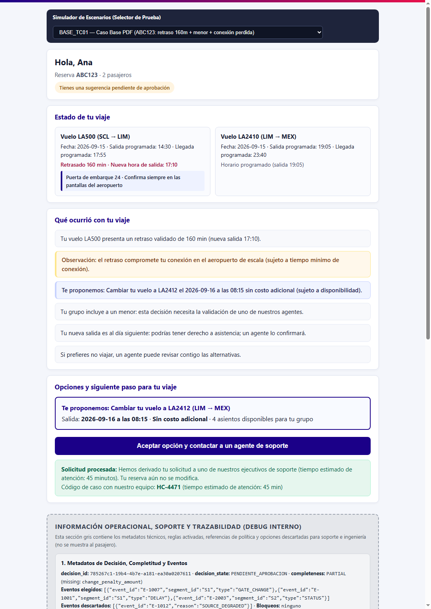
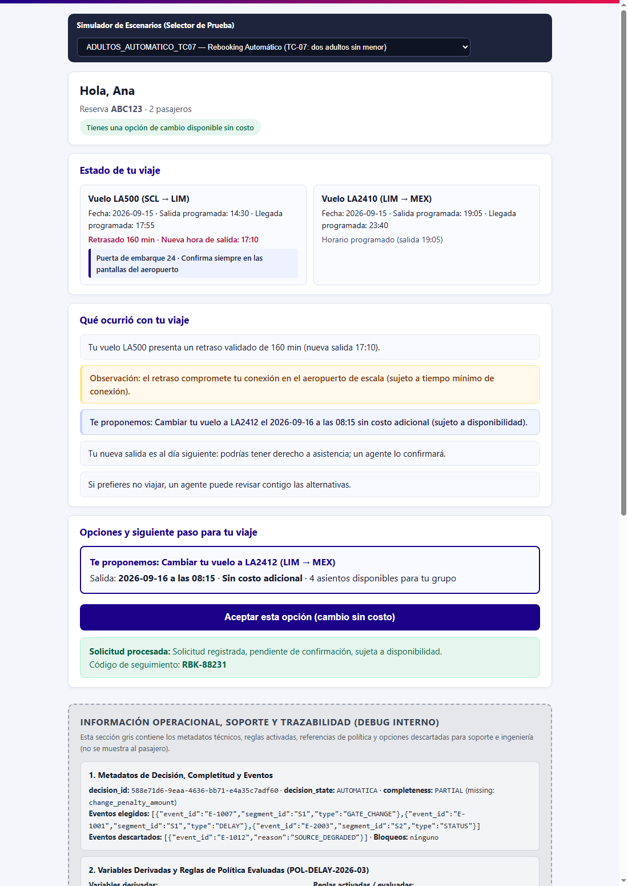
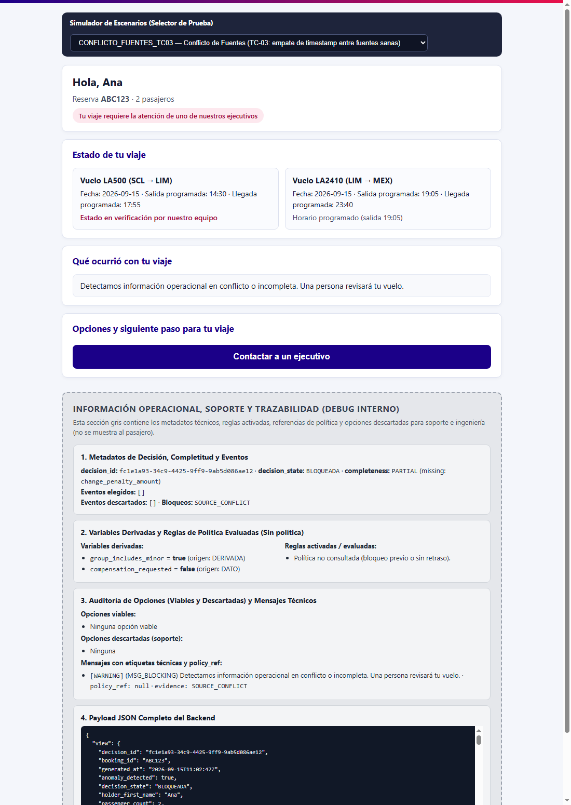
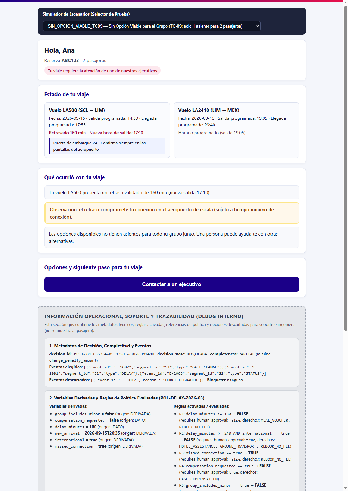

# Evidencia E2E y Visual — Disruption Companion V0

**Fecha**: 2026-10-19  
**Runtime verificado**: Python `3.13.16` (`companion313`) + FastAPI `0.115.0` + Visor Web en `http://127.0.0.1:8000`  
**Suite automatizada**: `backend/tests/e2e/test_e2e_scenarios.py` (`17/17 tests passed`, **93 % de cobertura total**)

---

## 1. Resumen de Escenarios E2E Verificados

| # | Escenario (`scenario_id`) | Entrada API | Estado de Decisión | Acción Ejecutada (`accept`) | Resultado (`outcome`) | Screenshot Capturado |
|---|---------------------------|-------------|--------------------|-----------------------------|-----------------------|----------------------|
| 1 | `BASE_TC01` *(Caso Base PDF)* | `POST /api/v1/trips/ABC123/evaluate` | `PENDIENTE_APROBACION` (`R3=TRUE`, `R5=TRUE` por menor) | `POST .../options/O1/accept` | `HUMAN_CASE_CREATED` (`HC-4471`, cola `DISRUPTION_L2`, SLA `45 min`) | `sdd/screenshots/result/01-base-tc01.png` |
| 2 | `ADULTOS_AUTOMATICO_TC07` | `POST /api/v1/trips/ABC123/evaluate` | `AUTOMATICA` (`R3=TRUE`, `R5=FALSE`) | `POST .../options/O1/accept` (y 2.º clic idempotente) | `REBOOKING_CREATED` (`RBK-88231`, `PENDING_CONFIRMATION`) → 2.º clic: `EXISTING_REQUEST` | `sdd/screenshots/result/02-adultos-automatico-tc07.png` |
| 3 | `CONFLICTO_FUENTES_TC03` | `POST /api/v1/trips/ABC123/evaluate` | `BLOQUEADA` (`SOURCE_CONFLICT` por empate de timestamp) | Escalamiento directo a agente | `HUMAN_CASE_CREATED` | `sdd/screenshots/result/03-conflicto-fuentes-tc03.png` |
| 4 | `SOLO_DEGRADADO_TC02` | `POST /api/v1/trips/ABC123/evaluate` | `null` (`NO_VERIFIED_INFO` en `S1`) | Sin acción automática | No afirma «a tiempo» con fuente degradada | Cubierto en `test_e2e_scenarios.py` |
| 5 | `SIN_OPCION_VIABLE_TC09` | `POST /api/v1/trips/ABC123/evaluate` | `BLOQUEADA` (`O2` descartada por `INSUFFICIENT_SEATS` y `FEE_CONFLICT`) | Escalamiento directo a agente | `HUMAN_CASE_CREATED` | `sdd/screenshots/result/04-sin-opcion-viable-tc09.png` |
| 6 | `UPSTREAM_TIMEOUT_TC14` | `POST /api/v1/trips/ABC123/evaluate` | `AUTOMATICA` (`503 UPSTREAM_TIMEOUT` al escribir) | `POST .../options/O1/accept` | 2 reintentos con misma `idempotency_key` (`retries = 2`) → `HUMAN_CASE_CREATED` | Cubierto en `test_e2e_scenarios.py` |

---

## 2. Capturas Reales del Flujo E2E (Frontend + Backend en vivo)

### 2.1 Caso Base del PDF (`BASE_TC01`): Retraso 160 min + Menor + Escalamiento a Caso Humano (`HC-4471`)

### 2.2 Rebooking Automático sin Menor (`ADULTOS_AUTOMATICO_TC07`): Solicitud `RBK-88231` (`PENDING_CONFIRMATION`)

### 2.3 Conflicto entre Fuentes Activas (`CONFLICTO_FUENTES_TC03`): Decisión `BLOQUEADA`

### 2.4 Sin Opción Viable para el Grupo (`SIN_OPCION_VIABLE_TC09`): Exclusión de `O2` por 1 asiento < 2 pasajeros

