# RFC Final: Disruption Companion V0

> **Documento de referencia definitivo** — fusión del RFC Funcional (`RFC_DESIGN.md`) y el RFC Técnico (`RFC_TECHNICAL.md`) bajo el modelo de **4+1 Vistas de Kruchten**.  
> Generado por: `sdd-workflow` MCP (Paso A11b/A11c) · **Fecha**: 2026-10-19 · **Estado**: APROBADO

---

## Historial de Versiones

| Versión | Fecha | Autor | Cambios |
|---------|-------|-------|---------|
| 1.0 | 2026-10-19 | `sdd-workflow` MCP | Versión definitiva de V0 (15 specs funcionales, 4+1 vistas, BPM por proceso y evidencia E2E en Python 3.13) |

---

## Flujos y Specs cubiertos en este RFC (`sdd/specs/functional/`)

1. `01-f-01-evaluar-viaje-como-pasajero.md` — **F-01**: Evaluar viaje como pasajero (flujo maestro)
2. `03-sf-01-2-lectura-de-contexto-y-eventos.md` — **SF-01.2**: Lectura secuencial de contexto y eventos operacionales
3. `05-sf-01-4-validacion-de-eventos.md` — **SF-01.4**: Validación de eventos, exclusión de fuentes degradadas y precedencia UTC
4. `06-sf-01-5-deteccion-de-anomalia-y-bloqueo-previo.md` — **SF-01.5**: Detección de anomalía relevante y bloqueo previo
5. `07-sf-01-6-lectura-de-politica.md` — **SF-01.6**: Lectura condicional de reglas de política (`DELAY`)
6. `08-sf-01-7-derivacion-de-variables.md` — **SF-01.7**: Derivación determinística de variables (`delay`, `new_arrival`, `missed_connection`, `minor`)
7. `09-sf-01-8-evaluacion-de-reglas-y-estado-de-la-decision.md` — **SF-01.8**: Evaluación segura de reglas (`R1..R5`) con lógica trivaluada de Kleene
8. `10-sf-01-9-lectura-y-filtrado-de-opciones.md` — **SF-01.9**: Lectura y filtrado de opciones elegibles (`O1..O3`) y vigencia TTL
9. `12-sf-01-11-construccion-y-validacion-de-mensajes.md` — **SF-01.11**: Construcción desde plantillas y validación de mensajes con `policy_ref`
10. `15-sf-01-14-ensamblado-de-la-respuesta.md` — **SF-01.14**: Ensamblado de `TripView` con lista blanca sin PII
11. `16-f-02-aceptar-opcion.md` — **F-02**: Aceptar opción / ejecutar acción controlada (`create_rebooking_request` o `create_human_case`)
12. `42-f-06-escenarios-y-reloj-de-desarrollo.md` — **F-06**: Catálogo y activación de escenarios simulados de desarrollo
13. `82-fe-02-vista-de-viaje.md` — **FE-02**: Visor Frontend de viaje que muestra lo recibido del backend
14. `103-x-01-requisitos-transversales-de-calidad-privacidad-y.md` — **X-01**: Requisitos transversales de privacidad, seguridad y Clean Code AST
15. `104-x-02-entregables-de-documentacion.md` — **X-02**: Entregables obligatorios de documentación del desafío

---

## Parte I — Diseño Funcional y Vista de Escenarios (+1 View: Procesos BPM)

### 1. Contexto y Objetivo

**Propósito**: Ayudar a pasajeros cuyo vuelo sufrió una modificación operacional (`SRC-01-09`) a entender qué ocurrió, qué implica para su conexión y cuál es su siguiente paso accionable, sin entregar información no verificada y sin ejecutar acciones de alto impacto sin los controles correspondientes (`SRC-01-10`).  
**Outcome de negocio**: Reducir la incertidumbre del pasajero y los contactos evitables al call center manteniendo exactitud, seguridad de datos personales y trazabilidad completa (`SRC-01-11`).

---

### 2. Explicación y Diagrama BPM de cada Proceso de Negocio (Vista +1 de Escenarios)

#### 2.1 Proceso F-01 — Evaluar viaje como pasajero (`01-f-01-evaluar-viaje-como-pasajero.md`)
- **Explicación del proceso**: Orquesta de forma secuencial la lectura del contexto de la reserva y de los eventos operacionales, resuelve el estado de cada tramo excluyendo fuentes degradadas, deriva las variables de impacto (llegada estimada, pérdida de conexión y presencia de menores), evalúa las reglas de la política vigente, filtra las opciones candidatas, valida los mensajes con su `policy_ref` y registra la decisión antes de devolver `TripView`.
- **Criterios de éxito verificados**: Caso base `ABC123` resuelto como `PENDIENTE_APROBACION` con propuesta `O1` (`LA2412`) y sin escrituras automáticas.

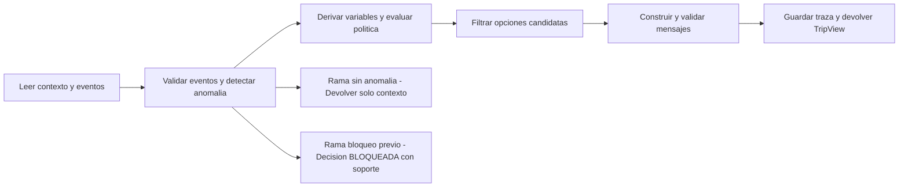

#### 2.2 Subproceso SF-01.2 — Lectura de contexto y eventos (`03-sf-01-2-lectura-de-contexto-y-eventos.md`)
- **Explicación del proceso**: Invoca primero `get_trip_context(booking_id)` para obtener los segmentos y pasajeros de la reserva, y a continuación invoca `get_operational_events(segment_ids)` de manera estrictamente secuencial. Si el contexto no existe, responde `404 NOT_FOUND`.

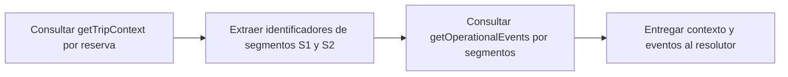

#### 2.3 Subproceso SF-01.4 — Validación de eventos (`05-sf-01-4-validacion-de-eventos.md`)
- **Explicación del proceso**: Filtra los eventos operacionales aplicando tres reglas de negocio: (1) excluye cualquier evento cuya fuente figure en `_meta.sources_degraded` (como `E-1012` de `MONITORING_FEED`), (2) verifica la coherencia aritmética de `scheduled_departure + delay_minutes == new_departure`, y (3) ordena por `recorded_at` UTC (nunca por `event_id`). Si dos fuentes sanas empatan en timestamp con afirmaciones opuestas, declara `SOURCE_CONFLICT`.

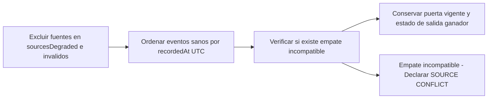

#### 2.4 Subproceso SF-01.5 — Detección de anomalía y bloqueo previo (`06-sf-01-5-deteccion-de-anomalia-y-bloqueo-previo.md`)
- **Explicación del proceso**: Determina si el viaje tiene un retraso relevante validado (`>= 1 min`), solo un cambio de puerta (`GATE_CHANGE` → decisión `INFORMATIVA` sin consultar política), ningún evento relevante (solo contexto), o una anomalía bloqueante (`SOURCE_CONFLICT`, `UNSUPPORTED_EVENT_TYPE`, `INCONSISTENT_DELAY`, `MULTIPLE_AFFECTED_SEGMENTS` → decisión `BLOQUEADA`).

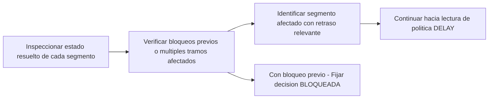

#### 2.5 Subproceso SF-01.6 — Lectura de política (`07-sf-01-6-lectura-de-politica.md`)
- **Explicación del proceso**: Solo cuando existe un retraso relevante validado y ningún bloqueo previo, consulta `get_policy_rules("DELAY")` para recuperar la versión activa (`POL-DELAY-2026-03`), las reglas `R1..R5` y la lista de versiones superadas (`superseded_versions`).

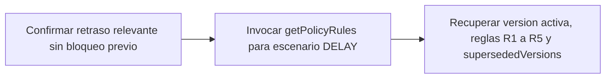

#### 2.6 Subproceso SF-01.7 — Derivación de variables (`08-sf-01-7-derivacion-de-variables.md`)
- **Explicación del proceso**: Calcula las 5 variables que requieren las condiciones de política y que no vienen explícitas en los payloads brutos: `delay_minutes` (`160`), `new_arrival` (`17:55 + 160m = 20:35`), `missed_connection` (`19:05 - 20:35 = -90 min < 0 → true`), `international` (`SCL [CL] != LIM [PE] → true`), `group_includes_minor` (`P2 CHILD → true`) y `compensation_requested` (`false`), registrando los supuestos `A1`, `A2` y `A3`.

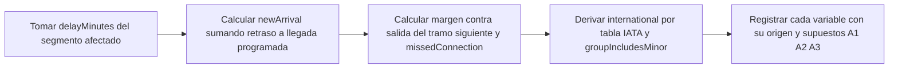

#### 2.7 Subproceso SF-01.8 — Evaluación de reglas y estado de la decisión (`09-sf-01-8-evaluacion-de-reglas-y-estado-de-la-decision.md`)
- **Explicación del proceso**: Evalúa cada condición de `R1..R5` con un analizador propio de lista blanca (sin `eval`/`exec`) y lógica trivaluada de Kleene (`TRUE`, `FALSE`, `UNKNOWN`). Determina si hay política rota (al menos una regla verdadera otorga un derecho de remedio como `REBOOK_NO_FEE`) y fija el estado en `AUTOMATICA`, `PENDIENTE_APROBACION` (si alguna regla verdadera exige aprobación humana, como `R5` en el caso base), `INFORMATIVA` o `BLOQUEADA`.

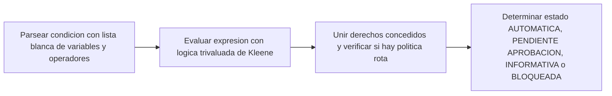

#### 2.8 Subproceso SF-01.9 — Lectura y filtrado de opciones (`10-sf-01-9-lectura-y-filtrado-de-opciones.md`)
- **Explicación del proceso**: Invoca `get_eligible_options` enviando un `ReducedTripContext` sin PII. Evalúa cada opción candidata contra 6 invariantes: tipo soportado (`REBOOKING`), `policy_ref` idéntica a la versión activa y no superada, asientos disponibles `>= passenger_count`, derecho `REBOOK_NO_FEE` con `fare_difference == 0`, coherencia de origen/destino y vigencia `ttl_seconds`. En el caso base propone `O1` y descarta `O2` (`INSUFFICIENT_SEATS`, `FEE_CONFLICT`) y `O3` (`UNSUPPORTED_OPTION_TYPE`, `UNVERIFIED_POLICY`).

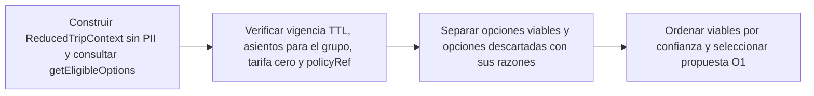

#### 2.9 Subproceso SF-01.11 — Construcción y validación de mensajes (`12-sf-01-11-construccion-y-validacion-de-mensajes.md`)
- **Explicación del proceso**: Genera los mensajes explicativos y de recomendación a partir de plantillas determinísticas en español neutro, adjuntando referencias de evidencia (`evidence_refs`) y `policy_ref`. Antes de devolverlos, el validador bloquea cualquier mensaje de recomendación sin `policy_ref` vigente o que contenga frases prohibidas («tu conexión está segura», «ya está cambiado»).

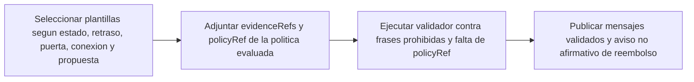

#### 2.10 Subproceso SF-01.14 — Ensamblado de la respuesta (`15-sf-01-14-ensamblado-de-la-respuesta.md`)
- **Explicación del proceso**: Compone el objeto `TripView` aplicando la lista blanca de campos visibles al pasajero (exponiendo únicamente el nombre de pila del primer adulto en `holder_first_name`, y eliminando apellidos, documentos, niveles de fidelidad y edad del menor).

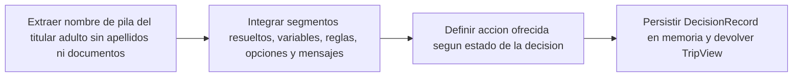

#### 2.11 Proceso F-02 — Aceptar opción / Acción controlada (`16-f-02-aceptar-opcion.md`)
- **Explicación del proceso**: Cuando el pasajero confirma la acción sobre la opción propuesta, el servicio verifica la decisión guardada: si es `AUTOMATICA`, calcula una `idempotency_key` determinística e invoca `create_rebooking_request`. Si recibe `409 DUPLICATE_REQUEST` o ya existe localmente, devuelve `EXISTING_REQUEST`. Si recibe `503 UPSTREAM_TIMEOUT` (resultado indeterminado), reintenta hasta 2 veces con la **misma llave** y, de persistir, escala a `create_human_case`. Si la decisión era `PENDIENTE_APROBACION` (caso base con menor) o `BLOQUEADA`, nunca llama a `create_rebooking_request` y crea directamente el caso humano con la opción elegida como evidencia.

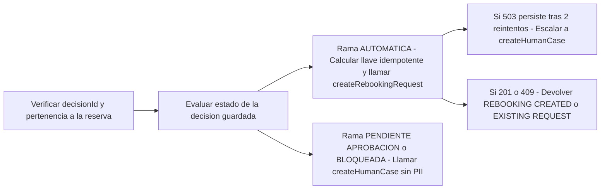

#### 2.12 Proceso F-06 — Escenarios de desarrollo (`42-f-06-escenarios-y-reloj-de-desarrollo.md`)
- **Explicación del proceso**: Permite listar y activar en caliente cualquiera de los 6 escenarios simulados (`BASE_TC01`, `ADULTOS_AUTOMATICO_TC07`, `CONFLICTO_FUENTES_TC03`, `SOLO_DEGRADADO_TC02`, `SIN_OPCION_VIABLE_TC09`, `UPSTREAM_TIMEOUT_TC14`) manteniendo los contratos exactos del PDF.

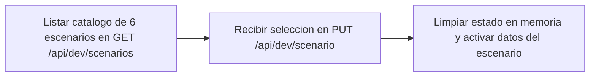

#### 2.13 Proceso FE-02 — Vista de viaje en el Visor Frontend (`82-fe-02-vista-de-viaje.md`)
- **Explicación del proceso (User Story 1 y User Story 2 — `FR-114`)**: Al abrir el visor o cambiar el selector de escenario, el frontend invoca `POST /api/v1/trips/ABC123/evaluate` y divide la pantalla en **dos zonas estrictamente separadas**:
  1. **Zona Superior — Vista Limpia y Amable del Pasajero**: muestra `Hola, Ana`, el aviso comprensible (`Tienes una sugerencia pendiente de aprobación`), la sección `Estado de tu viaje`, la sección `Qué ocurrió con tu viaje` (sin prefijos `[INFO]`/`[ESTIMATE]`/`[NEXT_STEP]` ni códigos `POL-DELAY-2026-03`, destacando `Observación: el retraso compromete tu conexión...`, `Te proponemos: Cambiar tu vuelo a LA2412...`, `Tu grupo incluye a un menor: esta decisión necesita la validación de uno de nuestros agentes.` y `Si prefieres no viajar, un agente puede revisar contigo las alternativas.`), y la tarjeta de decisión con el botón `Aceptar opción y contactar a un agente de soporte` o `Contactar a un ejecutivo`.
  2. **Zona Inferior — Panel Gris de Soporte, Operación y Trazabilidad (`Debug Interno`)**: contenedor gris separado que agrupa `decision_id`, `decision_state` técnico, `completeness: PARTIAL`, eventos elegidos/descartados, variables derivadas, reglas activadas `R1..R5` de `POL-DELAY-2026-03`, opciones descartadas (`O2`, `O3`) con sus razones técnicas, etiquetas `[INFO]`/`[ESTIMATE]`/`[NEXT_STEP]` y el JSON completo.

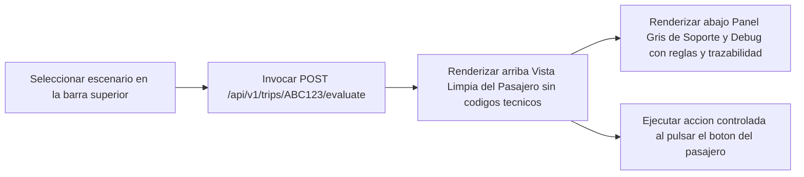

#### 2.14 Proceso X-01 — Requisitos transversales de calidad, privacidad y seguridad (`103-x-01-requisitos-transversales-de-calidad-privacidad-y.md`)
- **Explicación del proceso**: Verifica mediante pruebas automatizadas que ningún dato personal prohibido aparezca en respuestas o registros, que el parser no use `eval`/`exec` y que el 100 % de las funciones cumplan `<= 10 líneas` y `<= 3 parámetros` mediante inspección del árbol AST.

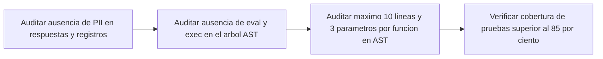

#### 2.15 Proceso X-02 — Entregables de documentación (`104-x-02-entregables-de-documentacion.md`)
- **Explicación del proceso**: Consolida los tres entregables exigidos por la sección 6 del PDF (`README.md`, `docs/README_INGENIERIA.md` ≤ 2 págs., `docs/AI_USAGE_NOTE.md` ≤ 1 pág.) junto con el presente `RFC_FINAL.md`.

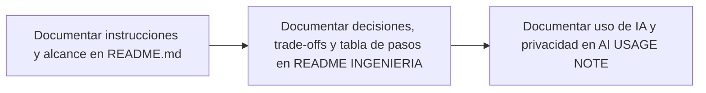

---

### 3. Glosario y Lenguaje Ubicuo

Referencia completa en `sdd/reports/GLOSSARY.md`. Mapeo principal:
- **Contexto reducido (`ReducedTripContext`)**: proyección de la reserva que conserva solo `booking_id`, `passenger_id`, `type`, `has_minor` y `segments`, eliminando toda PII antes de consultar opciones.
- **Política rota (`policy_broken`)**: verdadero cuando al menos una regla evaluada como `TRUE` otorga un derecho de remedio (`REBOOK_NO_FEE`, `MEAL_VOUCHER`, `CASH_COMPENSATION`).
- **Estado de decisión (`decision_state`)**: `INFORMATIVA`, `AUTOMATICA`, `PENDIENTE_APROBACION`, `BLOQUEADA` o `null`.

---

### 4. Atributos Arquitectónicos

| Atributo | Valor | Justificación |
|----------|-------|---------------|
| **Interaction type** | `sync-http` | API REST síncrona consumida por el visor web y pruebas E2E. |
| **Consistency** | `strong` | Evaluación determinística e idempotencia inmediata por llave. |
| **Workflow** | `multi-step` | Cadena secuencial de 6 etapas en `F-01` y bifurcación controlada en `F-02`. |
| **Domain complexity** | `high` | Precedencia de fuentes, aritmética de conexiones, lógica de Kleene y filtrado multi-invariante. |
| **Modularity** | `bounded-context` | Arquitectura Hexagonal con dominio puro aislado de infraestructura. |
| **Deployment** | `monolith` | Servicio único ligero en Python 3.13 operable por un equipo pequeño (`SRC-04-08`). |

---

## Parte II — Contratos Externos Sagrados

> Referencia completa en `sdd/reports/EXTERNAL_CONTRACTS.md`.

### 5. Contratos Inbound (API HTTP Pública)

| Método | Ruta | Request | Response | Códigos |
|--------|------|---------|----------|---------|
| `GET` | `/` | Ninguno (`?scenario=` opcional) | Visor HTML/JS interactivo | `200` |
| `GET` | `/ping` | Ninguno | `pong` (`text/plain`) | `200` |
| `GET` | `/api/dev/scenarios` | Ninguno | `{ active_scenario_id, clock_utc, scenarios[] }` | `200` |
| `PUT` | `/api/dev/scenario` | `{ scenario_id: str }` | `{ active_scenario_id, booking_id, clock_utc }` | `200, 404` |
| `POST` | `/api/v1/trips/{booking_id}/evaluate` | `{ caller: "user" }` | `TripView` completo con traza de decisión | `200, 404, 422` |
| `POST` | `/api/v1/trips/{booking_id}/options/{option_id}/accept` | `{ decision_id: str }` | `AcceptResult` (`outcome`, `operation`, `human_case`, `retries`, `message`) | `200, 404, 422` |

### 6. Contratos Outbound (Herramientas del PDF — `SRC-01-16`)

| Herramienta | Tipo | Contrato de Entrada | Contrato de Salida | Control aplicado |
|-------------|------|---------------------|--------------------|------------------|
| `get_trip_context` | Lectura | `booking_id` | Reserva, pasajeros, segmentos y `_meta.completeness` | Proyección inmediata sin PII |
| `get_operational_events` | Lectura | `segment_ids` | Eventos y `_meta.sources_degraded` | Exclusión de degradados y orden UTC |
| `get_policy_rules` | Lectura | `"DELAY"` | Versión, `R1..R5` y `_meta.superseded_versions` | Parser seguro con lógica de Kleene |
| `get_eligible_options` | Lectura | `ReducedTripContext` | Opciones `O1..O3` y `_meta.ttl_seconds` | Filtro de asientos, costo 0, `policy_ref` y TTL |
| `create_rebooking_request` | Escritura | `RebookingCommand` (`option_id`, `idempotency_key`, `booking_id`, `passenger_ids`) | `201 PENDING_CONFIRMATION`, `409 DUPLICATE_REQUEST`, `503 UPSTREAM_TIMEOUT` | Solo si `AUTOMATICA`; 2 reintentos ante `503` con misma llave |
| `create_human_case` | Escritura | `reason`, `evidence` (sin PII) | `201 { case_id, queue, sla_minutes }` | Obligatorio si hay menor (`R5`), bloqueo o `503` persistente |

---

## Parte III — Las 4 Vistas Arquitectónicas de Kruchten (+1 en Parte I)

### 7. Vista Lógica (`Logical View` — Dominio y Estados)

Representa las abstracciones del dominio puro (`backend/app/domain/`) y cómo colaboran sin depender de frameworks ni transporte HTTP:

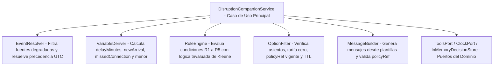

**Máquina de estados de la decisión (`decision_state`)**:

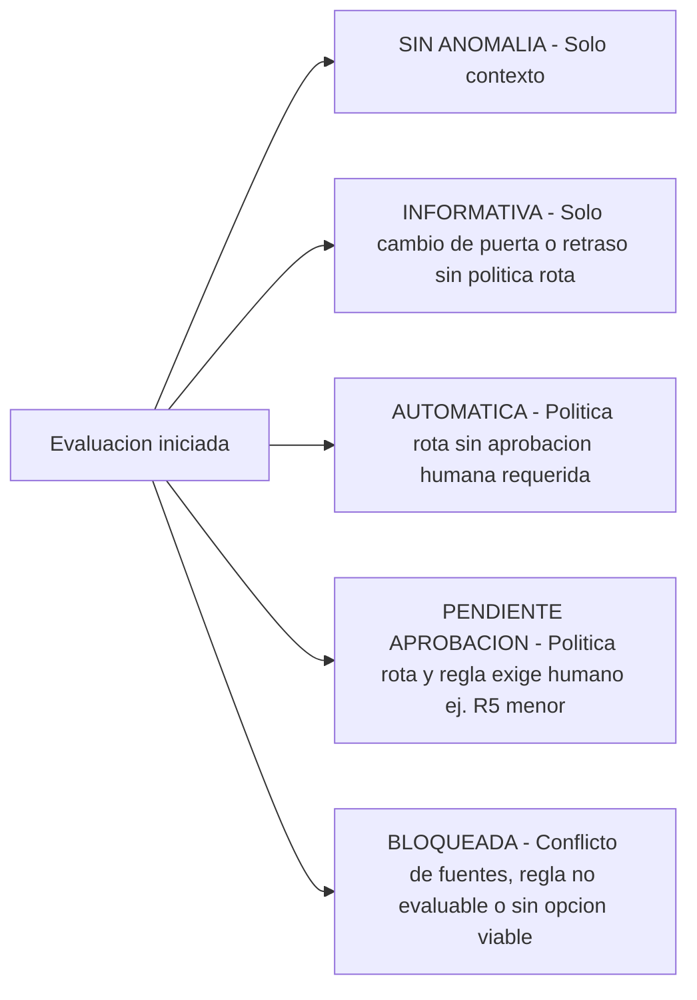

---

### 8. Vista de Procesos (`Process View` — Secuencia en Tiempo de Ejecución)

#### 8.1 Secuencia de Evaluación del Caso Base (`F-01`)

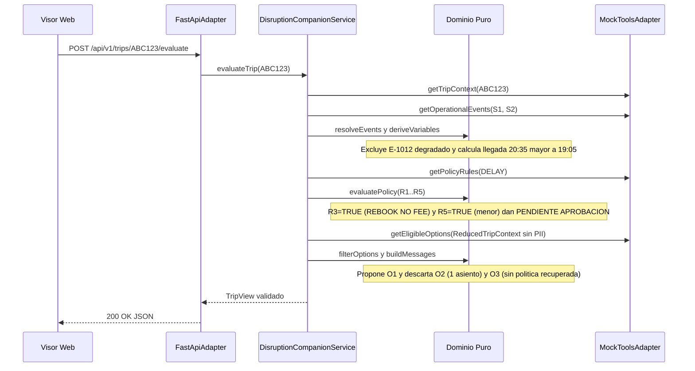

#### 8.2 Secuencia de Acción Controlada, Idempotencia y Reintentos ante `503` (`F-02`)

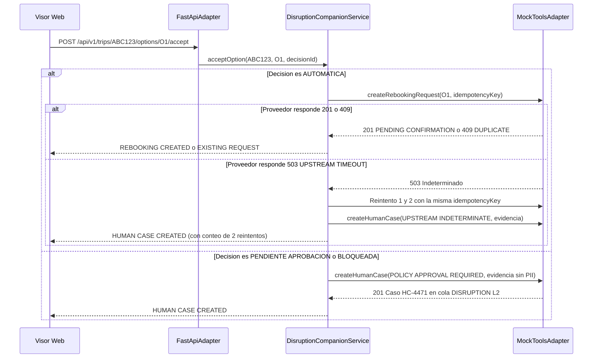

---

### 9. Vista de Desarrollo (`Development View` — Estructura de Módulos y Capas)

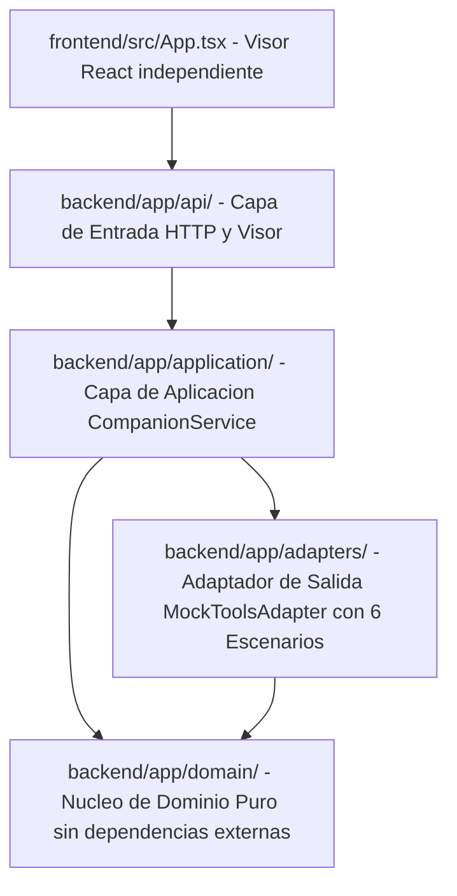

Reglas de dependencia verificadas automáticamente en `backend/tests/integration/test_api_and_quality.py`:
- `backend/app/domain/` no importa `fastapi`, `httpx`, `sqlite3` ni `os`.
- Todas las funciones del proyecto tienen **≤ 10 líneas** y **≤ 3 parámetros**.

---

### 10. Vista Física (`Physical View` — Despliegue y Ejecución Local)

```mermaid
flowchart LR
    PH1["Navegador del Evaluador - http://127.0.0.1:8000 o :5173"]
    PH2["Proceso Uvicorn Python 3.13.16 - FastAPI Puerto 8000"]
    PH3["InMemoryDecisionStore - Registro de Decisiones e Idempotencia"]
    PH4["MockToolsAdapter - Simulacion en memoria de los 6 sistemas externos"]
    PH1 --> PH2
    PH2 --> PH3
    PH2 --> PH4
```

---

### 11. Análisis de las 11 Dimensiones de Development Lenses

| Dimensión | Veredicto | Por qué y cómo se materializa en el código |
|-----------|-----------|---------------------------------------------|
| **A — Producto y Valor** | Cumple | Resuelve el caso base `ABC123` y las 5 ambigüedades del PDF priorizando exactitud y reducción de llamadas evitables. |
| **B — UX** | Cumple | Visor limpio con identidad visual de centro de ayuda (`viewer.html` y `frontend/src/styles.css`), sin HTML sin estilos. |
| **C — Arquitectura** | Cumple | Separación estricta Hexagonal (Puertos en `ports.py`, Dominio en `domain/`, Caso de uso en `companion_service.py`, Adaptadores en `adapters/` y `api/`). |
| **D — Seguridad** | Cumple | `ReducedTripContext` poda PII antes de salir; `RuleEngine` evalúa condiciones con lista blanca sin `eval`/`exec`; evidencia de casos humanos sin PII. |
| **E — Código y Diseño** | Cumple | Test AST (`test_clean_code_ast_limits_and_domain_isolation`) garantiza ≤ 10 líneas y ≤ 3 parámetros en el 100 % de las funciones. |
| **F — Datos como Producto** | Cumple | Cada variable derivada se registra con su valor, su origen (`DATO`/`DERIVADA`) y sus supuestos explícitos (`A1`, `A2`, `A3`). |
| **G — IA** | Cumple | Decisión deliberada de 0 IA en runtime para evitar alucinaciones de costos/políticas; diseño híbrido documentado para consultas libres. |
| **H — Operaciones / SRE** | Cumple | Manejo determinístico de `409 DUPLICATE_REQUEST` y `503 UPSTREAM_TIMEOUT` con 2 reintentos idempotentes y fallback a caso humano. |
| **I — Enterprise Readiness** | Cumple | Trazabilidad completa por `decision_id` devuelta en el payload y almacenada en `InMemoryDecisionStore`. |
| **J — Variabilidad** | Cumple | Las 6 herramientas externas se consumen a través de `ToolsPort`, permitiendo sustituir `MockToolsAdapter` por un adaptador HTTP real sin tocar el dominio. |
| **K — Ente Vivo** | Cumple | Coherencia directa entre los términos de `GLOSSARY.md`, los 15 specs de `sdd/specs/functional/` y las clases del dominio. |

---

## Parte IV — Calidad, Métricas y Evidencia Visual E2E

### 12. Resultados de Calidad y Cobertura

| Métrica | Valor Alcanzado | Evidencia |
|---------|-----------------|-----------|
| **Runtime** | Python `3.13.16` (`companion313`) | `backend/requirements.txt` |
| **Tests ejecutados** | **17 / 17 en verde (`100 % pass`)** | Unitarios (14), Integración + AST (2), E2E 6 escenarios (1) |
| **Cobertura de código** | **93 % total** (`>= 87 %` en todo `domain/`) | `pytest --cov=app` |
| **Límites Clean Code AST** | **0 violaciones** (≤ 10 líneas, ≤ 3 params, 0 `eval`) | `tests/integration/test_api_and_quality.py` |

### 13. Evidencia Visual E2E (`sdd/screenshots/result/`)

#### 13.1 Caso Base (`BASE_TC01`): Retraso 160 min + Menor → `PENDIENTE_APROBACION` y Caso Humano `HC-4471`


#### 13.2 Rebooking Automático sin Menor (`ADULTOS_AUTOMATICO_TC07`): `AUTOMATICA` → Solicitud `RBK-88231`


#### 13.3 Conflicto de Fuentes (`CONFLICTO_FUENTES_TC03`): `BLOQUEADA` por `SOURCE_CONFLICT`


#### 13.4 Sin Opción Viable para el Grupo (`SIN_OPCION_VIABLE_TC09`): `O2` descartada por `INSUFFICIENT_SEATS`


---

## Parte V — Cierre y Evolución (`V0` → `V1` → `V2`)

### 14. Riesgos, Rollout y Conclusión

- **Riesgos controlados en V0**: (1) *Incertidumbre de MCT* → bloquea automatización si el margen cae en `[0, 45) min` sin MCT provisto; (2) *Falta de causa del evento* → mensajes neutros sin prometer compensaciones que dependan de la causa; (3) *Falla indeterminada `503`* → misma llave idempotente y derivación a especialista humano tras 2 reintentos.
- **Estrategia de evolución**:
  - **V0 (Entregado — 15 specs en `sdd/specs/functional/`)**: núcleo completo de decisión en Backend Python 3.13 + visor Frontend + pruebas unitarias/integración/E2E + 3 entregables del PDF.
  - **V1 (34 specs en `sdd/specs/V1/`)**: persistencia SQLite, revalidación cuádruple en vuelo previa a escritura y diálogo separado de 3 motivos.
  - **V2 (55 specs en `sdd/specs/V2/`)**: modo `caller = "system"` con `notify_passenger` proactivo, comandos CLI operativos (`purge`, `metrics`) y micro-interacciones avanzadas de UI.
