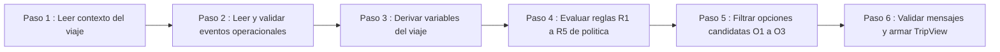
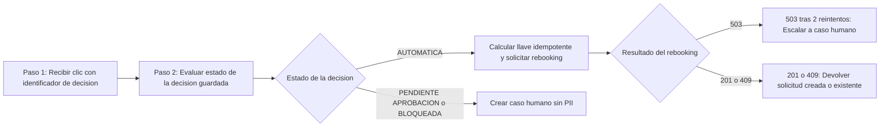
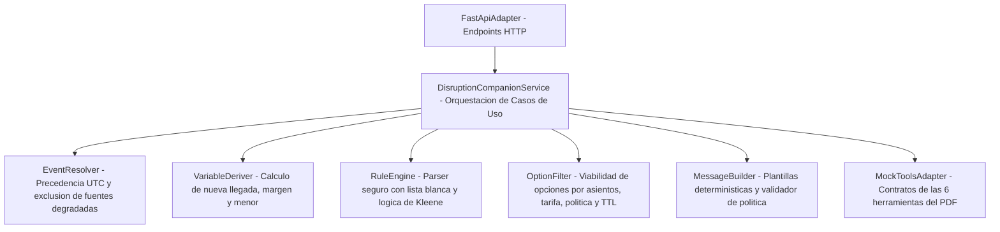
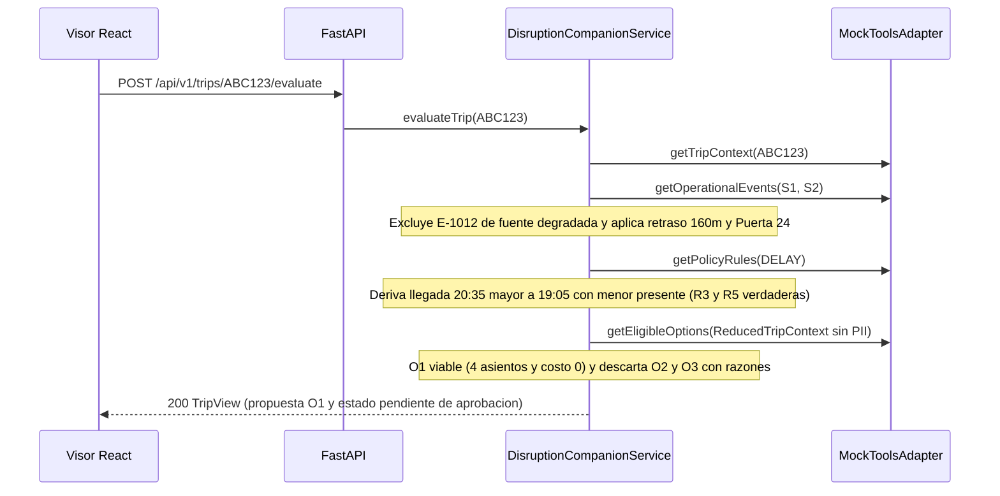

# RFC Técnico: Disruption Companion V0 (Modelo 4+1 Vistas)

**Estado**: APROBADO (Modo Cumplimiento / Pragmático)  
**Fecha**: 2026-10-19  
**Autor**: `sdd-workflow` MCP + Equipo de Ingeniería  
**Alcance**: `sdd/specs/functional/` (15 specs de V0)

---

## 1. Introducción y Motivación

**Disruption Companion V0** resuelve el problema central del pasajero cuyo vuelo sufre una modificación operacional (`Disruption Companion.pdf`, `SRC-01-09`..`SRC-01-15`): combinar el contexto de la reserva (`get_trip_context`), los eventos operacionales (`get_operational_events`), las políticas versionadas (`get_policy_rules`) y las opciones candidatas (`get_eligible_options`) para explicar qué ocurrió, qué implica para su conexión y ejecutar la acción controlada (`create_rebooking_request` con llave idempotente o escalamiento a `create_human_case` cuando se requiere aprobación humana o hay anomalía), sin exponer PII ni afirmar hechos no verificados.

---

## 2. Vista de Escenarios (+1) — Flujos de Negocio Implementados

### 2.1 F-01: Evaluar viaje como pasajero (`POST /api/v1/trips/{booking_id}/evaluate`)

### 2.2 F-02: Aceptar opción / Acción controlada (`POST /api/v1/trips/{booking_id}/options/{option_id}/accept`)

---

## 3. Vista Lógica (Arquitectura Hexagonal y Dominio)

---

## 4. Vista de Procesos (Secuencia del Caso Base `ABC123`)

---

## 5. Vista de Desarrollo y Calidad Verificada

- **Runtime**: Python `3.13.16` (entorno `companion313`), FastAPI `0.115.0`, Pydantic `2.9.2`, Pytest `8.3.3`.
- **Métricas de pruebas y código**:
  - **Tests**: `17 passed` (unitarios de dominio, adaptadores, casos de uso, integración API + AST y suite E2E `backend/tests/e2e/test_e2e_scenarios.py`).
  - **Cobertura**: **93 % total** (`>= 87 %` en todos los módulos de dominio).
  - **Clean Code verificado por AST (`test_clean_code_ast_limits_and_domain_isolation`)**: 100 % de las funciones en `backend/app/` tienen **≤ 10 líneas** y **≤ 3 parámetros**, con **0 llamadas a `eval`/`exec`**.

---

## 6. Evidencia E2E y Visual (`§Visual Evidence`)

Detalle completo en `sdd/reports/E2E_EVIDENCE.md` y pruebas automatizadas en `backend/tests/e2e/test_e2e_scenarios.py`.

| Pantalla / Escenario E2E | Archivo de Evidencia | Estado |
|--------------------------|----------------------|--------|
| 1. Caso Base `ABC123` (`BASE_TC01` — `PENDIENTE_APROBACION` + caso humano `HC-4471`) | `sdd/screenshots/result/01-base-tc01.png` | Verificado |
| 2. Rebooking Automático sin Menor (`ADULTOS_AUTOMATICO_TC07` — `RBK-88231`) | `sdd/screenshots/result/02-adultos-automatico-tc07.png` | Verificado |
| 3. Conflicto de Fuentes (`CONFLICTO_FUENTES_TC03` — `BLOQUEADA` por `SOURCE_CONFLICT`) | `sdd/screenshots/result/03-conflicto-fuentes-tc03.png` | Verificado |
| 4. Sin Opción Viable para el Grupo (`SIN_OPCION_VIABLE_TC09` — `INSUFFICIENT_SEATS`) | `sdd/screenshots/result/04-sin-opcion-viable-tc09.png` | Verificado |

### 6.1 Caso Base (`BASE_TC01`)

### 6.2 Rebooking Automático (`ADULTOS_AUTOMATICO_TC07`)

### 6.3 Conflicto de Fuentes (`CONFLICTO_FUENTES_TC03`)

### 6.4 Sin Opción Viable (`SIN_OPCION_VIABLE_TC09`)

