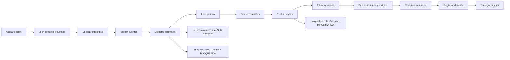

# Feature Specification: F-01 — Evaluar viaje como pasajero

**Created**: 2026-10-19  
**Status**: draft  
**Flow**: F-01 Evaluar viaje como pasajero  
**Related Specs**: [SF-01.1 Validación de cuerpo y autorización de sesión](02-sf-01-1-validacion-de-cuerpo-y-autorizacion-de-sesion.md), [SF-01.2 Lectura de contexto y eventos](03-sf-01-2-lectura-de-contexto-y-eventos.md), [SF-01.3 Integridad de lecturas](04-sf-01-3-integridad-de-lecturas.md), [SF-01.4 Validación de eventos](05-sf-01-4-validacion-de-eventos.md), [SF-01.5 Detección de anomalía y bloqueo previo](06-sf-01-5-deteccion-de-anomalia-y-bloqueo-previo.md), [SF-01.6 Lectura de política](07-sf-01-6-lectura-de-politica.md), [SF-01.7 Derivación de variables](08-sf-01-7-derivacion-de-variables.md), [SF-01.8 Evaluación de reglas y estado de la decisión](09-sf-01-8-evaluacion-de-reglas-y-estado-de-la-decision.md), [SF-01.9 Lectura y filtrado de opciones](10-sf-01-9-lectura-y-filtrado-de-opciones.md), [SF-01.10 Motivos, soporte y acciones ofrecidas](11-sf-01-10-motivos-soporte-y-acciones-ofrecidas.md), [SF-01.11 Construcción y validación de mensajes](12-sf-01-11-construccion-y-validacion-de-mensajes.md), [SF-01.12 Barrido perezoso del ciclo de vida](13-sf-01-12-barrido-perezoso-del-ciclo-de-vida.md), [SF-01.13 Huella por opción y registro de decisión](14-sf-01-13-huella-por-opcion-y-registro-de-decision.md), [SF-01.14 Ensamblado de la respuesta](15-sf-01-14-ensamblado-de-la-respuesta.md), [F-11 Evaluar viaje como sistema](64-f-11-evaluar-viaje-como-sistema.md), [F-02 Aceptar opción](16-f-02-aceptar-opcion.md), [F-03 Caso humano manual («Hablar con una persona»)](27-f-03-caso-humano-manual-hablar-con-una-persona.md), [FE-02 Vista de viaje](82-fe-02-vista-de-viaje.md)  
**Origen (DEC/H)**: DEC-02, DEC-04, DEC-05, DEC-06, DEC-07, DEC-08, DEC-09, DEC-10, DEC-11, DEC-12, DEC-13, DEC-15, DEC-16, DEC-17, DEC-18, DEC-19, DEC-20, DEC-21, DEC-22, DEC-23, DEC-24, DEC-27, DEC-28, DEC-29, DEC-30, DEC-31, DEC-32, DEC-33, DEC-36, H-08, H-09, H-13, H-21  
**Pruebas (TC)**: TC-01, TC-02, TC-03, TC-04, TC-05, TC-06, TC-07, TC-09, TC-10, TC-11, TC-12, TC-13, TC-18, TC-19, TC-23, TC-24, TC-25, TC-26, TC-27, TC-28, TC-29, TC-35, TC-36, TC-37, TC-39, TC-45, TC-46, TC-47, TC-51, TC-52, TC-53, TC-54, TC-58, TC-60  
**Contratos externos**: §1.1 (fila 2: evaluación del viaje), §2.1 (herramientas 1 a 4: contexto del viaje, eventos operacionales, opciones elegibles y reglas de política), §2.4 (configuración), §1.1 detalle de la evaluación  
**Deuda conocida de A1 (no se resuelve aquí)**: DEBT-A1-01  

## Reglas de este documento

> Este spec es FUNCIONAL, no técnico: describe QUÉ hace el sistema, no CÓMO. Usa lenguaje de negocio; las siete herramientas externas se nombran por su función y se referencian por la sección de `sdd/reports/EXTERNAL_CONTRACTS.md`. Los casos borde se DOCUMENTAN; los valores de configuración se citan por el nombre del parámetro (NFR-012) con su valor por defecto entre paréntesis.

**Alcance**: Construye la vista completa de una reserva para el pasajero: contexto, eventos, anomalías, variables derivadas, reglas evaluadas, opciones viables, acciones ofrecidas, plazos y mensajes, y registra la decisión. Cada entrada reconsulta los datos.

## User Scenarios & Testing *(mandatory)*

### User Story 1 - El pasajero entiende qué cambió en su viaje y qué puede hacer (Priority: P1)

Como pasajero con una conexión afectada por un retraso, quiero abrir mi reserva y ver, sin tener que interpretar datos operacionales, qué cambió, qué implica para mi conexión y cuál es la mejor alternativa, para decidir con un clic.

**Why this priority**: Es el valor central del producto: sin esta vista no existe ninguna de las acciones posteriores.

**Independent Test**: Se prueba cargando la reserva del caso base (retraso de 160 minutos) y comprobando que la vista muestra el retraso, la estimación de la conexión, las reglas evaluadas, una opción propuesta y las acciones ofrecidas, sin ejecutar ninguna escritura.

**Acceptance Scenarios**:

1. **Scenario**: Caso base con política rota
   - **Given** una reserva de dos pasajeros (un adulto y un niño) con un retraso validado de 160 minutos, política de retrasos recuperada y una opción viable
   - **When** el pasajero entra a la vista
   - **Then** ve el contexto, el retraso, la conexión estimada, las reglas que se cumplen y las que no, la opción propuesta con la vía de reembolso no afirmativa, la hora límite y las acciones ofrecidas; la decisión exige aprobación humana por el menor y no se escribe nada externo

2. **Scenario**: Viaje sin anomalía
   - **Given** una reserva cuyos eventos son solo de estado informado o no existen
   - **When** el pasajero entra a la vista
   - **Then** ve solo el contexto del viaje, sin alertas, reglas, opciones ni botones de soporte, y la decisión es nula

3. **Scenario**: Conexión desconocida
   - **Given** una conexión perdida desconocida por tiempo mínimo de conexión no provisto, con política rota y opciones en el proveedor
   - **When** el pasajero entra a la vista
   - **Then** ninguna opción es viable, la decisión es BLOQUEADA y se ofrece «Hablar con una persona»; no se afirma ni niega la conexión

4. **Scenario**: Cada entrada reconsulta
   - **Given** el pasajero ya vio la vista hace un minuto
   - **When** vuelve a entrar
   - **Then** el sistema consulta de nuevo el contexto y los eventos y genera un registro de decisión nuevo

5. **Scenario**: Caso base de punta a punta (TC-01, TC-12)
   - **Given** el caso base de la reserva ABC123 con Ana (adulta) y un niño, LA500 SCL-LIM 14:30 y LA2410 LIM-MEX 19:05, el retraso E-1001 de 160 min, el estado E-1012 de una fuente degradada, la política POL-DELAY-2026-03 y el contexto parcial: falta el monto de penalidad de cambio
   - **When** Ana abre la vista a las 11:02:47Z
   - **Then** ve el retraso de 160 min con nueva salida 17:10, que R3 y R5 se cumplen y R1, R2 y R4 no, la opción propuesta O1 LA2412 con 4 asientos, la decisión PENDIENTE_APROBACION por el menor y ninguna escritura externa; O2 y O3 no se muestran y, sin monto de penalidad, no se cotiza ningún cambio voluntario

---

### Edge Cases

> Solo se documentan; los marcados MUST-IMPLEMENT se vuelven requisito FR-XXX y se implementan con TDD, los DEFERRED quedan para una iteración posterior.

#### System Errors
- [MUST-IMPLEMENT] Cuando falla la consulta del contexto del viaje tras la re-consulta permitida → el sistema DEBE responder «no pudimos cargar tu viaje» con reintento y sin soporte (FR-105)
- [MUST-IMPLEMENT] Cuando solo fallan los eventos → el sistema DEBE mostrar el contexto sin estado ni alerta y con aviso (FR-105)

#### Invalid Data
- [MUST-IMPLEMENT] Cuando la lectura es inválida (sin instante de lectura, sin segmentos o sin pasajeros) → el sistema DEBE tratarla como lectura fallida, sin decisión ni soporte (FR-066)
- [MUST-IMPLEMENT] Cuando la conexión perdida es desconocida → ninguna opción es viable, la decisión es BLOQUEADA y se ofrece soporte (FR-041)

#### Race Conditions
- [DEFERRED] Cuando dos pestañas del mismo pasajero evalúan a la vez → cada una obtiene su propio registro de decisión; la unicidad por reserva de la operación de cambio es un riesgo declarado que decide el usuario (DEBT-A1-01, OQ-A2-06) (FR-053)

#### Security & Permissions
- [MUST-IMPLEMENT] Cuando la reserva pedida no pertenece a la sesión o no existe → el sistema DEBE dar la misma respuesta de «no encontrado» (FR-001)
- [MUST-IMPLEMENT] Cuando la misma reserva y credencial superan `EVALUATE_RATE_LIMIT_PER_MINUTE` (30) solicitudes por minuto → rechazo por límite de tasa (NFR-013)

## Requirements *(mandatory)*

### Functional Requirements

- **FR-001**: El sistema DEBE operar sobre la sesión autenticada del pasajero y comprobar que la reserva y la decisión solicitadas pertenezcan a esa sesión; una reserva ajena y una inexistente DEBEN producir exactamente la misma respuesta de «no encontrado», sin confirmar la existencia de ninguna. La sesión simulada solo existe con el parámetro `DEV_SESSION_HEADER_ENABLED` (apagado por defecto): en cualquier otro perfil toda petición del pasajero sin sesión DEBE rechazarse por falta de autenticación, y toda petición del sistema DEBE exigir la credencial de servicio (FR-120). Los errores NO DEBEN mostrar trazas ni repetir la entrada, nunca se pide ni se muestra documento de identidad, y el identificador de decisión DEBE ser aleatorio y no adivinable.
- **FR-002**: En cada entrada del pasajero a la vista, el sistema DEBE consultar de nuevo el contexto del viaje y los eventos operacionales; no existe memoria intermedia de lecturas en la versión 1.
- **FR-003**: El sistema DEBE mostrar siempre el contexto del viaje: segmentos (origen, destino, fecha, hora programada y estado), número de pasajeros y nombre de pila del titular (el primer pasajero adulto de la reserva; sin adulto se omite el saludo). Es la única excepción de información personal autorizada en pantalla.
- **FR-004**: Si no hay anomalía (ningún retraso relevante ni cambio de puerta validado y ninguna evidencia anómala), el sistema DEBE mostrar solo el contexto: sin alertas, reglas, opciones ni botones de acción (puede haber un botón «Actualizar» que solo vuelve a consultar y no es una acción externa), y el pasajero ve que todo está en orden. Con un cambio de puerta validado y sin retraso la decisión es INFORMATIVA con la puerta destacada. La evidencia degradada no genera alerta pero aplica FR-014. El soporte humano solo se ofrece cuando hay una acción posible.
- **FR-005**: El sistema DEBE tratar como evento relevante un retraso validado con minutos de retraso mayores o iguales a `RELEVANT_DELAY_MIN_MINUTES` (1); qué derechos otorga lo decide la política vigente (FR-034).
- **FR-006**: El sistema DEBE informar siempre al pasajero de un cambio de puerta validado: en modo pasajero la vista lo muestra de forma destacada con la hora de la información; en modo sistema se envía la notificación correspondiente (FR-122). El cambio de puerta no consulta reglas de política en la Fase 1, no abre por sí solo el flujo de problema y el estado informado de vuelo se reconoce sin acción.
- **FR-007**: Ante un evento de tipo desconocido o no soportado (por ejemplo una cancelación), el sistema NO DEBE interpretarlo: muestra un aviso neutro («una persona debe revisar tu vuelo») y ofrece el caso humano con el motivo `UNSUPPORTED_EVENT_TYPE`.
- **FR-008**: Con un retraso relevante validado el sistema DEBE consultar la política de retrasos y evaluar todas sus reglas, mostrando las que se cumplen y las que no con los valores usados. Una política vacía, o una regla cumplida cuyo indicador de aprobación humana falta o no es verdadero/falso, deja la decisión BLOQUEADA y con caso humano ofrecido; un fallo de lectura del contexto o de los eventos no produce decisión; un fallo de lectura de la política o de las opciones deja la decisión BLOQUEADA con soporte ofrecido.
- **FR-009**: La consulta de opciones elegibles DEBE ocurrir solo después de evaluar la política; la cadena de lecturas es secuencial (contexto, eventos, política, opciones) y con ella se arma la vista.
- **FR-010**: Un evento cuya fuente figura entre las fuentes degradadas NO DEBE usarse como evidencia: se excluye y se registra la razón `SOURCE_DEGRADED`.
- **FR-011**: El sistema DEBE ordenar los eventos por su instante de registro en UTC y NUNCA por su identificador.
- **FR-012**: Precedencia de eventos en orden fijo: (1) se excluyen los degradados e inválidos; (2) con los restantes de un segmento se busca conflicto (empate de instante con afirmaciones incompatibles); (3) sin conflicto, por segmento y atributo (salida o puerta) gana el evento sano más reciente. Un estado sano de «horario programado» o «a tiempo» más reciente que un retraso lo reemplaza; si es más antiguo, el retraso se mantiene; un evento degradado nunca reemplaza ni borra.
- **FR-013**: Existe conflicto solo si dos eventos no degradados del mismo segmento comparten instante de registro y afirman cosas incompatibles sobre la salida (tabla `ASSERTION_COMPATIBILITY`). Con instantes distintos gana el más reciente; dos retrasos compatibles (100 y luego 160 minutos) no son conflicto. Ante un conflicto no se afirma estado: aviso neutro y caso humano `SOURCE_CONFLICT`.
- **FR-014**: Un segmento con solo evidencia degradada DEBE mostrarse como «sin información verificada» (nunca «a tiempo»), sin alerta ni botón. Un segmento sin ningún evento, o solo con eventos que no informan la salida, DEBE mostrar su horario programado sin afirmar estado ni alertar.
- **FR-015**: Un retraso incoherente (la salida programada más los minutos de retraso no coincide con la nueva salida) DEBE descartarse como evidencia con la razón `INCONSISTENT_DELAY` y ofrecerse el caso humano.
- **FR-016**: El sistema DEBE descartar los eventos de un segmento que no fue solicitado (`UNKNOWN_SEGMENT`) y los eventos con instante de registro posterior al de la lectura más la tolerancia `CLOCK_SKEW_SECONDS` (60) (`FUTURE_TIMESTAMP`).
- **FR-017**: El sistema DEBE usar siempre el dato más reciente y respetar la vigencia: las opciones vencen en el instante de su lectura más su vigencia en segundos (en el instante exacto ya están vencidas; sin vigencia declarada el conjunto se considera vencido). Los eventos no vencen por sí mismos (`EVENT_MAX_AGE_SECONDS`, por defecto sin límite). Al vencer se re-consulta una sola vez por acción, sin bucles.
- **FR-018**: El sistema DEBE calcular las edades de los datos en UTC (ahora menos el instante de registro o de lectura).
- **FR-019**: Se evalúa cada segmento con retraso relevante; si hay más de uno, el sistema NO DEBE decidir: muestra el contexto, informa y ofrece el caso humano `MULTIPLE_AFFECTED_SEGMENTS`. Con uno solo, todas las variables se calculan sobre ese segmento y su conexión con el siguiente.
- **FR-020**: El retraso en minutos DEBE ser el retraso de salida del evento resuelto del segmento afectado, solo si no es degradado.
- **FR-021**: La nueva llegada DEBE calcularse como la llegada programada más el retraso (el retraso no se recupera), con fecha completa: la fecha de llegada es la de salida y se suma un día si la hora de llegada es menor que la de salida; la suma cruza medianoche con fecha correcta. Se etiqueta siempre DERIVADA/ESTIMADA.
- **FR-022**: El margen de conexión es la salida programada del segmento siguiente menos la nueva llegada del segmento afectado (horas locales del mismo aeropuerto, con fecha). Si el afectado es el último segmento no hay conexión y la conexión perdida es falsa. La conexión perdida es verdadera si el margen es menor que el tiempo mínimo de conexión; desconocida si ese tiempo no fue provisto y el margen está entre cero y `MCT_UNCERTAINTY_MINUTES` (45); falsa en el resto. Siempre es una estimación.
- **FR-023**: El tiempo mínimo de conexión es un dato requerido (`MIN_CONNECTION_MINUTES` por aeropuerto, 0 por defecto, rotulado «supuesto, no provisto»). Con tiempo no provisto un «falso» nunca se afirma en el rango incierto, la regla de conexión queda indeterminada y se ofrece el caso humano; un «falso» con tiempo no provisto se rotula «estimada, sujeta al tiempo mínimo de conexión» y la interfaz nunca dice «tu conexión está segura». Se registran los supuestos A1 (el retraso se propaga íntegro), A2 (tiempo mínimo no provisto) y A3 (el segmento siguiente no se retiene), y el dato queda en la lista de datos a solicitar.
- **FR-024**: El grupo incluye un menor si algún pasajero es de tipo niño; es falso solo si todos son adultos; cualquier otro tipo o tipo ausente es desconocido y se trata como posible menor: con política rota pasa a validación manual aunque la política no traiga una regla de menores; sin política rota solo se informa.
- **FR-025**: La solicitud de compensación DEBE ser falsa por defecto y verdadera solo si el pasajero la pide explícitamente.
- **FR-026**: El carácter internacional de un segmento DEBE determinarse comparando el país de origen y de destino según la tabla de referencia versionada; un aeropuerto desconocido deja la variable desconocida.
- **FR-027**: El sistema DEBE contar con una tabla de referencia versionada mínima de aeropuertos (SCL, LIM, MEX) con país y zona horaria, usada solo para el carácter internacional y las conversiones.
- **FR-028**: Toda variable derivada DEBE registrarse con su valor, su origen (dato o derivada) y sus supuestos.
- **FR-029**: El pernocte se deriva cuando la salida de la opción propuesta cae en una fecha local posterior a la de la nueva llegada del segmento con conexión perdida; sin conexión perdida, o con conexión desconocida, no se deriva. Activa el aviso de asistencia (FR-058) y ofrece el caso humano `OVERNIGHT_ASSISTANCE`.
- **FR-030**: El sistema DEBE evaluar las condiciones de política con un analizador acotado de lista blanca: variables permitidas (retraso, carácter internacional, conexión perdida, compensación solicitada, grupo con menor), comparadores de igualdad, desigualdad y orden, conectores Y/O (Y precede a O), literales enteros y verdadero/falso, y paréntesis; `EQ` equivale a igualdad y `NE` a desigualdad. Comparar un booleano con un entero, o usar orden sobre un booleano, es error de regla. Las condiciones miden como máximo `PARSER_MAX_CONDITION_CHARS` (200) caracteres y `PARSER_MAX_DEPTH` (10) niveles; todo lo demás es error.
- **FR-031**: Está PROHIBIDO ejecutar código dinámico o acceder a atributos arbitrarios al evaluar una condición de política.
- **FR-032**: Un error de expresión (sintaxis o identificador fuera de la lista blanca) DEBE producir `RULE_ERROR`: toda la evaluación queda indeterminada, no se ofrecen opciones por política y se ofrece el caso humano `BLOCKING_PARTIAL_DATA`.
- **FR-033**: Un valor desconocido DEBE tratarse con lógica trivaluada (falso Y desconocido es falso; verdadero O desconocido es verdadero). Una regla de resultado desconocido se muestra «no evaluable» e impide la aceptación automática. Solo bloquea la decisión si sus derechos incluyen un derecho de remedio o si ya existe política rota; sin ambas condiciones se ignora.
- **FR-034**: Cada regla de la versión recuperada DEBE producir «cumple», «no cumple» o «indeterminada», con las variables usadas.
- **FR-035**: Si cualquier regla cumplida exige aprobación humana y existe política rota, la decisión DEBE ser PENDIENTE_APROBACION (gana la más restrictiva); sin política rota (INFORMATIVA) una regla de aprobación no cambia el estado, que lo determina la política.
- **FR-036**: El sistema DEBE fijar en el registro la versión de política y los identificadores de regla evaluados.
- **FR-037**: El conjunto de derechos concedidos DEBE ser la unión de los de las reglas cumplidas; un derecho de código desconocido se muestra por su código sin interpretarlo y no habilita ninguna acción automática.
- **FR-038**: Si en cualquier segmento existe `SOURCE_CONFLICT`, `UNSUPPORTED_EVENT_TYPE`, `INCONSISTENT_DELAY`, `MULTIPLE_AFFECTED_SEGMENTS`, `RULE_ERROR`, una regla no evaluable en los términos de FR-033 o una lectura íntegra inválida (FR-066), la decisión DEBE ser BLOQUEADA: ninguna regla cumplida habilita la creación de la solicitud de cambio y aceptar una opción solo puede abrir un caso humano.
- **FR-039**: Hay política rota si al menos una regla cumplida concede un derecho de remedio (`REMEDY_RIGHTS`; por defecto cambio sin costo, vale de comida y compensación en dinero). Un retraso sin política rota deja la decisión INFORMATIVA: se informa el retraso y se muestran las reglas evaluadas, sin consultar opciones, sin rebooking, compensación, soporte ni notificación de política, hasta que exista política rota. Los derechos que no son de remedio (trato prioritario) modifican el trato pero no rompen la política por sí solos.
- **FR-040**: El contenido enviado a la consulta de opciones DEBE ser un subconjunto reducido del contexto: sin correo, teléfono, documento, nombre ni nivel de fidelidad; el grupo lleva un indicador de menor y cada pasajero solo su identificador y tipo, sin edad.
- **FR-041**: Una opción es viable si (a) los asientos disponibles cubren a todo el grupo junto; (b) existe un derecho concedido que la respalda (`CHANGE_RIGHTS`, por defecto cambio sin costo, y costo cero); (c) su referencia de política coincide con una versión vigente y no superada; (d) su tipo está soportado; (e) no está vencida; (f) es coherente con el itinerario: con conexión perdida parte del origen del segmento siguiente, llega al destino final y sale después de la nueva llegada más el tiempo mínimo de conexión; sin conexión perdida reemplaza al segmento afectado (mismo origen y destino) y sale después de la lectura; con la conexión perdida desconocida no se puede verificar (f): ninguna opción es viable por itinerario incierto, la decisión es BLOQUEADA y se ofrece soporte.
- **FR-042**: Las opciones no viables NO DEBEN mostrarse; se registran con todas sus razones de descarte (por ejemplo asientos insuficientes y conflicto de costo a la vez).
- **FR-043**: Si se excluyó una opción por no cubrir al grupo o dejar al menor solo, el mensaje DEBE decirlo explícitamente y remitir a soporte.
- **FR-044**: La confianza declarada de una opción solo ordena entre las viables y nunca decide.
- **FR-045**: La propuesta principal DEBE ser la opción viable de mayor confianza, con desempate por salida más temprana y luego por identificador de opción, y se presenta como propuesta.
- **FR-046**: La vía de reembolso DEBE mencionarse con redacción no afirmativa («si prefieres no viajar, una persona puede revisar contigo las alternativas»): no afirma un derecho y por eso queda exenta de referencia de política; la condición de tarifa «no reembolsable» no se usa para negar.
- **FR-047**: Sin opción viable el sistema DEBE mostrar un mensaje claro y ofrecer el caso humano con el motivo `NO_OPTION_COVERS_GROUP` si la causa son los asientos o separar al grupo, o `NO_VIABLE_OPTION` en otro caso.
- **FR-048**: Una opción con diferencia de tarifa positiva y sin moneda NO DEBE considerarse viable.
- **FR-049**: Sin monto de penalidad de cambio, el sistema NO DEBE cotizar cambios voluntarios ni afirmar un costo.
- **FR-057**: Los motivos de caso humano son un conjunto cerrado de trece códigos (compensación solicitada, datos parciales bloqueantes, conflicto de fuentes, falla indeterminada del proveedor, evento no soportado, ninguna opción cubre al grupo, asistencia por pernocte, petición de datos personales, aprobación de política requerida, varios segmentos afectados, retraso incoherente, ninguna opción viable y otra ayuda). El sistema los ofrece; el caso se crea con el clic.
- **FR-058**: Ante pernocte el mensaje DEBE decir «podrías tener derecho a asistencia; un agente lo confirmará», sin cifras.
- **FR-060**: El botón neutro «Hablar con una persona» DEBE mostrarse solo cuando hay una acción posible, con un motivo de enumeración cerrada (otra ayuda, datos personales y, solo si hay compensación elegible, compensación), con rótulos neutros sin resaltar ni preseleccionar y sin texto libre. La compensación nunca es proactiva ni lleva montos y, al elegirla, fija la solicitud de compensación y abre el caso con el clic.
- **FR-063**: Cada causa se traduce a un motivo con prioridad fija (de mayor a menor: falla indeterminada del proveedor, conflicto de fuentes, evento no soportado, retraso incoherente, varios segmentos afectados, datos parciales bloqueantes, compensación solicitada, datos personales, aprobación de política, ninguna opción cubre al grupo, ninguna opción viable, pernocte y otra ayuda); el motivo del caso es el primero que aplique y se conservan todos los demás (`REASON_PRIORITY`).
- **FR-064**: La operación de cambio DEBE seguir un ciclo de vida: en curso, creada, indeterminada, fallida y expirada. En curso pasa a indeterminada tras `OPERATION_STALE_SECONDS` (120) sin respuesta; creada pasa a expirada en su vencimiento; indeterminada pasa a expirada tras `OPERATION_INDETERMINATE_EXPIRY_SECONDS` (900, mayor que la vigencia de una solicitud) si nada la resuelve. Si la llave no pudo persistirse no se escribe. Expirada o fallida permiten una operación nueva con la generación siguiente; creada, en curso e indeterminada la bloquean y la vista muestra su estado. Un rechazo por duplicado sin operación local se muestra «ya existe una solicitud para esta opción».
- **FR-066**: El sistema DEBE verificar la integridad de las lecturas: instante de lectura presente y en UTC, al menos un segmento y un pasajero, segmentos ordenados y encadenados, horas y fechas con formato válido, menor con edad y menor acompañado de adulto; en un retraso, minutos enteros mayores o iguales a 1 y nueva salida presente (un retraso menor o igual a cero es retraso incoherente). Una lectura inválida es lectura fallida (sin decisión, aviso y reintento, sin soporte); cadena rota o menor sin adulto dejan la conexión desconocida y la decisión BLOQUEADA con `BLOCKING_PARTIAL_DATA`; segmentos desordenados se reordenan sin bloqueo.
- **FR-067**: El motivo de compensación del menú de soporte solo DEBE mostrarse si la política tiene una regla que concede un derecho de compensación (`COMPENSATION_RIGHTS`) que, evaluada con la solicitud de compensación verdadera y las demás variables, resulta verdadera, y la decisión no es INFORMATIVA.
- **FR-068**: La evaluación DEBE considerar todos los eventos validados de todos los segmentos en conjunto y la vista los muestra todos. En la Fase 1 solo el retraso consulta la política (`POLICY_SCENARIOS`); el cambio de puerta nunca la consulta y solo se informa o se notifica. Los tipos admitidos son `SUPPORTED_EVENT_TYPES`; uno fuera de la lista no se interpreta (FR-007). Un viaje solo con cambio de puerta queda INFORMATIVO.
- **FR-070**: Antes de crear un cambio el sistema DEBE reconsultar contexto, eventos, opciones y política y recalcular la decisión y su huella (estado de cada segmento, reglas cumplidas, derechos, aprobación, versión de política, composición del grupo y, de la opción elegida, itinerario, suficiencia de asientos, diferencia de tarifa y referencia de política). Si la huella difiere de la mostrada, no se escribe y se muestra el nuevo estado; marcas de tiempo, ids de eventos descartados, identificador de opción y confianza no cuentan. La vigencia no entra en la huella: es una condición de ejecución independiente. Los casos humanos no se revalidan.
- **FR-071**: La vista DEBE mostrar la hora límite (el mínimo de los vencimientos de las opciones mostradas) en UTC y como cuenta regresiva; pasada esa hora, «sujeto a disponibilidad».
- **FR-080**: Los mensajes DEBEN salir de plantillas determinísticas y cada afirmación dinámica referencia su evidencia; el idioma es español neutro sin localización.
- **FR-081**: Un validador propio DEBE revisar todo mensaje dinámico antes de devolverlo y el contrato de notificación: bloquea un hecho sin evidencia vigente o un campo fuera de la lista blanca; exige referencia de política a los mensajes que afirman una opción o un derecho y a toda notificación de política; el aviso informativo de cambio de puerta va sin referencia de política. Los textos estáticos de la interfaz están exentos.
- **FR-082**: El contenido mínimo de un mensaje DEBE ser qué cambió (con la hora de la información), qué implica, el siguiente paso, el aviso de estimación y la vía humana; la referencia de política solo aparece cuando el mensaje afirma una opción o un derecho. Sin plazos legales ni derechos de normas externas.
- **FR-083**: El sistema NUNCA DEBE afirmar «tu conexión está segura» o «llegarás a tiempo», la hora de llegada al destino final, la retención de un segmento posterior, hotel o comidas, montos, causa ni «ya está cambiado».
- **FR-084**: Sin campo de causa el mensaje DEBE ser neutro y no afirmar ni negar derechos que dependan de la causa.
- **FR-085**: La notificación al pasajero DEBE invocarse solo en modo sistema (FR-122) con una plantilla fija; en modo pasajero no se invoca porque el mensaje se ve en la pantalla. Se activa con `NOTIFY_ENABLED`.
- **FR-086**: La indicación de datos parciales de una lectura es información de contexto y solo bloquea si falta un campo necesario para decidir. Una lectura fallida o inválida da aviso y reintento sin soporte; el caso humano de datos parciales solo se ofrece si la decisión queda BLOQUEADA por una anomalía que exige validación manual.
- **FR-090**: Cada evaluación DEBE generar un registro con identificador de decisión, reserva, lecturas con su instante, eventos elegidos y descartados con razón, versión de política y reglas, variables derivadas con supuestos, opciones viables y descartadas con razón, acción y huella del mensaje.
- **FR-091**: Solo se persisten campos de una lista cerrada: hechos operacionales no personales, identificadores seudónimos, enumeraciones, números, marcas de tiempo y huellas. NUNCA se guardan cargas completas, nombre, contacto, documento ni edad del menor; los identificadores son seudónimos, no anónimos, y la reserva se trunca en los registros de aplicación.
- **FR-105**: Matriz de errores por herramienta: las lecturas con fallo se reconsultan una vez sin bucles; sin contexto del viaje hay pantalla de «no pudimos cargar tu viaje» con reintento; solo sin eventos se muestra el contexto sin estado ni alerta y con aviso; sin política u opciones queda BLOQUEADA con caso humano ofrecido. Una solicitud de cambio con error no reintentable no se reintenta, muestra un fallo genérico y ofrece caso humano. En el caso humano, un error explícito dice «no pudimos registrar tu solicitud, puedes reintentar»; un tiempo agotado o respuesta perdida es indeterminado («no pudimos confirmar si tu solicitud quedó registrada; puede que ya lo esté»), no se reenvía automáticamente y el reintento exige un segundo clic explícito tras advertir del posible duplicado. Nunca se afirma éxito.
- **FR-110**: El servicio DEBE exponer: la evaluación de un viaje con reserva y `caller`, la vista del viaje, la aceptación de una opción, el caso humano, la lectura del registro de decisión y una verificación de vida que responde «pong».
- **FR-112**: La interfaz NO DEBE mostrar información personal salvo la excepción de FR-003 ni identificadores internos innecesarios; la lista de campos visibles es cerrada.
- **FR-120**: La evaluación DEBE recibir un parámetro `caller` obligatorio (`user` o `system`): el pasajero exige su sesión (FR-001); otro sistema exige una credencial de servicio (`SERVICE_API_KEY`, apagada por defecto) y NUNCA recibe información personal ni la vista completa, solo el identificador de decisión, el estado de la decisión, el motivo del cambio, el estado de la notificación y si requiere revisión manual.

### Non-Functional and Documentation Requirements

- **NFR-001**: Determinismo: con el mismo reloj inyectado y las mismas lecturas el sistema DEBE producir la misma huella de decisión y los mismos mensajes, sin inteligencia artificial ni modelos en ejecución y con costo por interacción en modelos igual a cero.
- **NFR-004**: Latencia: la vista DEBE responder en menos de 1,5 s (percentil 95) con proveedores simulados de 100 ms fijos; protocolo de aceptación: 50 solicitudes secuenciales del caso base en la máquina de desarrollo, reportando percentiles 50 y 95. La cadena de lecturas es secuencial (contexto, eventos, solo con evento relevante validado la política, y las opciones).
- **NFR-012**: Configuración: todos los parámetros de los supuestos S-09 a S-19 DEBEN ser variables configurables (archivo de configuración con sobrescritura por entorno, validadas al arrancar y con valor por defecto documentado) y ninguno puede estar fijado en la lógica; entre ellos `RELEVANT_DELAY_MIN_MINUTES` (1), `MIN_CONNECTION_MINUTES` (0 por aeropuerto), `MCT_UNCERTAINTY_MINUTES` (45), `CLOCK_SKEW_SECONDS` (60), `EVENT_MAX_AGE_SECONDS` (sin límite), `OPERATION_STALE_SECONDS` (120), `REBOOK_MAX_RETRIES` (2), `AUDIT_RETENTION_DAYS` (30), `PARSER_MAX_CONDITION_CHARS` (200), `PARSER_MAX_DEPTH` (10), `REMEDY_RIGHTS`, `COMPENSATION_RIGHTS`, `NOTIFY_ENABLED`, `NOTIFY_COOLDOWN_SECONDS` (86400), `NOTIFY_MAX_RETRIES` (2), `OPERATION_INDETERMINATE_EXPIRY_SECONDS` (900), `EVALUATE_RATE_LIMIT_PER_MINUTE` (30), `CHANGE_RIGHTS`, `SUPPORTED_EVENT_TYPES`, `NOTIFY_ONLY_EVENT_TYPES`, `POLICY_SCENARIOS`, `REASON_PRIORITY`, la tabla de compatibilidad de afirmaciones y los secretos `SERVICE_API_KEY` e `IDEMPOTENCY_SECRET` (solo por entorno). Una prueba cambia cada parámetro y comprueba que cambia el comportamiento. También son configurables los parámetros operativos de `sdd/reports/EXTERNAL_CONTRACTS.md` §2.4 (tiempos de espera, reintentos de lectura, modo de reloj, origen permitido, ubicación del registro y banderas de desarrollo).
- **NFR-013**: Seguridad de entradas: todo acceso al registro persistente DEBE usar consultas parametrizadas (las consultas viven en archivos propios); la interfaz DEBE mostrar los textos del proveedor (condición, derecho, puerta, mensajes) como texto plano, sin insertar marcado HTML; y la evaluación, la aceptación de una opción, el caso humano y la consulta de una decisión DEBEN tener un límite de tasa por reserva y por origen (`EVALUATE_RATE_LIMIT_PER_MINUTE`, 30 por minuto), con los intentos fallidos de credencial de servicio también limitados por origen.

### Key Entities *(include if feature involves data)*

- **Contexto del viaje**: Reserva del pasajero con sus tramos; se reduce de inmediato a lo mínimo necesario (sin correo, teléfono, documento, nombre completo ni edad). Campos principales:
  - `booking_id`: texto de 6 caracteres alfanuméricos
  - `passenger_count`: entero ≥ 1
  - `passengers`: lista de {passenger_id: texto, type: ADULT | CHILD | otro | ausente}
  - `segments`: lista de {segment_id: texto, flight_number: texto, origin: código de aeropuerto, destination: código de aeropuerto, date: fecha, scheduled_departure: hora local HH:MM, scheduled_arrival: hora local HH:MM}
  - `fare_conditions`: {changeable: booleano, refundable: booleano, fare_family: texto, change_penalty_amount: entero | ausente}
  - `retrieved_at`: marca de tiempo UTC
  - `completeness`: enumeración abierta (p. ej. PARTIAL)
  - `missing_fields`: lista de texto
- **Evento operacional**: Hecho operacional informado por una fuente (retraso, cambio de puerta, estado) con su instante de registro. Campos principales:
  - `event_id`: texto (nunca se usa para ordenar)
  - `segment_id`: texto
  - `type`: enumeración abierta: DELAY | GATE_CHANGE | STATUS | otro
  - `delay_minutes`: entero | ausente
  - `new_departure`: hora local HH:MM | ausente
  - `gate`: texto | ausente
  - `status`: ON_TIME | SCHEDULED | otro | ausente
  - `source`: texto
  - `recorded_at`: marca de tiempo UTC
- **Estado resuelto del segmento**: Resultado de validar los eventos de un segmento: qué se afirma de su salida y de su puerta. Campos principales:
  - `segment_id`: texto
  - `state`: ON_TIME | SCHEDULED | DELAYED | NO_EVENTS | NO_VERIFIED_INFO | CONFLICT | UNSUPPORTED | INCONSISTENT | nulo
  - `affected`: booleano
  - `delay_minutes`: entero | nulo
  - `gate`: texto | nulo
  - `gate_recorded_at`: marca de tiempo UTC | nulo
  - `information_as_of`: marca de tiempo UTC | nulo
  - `discarded_events`: lista de {event_id: texto, reason: SOURCE_DEGRADED | INCONSISTENT_DELAY | UNKNOWN_SEGMENT | FUTURE_TIMESTAMP | SUPERSEDED | SOURCE_CONFLICT | UNSUPPORTED_EVENT_TYPE}
- **Variable derivada**: Valor calculado a partir de los datos, con su origen y sus supuestos. Campos principales:
  - `name`: delay_minutes | new_arrival | missed_connection | international | group_includes_minor | compensation_requested | overnight_required
  - `segment_id`: texto | nulo
  - `value`: booleano | entero | texto | nulo (nulo = desconocido)
  - `known`: booleano
  - `origin`: DATO | DERIVADA
  - `estimated`: booleano
  - `assumptions`: lista de texto (p. ej. propagación íntegra del retraso, tiempo mínimo de conexión no provisto)
- **Política y regla**: Versión recuperada de la política de retrasos y el resultado de evaluar cada una de sus reglas. Campos principales:
  - `scenario`: texto
  - `status`: EVALUATED | RULE_ERROR | EMPTY | UNAVAILABLE
  - `version`: texto | nulo
  - `effective_from`: fecha | nulo
  - `superseded_versions`: lista de texto
  - `entitlements`: lista de códigos de derecho
  - `requires_human_approval`: booleano
  - `rules`: lista de {rule_id: texto, condition: texto, entitlement: texto, requires_human_approval: booleano, result: CUMPLE | NO_CUMPLE | INDETERMINADA, variables_used: lista de {name: texto, value: booleano | entero | nulo, known: booleano}}
- **Opción de reprogramación**: Alternativa candidata entregada por el proveedor; solo las viables se muestran. Campos principales:
  - `option_id`: texto local a la lectura
  - `itinerary_key`: texto que identifica el itinerario entre lecturas
  - `type`: REBOOK | REFUND | otro
  - `flight_number`: texto | nulo
  - `origin`: código de aeropuerto | nulo
  - `destination`: código de aeropuerto | nulo
  - `date`: fecha | nulo
  - `departure`: hora local HH:MM | nulo
  - `fare_difference`: entero sin decimales | nulo
  - `currency`: código de moneda | nulo
  - `seats_available`: entero | nulo
  - `policy_ref`: texto
  - `confidence`: enumeración abierta (HIGH | MEDIUM | LOW | otro)
  - `viable`: booleano
  - `discard_reasons`: lista de INSUFFICIENT_SEATS | FEE_CONFLICT | NO_ENTITLEMENT | POLICY_REF_UNVERIFIED | POLICY_REF_SUPERSEDED | UNSUPPORTED_TYPE | EXPIRED | MISSING_CURRENCY | ITINERARY_MISMATCH
  - `fingerprint`: texto: huella por opción
  - `is_proposed`: booleano
  - `overnight`: booleano | nulo
  - `expires_at`: marca de tiempo UTC
- **Decisión**: Resultado de evaluar la reserva: su estado y las razones que lo explican. Campos principales:
  - `decision_id`: identificador aleatorio no adivinable
  - `decision_state`: INFORMATIVA | AUTOMATICA | PENDIENTE_APROBACION | BLOQUEADA | nulo
  - `anomaly_detected`: booleano
  - `fingerprint`: texto: huella de decisión sin opción
  - `human_case_reasons`: lista ordenada de motivos de caso humano
  - `support_offered`: booleano
  - `compensation_eligible`: booleano
  - `needs_manual_review`: booleano (campo interno: se persiste y no se entrega a la sesión del pasajero, FR-093)
- **Mensaje validado**: Texto de plantilla con su evidencia, aprobado por el validador antes de mostrarse o enviarse. Campos principales:
  - `message_id`: texto
  - `template_id`: texto del catálogo
  - `kind`: INFO | ESTIMATE | WARNING | NEXT_STEP | DEADLINE
  - `text`: texto en español neutro
  - `evidence_refs`: lista de identificadores
  - `policy_ref`: texto | nulo
  - `blocked`: booleano
- **Vista del viaje**: Respuesta completa para el pasajero; solo contiene campos de la lista blanca. Campos principales:
  - `decision_id`: identificador
  - `generated_at`: marca de tiempo UTC
  - `anomaly_detected`: booleano
  - `decision_state`: INFORMATIVA | AUTOMATICA | PENDIENTE_APROBACION | BLOQUEADA | nulo
  - `holder_first_name`: texto | nulo
  - `passenger_count`: entero
  - `load_status`: {trip_context: OK | INVALID, events: OK | FAILED, policy: OK | FAILED | NOT_REQUESTED, options: OK | FAILED | NOT_REQUESTED}
  - `data_as_of`: {trip_context, events, policy, options: marca de tiempo UTC | nulo}
  - `segments`: lista de estados resueltos con puerta y hora de la puerta
  - `alerts`: lista de {code: texto, severity: INFO | WARNING | CRITICAL, message_id: texto}
  - `derived_variables`: lista de variables derivadas
  - `policy`: política y reglas | nulo
  - `options`: lista de opciones viables
  - `proposed_option_id`: texto | nulo
  - `refund_notice`: mensaje validado | nulo
  - `offer_deadline`: marca de tiempo UTC | nulo
  - `actions`: lista de {action_id: texto, kind: ACCEPT_OPTION | OPEN_HUMAN_CASE, efecto: crear solicitud de cambio | crear caso humano con la opción elegida | crear caso humano, enabled: booleano, offered_reasons: lista de texto}
  - `messages`: lista de mensajes validados
  - `operations`: lista de operaciones activas de la reserva
  - `human_cases`: lista de intentos de caso humano de la situación
- **Registro de decisión**: Instantánea de auditoría de una evaluación, sin información personal. Campos principales:
  - `decision_id`: identificador
  - `booking_id`: texto seudónimo
  - `created_at`: marca de tiempo UTC
  - `caller`: user | system
  - `fingerprint`: texto
  - `decision_state`: estado | nulo
  - `needs_manual_review`: booleano (campo interno, no se entrega a la sesión del pasajero)
  - `policy_version`: texto | nulo
  - `mct_provided`: booleano
  - `passenger_count`: entero
  - `segments`: lista de {segment_id: texto, state: texto | nulo, delay_minutes: entero | nulo}
  - `message_hash`: texto
  - `messages_blocked`: entero
  - `reads`: lista de {tool: texto, retrieved_at: marca de tiempo | nulo, outcome: OK | FAILED | INVALID | NOT_REQUESTED}
  - `events`: lista de {event_id, segment_id, event_type, disposition: CHOSEN | DISCARDED | NOT_INTERPRETED, reason}
  - `rules`: lista de {rule_id, result, requires_human_approval}
  - `options`: lista de opciones con sus razones de descarte (también las no viables)
  - `notifications`: lista de {reason, kind, status, notification_id} (solo modo sistema; campo interno, no se entrega a la sesión del pasajero)
  - `outcomes`: lista de {kind: REBOOKING | HUMAN_CASE, reference_id: texto | nulo, state: texto, at: marca de tiempo}

## Architectural Attributes *(mandatory)*

| Attribute | Value |
|-----------|-------|
| **Interaction type** | sync-http |
| **Consistency** | strong |
| **Workflow** | multi-step |
| **Read pattern** | simple |
| **Auditability** | full-history |
| **Domain complexity** | high |
| **Modularity** | bounded-context |
| **Deployment** | monolith |

## Success Criteria *(mandatory)*

### Measurable Outcomes

- **SC-001**: La vista del caso base responde en menos de 1,5 s (percentil 95) con proveedores simulados de 100 ms, en 50 solicitudes secuenciales.
- **SC-002**: Con las mismas lecturas y el mismo reloj, el 100 % de las evaluaciones produce la misma huella de decisión y los mismos mensajes.
- **SC-003**: El 0 % de los mensajes mostrados afirma un hecho sin evidencia vigente (los bloqueados no llegan al pasajero).
- **SC-004**: El 100 % de los escenarios con anomalía termina en decisión BLOQUEADA y no consulta política ni opciones; el 100 % de los retrasos sin política rota termina en decisión INFORMATIVA y no consulta opciones.
- **SC-005**: Cada evaluación deja exactamente un registro de decisión sin ningún campo de la lista prohibida.

## Traceability *(mandatory after implementation)*

> Las columnas de archivo y línea se registran en la verificación de trazabilidad posterior a la implementación; hoy cada criterio queda enlazado a su origen y a las pruebas que lo verifican.

| Criterion | Origen | Prueba (TC) | Source File | Line(s) |
|-----------|--------|-------------|-------------|---------|
| FR-001 | DEC-21 | sin TC en el mapa §6 de REQUERIMIENTOS_V1 | se registra en la verificación posterior a la implementación | se registra en la verificación posterior a la implementación |
| FR-002 | DEC-10, DEC-19 | sin TC en el mapa §6 de REQUERIMIENTOS_V1 | se registra en la verificación posterior a la implementación | se registra en la verificación posterior a la implementación |
| FR-003 | DEC-04, DEC-21 | sin TC en el mapa §6 de REQUERIMIENTOS_V1 | se registra en la verificación posterior a la implementación | se registra en la verificación posterior a la implementación |
| FR-004 | DEC-02 | TC-01, TC-45, TC-54 | se registra en la verificación posterior a la implementación | se registra en la verificación posterior a la implementación |
| FR-005 | DEC-05, DEC-31, H-09 | TC-01 | se registra en la verificación posterior a la implementación | se registra en la verificación posterior a la implementación |
| FR-006 | DEC-05, DEC-31 | TC-01, TC-51 | se registra en la verificación posterior a la implementación | se registra en la verificación posterior a la implementación |
| FR-007 | DEC-15, DEC-31 | TC-01, TC-13 | se registra en la verificación posterior a la implementación | se registra en la verificación posterior a la implementación |
| FR-008 | DEC-02, DEC-12 | TC-01, TC-35, TC-53 | se registra en la verificación posterior a la implementación | se registra en la verificación posterior a la implementación |
| FR-009 | DEC-02 | TC-01 | se registra en la verificación posterior a la implementación | se registra en la verificación posterior a la implementación |
| FR-010 | DEC-06, DEC-09 | TC-01, TC-02, TC-36 | se registra en la verificación posterior a la implementación | se registra en la verificación posterior a la implementación |
| FR-011 | DEC-09 | TC-01 | se registra en la verificación posterior a la implementación | se registra en la verificación posterior a la implementación |
| FR-012 | DEC-09 | TC-01, TC-03, TC-24, TC-25, TC-36 | se registra en la verificación posterior a la implementación | se registra en la verificación posterior a la implementación |
| FR-013 | DEC-09, DEC-15 | TC-01, TC-03, TC-24 | se registra en la verificación posterior a la implementación | se registra en la verificación posterior a la implementación |
| FR-014 | DEC-09 | TC-01, TC-02, TC-19, TC-54 | se registra en la verificación posterior a la implementación | se registra en la verificación posterior a la implementación |
| FR-015 | DEC-12 | TC-01, TC-26 | se registra en la verificación posterior a la implementación | se registra en la verificación posterior a la implementación |
| FR-016 | DEC-09 | TC-01, TC-26 | se registra en la verificación posterior a la implementación | se registra en la verificación posterior a la implementación |
| FR-017 | DEC-10 | TC-01, TC-27 | se registra en la verificación posterior a la implementación | se registra en la verificación posterior a la implementación |
| FR-018 | DEC-08 | TC-01 | se registra en la verificación posterior a la implementación | se registra en la verificación posterior a la implementación |
| FR-019 | DEC-31 | TC-01, TC-23 | se registra en la verificación posterior a la implementación | se registra en la verificación posterior a la implementación |
| FR-020 | DEC-06 | TC-01 | se registra en la verificación posterior a la implementación | se registra en la verificación posterior a la implementación |
| FR-021 | DEC-06, DEC-08 | TC-01, TC-18 | se registra en la verificación posterior a la implementación | se registra en la verificación posterior a la implementación |
| FR-022 | DEC-07, DEC-08, H-13 | TC-01, TC-06, TC-35 | se registra en la verificación posterior a la implementación | se registra en la verificación posterior a la implementación |
| FR-023 | DEC-07, H-08, H-13 | TC-01, TC-06 | se registra en la verificación posterior a la implementación | se registra en la verificación posterior a la implementación |
| FR-024 | DEC-32 | TC-01, TC-23, TC-47 | se registra en la verificación posterior a la implementación | se registra en la verificación posterior a la implementación |
| FR-025 | DEC-29 | TC-01 | se registra en la verificación posterior a la implementación | se registra en la verificación posterior a la implementación |
| FR-026 | DEC-08 | TC-01 | se registra en la verificación posterior a la implementación | se registra en la verificación posterior a la implementación |
| FR-027 | DEC-08 | TC-01 | se registra en la verificación posterior a la implementación | se registra en la verificación posterior a la implementación |
| FR-028 | DEC-12, DEC-23 | TC-01 | se registra en la verificación posterior a la implementación | se registra en la verificación posterior a la implementación |
| FR-029 | DEC-15, DEC-27 | TC-01, TC-28 | se registra en la verificación posterior a la implementación | se registra en la verificación posterior a la implementación |
| FR-030 | DEC-12 | TC-01, TC-04, TC-05 | se registra en la verificación posterior a la implementación | se registra en la verificación posterior a la implementación |
| FR-031 | DEC-12 | TC-01, TC-04, TC-05 | se registra en la verificación posterior a la implementación | se registra en la verificación posterior a la implementación |
| FR-032 | DEC-12, DEC-15 | TC-01, TC-04, TC-05 | se registra en la verificación posterior a la implementación | se registra en la verificación posterior a la implementación |
| FR-033 | DEC-12 | TC-01, TC-04, TC-05, TC-47 | se registra en la verificación posterior a la implementación | se registra en la verificación posterior a la implementación |
| FR-034 | DEC-02 | TC-01, TC-04, TC-05 | se registra en la verificación posterior a la implementación | se registra en la verificación posterior a la implementación |
| FR-035 | DEC-13 | TC-01, TC-07 | se registra en la verificación posterior a la implementación | se registra en la verificación posterior a la implementación |
| FR-036 | DEC-23 | TC-01 | se registra en la verificación posterior a la implementación | se registra en la verificación posterior a la implementación |
| FR-037 | DEC-13 | TC-01 | se registra en la verificación posterior a la implementación | se registra en la verificación posterior a la implementación |
| FR-038 | DEC-09, DEC-13, DEC-31 | TC-01 | se registra en la verificación posterior a la implementación | se registra en la verificación posterior a la implementación |
| FR-039 | DEC-02, DEC-05 | TC-01, TC-45, TC-47 | se registra en la verificación posterior a la implementación | se registra en la verificación posterior a la implementación |
| FR-040 | DEC-22 | TC-01 | se registra en la verificación posterior a la implementación | se registra en la verificación posterior a la implementación |
| FR-041 | DEC-16, DEC-17 | TC-01, TC-09, TC-10, TC-11, TC-37, TC-60 | se registra en la verificación posterior a la implementación | se registra en la verificación posterior a la implementación |
| FR-042 | DEC-17 | TC-01 | se registra en la verificación posterior a la implementación | se registra en la verificación posterior a la implementación |
| FR-043 | DEC-16 | TC-01 | se registra en la verificación posterior a la implementación | se registra en la verificación posterior a la implementación |
| FR-044 | DEC-17 | TC-01 | se registra en la verificación posterior a la implementación | se registra en la verificación posterior a la implementación |
| FR-045 | DEC-17 | TC-01 | se registra en la verificación posterior a la implementación | se registra en la verificación posterior a la implementación |
| FR-046 | DEC-17, DEC-28 | TC-01, TC-11 | se registra en la verificación posterior a la implementación | se registra en la verificación posterior a la implementación |
| FR-047 | DEC-15 | TC-01, TC-09 | se registra en la verificación posterior a la implementación | se registra en la verificación posterior a la implementación |
| FR-048 | DEC-17 | TC-01, TC-29 | se registra en la verificación posterior a la implementación | se registra en la verificación posterior a la implementación |
| FR-049 | DEC-11 | TC-01, TC-12 | se registra en la verificación posterior a la implementación | se registra en la verificación posterior a la implementación |
| FR-057 | DEC-13, DEC-15, DEC-27 | TC-01 | se registra en la verificación posterior a la implementación | se registra en la verificación posterior a la implementación |
| FR-058 | DEC-27 | TC-01 | se registra en la verificación posterior a la implementación | se registra en la verificación posterior a la implementación |
| FR-060 | DEC-02, DEC-29 | TC-01, TC-46 | se registra en la verificación posterior a la implementación | se registra en la verificación posterior a la implementación |
| FR-063 | DEC-15 | TC-01 | se registra en la verificación posterior a la implementación | se registra en la verificación posterior a la implementación |
| FR-064 | DEC-18 | sin TC en el mapa §6 de REQUERIMIENTOS_V1 | se registra en la verificación posterior a la implementación | se registra en la verificación posterior a la implementación |
| FR-066 | DEC-12, DEC-31 | TC-39 | se registra en la verificación posterior a la implementación | se registra en la verificación posterior a la implementación |
| FR-067 | DEC-29 | TC-46 | se registra en la verificación posterior a la implementación | se registra en la verificación posterior a la implementación |
| FR-068 | Usuario (2026-10-19) | TC-51, TC-52, TC-53 | se registra en la verificación posterior a la implementación | se registra en la verificación posterior a la implementación |
| FR-070 | DEC-19 | sin TC en el mapa §6 de REQUERIMIENTOS_V1 | se registra en la verificación posterior a la implementación | se registra en la verificación posterior a la implementación |
| FR-071 | DEC-19 | sin TC en el mapa §6 de REQUERIMIENTOS_V1 | se registra en la verificación posterior a la implementación | se registra en la verificación posterior a la implementación |
| FR-080 | DEC-02, DEC-36 | sin TC en el mapa §6 de REQUERIMIENTOS_V1 | se registra en la verificación posterior a la implementación | se registra en la verificación posterior a la implementación |
| FR-081 | DEC-20, H-21 | sin TC en el mapa §6 de REQUERIMIENTOS_V1 | se registra en la verificación posterior a la implementación | se registra en la verificación posterior a la implementación |
| FR-082 | DEC-33 | sin TC en el mapa §6 de REQUERIMIENTOS_V1 | se registra en la verificación posterior a la implementación | se registra en la verificación posterior a la implementación |
| FR-083 | DEC-27, DEC-30 | sin TC en el mapa §6 de REQUERIMIENTOS_V1 | se registra en la verificación posterior a la implementación | se registra en la verificación posterior a la implementación |
| FR-084 | DEC-30 | sin TC en el mapa §6 de REQUERIMIENTOS_V1 | se registra en la verificación posterior a la implementación | se registra en la verificación posterior a la implementación |
| FR-085 | DEC-20 | sin TC en el mapa §6 de REQUERIMIENTOS_V1 | se registra en la verificación posterior a la implementación | se registra en la verificación posterior a la implementación |
| FR-086 | DEC-11 | TC-12 | se registra en la verificación posterior a la implementación | se registra en la verificación posterior a la implementación |
| FR-090 | DEC-23 | sin TC en el mapa §6 de REQUERIMIENTOS_V1 | se registra en la verificación posterior a la implementación | se registra en la verificación posterior a la implementación |
| FR-091 | DEC-23 | sin TC en el mapa §6 de REQUERIMIENTOS_V1 | se registra en la verificación posterior a la implementación | se registra en la verificación posterior a la implementación |
| FR-105 | DEC-15, DEC-18 | sin TC en el mapa §6 de REQUERIMIENTOS_V1 | se registra en la verificación posterior a la implementación | se registra en la verificación posterior a la implementación |
| FR-110 | DEC-04 | sin TC en el mapa §6 de REQUERIMIENTOS_V1 | se registra en la verificación posterior a la implementación | se registra en la verificación posterior a la implementación |
| FR-112 | DEC-21 | sin TC en el mapa §6 de REQUERIMIENTOS_V1 | se registra en la verificación posterior a la implementación | se registra en la verificación posterior a la implementación |
| FR-120 | Usuario (2026-10-19) | sin TC en el mapa §6 de REQUERIMIENTOS_V1 | se registra en la verificación posterior a la implementación | se registra en la verificación posterior a la implementación |
| NFR-001 | DEC-02 | sin TC en el mapa §6 de REQUERIMIENTOS_V1 | se registra en la verificación posterior a la implementación | se registra en la verificación posterior a la implementación |
| NFR-004 | DEC-24 | sin TC en el mapa §6 de REQUERIMIENTOS_V1 | se registra en la verificación posterior a la implementación | se registra en la verificación posterior a la implementación |
| NFR-012 | Usuario (2026-10-19) | sin TC en el mapa §6 de REQUERIMIENTOS_V1 | se registra en la verificación posterior a la implementación | se registra en la verificación posterior a la implementación |
| NFR-013 | Usuario (2026-10-19) | TC-58 | se registra en la verificación posterior a la implementación | se registra en la verificación posterior a la implementación |
| SC-001 | criterio medible de este spec | TC-01, TC-02, TC-03, TC-04, TC-05, TC-06, TC-07, TC-09, TC-10, TC-11, TC-12, TC-13, TC-18, TC-19, TC-23, TC-24, TC-25, TC-26, TC-27, TC-28, TC-29, TC-35, TC-36, TC-37, TC-39, TC-45, TC-46, TC-47, TC-51, TC-52, TC-53, TC-54, TC-58, TC-60 | se registra en la verificación posterior a la implementación | se registra en la verificación posterior a la implementación |
| SC-002 | criterio medible de este spec | TC-01, TC-02, TC-03, TC-04, TC-05, TC-06, TC-07, TC-09, TC-10, TC-11, TC-12, TC-13, TC-18, TC-19, TC-23, TC-24, TC-25, TC-26, TC-27, TC-28, TC-29, TC-35, TC-36, TC-37, TC-39, TC-45, TC-46, TC-47, TC-51, TC-52, TC-53, TC-54, TC-58, TC-60 | se registra en la verificación posterior a la implementación | se registra en la verificación posterior a la implementación |
| SC-003 | criterio medible de este spec | TC-01, TC-02, TC-03, TC-04, TC-05, TC-06, TC-07, TC-09, TC-10, TC-11, TC-12, TC-13, TC-18, TC-19, TC-23, TC-24, TC-25, TC-26, TC-27, TC-28, TC-29, TC-35, TC-36, TC-37, TC-39, TC-45, TC-46, TC-47, TC-51, TC-52, TC-53, TC-54, TC-58, TC-60 | se registra en la verificación posterior a la implementación | se registra en la verificación posterior a la implementación |
| SC-004 | criterio medible de este spec | TC-01, TC-02, TC-03, TC-04, TC-05, TC-06, TC-07, TC-09, TC-10, TC-11, TC-12, TC-13, TC-18, TC-19, TC-23, TC-24, TC-25, TC-26, TC-27, TC-28, TC-29, TC-35, TC-36, TC-37, TC-39, TC-45, TC-46, TC-47, TC-51, TC-52, TC-53, TC-54, TC-58, TC-60 | se registra en la verificación posterior a la implementación | se registra en la verificación posterior a la implementación |
| SC-005 | criterio medible de este spec | TC-01, TC-02, TC-03, TC-04, TC-05, TC-06, TC-07, TC-09, TC-10, TC-11, TC-12, TC-13, TC-18, TC-19, TC-23, TC-24, TC-25, TC-26, TC-27, TC-28, TC-29, TC-35, TC-36, TC-37, TC-39, TC-45, TC-46, TC-47, TC-51, TC-52, TC-53, TC-54, TC-58, TC-60 | se registra en la verificación posterior a la implementación | se registra en la verificación posterior a la implementación |

## Business Process (BPM View)

```
Validar sesión → Leer contexto y eventos → Verificar integridad → Validar eventos → Detectar anomalía → Leer política → Derivar variables → Evaluar reglas → Filtrar opciones → Definir acciones y motivos → Construir mensajes → Registrar decisión → Entregar la vista
```



### Subprocesses (if applicable)

```
SF-01.1: Validación de cuerpo y autorización de sesión
SF-01.2: Lectura de contexto y eventos
SF-01.3: Integridad de lecturas
SF-01.4: Validación de eventos
SF-01.5: Detección de anomalía y bloqueo previo
SF-01.6: Lectura de política
SF-01.7: Derivación de variables
SF-01.8: Evaluación de reglas y estado de la decisión
SF-01.9: Lectura y filtrado de opciones
SF-01.10: Motivos, soporte y acciones ofrecidas
SF-01.11: Construcción y validación de mensajes
SF-01.12: Barrido perezoso del ciclo de vida
SF-01.13: Huella por opción y registro de decisión
SF-01.14: Ensamblado de la respuesta
```
