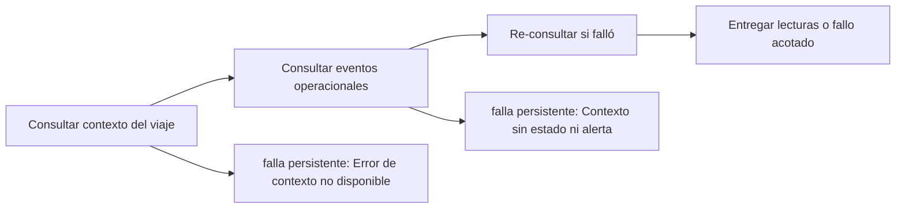

# Feature Specification: SF-01.2 — Lectura de contexto y eventos

**Created**: 2026-10-19  
**Status**: draft  
**Flow**: [F-01 Evaluar viaje como pasajero](01-f-01-evaluar-viaje-como-pasajero.md) (subflujo)  
**Related Specs**: [F-01 Evaluar viaje como pasajero](01-f-01-evaluar-viaje-como-pasajero.md), [SF-01.1 Validación de cuerpo y autorización de sesión](02-sf-01-1-validacion-de-cuerpo-y-autorizacion-de-sesion.md), [SF-01.3 Integridad de lecturas](04-sf-01-3-integridad-de-lecturas.md)  
**Origen (DEC/H)**: DEC-02, DEC-10, DEC-15, DEC-18, DEC-19, DEC-24  
**Pruebas (TC)**: TC-33  
**Contratos externos**: §2.1 (herramientas 1 y 2), matriz de errores por herramienta de §2.1  

## Reglas de este documento

> Este spec es FUNCIONAL, no técnico: describe QUÉ hace el sistema, no CÓMO. Usa lenguaje de negocio; las siete herramientas externas se nombran por su función y se referencian por la sección de `sdd/reports/EXTERNAL_CONTRACTS.md`. Los casos borde se DOCUMENTAN; los valores de configuración se citan por el nombre del parámetro (NFR-012) con su valor por defecto entre paréntesis.

**Alcance**: Consulta, en secuencia, el contexto del viaje y los eventos operacionales de los segmentos de la reserva, con una re-consulta ante fallo.

## User Scenarios & Testing *(mandatory)*

### User Story 1 - El pasajero ve datos frescos o un aviso claro si no pueden obtenerse (Priority: P1)

Como pasajero, quiero que cada vez que abro mi reserva se consulten los datos más recientes, y que si una consulta falla me lo digan con claridad.

**Why this priority**: Sin datos frescos cualquier decisión posterior sería insegura.

**Independent Test**: Se prueba con proveedores simulados que responden bien, que fallan una vez y que fallan siempre, en cada una de las dos lecturas.

**Acceptance Scenarios**:

1. **Scenario**: Lectura normal
   - **Given** el contexto y los eventos responden correctamente
   - **When** el pasajero abre la reserva
   - **Then** se consulta primero el contexto del viaje y después los eventos con los segmentos obtenidos, sin llamadas en paralelo

2. **Scenario**: Falla persistente del contexto
   - **Given** la consulta del contexto falla por tiempo agotado y la re-consulta también
   - **When** el pasajero abre la reserva
   - **Then** no se construye la vista: se responde «no pudimos cargar tu viaje» con la posibilidad de reintentar y sin soporte

3. **Scenario**: Falla solo de los eventos
   - **Given** el contexto responde y los eventos fallan tras la re-consulta
   - **When** el pasajero abre la reserva
   - **Then** se muestra el contexto sin estado ni alerta, con un aviso, sin decisión y sin soporte

4. **Scenario**: Falla de eventos tras la re-consulta (TC-33)
   - **Given** el contexto de ABC123 responde a las 11:02:31Z y los eventos de S1 (LA500) y S2 (LA2410) fallan dos veces seguidas
   - **When** se arma la lectura
   - **Then** se muestra el contexto con ambos segmentos sin estado, un aviso y ninguna decisión; hubo exactamente 2 consultas de eventos

---

### Edge Cases

> Solo se documentan; los marcados MUST-IMPLEMENT se vuelven requisito FR-XXX y se implementan con TDD, los DEFERRED quedan para una iteración posterior.

#### System Errors
- [MUST-IMPLEMENT] Cuando una lectura agota el tiempo, falla o es rechazada → el sistema DEBE re-consultar una sola vez, sin bucles (FR-105)
- [MUST-IMPLEMENT] Cuando el contexto sigue fallando → el sistema DEBE responder con error acotado de contexto no disponible (FR-105)
- [MUST-IMPLEMENT] Cuando solo fallan los eventos → el sistema DEBE devolver el contexto con estado nulo por segmento y sin alertas (FR-105)

#### Invalid Data
- [MUST-IMPLEMENT] Cuando los eventos pedidos incluyen un segmento inexistente → el sistema DEBE descartar los eventos de segmentos no solicitados (se ve en SF-01.4) (FR-016)

#### Race Conditions
- [DEFERRED] Memoria intermedia de lecturas para evitar consultas repetidas: queda para la Fase 2 (FR-002)

## Requirements *(mandatory)*

### Functional Requirements

- **FR-002**: En cada entrada del pasajero a la vista, el sistema DEBE consultar de nuevo el contexto del viaje y los eventos operacionales; no existe memoria intermedia de lecturas en la versión 1.
- **FR-105**: Matriz de errores por herramienta: las lecturas con fallo se reconsultan una vez sin bucles; sin contexto del viaje hay pantalla de «no pudimos cargar tu viaje» con reintento; solo sin eventos se muestra el contexto sin estado ni alerta y con aviso; sin política u opciones queda BLOQUEADA con caso humano ofrecido. Una solicitud de cambio con error no reintentable no se reintenta, muestra un fallo genérico y ofrece caso humano. En el caso humano, un error explícito dice «no pudimos registrar tu solicitud, puedes reintentar»; un tiempo agotado o respuesta perdida es indeterminado («no pudimos confirmar si tu solicitud quedó registrada; puede que ya lo esté»), no se reenvía automáticamente y el reintento exige un segundo clic explícito tras advertir del posible duplicado. Nunca se afirma éxito.
- **FR-009**: La consulta de opciones elegibles DEBE ocurrir solo después de evaluar la política; la cadena de lecturas es secuencial (contexto, eventos, política, opciones) y con ella se arma la vista.

### Non-Functional and Documentation Requirements

- **NFR-004**: Latencia: la vista DEBE responder en menos de 1,5 s (percentil 95) con proveedores simulados de 100 ms fijos; protocolo de aceptación: 50 solicitudes secuenciales del caso base en la máquina de desarrollo, reportando percentiles 50 y 95. La cadena de lecturas es secuencial (contexto, eventos, solo con evento relevante validado la política, y las opciones).

### Key Entities *(include if feature involves data)*

- **Contexto del viaje**: Reserva del pasajero con sus tramos; se reduce de inmediato a lo mínimo necesario (sin correo, teléfono, documento, nombre completo ni edad). Campos principales:
  - `booking_id`: texto de 6 caracteres alfanuméricos
  - `passenger_count`: entero ≥ 1
  - `passengers`: lista de {passenger_id: texto, type: ADULT | CHILD | otro | ausente}
  - `segments`: lista de {segment_id: texto, flight_number: texto, origin: código de aeropuerto, destination: código de aeropuerto, date: fecha, scheduled_departure: hora local HH:MM, scheduled_arrival: hora local HH:MM}
  - `fare_conditions`: {changeable: booleano, refundable: booleano, fare_family: texto, change_penalty_amount: entero | ausente}
  - `retrieved_at`: marca de tiempo UTC
  - `completeness`: enumeración abierta (p. ej. PARTIAL)
  - `missing_fields`: lista de texto
- **Evento operacional**: Hecho operacional informado por una fuente (retraso, cambio de puerta, estado) con su instante de registro. Campos principales:
  - `event_id`: texto (nunca se usa para ordenar)
  - `segment_id`: texto
  - `type`: enumeración abierta: DELAY | GATE_CHANGE | STATUS | otro
  - `delay_minutes`: entero | ausente
  - `new_departure`: hora local HH:MM | ausente
  - `gate`: texto | ausente
  - `status`: ON_TIME | SCHEDULED | otro | ausente
  - `source`: texto
  - `recorded_at`: marca de tiempo UTC

## Architectural Attributes *(mandatory)*

| Attribute | Value |
|-----------|-------|
| **Interaction type** | sync-http |
| **Consistency** | strong |
| **Workflow** | single-step |
| **Read pattern** | simple |
| **Auditability** | full-history |
| **Domain complexity** | medium |
| **Modularity** | bounded-context |
| **Deployment** | monolith |

## Success Criteria *(mandatory)*

### Measurable Outcomes

- **SC-001**: El 100 % de las entradas del pasajero provoca una nueva consulta de contexto y de eventos.
- **SC-002**: Ante una falla de lectura se realiza exactamente una re-consulta y nunca más.
- **SC-003**: En el peor caso con los valores por defecto la cadena de lecturas del flujo completo no excede 16 s.

## Traceability *(mandatory after implementation)*

> Las columnas de archivo y línea se registran en la verificación de trazabilidad posterior a la implementación; hoy cada criterio queda enlazado a su origen y a las pruebas que lo verifican.

| Criterion | Origen | Prueba (TC) | Source File | Line(s) |
|-----------|--------|-------------|-------------|---------|
| FR-002 | DEC-10, DEC-19 | sin TC en el mapa §6 de REQUERIMIENTOS_V1 | se registra en la verificación posterior a la implementación | se registra en la verificación posterior a la implementación |
| FR-105 | DEC-15, DEC-18 | TC-33 | se registra en la verificación posterior a la implementación | se registra en la verificación posterior a la implementación |
| FR-009 | DEC-02 | sin TC en el mapa §6 de REQUERIMIENTOS_V1 | se registra en la verificación posterior a la implementación | se registra en la verificación posterior a la implementación |
| NFR-004 | DEC-24 | sin TC en el mapa §6 de REQUERIMIENTOS_V1 | se registra en la verificación posterior a la implementación | se registra en la verificación posterior a la implementación |
| SC-001 | criterio medible de este spec | TC-33 | se registra en la verificación posterior a la implementación | se registra en la verificación posterior a la implementación |
| SC-002 | criterio medible de este spec | TC-33 | se registra en la verificación posterior a la implementación | se registra en la verificación posterior a la implementación |
| SC-003 | criterio medible de este spec | TC-33 | se registra en la verificación posterior a la implementación | se registra en la verificación posterior a la implementación |

## Business Process (BPM View)

```
Consultar contexto del viaje → Consultar eventos operacionales → Re-consultar si falló → Entregar lecturas o fallo acotado
```



