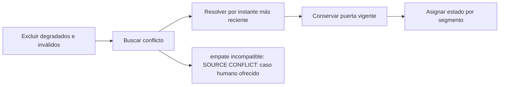

# Feature Specification: SF-01.4 — Validación de eventos

**Created**: 2026-10-19  
**Status**: draft  
**Flow**: [F-01 Evaluar viaje como pasajero](01-f-01-evaluar-viaje-como-pasajero.md) (subflujo)  
**Related Specs**: [F-01 Evaluar viaje como pasajero](01-f-01-evaluar-viaje-como-pasajero.md), [SF-01.3 Integridad de lecturas](04-sf-01-3-integridad-de-lecturas.md), [SF-01.5 Detección de anomalía y bloqueo previo](06-sf-01-5-deteccion-de-anomalia-y-bloqueo-previo.md)  
**Origen (DEC/H)**: DEC-05, DEC-06, DEC-08, DEC-09, DEC-10, DEC-12, DEC-15, DEC-31  
**Pruebas (TC)**: TC-02, TC-03, TC-13, TC-19, TC-24, TC-25, TC-26, TC-36, TC-54  
**Contratos externos**: §2.1 (herramienta 2: eventos operacionales e invariantes), §2.4 (`ASSERTION_COMPATIBILITY`, `CLOCK_SKEW_SECONDS`, `EVENT_MAX_AGE_SECONDS`)  

## Reglas de este documento

> Este spec es FUNCIONAL, no técnico: describe QUÉ hace el sistema, no CÓMO. Usa lenguaje de negocio; las siete herramientas externas se nombran por su función y se referencian por la sección de `sdd/reports/EXTERNAL_CONTRACTS.md`. Los casos borde se DOCUMENTAN; los valores de configuración se citan por el nombre del parámetro (NFR-012) con su valor por defecto entre paréntesis.

**Alcance**: Decide qué eventos son evidencia y qué estado resulta para cada segmento: excluye degradados e inválidos, aplica la precedencia por instante, detecta conflicto y conserva la puerta vigente.

## User Scenarios & Testing *(mandatory)*

### User Story 1 - El sistema solo se apoya en evidencia sana y más reciente (Priority: P1)

Como pasajero, quiero que el estado de mi vuelo salga de la fuente confiable más reciente, y que ante información contradictoria el sistema no afirme nada y me lleve con una persona.

**Why this priority**: Afirmar «a tiempo» o «retrasado» sin evidencia fiable puede llevar al pasajero a perder su vuelo.

**Independent Test**: Se prueba con las combinaciones de eventos de TC-02, TC-03, TC-24, TC-25, TC-26, TC-36 y TC-54.

**Acceptance Scenarios**:

1. **Scenario**: Fuente degradada
   - **Given** un segmento tiene un retraso sano y un estado «a tiempo» de una fuente degradada posterior
   - **When** se validan los eventos
   - **Then** el degradado se excluye con la razón fuente degradada y el retraso se mantiene

2. **Scenario**: Estado sano más reciente reemplaza al retraso
   - **Given** un segmento tiene un retraso y un estado «horario programado» sano de instante posterior
   - **When** se validan los eventos
   - **Then** el segmento queda «programado» y no hay retraso ni alerta

3. **Scenario**: Conflicto por empate
   - **Given** dos eventos sanos del mismo segmento tienen el mismo instante de registro y afirman «retrasado» y «a tiempo»
   - **When** se validan los eventos
   - **Then** no se afirma ningún estado: aviso neutro y caso humano por conflicto de fuentes

4. **Scenario**: Segmento sin evidencia
   - **Given** un segmento solo tiene eventos degradados, y otro no tiene eventos o solo cambios de puerta
   - **When** se validan los eventos
   - **Then** el primero muestra «sin información verificada» y el segundo su horario programado, sin alertar

5. **Scenario**: Degradado posterior no gana al retraso sano (TC-36)
   - **Given** E-1001 (DELAY de 160 min, OPS_CORE, 10:48:00Z) y E-1012 (ON_TIME, LEGACY_MIRROR degradada, 11:00:00Z)
   - **When** se validan los eventos de S1
   - **Then** E-1012 se excluye con la razón fuente degradada y el estado sigue siendo retrasado 160 min

6. **Scenario**: Estado sano posterior reemplaza al retraso (TC-24)
   - **Given** E-1001 de 160 min a las 10:48:00Z y un estado sano «horario programado» a las 11:00:00Z en S1
   - **When** se validan los eventos
   - **Then** S1 queda programado y no hay alerta de retraso

7. **Scenario**: Dos retrasos compatibles y eventos inválidos (TC-25, TC-26)
   - **Given** un retraso de 100 min a las 10:30:00Z y otro de 160 min a las 10:48:00Z, más un evento del segmento S9 que no se pidió y otro con instante 11:20:00Z posterior a la lectura de 11:02:33Z
   - **When** se validan los eventos
   - **Then** gana el de 160 min sin conflicto y los otros dos se descartan con las razones segmento desconocido y marca futura

8. **Scenario**: Empate sano incompatible y segmento sin eventos (TC-03, TC-54)
   - **Given** dos eventos sanos de S1 con el mismo instante 10:48:00Z que dicen «retrasado 160 min» y «a tiempo», y S2 sin eventos
   - **When** se validan los eventos
   - **Then** S1 queda en conflicto sin afirmar estado y S2 muestra su horario programado 19:05 sin alertar

9. **Scenario**: Solo evidencia degradada (TC-02)
   - **Given** S1 solo tiene E-1012 (ON_TIME de LEGACY_MIRROR, fuente degradada)
   - **When** se validan los eventos de S1
   - **Then** E-1012 se excluye con la razón fuente degradada; S1 se muestra «sin información verificada», nunca «a tiempo», sin alerta ni botón

---

### Edge Cases

> Solo se documentan; los marcados MUST-IMPLEMENT se vuelven requisito FR-XXX y se implementan con TDD, los DEFERRED quedan para una iteración posterior.

#### System Errors
- [DEFERRED] Antigüedad máxima de un evento como evidencia: el parámetro `EVENT_MAX_AGE_SECONDS` queda sin límite por defecto (decisión pendiente H-06) (FR-017)

#### Invalid Data
- [MUST-IMPLEMENT] Cuando un retraso es incoherente (salida más minutos distinta de la nueva salida) → descartar con la razón de retraso incoherente y ofrecer caso humano (FR-015)
- [MUST-IMPLEMENT] Cuando un evento pertenece a un segmento no solicitado o tiene un instante futuro más allá de la tolerancia → descartarlo con su razón (FR-016)
- [MUST-IMPLEMENT] Cuando el tipo de evento es desconocido (por ejemplo cancelación) → no interpretarlo y ofrecer el caso humano (FR-007)
- [MUST-IMPLEMENT] Cuando dos retrasos compatibles se suceden (100 y 160 minutos) → gana el más reciente y no hay conflicto (FR-013)

## Requirements *(mandatory)*

### Functional Requirements

- **FR-010**: Un evento cuya fuente figura entre las fuentes degradadas NO DEBE usarse como evidencia: se excluye y se registra la razón `SOURCE_DEGRADED`.
- **FR-011**: El sistema DEBE ordenar los eventos por su instante de registro en UTC y NUNCA por su identificador.
- **FR-012**: Precedencia de eventos en orden fijo: (1) se excluyen los degradados e inválidos; (2) con los restantes de un segmento se busca conflicto (empate de instante con afirmaciones incompatibles); (3) sin conflicto, por segmento y atributo (salida o puerta) gana el evento sano más reciente. Un estado sano de «horario programado» o «a tiempo» más reciente que un retraso lo reemplaza; si es más antiguo, el retraso se mantiene; un evento degradado nunca reemplaza ni borra.
- **FR-013**: Existe conflicto solo si dos eventos no degradados del mismo segmento comparten instante de registro y afirman cosas incompatibles sobre la salida (tabla `ASSERTION_COMPATIBILITY`). Con instantes distintos gana el más reciente; dos retrasos compatibles (100 y luego 160 minutos) no son conflicto. Ante un conflicto no se afirma estado: aviso neutro y caso humano `SOURCE_CONFLICT`.
- **FR-014**: Un segmento con solo evidencia degradada DEBE mostrarse como «sin información verificada» (nunca «a tiempo»), sin alerta ni botón. Un segmento sin ningún evento, o solo con eventos que no informan la salida, DEBE mostrar su horario programado sin afirmar estado ni alertar.
- **FR-015**: Un retraso incoherente (la salida programada más los minutos de retraso no coincide con la nueva salida) DEBE descartarse como evidencia con la razón `INCONSISTENT_DELAY` y ofrecerse el caso humano.
- **FR-016**: El sistema DEBE descartar los eventos de un segmento que no fue solicitado (`UNKNOWN_SEGMENT`) y los eventos con instante de registro posterior al de la lectura más la tolerancia `CLOCK_SKEW_SECONDS` (60) (`FUTURE_TIMESTAMP`).
- **FR-017**: El sistema DEBE usar siempre el dato más reciente y respetar la vigencia: las opciones vencen en el instante de su lectura más su vigencia en segundos (en el instante exacto ya están vencidas; sin vigencia declarada el conjunto se considera vencido). Los eventos no vencen por sí mismos (`EVENT_MAX_AGE_SECONDS`, por defecto sin límite). Al vencer se re-consulta una sola vez por acción, sin bucles.
- **FR-018**: El sistema DEBE calcular las edades de los datos en UTC (ahora menos el instante de registro o de lectura).
- **FR-007**: Ante un evento de tipo desconocido o no soportado (por ejemplo una cancelación), el sistema NO DEBE interpretarlo: muestra un aviso neutro («una persona debe revisar tu vuelo») y ofrece el caso humano con el motivo `UNSUPPORTED_EVENT_TYPE`.
- **FR-006**: El sistema DEBE informar siempre al pasajero de un cambio de puerta validado: en modo pasajero la vista lo muestra de forma destacada con la hora de la información; en modo sistema se envía la notificación correspondiente (FR-122). El cambio de puerta no consulta reglas de política en la Fase 1, no abre por sí solo el flujo de problema y el estado informado de vuelo se reconoce sin acción.

### Key Entities *(include if feature involves data)*

- **Evento operacional**: Hecho operacional informado por una fuente (retraso, cambio de puerta, estado) con su instante de registro. Campos principales:
  - `event_id`: texto (nunca se usa para ordenar)
  - `segment_id`: texto
  - `type`: enumeración abierta: DELAY | GATE_CHANGE | STATUS | otro
  - `delay_minutes`: entero | ausente
  - `new_departure`: hora local HH:MM | ausente
  - `gate`: texto | ausente
  - `status`: ON_TIME | SCHEDULED | otro | ausente
  - `source`: texto
  - `recorded_at`: marca de tiempo UTC
- **Estado resuelto del segmento**: Resultado de validar los eventos de un segmento: qué se afirma de su salida y de su puerta. Campos principales:
  - `segment_id`: texto
  - `state`: ON_TIME | SCHEDULED | DELAYED | NO_EVENTS | NO_VERIFIED_INFO | CONFLICT | UNSUPPORTED | INCONSISTENT | nulo
  - `affected`: booleano
  - `delay_minutes`: entero | nulo
  - `gate`: texto | nulo
  - `gate_recorded_at`: marca de tiempo UTC | nulo
  - `information_as_of`: marca de tiempo UTC | nulo
  - `discarded_events`: lista de {event_id: texto, reason: SOURCE_DEGRADED | INCONSISTENT_DELAY | UNKNOWN_SEGMENT | FUTURE_TIMESTAMP | SUPERSEDED | SOURCE_CONFLICT | UNSUPPORTED_EVENT_TYPE}

## Architectural Attributes *(mandatory)*

| Attribute | Value |
|-----------|-------|
| **Interaction type** | sync-http |
| **Consistency** | strong |
| **Workflow** | single-step |
| **Read pattern** | simple |
| **Auditability** | full-history |
| **Domain complexity** | medium |
| **Modularity** | bounded-context |
| **Deployment** | monolith |

## Success Criteria *(mandatory)*

### Measurable Outcomes

- **SC-001**: El 100 % de los eventos de fuentes degradadas queda excluido y registrado con su razón.
- **SC-002**: Ningún orden depende del identificador del evento: reordenar los identificadores no cambia el resultado.
- **SC-003**: El 100 % de los empates conflictivos termina en aviso neutro, sin afirmar estado.
- **SC-004**: Un segmento sin evidencia nunca se muestra como «a tiempo».

## Traceability *(mandatory after implementation)*

> Las columnas de archivo y línea se registran en la verificación de trazabilidad posterior a la implementación; hoy cada criterio queda enlazado a su origen y a las pruebas que lo verifican.

| Criterion | Origen | Prueba (TC) | Source File | Line(s) |
|-----------|--------|-------------|-------------|---------|
| FR-010 | DEC-06, DEC-09 | TC-02, TC-36 | se registra en la verificación posterior a la implementación | se registra en la verificación posterior a la implementación |
| FR-011 | DEC-09 | sin TC en el mapa §6 de REQUERIMIENTOS_V1 | se registra en la verificación posterior a la implementación | se registra en la verificación posterior a la implementación |
| FR-012 | DEC-09 | TC-03, TC-24, TC-25, TC-36 | se registra en la verificación posterior a la implementación | se registra en la verificación posterior a la implementación |
| FR-013 | DEC-09, DEC-15 | TC-03, TC-24 | se registra en la verificación posterior a la implementación | se registra en la verificación posterior a la implementación |
| FR-014 | DEC-09 | TC-02, TC-19, TC-54 | se registra en la verificación posterior a la implementación | se registra en la verificación posterior a la implementación |
| FR-015 | DEC-12 | TC-26 | se registra en la verificación posterior a la implementación | se registra en la verificación posterior a la implementación |
| FR-016 | DEC-09 | TC-26 | se registra en la verificación posterior a la implementación | se registra en la verificación posterior a la implementación |
| FR-017 | DEC-10 | sin TC en el mapa §6 de REQUERIMIENTOS_V1 | se registra en la verificación posterior a la implementación | se registra en la verificación posterior a la implementación |
| FR-018 | DEC-08 | sin TC en el mapa §6 de REQUERIMIENTOS_V1 | se registra en la verificación posterior a la implementación | se registra en la verificación posterior a la implementación |
| FR-007 | DEC-15, DEC-31 | TC-13 | se registra en la verificación posterior a la implementación | se registra en la verificación posterior a la implementación |
| FR-006 | DEC-05, DEC-31 | sin TC en el mapa §6 de REQUERIMIENTOS_V1 | se registra en la verificación posterior a la implementación | se registra en la verificación posterior a la implementación |
| SC-001 | criterio medible de este spec | TC-02, TC-03, TC-13, TC-19, TC-24, TC-25, TC-26, TC-36, TC-54 | se registra en la verificación posterior a la implementación | se registra en la verificación posterior a la implementación |
| SC-002 | criterio medible de este spec | TC-02, TC-03, TC-13, TC-19, TC-24, TC-25, TC-26, TC-36, TC-54 | se registra en la verificación posterior a la implementación | se registra en la verificación posterior a la implementación |
| SC-003 | criterio medible de este spec | TC-02, TC-03, TC-13, TC-19, TC-24, TC-25, TC-26, TC-36, TC-54 | se registra en la verificación posterior a la implementación | se registra en la verificación posterior a la implementación |
| SC-004 | criterio medible de este spec | TC-02, TC-03, TC-13, TC-19, TC-24, TC-25, TC-26, TC-36, TC-54 | se registra en la verificación posterior a la implementación | se registra en la verificación posterior a la implementación |

## Business Process (BPM View)

```
Excluir degradados e inválidos → Buscar conflicto → Resolver por instante más reciente → Conservar puerta vigente → Asignar estado por segmento
```



