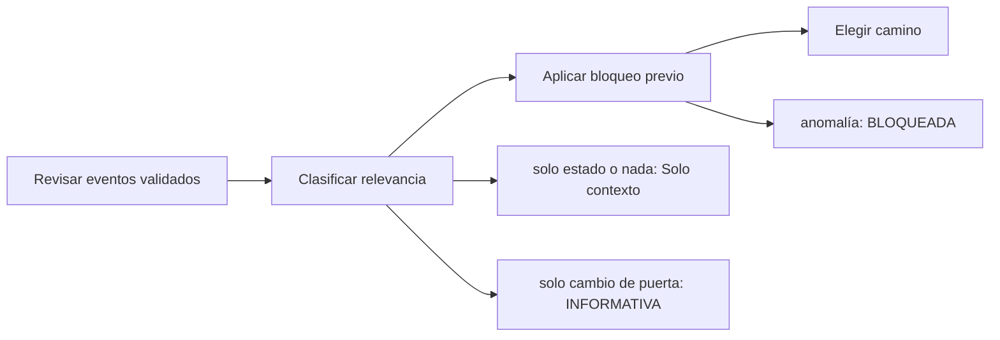

# Feature Specification: SF-01.5 — Detección de anomalía y bloqueo previo

**Created**: 2026-10-19  
**Status**: draft  
**Flow**: [F-01 Evaluar viaje como pasajero](01-f-01-evaluar-viaje-como-pasajero.md) (subflujo)  
**Related Specs**: [F-01 Evaluar viaje como pasajero](01-f-01-evaluar-viaje-como-pasajero.md), [SF-01.4 Validación de eventos](05-sf-01-4-validacion-de-eventos.md), [SF-01.6 Lectura de política](07-sf-01-6-lectura-de-politica.md)  
**Origen (DEC/H)**: DEC-02, DEC-05, DEC-09, DEC-13, DEC-31, H-09  
**Pruebas (TC)**: TC-13, TC-23, TC-51, TC-52, TC-54  
**Contratos externos**: §1.1 (reglas de la evaluación), §2.4 (`RELEVANT_DELAY_MIN_MINUTES`, `NOTIFY_ONLY_EVENT_TYPES`, `SUPPORTED_EVENT_TYPES`)  

## Reglas de este documento

> Este spec es FUNCIONAL, no técnico: describe QUÉ hace el sistema, no CÓMO. Usa lenguaje de negocio; las siete herramientas externas se nombran por su función y se referencian por la sección de `sdd/reports/EXTERNAL_CONTRACTS.md`. Los casos borde se DOCUMENTAN; los valores de configuración se citan por el nombre del parámetro (NFR-012) con su valor por defecto entre paréntesis.

**Alcance**: Decide si hay un evento relevante validado o evidencia anómala y, según eso, si el viaje solo se muestra, si es informativo, si se bloquea antes de consultar política o si sigue la cadena.

## User Scenarios & Testing *(mandatory)*

### User Story 1 - El sistema solo molesta al pasajero cuando hay algo que contar (Priority: P1)

Como pasajero, quiero ver alertas únicamente cuando hay un retraso relevante, un cambio de puerta o una anomalía, y que ante una anomalía el sistema no intente decidir.

**Why this priority**: Evita ruido y evita decisiones automáticas sobre evidencia dudosa.

**Independent Test**: Se prueba con viajes sin eventos, solo con estado, solo con cambio de puerta, con retraso, con varios segmentos retrasados y con evento no soportado.

**Acceptance Scenarios**:

1. **Scenario**: Sin evento relevante
   - **Given** solo hay eventos de estado informado o ninguno
   - **When** se detecta la anomalía
   - **Then** no hay anomalía: se muestra solo el contexto, sin botones

2. **Scenario**: Solo cambio de puerta
   - **Given** el único evento validado es un cambio de puerta
   - **When** se detecta la anomalía
   - **Then** la decisión es INFORMATIVA con la puerta destacada y no se consulta la política

3. **Scenario**: Varios segmentos retrasados
   - **Given** dos segmentos tienen retraso relevante
   - **When** se detecta la anomalía
   - **Then** no se decide: se informa y se ofrece el caso humano por varios segmentos afectados; la decisión es BLOQUEADA y la política queda sin solicitar

4. **Scenario**: Solo cambio de puerta, cancelación y varios segmentos (TC-51, TC-13, TC-23)
   - **Given** tres reservas ABC123: una con solo E-1007 (puerta 24), otra con un evento CANCELLATION y otra con retrasos de 160 min en S1 y S2
   - **When** se detecta la anomalía
   - **Then** la primera es INFORMATIVA sin consultar política, la segunda y la tercera son BLOQUEADAS sin consultar política ni opciones y con el caso humano correspondiente

---

### Edge Cases

> Solo se documentan; los marcados MUST-IMPLEMENT se vuelven requisito FR-XXX y se implementan con TDD, los DEFERRED quedan para una iteración posterior.

#### System Errors
- [DEFERRED] Flujo de cancelación y adelanto: queda para la segunda etapa (DOC-008) (FR-007)

#### Invalid Data
- [MUST-IMPLEMENT] Cuando hay más de un segmento con retraso relevante → decisión BLOQUEADA y caso humano por varios segmentos afectados (FR-019)
- [MUST-IMPLEMENT] Cuando hay conflicto, tipo desconocido o retraso incoherente → decisión BLOQUEADA, política y opciones sin solicitar y sin reglas en pantalla (FR-038)
- [MUST-IMPLEMENT] Cuando el retraso es menor que `RELEVANT_DELAY_MIN_MINUTES` → no es evento relevante (FR-005)
- [MUST-IMPLEMENT] Cuando el cambio de puerta proviene de una fuente degradada → no se muestra ni se notifica (FR-006)

## Requirements *(mandatory)*

### Functional Requirements

- **FR-004**: Si no hay anomalía (ningún retraso relevante ni cambio de puerta validado y ninguna evidencia anómala), el sistema DEBE mostrar solo el contexto: sin alertas, reglas, opciones ni botones de acción (puede haber un botón «Actualizar» que solo vuelve a consultar y no es una acción externa), y el pasajero ve que todo está en orden. Con un cambio de puerta validado y sin retraso la decisión es INFORMATIVA con la puerta destacada. La evidencia degradada no genera alerta pero aplica FR-014. El soporte humano solo se ofrece cuando hay una acción posible.
- **FR-005**: El sistema DEBE tratar como evento relevante un retraso validado con minutos de retraso mayores o iguales a `RELEVANT_DELAY_MIN_MINUTES` (1); qué derechos otorga lo decide la política vigente (FR-034).
- **FR-006**: El sistema DEBE informar siempre al pasajero de un cambio de puerta validado: en modo pasajero la vista lo muestra de forma destacada con la hora de la información; en modo sistema se envía la notificación correspondiente (FR-122). El cambio de puerta no consulta reglas de política en la Fase 1, no abre por sí solo el flujo de problema y el estado informado de vuelo se reconoce sin acción.
- **FR-019**: Se evalúa cada segmento con retraso relevante; si hay más de uno, el sistema NO DEBE decidir: muestra el contexto, informa y ofrece el caso humano `MULTIPLE_AFFECTED_SEGMENTS`. Con uno solo, todas las variables se calculan sobre ese segmento y su conexión con el siguiente.
- **FR-038**: Si en cualquier segmento existe `SOURCE_CONFLICT`, `UNSUPPORTED_EVENT_TYPE`, `INCONSISTENT_DELAY`, `MULTIPLE_AFFECTED_SEGMENTS`, `RULE_ERROR`, una regla no evaluable en los términos de FR-033 o una lectura íntegra inválida (FR-066), la decisión DEBE ser BLOQUEADA: ninguna regla cumplida habilita la creación de la solicitud de cambio y aceptar una opción solo puede abrir un caso humano.
- **FR-068**: La evaluación DEBE considerar todos los eventos validados de todos los segmentos en conjunto y la vista los muestra todos. En la Fase 1 solo el retraso consulta la política (`POLICY_SCENARIOS`); el cambio de puerta nunca la consulta y solo se informa o se notifica. Los tipos admitidos son `SUPPORTED_EVENT_TYPES`; uno fuera de la lista no se interpreta (FR-007). Un viaje solo con cambio de puerta queda INFORMATIVO.

### Key Entities *(include if feature involves data)*

- **Estado resuelto del segmento**: Resultado de validar los eventos de un segmento: qué se afirma de su salida y de su puerta. Campos principales:
  - `segment_id`: texto
  - `state`: ON_TIME | SCHEDULED | DELAYED | NO_EVENTS | NO_VERIFIED_INFO | CONFLICT | UNSUPPORTED | INCONSISTENT | nulo
  - `affected`: booleano
  - `delay_minutes`: entero | nulo
  - `gate`: texto | nulo
  - `gate_recorded_at`: marca de tiempo UTC | nulo
  - `information_as_of`: marca de tiempo UTC | nulo
  - `discarded_events`: lista de {event_id: texto, reason: SOURCE_DEGRADED | INCONSISTENT_DELAY | UNKNOWN_SEGMENT | FUTURE_TIMESTAMP | SUPERSEDED | SOURCE_CONFLICT | UNSUPPORTED_EVENT_TYPE}
- **Decisión**: Resultado de evaluar la reserva: su estado y las razones que lo explican. Campos principales:
  - `decision_id`: identificador aleatorio no adivinable
  - `decision_state`: INFORMATIVA | AUTOMATICA | PENDIENTE_APROBACION | BLOQUEADA | nulo
  - `anomaly_detected`: booleano
  - `fingerprint`: texto: huella de decisión sin opción
  - `human_case_reasons`: lista ordenada de motivos de caso humano
  - `support_offered`: booleano
  - `compensation_eligible`: booleano
  - `needs_manual_review`: booleano (campo interno: se persiste y no se entrega a la sesión del pasajero, FR-093)

## Architectural Attributes *(mandatory)*

| Attribute | Value |
|-----------|-------|
| **Interaction type** | sync-http |
| **Consistency** | strong |
| **Workflow** | single-step |
| **Read pattern** | simple |
| **Auditability** | full-history |
| **Domain complexity** | medium |
| **Modularity** | bounded-context |
| **Deployment** | monolith |

## Success Criteria *(mandatory)*

### Measurable Outcomes

- **SC-001**: El 100 % de los viajes sin evento relevante se muestra sin alertas ni botones.
- **SC-002**: El 100 % de los viajes solo con cambio de puerta termina INFORMATIVO sin consultar política.
- **SC-003**: El 100 % de las anomalías previas termina BLOQUEADO sin consultar política ni opciones.

## Traceability *(mandatory after implementation)*

> Las columnas de archivo y línea se registran en la verificación de trazabilidad posterior a la implementación; hoy cada criterio queda enlazado a su origen y a las pruebas que lo verifican.

| Criterion | Origen | Prueba (TC) | Source File | Line(s) |
|-----------|--------|-------------|-------------|---------|
| FR-004 | DEC-02 | TC-54 | se registra en la verificación posterior a la implementación | se registra en la verificación posterior a la implementación |
| FR-005 | DEC-05, DEC-31, H-09 | sin TC en el mapa §6 de REQUERIMIENTOS_V1 | se registra en la verificación posterior a la implementación | se registra en la verificación posterior a la implementación |
| FR-006 | DEC-05, DEC-31 | TC-51 | se registra en la verificación posterior a la implementación | se registra en la verificación posterior a la implementación |
| FR-019 | DEC-31 | TC-23 | se registra en la verificación posterior a la implementación | se registra en la verificación posterior a la implementación |
| FR-038 | DEC-09, DEC-13, DEC-31 | sin TC en el mapa §6 de REQUERIMIENTOS_V1 | se registra en la verificación posterior a la implementación | se registra en la verificación posterior a la implementación |
| FR-068 | Usuario (2026-10-19) | TC-51, TC-52 | se registra en la verificación posterior a la implementación | se registra en la verificación posterior a la implementación |
| SC-001 | criterio medible de este spec | TC-13, TC-23, TC-51, TC-52, TC-54 | se registra en la verificación posterior a la implementación | se registra en la verificación posterior a la implementación |
| SC-002 | criterio medible de este spec | TC-13, TC-23, TC-51, TC-52, TC-54 | se registra en la verificación posterior a la implementación | se registra en la verificación posterior a la implementación |
| SC-003 | criterio medible de este spec | TC-13, TC-23, TC-51, TC-52, TC-54 | se registra en la verificación posterior a la implementación | se registra en la verificación posterior a la implementación |

## Business Process (BPM View)

```
Revisar eventos validados → Clasificar relevancia → Aplicar bloqueo previo → Elegir camino
```



