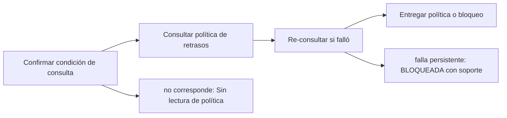

# Feature Specification: SF-01.6 — Lectura de política

**Created**: 2026-10-19  
**Status**: draft  
**Flow**: [F-01 Evaluar viaje como pasajero](01-f-01-evaluar-viaje-como-pasajero.md) (subflujo)  
**Related Specs**: [F-01 Evaluar viaje como pasajero](01-f-01-evaluar-viaje-como-pasajero.md), [SF-01.5 Detección de anomalía y bloqueo previo](06-sf-01-5-deteccion-de-anomalia-y-bloqueo-previo.md), [SF-01.7 Derivación de variables](08-sf-01-7-derivacion-de-variables.md)  
**Origen (DEC/H)**: DEC-02, DEC-11, DEC-12, DEC-15, DEC-18, DEC-24  
**Pruebas (TC)**: TC-33, TC-35, TC-52, TC-53  
**Contratos externos**: §2.1 (herramienta 4: reglas de política), matriz de errores de §2.1, §2.4 (`POLICY_SCENARIOS`)  

## Reglas de este documento

> Este spec es FUNCIONAL, no técnico: describe QUÉ hace el sistema, no CÓMO. Usa lenguaje de negocio; las siete herramientas externas se nombran por su función y se referencian por la sección de `sdd/reports/EXTERNAL_CONTRACTS.md`. Los casos borde se DOCUMENTAN; los valores de configuración se citan por el nombre del parámetro (NFR-012) con su valor por defecto entre paréntesis.

**Alcance**: Consulta la política de retrasos solo cuando hay un retraso relevante validado y ningún bloqueo previo; el cambio de puerta nunca la consulta.

## User Scenarios & Testing *(mandatory)*

### User Story 1 - La política vigente es la única fuente de umbrales (Priority: P1)

Como equipo de producto, quiero que los derechos del pasajero salgan solo de la política recuperada y que la consulta ocurra únicamente cuando corresponde.

**Why this priority**: Evita decidir con reglas externas y evita lecturas innecesarias.

**Independent Test**: Se prueba con retraso relevante, solo cambio de puerta, bloqueo previo, política vacía y fallo de lectura de la política.

**Acceptance Scenarios**:

1. **Scenario**: Retraso relevante validado
   - **Given** hay un retraso relevante validado y ningún bloqueo previo
   - **When** se llega a la lectura de política
   - **Then** se consulta la política de retrasos y se evalúan todas sus reglas

2. **Scenario**: Cambio de puerta nunca consulta política
   - **Given** la configuración incluyera otros escenarios y el único evento es un cambio de puerta
   - **When** se evalúa el viaje
   - **Then** no se consulta ninguna política

3. **Scenario**: Falla la lectura de la política
   - **Given** la consulta falla por tiempo agotado y la re-consulta también
   - **When** se evalúa el viaje
   - **Then** la decisión es BLOQUEADA con anomalía que exige validación manual: no se consultan opciones y el soporte se ofrece con el motivo de datos parciales bloqueantes

4. **Scenario**: Política vacía y fallo de lectura (TC-35, TC-53, TC-33)
   - **Given** un retraso de 160 min validado en ABC123
   - **When** la política de retrasos llega con 0 reglas, o falla dos veces
   - **Then** ambos casos terminan BLOQUEADOS; con la política vacía el soporte se ofrece, con el fallo se registra la revisión manual; con solo E-1007 la política no se consulta aunque la configuración la incluya

---

### Edge Cases

> Solo se documentan; los marcados MUST-IMPLEMENT se vuelven requisito FR-XXX y se implementan con TDD, los DEFERRED quedan para una iteración posterior.

#### System Errors
- [MUST-IMPLEMENT] Cuando falla la lectura de la política tras la re-consulta → decisión BLOQUEADA con soporte ofrecido y revisión manual (FR-105)
- [DEFERRED] Escenarios de política adicionales (por ejemplo cambio de puerta) para la Fase 2 (FR-068)

#### Invalid Data
- [MUST-IMPLEMENT] Cuando la política llega vacía o inexistente → decisión BLOQUEADA y caso humano ofrecido (FR-008)
- [MUST-IMPLEMENT] Cuando hay bloqueo previo → no se consulta la política y la pantalla no muestra reglas (FR-038)
- [MUST-IMPLEMENT] Cuando el evento es un tipo que solo se informa → nunca consulta política aunque figure en `POLICY_SCENARIOS` (FR-068)

## Requirements *(mandatory)*

### Functional Requirements

- **FR-008**: Con un retraso relevante validado el sistema DEBE consultar la política de retrasos y evaluar todas sus reglas, mostrando las que se cumplen y las que no con los valores usados. Una política vacía, o una regla cumplida cuyo indicador de aprobación humana falta o no es verdadero/falso, deja la decisión BLOQUEADA y con caso humano ofrecido; un fallo de lectura del contexto o de los eventos no produce decisión; un fallo de lectura de la política o de las opciones deja la decisión BLOQUEADA con soporte ofrecido.
- **FR-009**: La consulta de opciones elegibles DEBE ocurrir solo después de evaluar la política; la cadena de lecturas es secuencial (contexto, eventos, política, opciones) y con ella se arma la vista.
- **FR-068**: La evaluación DEBE considerar todos los eventos validados de todos los segmentos en conjunto y la vista los muestra todos. En la Fase 1 solo el retraso consulta la política (`POLICY_SCENARIOS`); el cambio de puerta nunca la consulta y solo se informa o se notifica. Los tipos admitidos son `SUPPORTED_EVENT_TYPES`; uno fuera de la lista no se interpreta (FR-007). Un viaje solo con cambio de puerta queda INFORMATIVO.
- **FR-086**: La indicación de datos parciales de una lectura es información de contexto y solo bloquea si falta un campo necesario para decidir. Una lectura fallida o inválida da aviso y reintento sin soporte; el caso humano de datos parciales solo se ofrece si la decisión queda BLOQUEADA por una anomalía que exige validación manual.
- **FR-105**: Matriz de errores por herramienta: las lecturas con fallo se reconsultan una vez sin bucles; sin contexto del viaje hay pantalla de «no pudimos cargar tu viaje» con reintento; solo sin eventos se muestra el contexto sin estado ni alerta y con aviso; sin política u opciones queda BLOQUEADA con caso humano ofrecido. Una solicitud de cambio con error no reintentable no se reintenta, muestra un fallo genérico y ofrece caso humano. En el caso humano, un error explícito dice «no pudimos registrar tu solicitud, puedes reintentar»; un tiempo agotado o respuesta perdida es indeterminado («no pudimos confirmar si tu solicitud quedó registrada; puede que ya lo esté»), no se reenvía automáticamente y el reintento exige un segundo clic explícito tras advertir del posible duplicado. Nunca se afirma éxito.

### Non-Functional and Documentation Requirements

- **NFR-004**: Latencia: la vista DEBE responder en menos de 1,5 s (percentil 95) con proveedores simulados de 100 ms fijos; protocolo de aceptación: 50 solicitudes secuenciales del caso base en la máquina de desarrollo, reportando percentiles 50 y 95. La cadena de lecturas es secuencial (contexto, eventos, solo con evento relevante validado la política, y las opciones).

### Key Entities *(include if feature involves data)*

- **Política y regla**: Versión recuperada de la política de retrasos y el resultado de evaluar cada una de sus reglas. Campos principales:
  - `scenario`: texto
  - `status`: EVALUATED | RULE_ERROR | EMPTY | UNAVAILABLE
  - `version`: texto | nulo
  - `effective_from`: fecha | nulo
  - `superseded_versions`: lista de texto
  - `entitlements`: lista de códigos de derecho
  - `requires_human_approval`: booleano
  - `rules`: lista de {rule_id: texto, condition: texto, entitlement: texto, requires_human_approval: booleano, result: CUMPLE | NO_CUMPLE | INDETERMINADA, variables_used: lista de {name: texto, value: booleano | entero | nulo, known: booleano}}
- **Decisión**: Resultado de evaluar la reserva: su estado y las razones que lo explican. Campos principales:
  - `decision_id`: identificador aleatorio no adivinable
  - `decision_state`: INFORMATIVA | AUTOMATICA | PENDIENTE_APROBACION | BLOQUEADA | nulo
  - `anomaly_detected`: booleano
  - `fingerprint`: texto: huella de decisión sin opción
  - `human_case_reasons`: lista ordenada de motivos de caso humano
  - `support_offered`: booleano
  - `compensation_eligible`: booleano
  - `needs_manual_review`: booleano (campo interno: se persiste y no se entrega a la sesión del pasajero, FR-093)

## Architectural Attributes *(mandatory)*

| Attribute | Value |
|-----------|-------|
| **Interaction type** | sync-http |
| **Consistency** | strong |
| **Workflow** | single-step |
| **Read pattern** | simple |
| **Auditability** | full-history |
| **Domain complexity** | medium |
| **Modularity** | bounded-context |
| **Deployment** | monolith |

## Success Criteria *(mandatory)*

### Measurable Outcomes

- **SC-001**: La política se consulta en el 100 % de los retrasos relevantes validados sin bloqueo previo y en el 0 % de los demás casos.
- **SC-002**: Ninguna lectura de política ocurre en paralelo con otra: la cadena es secuencial.
- **SC-003**: El 100 % de los fallos de lectura de política termina BLOQUEADO con soporte ofrecido.

## Traceability *(mandatory after implementation)*

> Las columnas de archivo y línea se registran en la verificación de trazabilidad posterior a la implementación; hoy cada criterio queda enlazado a su origen y a las pruebas que lo verifican.

| Criterion | Origen | Prueba (TC) | Source File | Line(s) |
|-----------|--------|-------------|-------------|---------|
| FR-008 | DEC-02, DEC-12 | TC-35, TC-53 | se registra en la verificación posterior a la implementación | se registra en la verificación posterior a la implementación |
| FR-009 | DEC-02 | sin TC en el mapa §6 de REQUERIMIENTOS_V1 | se registra en la verificación posterior a la implementación | se registra en la verificación posterior a la implementación |
| FR-068 | Usuario (2026-10-19) | TC-52, TC-53 | se registra en la verificación posterior a la implementación | se registra en la verificación posterior a la implementación |
| FR-086 | DEC-11 | sin TC en el mapa §6 de REQUERIMIENTOS_V1 | se registra en la verificación posterior a la implementación | se registra en la verificación posterior a la implementación |
| FR-105 | DEC-15, DEC-18 | TC-33 | se registra en la verificación posterior a la implementación | se registra en la verificación posterior a la implementación |
| NFR-004 | DEC-24 | sin TC en el mapa §6 de REQUERIMIENTOS_V1 | se registra en la verificación posterior a la implementación | se registra en la verificación posterior a la implementación |
| SC-001 | criterio medible de este spec | TC-33, TC-35, TC-52, TC-53 | se registra en la verificación posterior a la implementación | se registra en la verificación posterior a la implementación |
| SC-002 | criterio medible de este spec | TC-33, TC-35, TC-52, TC-53 | se registra en la verificación posterior a la implementación | se registra en la verificación posterior a la implementación |
| SC-003 | criterio medible de este spec | TC-33, TC-35, TC-52, TC-53 | se registra en la verificación posterior a la implementación | se registra en la verificación posterior a la implementación |

## Business Process (BPM View)

```
Confirmar condición de consulta → Consultar política de retrasos → Re-consultar si falló → Entregar política o bloqueo
```



