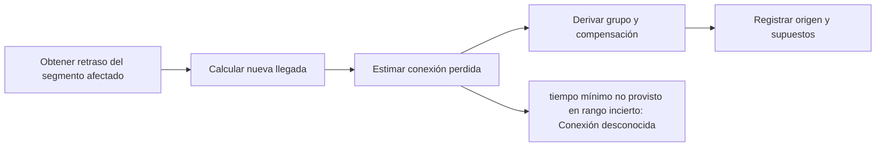

# Feature Specification: SF-01.7 — Derivación de variables

**Created**: 2026-10-19  
**Status**: draft  
**Flow**: [F-01 Evaluar viaje como pasajero](01-f-01-evaluar-viaje-como-pasajero.md) (subflujo)  
**Related Specs**: [F-01 Evaluar viaje como pasajero](01-f-01-evaluar-viaje-como-pasajero.md), [SF-01.6 Lectura de política](07-sf-01-6-lectura-de-politica.md), [SF-01.8 Evaluación de reglas y estado de la decisión](09-sf-01-8-evaluacion-de-reglas-y-estado-de-la-decision.md)  
**Origen (DEC/H)**: DEC-04, DEC-06, DEC-07, DEC-08, DEC-11, DEC-12, DEC-15, DEC-23, DEC-27, DEC-29, DEC-32, H-08, H-13  
**Pruebas (TC)**: TC-06, TC-18, TC-23, TC-28, TC-47  
**Contratos externos**: §2.1 (herramienta 1: contexto del viaje), §2.4 (`MIN_CONNECTION_MINUTES`, `MCT_UNCERTAINTY_MINUTES`)  

## Reglas de este documento

> Este spec es FUNCIONAL, no técnico: describe QUÉ hace el sistema, no CÓMO. Usa lenguaje de negocio; las siete herramientas externas se nombran por su función y se referencian por la sección de `sdd/reports/EXTERNAL_CONTRACTS.md`. Los casos borde se DOCUMENTAN; los valores de configuración se citan por el nombre del parámetro (NFR-012) con su valor por defecto entre paréntesis.

**Alcance**: Calcula las variables que alimentan las reglas: retraso, nueva llegada, conexión perdida, carácter internacional, grupo con menor y compensación solicitada, cada una con su origen y supuestos.

## User Scenarios & Testing *(mandatory)*

### User Story 1 - El pasajero ve estimaciones honestas, nunca certezas inventadas (Priority: P1)

Como pasajero, quiero que el sistema me diga si podría perder mi conexión rotulándolo como estimación, y que no me asegure nada que depende de datos que no tiene.

**Why this priority**: Una afirmación falsa de «conexión segura» o de conexión perdida puede inducir decisiones equivocadas.

**Independent Test**: Se prueba con retrasos de 60 y 10 minutos sin tiempo mínimo de conexión, con retraso que cruza medianoche, con último segmento afectado y con tipos de pasajero desconocidos.

**Acceptance Scenarios**:

1. **Scenario**: Conexión desconocida
   - **Given** retraso de 60 minutos, margen de 10 minutos y tiempo mínimo de conexión no provisto
   - **When** se derivan las variables
   - **Then** la conexión perdida queda desconocida, se rotula «estimada» y se ofrece el caso humano

2. **Scenario**: Conexión falsa con aviso
   - **Given** retraso de 10 minutos, margen de 60 minutos y tiempo mínimo no provisto
   - **When** se derivan las variables
   - **Then** la conexión perdida es falsa, rotulada «estimada, sujeta al tiempo mínimo de conexión»; nunca se dice «tu conexión está segura»

3. **Scenario**: Cruce de medianoche
   - **Given** una llegada programada a las 23:40 con 160 minutos de retraso
   - **When** se calcula la nueva llegada
   - **Then** resulta en la fecha siguiente, con fecha completa y etiquetada como derivada y estimada

4. **Scenario**: Tipo de pasajero desconocido
   - **Given** un pasajero no trae tipo
   - **When** se deriva el grupo con menor
   - **Then** el valor es desconocido y se trata como posible menor

5. **Scenario**: Margen de 10 min y de 60 min con tiempo mínimo no provisto (TC-06)
   - **Given** LA500 llega a las 17:55 y LA2410 sale a las 19:05 (margen 70 min sin retraso)
   - **When** se deriva con retrasos de 60 min y de 10 min
   - **Then** con 60 min el margen es 10 min y la conexión es desconocida; con 10 min el margen es 60 min y es falsa «estimada, sujeta al tiempo mínimo de conexión»

6. **Scenario**: Cruce de medianoche y pasajero sin tipo (TC-18, TC-47)
   - **Given** S1 llega a las 23:30 con 120 min de retraso y un pasajero P2 sin campo de tipo
   - **When** se deriva la nueva llegada y el grupo
   - **Then** la nueva llegada es 01:30 del día siguiente (derivada, estimada) y el grupo con menor es desconocido, tratado como posible menor

7. **Scenario**: Último segmento sin conexión (TC-35)
   - **Given** un retraso de 200 min solo en S2 (LA2410), último segmento de ABC123
   - **When** se deriva la conexión
   - **Then** no hay segmento siguiente: la conexión perdida es falsa (FR-022) y R1 (desde 180 min) queda como único derecho de cambio

8. **Scenario**: Derivación numérica del caso base (TC-01)
   - **Given** el caso base ABC123: LA500 llega a las 17:55, LA2410 sale a las 19:05 y el retraso es de 160 min, con tiempo mínimo de conexión 0 no provisto
   - **When** se derivan las variables
   - **Then** la nueva llegada es 17:55 + 160 min = 20:35 (estimada); el margen es 19:05 − 20:35 = −90 min, menor que 0, por lo que la conexión perdida es verdadera aun con tiempo mínimo 0 (fuera del rango incierto de 0 a 45 min); R3 se cumple, el grupo incluye un menor y R5 se cumple, la política está rota y la decisión es PENDIENTE_APROBACION

---

### Edge Cases

> Solo se documentan; los marcados MUST-IMPLEMENT se vuelven requisito FR-XXX y se implementan con TDD, los DEFERRED quedan para una iteración posterior.

#### System Errors
- [DEFERRED] Tiempo mínimo de conexión real por aeropuerto: se solicita (DOC-009) y mientras tanto rige el supuesto rotulado (FR-023)

#### Invalid Data
- [MUST-IMPLEMENT] Cuando el aeropuerto no figura en la tabla de referencia → el carácter internacional queda desconocido (FR-026)
- [MUST-IMPLEMENT] Cuando el segmento afectado es el último → no hay conexión y la conexión perdida es falsa (FR-022)
- [MUST-IMPLEMENT] Cuando el tipo de pasajero es distinto de adulto o niño (por ejemplo bebé) o falta → grupo con menor desconocido, tratado como posible menor (FR-024)
- [DEFERRED] Limitación de la regla de «+1 día» con diferencias horarias extremas: se documenta en el README de ingeniería (mejora M4) (FR-021)

## Requirements *(mandatory)*

### Functional Requirements

- **FR-020**: El retraso en minutos DEBE ser el retraso de salida del evento resuelto del segmento afectado, solo si no es degradado.
- **FR-021**: La nueva llegada DEBE calcularse como la llegada programada más el retraso (el retraso no se recupera), con fecha completa: la fecha de llegada es la de salida y se suma un día si la hora de llegada es menor que la de salida; la suma cruza medianoche con fecha correcta. Se etiqueta siempre DERIVADA/ESTIMADA.
- **FR-022**: El margen de conexión es la salida programada del segmento siguiente menos la nueva llegada del segmento afectado (horas locales del mismo aeropuerto, con fecha). Si el afectado es el último segmento no hay conexión y la conexión perdida es falsa. La conexión perdida es verdadera si el margen es menor que el tiempo mínimo de conexión; desconocida si ese tiempo no fue provisto y el margen está entre cero y `MCT_UNCERTAINTY_MINUTES` (45); falsa en el resto. Siempre es una estimación.
- **FR-023**: El tiempo mínimo de conexión es un dato requerido (`MIN_CONNECTION_MINUTES` por aeropuerto, 0 por defecto, rotulado «supuesto, no provisto»). Con tiempo no provisto un «falso» nunca se afirma en el rango incierto, la regla de conexión queda indeterminada y se ofrece el caso humano; un «falso» con tiempo no provisto se rotula «estimada, sujeta al tiempo mínimo de conexión» y la interfaz nunca dice «tu conexión está segura». Se registran los supuestos A1 (el retraso se propaga íntegro), A2 (tiempo mínimo no provisto) y A3 (el segmento siguiente no se retiene), y el dato queda en la lista de datos a solicitar.
- **FR-024**: El grupo incluye un menor si algún pasajero es de tipo niño; es falso solo si todos son adultos; cualquier otro tipo o tipo ausente es desconocido y se trata como posible menor: con política rota pasa a validación manual aunque la política no traiga una regla de menores; sin política rota solo se informa.
- **FR-025**: La solicitud de compensación DEBE ser falsa por defecto y verdadera solo si el pasajero la pide explícitamente.
- **FR-026**: El carácter internacional de un segmento DEBE determinarse comparando el país de origen y de destino según la tabla de referencia versionada; un aeropuerto desconocido deja la variable desconocida.
- **FR-027**: El sistema DEBE contar con una tabla de referencia versionada mínima de aeropuertos (SCL, LIM, MEX) con país y zona horaria, usada solo para el carácter internacional y las conversiones.
- **FR-028**: Toda variable derivada DEBE registrarse con su valor, su origen (dato o derivada) y sus supuestos.
- **FR-029**: El pernocte se deriva cuando la salida de la opción propuesta cae en una fecha local posterior a la de la nueva llegada del segmento con conexión perdida; sin conexión perdida, o con conexión desconocida, no se deriva. Activa el aviso de asistencia (FR-058) y ofrece el caso humano `OVERNIGHT_ASSISTANCE`.
- **FR-086**: La indicación de datos parciales de una lectura es información de contexto y solo bloquea si falta un campo necesario para decidir. Una lectura fallida o inválida da aviso y reintento sin soporte; el caso humano de datos parciales solo se ofrece si la decisión queda BLOQUEADA por una anomalía que exige validación manual.

### Non-Functional and Documentation Requirements

- **DOC-009**: Información a solicitar: lista completa de tipos de evento y documentación de cada servicio; tiempo mínimo de conexión por aeropuerto; campo de causa; semántica de «pendiente de confirmación»; definición de «menor».

### Key Entities *(include if feature involves data)*

- **Variable derivada**: Valor calculado a partir de los datos, con su origen y sus supuestos. Campos principales:
  - `name`: delay_minutes | new_arrival | missed_connection | international | group_includes_minor | compensation_requested | overnight_required
  - `segment_id`: texto | nulo
  - `value`: booleano | entero | texto | nulo (nulo = desconocido)
  - `known`: booleano
  - `origin`: DATO | DERIVADA
  - `estimated`: booleano
  - `assumptions`: lista de texto (p. ej. propagación íntegra del retraso, tiempo mínimo de conexión no provisto)
- **Contexto del viaje**: Reserva del pasajero con sus tramos; se reduce de inmediato a lo mínimo necesario (sin correo, teléfono, documento, nombre completo ni edad). Campos principales:
  - `booking_id`: texto de 6 caracteres alfanuméricos
  - `passenger_count`: entero ≥ 1
  - `passengers`: lista de {passenger_id: texto, type: ADULT | CHILD | otro | ausente}
  - `segments`: lista de {segment_id: texto, flight_number: texto, origin: código de aeropuerto, destination: código de aeropuerto, date: fecha, scheduled_departure: hora local HH:MM, scheduled_arrival: hora local HH:MM}
  - `fare_conditions`: {changeable: booleano, refundable: booleano, fare_family: texto, change_penalty_amount: entero | ausente}
  - `retrieved_at`: marca de tiempo UTC
  - `completeness`: enumeración abierta (p. ej. PARTIAL)
  - `missing_fields`: lista de texto
- **Estado resuelto del segmento**: Resultado de validar los eventos de un segmento: qué se afirma de su salida y de su puerta. Campos principales:
  - `segment_id`: texto
  - `state`: ON_TIME | SCHEDULED | DELAYED | NO_EVENTS | NO_VERIFIED_INFO | CONFLICT | UNSUPPORTED | INCONSISTENT | nulo
  - `affected`: booleano
  - `delay_minutes`: entero | nulo
  - `gate`: texto | nulo
  - `gate_recorded_at`: marca de tiempo UTC | nulo
  - `information_as_of`: marca de tiempo UTC | nulo
  - `discarded_events`: lista de {event_id: texto, reason: SOURCE_DEGRADED | INCONSISTENT_DELAY | UNKNOWN_SEGMENT | FUTURE_TIMESTAMP | SUPERSEDED | SOURCE_CONFLICT | UNSUPPORTED_EVENT_TYPE}

## Architectural Attributes *(mandatory)*

| Attribute | Value |
|-----------|-------|
| **Interaction type** | sync-http |
| **Consistency** | strong |
| **Workflow** | single-step |
| **Read pattern** | simple |
| **Auditability** | full-history |
| **Domain complexity** | medium |
| **Modularity** | bounded-context |
| **Deployment** | monolith |

## Success Criteria *(mandatory)*

### Measurable Outcomes

- **SC-001**: El 100 % de las variables derivadas se registra con valor, origen y supuestos.
- **SC-002**: Con tiempo mínimo no provisto, el 0 % de los resultados «falso» en el rango incierto se afirma como cierto.
- **SC-003**: El 100 % de los retrasos que cruzan medianoche produce la fecha de llegada correcta.

## Traceability *(mandatory after implementation)*

> Las columnas de archivo y línea se registran en la verificación de trazabilidad posterior a la implementación; hoy cada criterio queda enlazado a su origen y a las pruebas que lo verifican.

| Criterion | Origen | Prueba (TC) | Source File | Line(s) |
|-----------|--------|-------------|-------------|---------|
| FR-020 | DEC-06 | sin TC en el mapa §6 de REQUERIMIENTOS_V1 | se registra en la verificación posterior a la implementación | se registra en la verificación posterior a la implementación |
| FR-021 | DEC-06, DEC-08 | TC-18 | se registra en la verificación posterior a la implementación | se registra en la verificación posterior a la implementación |
| FR-022 | DEC-07, DEC-08, H-13 | TC-06 | se registra en la verificación posterior a la implementación | se registra en la verificación posterior a la implementación |
| FR-023 | DEC-07, H-08, H-13 | TC-06 | se registra en la verificación posterior a la implementación | se registra en la verificación posterior a la implementación |
| FR-024 | DEC-32 | TC-23, TC-47 | se registra en la verificación posterior a la implementación | se registra en la verificación posterior a la implementación |
| FR-025 | DEC-29 | sin TC en el mapa §6 de REQUERIMIENTOS_V1 | se registra en la verificación posterior a la implementación | se registra en la verificación posterior a la implementación |
| FR-026 | DEC-08 | sin TC en el mapa §6 de REQUERIMIENTOS_V1 | se registra en la verificación posterior a la implementación | se registra en la verificación posterior a la implementación |
| FR-027 | DEC-08 | sin TC en el mapa §6 de REQUERIMIENTOS_V1 | se registra en la verificación posterior a la implementación | se registra en la verificación posterior a la implementación |
| FR-028 | DEC-12, DEC-23 | sin TC en el mapa §6 de REQUERIMIENTOS_V1 | se registra en la verificación posterior a la implementación | se registra en la verificación posterior a la implementación |
| FR-029 | DEC-15, DEC-27 | TC-28 | se registra en la verificación posterior a la implementación | se registra en la verificación posterior a la implementación |
| FR-086 | DEC-11 | sin TC en el mapa §6 de REQUERIMIENTOS_V1 | se registra en la verificación posterior a la implementación | se registra en la verificación posterior a la implementación |
| DOC-009 | DEC-04, DEC-07 | sin TC en el mapa §6 de REQUERIMIENTOS_V1 | se registra en la verificación posterior a la implementación | se registra en la verificación posterior a la implementación |
| SC-001 | criterio medible de este spec | TC-06, TC-18, TC-23, TC-28, TC-47 | se registra en la verificación posterior a la implementación | se registra en la verificación posterior a la implementación |
| SC-002 | criterio medible de este spec | TC-06, TC-18, TC-23, TC-28, TC-47 | se registra en la verificación posterior a la implementación | se registra en la verificación posterior a la implementación |
| SC-003 | criterio medible de este spec | TC-06, TC-18, TC-23, TC-28, TC-47 | se registra en la verificación posterior a la implementación | se registra en la verificación posterior a la implementación |

## Business Process (BPM View)

```
Obtener retraso del segmento afectado → Calcular nueva llegada → Estimar conexión perdida → Derivar grupo y compensación → Registrar origen y supuestos
```



