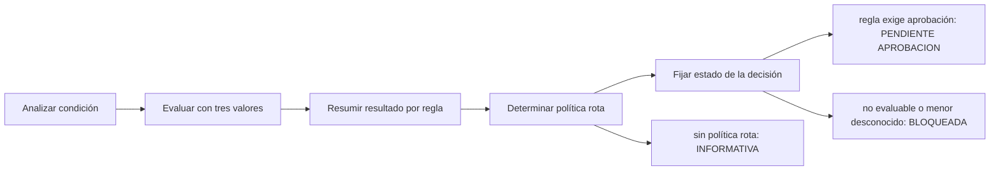

# Feature Specification: SF-01.8 — Evaluación de reglas y estado de la decisión

**Created**: 2026-10-19  
**Status**: draft  
**Flow**: [F-01 Evaluar viaje como pasajero](01-f-01-evaluar-viaje-como-pasajero.md) (subflujo)  
**Related Specs**: [F-01 Evaluar viaje como pasajero](01-f-01-evaluar-viaje-como-pasajero.md), [SF-01.7 Derivación de variables](08-sf-01-7-derivacion-de-variables.md), [SF-01.9 Lectura y filtrado de opciones](10-sf-01-9-lectura-y-filtrado-de-opciones.md)  
**Origen (DEC/H)**: DEC-02, DEC-05, DEC-09, DEC-12, DEC-13, DEC-15, DEC-23, DEC-31, DEC-32  
**Pruebas (TC)**: TC-04, TC-05, TC-07, TC-23, TC-35, TC-41, TC-45, TC-47, TC-49, TC-53  
**Contratos externos**: §2.1 (herramienta 4: gramática aceptada y errores), §2.4 (`REMEDY_RIGHTS`, `PARSER_MAX_CONDITION_CHARS`, `PARSER_MAX_DEPTH`)  

## Reglas de este documento

> Este spec es FUNCIONAL, no técnico: describe QUÉ hace el sistema, no CÓMO. Usa lenguaje de negocio; las siete herramientas externas se nombran por su función y se referencian por la sección de `sdd/reports/EXTERNAL_CONTRACTS.md`. Los casos borde se DOCUMENTAN; los valores de configuración se citan por el nombre del parámetro (NFR-012) con su valor por defecto entre paréntesis.

**Alcance**: Evalúa todas las reglas de la política con un analizador acotado y lógica de tres valores, determina si la política está rota y fija el estado de la decisión.

## User Scenarios & Testing *(mandatory)*

### User Story 1 - La decisión es consecuencia verificable de las reglas y no de la intuición (Priority: P1)

Como pasajero, quiero que mis derechos salgan de reglas explícitas y, si una regla no puede evaluarse, que una persona revise mi caso en lugar de que el sistema adivine.

**Why this priority**: Es el corazón normativo: errores aquí otorgan o niegan derechos por error.

**Independent Test**: Se prueba con los bordes de 179/180 y 239/240 minutos, con reglas no evaluables, con política sin regla de menores y con errores de expresión.

**Acceptance Scenarios**:

1. **Scenario**: Política rota y aprobación humana
   - **Given** el caso base con el niño: se cumplen la regla de conexión y la de menores
   - **When** se evalúan las reglas
   - **Then** hay política rota, y como una regla cumplida exige aprobación la decisión es PENDIENTE_APROBACION

2. **Scenario**: Sin política rota
   - **Given** un retraso que solo activa una regla de trato prioritario
   - **When** se evalúan las reglas
   - **Then** la decisión es INFORMATIVA: se informa y se muestran las reglas, sin opciones ni soporte

3. **Scenario**: Menor desconocido con política rota
   - **Given** un pasajero sin tipo y una política que rompe, sin regla de menores
   - **When** se evalúan las reglas
   - **Then** la decisión es BLOQUEADA para validación manual aunque la política no traiga esa regla

4. **Scenario**: Error de expresión
   - **Given** una condición usa un identificador fuera de la lista blanca
   - **When** se evalúan las reglas
   - **Then** toda la evaluación queda indeterminada: decisión BLOQUEADA y caso humano por datos parciales bloqueantes

5. **Scenario**: Bordes de las reglas R1 y R2 (TC-04, TC-05)
   - **Given** retrasos de 179, 180, 239 y 240 min en un vuelo internacional
   - **When** se evalúan R1 y R2
   - **Then** R1 se cumple desde 180 min y R2 desde 240 min; con 179 y 239 min no se cumplen

6. **Scenario**: Sin menor, parser y política sin remedio (TC-07, TC-41, TC-45)
   - **Given** dos pasajeros adultos con 160 min (R5 falsa), una política con EQ/NE y una condición de 201 caracteres, y un retraso de 5 min
   - **When** se evalúa la política
   - **Then** con dos adultos la decisión es AUTOMATICA; la condición de 201 caracteres es error de regla; con 5 min solo se cumple R5 (trato prioritario) y la decisión es INFORMATIVA

---

### Edge Cases

> Solo se documentan; los marcados MUST-IMPLEMENT se vuelven requisito FR-XXX y se implementan con TDD, los DEFERRED quedan para una iteración posterior.

#### System Errors
- [DEFERRED] Pruebas de propiedades del analizador con gramática ampliada: fuera de la versión 1 (FR-031)

#### Invalid Data
- [MUST-IMPLEMENT] Cuando comparar un booleano con un entero o usar orden sobre un booleano → error de regla (FR-030)
- [MUST-IMPLEMENT] Cuando la condición excede `PARSER_MAX_CONDITION_CHARS` o `PARSER_MAX_DEPTH` → error de regla (FR-030)
- [MUST-IMPLEMENT] Cuando una regla cumplida no trae el indicador de aprobación humana como verdadero/falso → se asume que exige aprobación (FR-008)
- [MUST-IMPLEMENT] Cuando un derecho es de código desconocido → se muestra por su código sin interpretarlo y no habilita acciones automáticas (FR-037)
- [MUST-IMPLEMENT] Cuando una regla es no evaluable pero no hay política rota ni derechos de remedio en ella → se ignora (FR-033)

## Requirements *(mandatory)*

### Functional Requirements

- **FR-030**: El sistema DEBE evaluar las condiciones de política con un analizador acotado de lista blanca: variables permitidas (retraso, carácter internacional, conexión perdida, compensación solicitada, grupo con menor), comparadores de igualdad, desigualdad y orden, conectores Y/O (Y precede a O), literales enteros y verdadero/falso, y paréntesis; `EQ` equivale a igualdad y `NE` a desigualdad. Comparar un booleano con un entero, o usar orden sobre un booleano, es error de regla. Las condiciones miden como máximo `PARSER_MAX_CONDITION_CHARS` (200) caracteres y `PARSER_MAX_DEPTH` (10) niveles; todo lo demás es error.
- **FR-031**: Está PROHIBIDO ejecutar código dinámico o acceder a atributos arbitrarios al evaluar una condición de política.
- **FR-032**: Un error de expresión (sintaxis o identificador fuera de la lista blanca) DEBE producir `RULE_ERROR`: toda la evaluación queda indeterminada, no se ofrecen opciones por política y se ofrece el caso humano `BLOCKING_PARTIAL_DATA`.
- **FR-033**: Un valor desconocido DEBE tratarse con lógica trivaluada (falso Y desconocido es falso; verdadero O desconocido es verdadero). Una regla de resultado desconocido se muestra «no evaluable» e impide la aceptación automática. Solo bloquea la decisión si sus derechos incluyen un derecho de remedio o si ya existe política rota; sin ambas condiciones se ignora.
- **FR-034**: Cada regla de la versión recuperada DEBE producir «cumple», «no cumple» o «indeterminada», con las variables usadas.
- **FR-035**: Si cualquier regla cumplida exige aprobación humana y existe política rota, la decisión DEBE ser PENDIENTE_APROBACION (gana la más restrictiva); sin política rota (INFORMATIVA) una regla de aprobación no cambia el estado, que lo determina la política.
- **FR-036**: El sistema DEBE fijar en el registro la versión de política y los identificadores de regla evaluados.
- **FR-037**: El conjunto de derechos concedidos DEBE ser la unión de los de las reglas cumplidas; un derecho de código desconocido se muestra por su código sin interpretarlo y no habilita ninguna acción automática.
- **FR-038**: Si en cualquier segmento existe `SOURCE_CONFLICT`, `UNSUPPORTED_EVENT_TYPE`, `INCONSISTENT_DELAY`, `MULTIPLE_AFFECTED_SEGMENTS`, `RULE_ERROR`, una regla no evaluable en los términos de FR-033 o una lectura íntegra inválida (FR-066), la decisión DEBE ser BLOQUEADA: ninguna regla cumplida habilita la creación de la solicitud de cambio y aceptar una opción solo puede abrir un caso humano.
- **FR-039**: Hay política rota si al menos una regla cumplida concede un derecho de remedio (`REMEDY_RIGHTS`; por defecto cambio sin costo, vale de comida y compensación en dinero). Un retraso sin política rota deja la decisión INFORMATIVA: se informa el retraso y se muestran las reglas evaluadas, sin consultar opciones, sin rebooking, compensación, soporte ni notificación de política, hasta que exista política rota. Los derechos que no son de remedio (trato prioritario) modifican el trato pero no rompen la política por sí solos.
- **FR-008**: Con un retraso relevante validado el sistema DEBE consultar la política de retrasos y evaluar todas sus reglas, mostrando las que se cumplen y las que no con los valores usados. Una política vacía, o una regla cumplida cuyo indicador de aprobación humana falta o no es verdadero/falso, deja la decisión BLOQUEADA y con caso humano ofrecido; un fallo de lectura del contexto o de los eventos no produce decisión; un fallo de lectura de la política o de las opciones deja la decisión BLOQUEADA con soporte ofrecido.
- **FR-024**: El grupo incluye un menor si algún pasajero es de tipo niño; es falso solo si todos son adultos; cualquier otro tipo o tipo ausente es desconocido y se trata como posible menor: con política rota pasa a validación manual aunque la política no traiga una regla de menores; sin política rota solo se informa.

### Non-Functional and Documentation Requirements

- **NFR-003**: Seguridad: el analizador de reglas DEBE operar sin ejecución dinámica, las entradas se validan estrictamente, el origen permitido se acota al front y no hay secretos en el repositorio.
- **NFR-012**: Configuración: todos los parámetros de los supuestos S-09 a S-19 DEBEN ser variables configurables (archivo de configuración con sobrescritura por entorno, validadas al arrancar y con valor por defecto documentado) y ninguno puede estar fijado en la lógica; entre ellos `RELEVANT_DELAY_MIN_MINUTES` (1), `MIN_CONNECTION_MINUTES` (0 por aeropuerto), `MCT_UNCERTAINTY_MINUTES` (45), `CLOCK_SKEW_SECONDS` (60), `EVENT_MAX_AGE_SECONDS` (sin límite), `OPERATION_STALE_SECONDS` (120), `REBOOK_MAX_RETRIES` (2), `AUDIT_RETENTION_DAYS` (30), `PARSER_MAX_CONDITION_CHARS` (200), `PARSER_MAX_DEPTH` (10), `REMEDY_RIGHTS`, `COMPENSATION_RIGHTS`, `NOTIFY_ENABLED`, `NOTIFY_COOLDOWN_SECONDS` (86400), `NOTIFY_MAX_RETRIES` (2), `OPERATION_INDETERMINATE_EXPIRY_SECONDS` (900), `EVALUATE_RATE_LIMIT_PER_MINUTE` (30), `CHANGE_RIGHTS`, `SUPPORTED_EVENT_TYPES`, `NOTIFY_ONLY_EVENT_TYPES`, `POLICY_SCENARIOS`, `REASON_PRIORITY`, la tabla de compatibilidad de afirmaciones y los secretos `SERVICE_API_KEY` e `IDEMPOTENCY_SECRET` (solo por entorno). Una prueba cambia cada parámetro y comprueba que cambia el comportamiento. También son configurables los parámetros operativos de `sdd/reports/EXTERNAL_CONTRACTS.md` §2.4 (tiempos de espera, reintentos de lectura, modo de reloj, origen permitido, ubicación del registro y banderas de desarrollo).

### Key Entities *(include if feature involves data)*

- **Política y regla**: Versión recuperada de la política de retrasos y el resultado de evaluar cada una de sus reglas. Campos principales:
  - `scenario`: texto
  - `status`: EVALUATED | RULE_ERROR | EMPTY | UNAVAILABLE
  - `version`: texto | nulo
  - `effective_from`: fecha | nulo
  - `superseded_versions`: lista de texto
  - `entitlements`: lista de códigos de derecho
  - `requires_human_approval`: booleano
  - `rules`: lista de {rule_id: texto, condition: texto, entitlement: texto, requires_human_approval: booleano, result: CUMPLE | NO_CUMPLE | INDETERMINADA, variables_used: lista de {name: texto, value: booleano | entero | nulo, known: booleano}}
- **Variable derivada**: Valor calculado a partir de los datos, con su origen y sus supuestos. Campos principales:
  - `name`: delay_minutes | new_arrival | missed_connection | international | group_includes_minor | compensation_requested | overnight_required
  - `segment_id`: texto | nulo
  - `value`: booleano | entero | texto | nulo (nulo = desconocido)
  - `known`: booleano
  - `origin`: DATO | DERIVADA
  - `estimated`: booleano
  - `assumptions`: lista de texto (p. ej. propagación íntegra del retraso, tiempo mínimo de conexión no provisto)
- **Decisión**: Resultado de evaluar la reserva: su estado y las razones que lo explican. Campos principales:
  - `decision_id`: identificador aleatorio no adivinable
  - `decision_state`: INFORMATIVA | AUTOMATICA | PENDIENTE_APROBACION | BLOQUEADA | nulo
  - `anomaly_detected`: booleano
  - `fingerprint`: texto: huella de decisión sin opción
  - `human_case_reasons`: lista ordenada de motivos de caso humano
  - `support_offered`: booleano
  - `compensation_eligible`: booleano
  - `needs_manual_review`: booleano (campo interno: se persiste y no se entrega a la sesión del pasajero, FR-093)

## Architectural Attributes *(mandatory)*

| Attribute | Value |
|-----------|-------|
| **Interaction type** | sync-http |
| **Consistency** | strong |
| **Workflow** | single-step |
| **Read pattern** | simple |
| **Auditability** | full-history |
| **Domain complexity** | medium |
| **Modularity** | bounded-context |
| **Deployment** | monolith |

## Success Criteria *(mandatory)*

### Measurable Outcomes

- **SC-001**: El 100 % de las condiciones del enunciado (incluidos los bordes de 179/180 y 239/240 minutos) se evalúa con el resultado esperado.
- **SC-002**: Ninguna condición ejecuta código dinámico: las entradas fuera de la lista blanca terminan en error de regla en el 100 % de los casos.
- **SC-003**: El 100 % de las decisiones registra la versión de política y los identificadores de regla evaluados.

## Traceability *(mandatory after implementation)*

> Las columnas de archivo y línea se registran en la verificación de trazabilidad posterior a la implementación; hoy cada criterio queda enlazado a su origen y a las pruebas que lo verifican.

| Criterion | Origen | Prueba (TC) | Source File | Line(s) |
|-----------|--------|-------------|-------------|---------|
| FR-030 | DEC-12 | TC-04, TC-05, TC-41 | se registra en la verificación posterior a la implementación | se registra en la verificación posterior a la implementación |
| FR-031 | DEC-12 | TC-04, TC-05 | se registra en la verificación posterior a la implementación | se registra en la verificación posterior a la implementación |
| FR-032 | DEC-12, DEC-15 | TC-04, TC-05 | se registra en la verificación posterior a la implementación | se registra en la verificación posterior a la implementación |
| FR-033 | DEC-12 | TC-04, TC-05, TC-47 | se registra en la verificación posterior a la implementación | se registra en la verificación posterior a la implementación |
| FR-034 | DEC-02 | TC-04, TC-05 | se registra en la verificación posterior a la implementación | se registra en la verificación posterior a la implementación |
| FR-035 | DEC-13 | TC-07 | se registra en la verificación posterior a la implementación | se registra en la verificación posterior a la implementación |
| FR-036 | DEC-23 | sin TC en el mapa §6 de REQUERIMIENTOS_V1 | se registra en la verificación posterior a la implementación | se registra en la verificación posterior a la implementación |
| FR-037 | DEC-13 | sin TC en el mapa §6 de REQUERIMIENTOS_V1 | se registra en la verificación posterior a la implementación | se registra en la verificación posterior a la implementación |
| FR-038 | DEC-09, DEC-13, DEC-31 | sin TC en el mapa §6 de REQUERIMIENTOS_V1 | se registra en la verificación posterior a la implementación | se registra en la verificación posterior a la implementación |
| FR-039 | DEC-02, DEC-05 | TC-45, TC-47 | se registra en la verificación posterior a la implementación | se registra en la verificación posterior a la implementación |
| FR-008 | DEC-02, DEC-12 | TC-35, TC-53 | se registra en la verificación posterior a la implementación | se registra en la verificación posterior a la implementación |
| FR-024 | DEC-32 | TC-23, TC-47 | se registra en la verificación posterior a la implementación | se registra en la verificación posterior a la implementación |
| NFR-003 | DEC-12 | sin TC en el mapa §6 de REQUERIMIENTOS_V1 | se registra en la verificación posterior a la implementación | se registra en la verificación posterior a la implementación |
| NFR-012 | Usuario (2026-10-19) | TC-49 | se registra en la verificación posterior a la implementación | se registra en la verificación posterior a la implementación |
| SC-001 | criterio medible de este spec | TC-04, TC-05, TC-07, TC-23, TC-35, TC-41, TC-45, TC-47, TC-49, TC-53 | se registra en la verificación posterior a la implementación | se registra en la verificación posterior a la implementación |
| SC-002 | criterio medible de este spec | TC-04, TC-05, TC-07, TC-23, TC-35, TC-41, TC-45, TC-47, TC-49, TC-53 | se registra en la verificación posterior a la implementación | se registra en la verificación posterior a la implementación |
| SC-003 | criterio medible de este spec | TC-04, TC-05, TC-07, TC-23, TC-35, TC-41, TC-45, TC-47, TC-49, TC-53 | se registra en la verificación posterior a la implementación | se registra en la verificación posterior a la implementación |

## Business Process (BPM View)

```
Analizar condición → Evaluar con tres valores → Resumir resultado por regla → Determinar política rota → Fijar estado de la decisión
```



