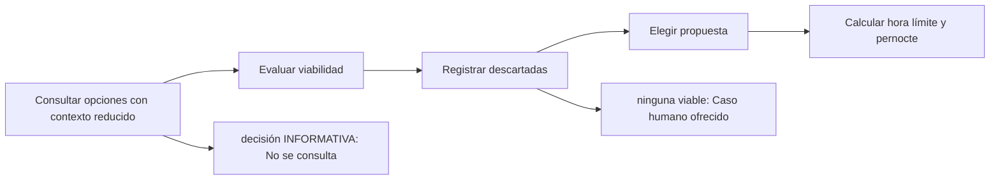

# Feature Specification: SF-01.9 — Lectura y filtrado de opciones

**Created**: 2026-10-19  
**Status**: draft  
**Flow**: [F-01 Evaluar viaje como pasajero](01-f-01-evaluar-viaje-como-pasajero.md) (subflujo)  
**Related Specs**: [F-01 Evaluar viaje como pasajero](01-f-01-evaluar-viaje-como-pasajero.md), [SF-01.8 Evaluación de reglas y estado de la decisión](09-sf-01-8-evaluacion-de-reglas-y-estado-de-la-decision.md), [SF-01.10 Motivos, soporte y acciones ofrecidas](11-sf-01-10-motivos-soporte-y-acciones-ofrecidas.md)  
**Origen (DEC/H)**: DEC-02, DEC-05, DEC-10, DEC-11, DEC-15, DEC-16, DEC-17, DEC-19, DEC-22, DEC-27, DEC-28, DEC-31  
**Pruebas (TC)**: TC-01, TC-06, TC-09, TC-10, TC-11, TC-12, TC-27, TC-28, TC-29, TC-37, TC-45, TC-60  
**Contratos externos**: §2.1 (herramienta 3: opciones elegibles, contrato efectivo reducido y viabilidad con conexión desconocida), §2.4 (`CHANGE_RIGHTS`)  

## Reglas de este documento

> Este spec es FUNCIONAL, no técnico: describe QUÉ hace el sistema, no CÓMO. Usa lenguaje de negocio; las siete herramientas externas se nombran por su función y se referencian por la sección de `sdd/reports/EXTERNAL_CONTRACTS.md`. Los casos borde se DOCUMENTAN; los valores de configuración se citan por el nombre del parámetro (NFR-012) con su valor por defecto entre paréntesis.

**Alcance**: Solo con política rota consulta las opciones elegibles con un contexto reducido sin información personal, filtra las viables, registra las descartadas con todas sus razones y elige la propuesta.

## User Scenarios & Testing *(mandatory)*

### User Story 1 - El pasajero solo ve alternativas viables y respaldadas (Priority: P1)

Como pasajero, quiero que me propongan únicamente opciones que cubran a todo mi grupo, que estén respaldadas por la política vigente y que sean coherentes con mi itinerario.

**Why this priority**: Proponer una opción inviable haría perder tiempo y confianza.

**Independent Test**: Se prueba con las tres opciones del enunciado y con variantes: asientos insuficientes, política superada, opción vencida, moneda ausente e itinerario incoherente.

**Acceptance Scenarios**:

1. **Scenario**: Opción viable propuesta
   - **Given** una opción de cambio sin costo con asientos para el grupo, referencia de política vigente y salida posterior a la nueva llegada
   - **When** se filtran las opciones
   - **Then** queda como viable y propuesta, con hora límite según su vigencia

2. **Scenario**: Opciones descartadas con todas sus razones
   - **Given** una opción con un solo asiento para dos pasajeros y diferencia de tarifa, y una opción de reembolso sin respaldo recuperado
   - **When** se filtran las opciones
   - **Then** ninguna se muestra; la de un asiento se registra con asientos insuficientes y conflicto de costo, y la de reembolso con su razón

3. **Scenario**: Sin opción viable
   - **Given** ninguna opción cubre al grupo
   - **When** se filtran las opciones
   - **Then** se muestra un mensaje claro y se ofrece el caso humano por ninguna opción cubre al grupo

4. **Scenario**: Conexión desconocida
   - **Given** la conexión perdida es desconocida y el proveedor entrega opciones con cupos y política vigente
   - **When** se filtran las opciones
   - **Then** ninguna opción es viable, todas se registran como itinerario incoherente, la decisión es BLOQUEADA y se ofrece soporte

5. **Scenario**: Pernocte
   - **Given** la salida de la opción propuesta cae en la fecha siguiente a la nueva llegada
   - **When** se arma la propuesta
   - **Then** se activa el aviso «podrías tener derecho a asistencia; un agente lo confirmará», sin cifras

6. **Scenario**: Opciones del caso base (TC-01, TC-09, TC-11)
   - **Given** O1 LA2412 con 4 asientos, O2 LA2450 con 1 asiento y 180.000 CLP, O3 reembolso con POL-REFUND-2026-01, y 2 pasajeros
   - **When** se filtran las opciones con la política POL-DELAY-2026-03
   - **Then** solo O1 es viable y se propone; O2 se descarta por asientos insuficientes y conflicto de costo, y O3 por referencia de política no verificada; con dos adultos y solo O2 no hay opción viable

7. **Scenario**: Moneda, itinerario y penalidad (TC-12, TC-28, TC-29, TC-37)
   - **Given** opciones leídas a las 11:02:35Z: una con diferencia de 180.000 CLP sin moneda, otra con destino distinto, el contexto sin monto de penalidad de cambio y O1 que sale el 16 sep a las 08:15
   - **When** se evalúan las opciones
   - **Then** la opción sin moneda y la de destino distinto no son viables; no se cotizan cambios voluntarios; O1 activa el aviso de pernocte

8. **Scenario**: Política superada (TC-10)
   - **Given** las opciones de ABC123 traen la referencia POL-DELAY-2025-11, que figura entre las versiones superadas de POL-DELAY-2026-03
   - **When** se filtran las opciones
   - **Then** ninguna opción queda respaldada: todas se descartan por referencia de política superada y la decisión ofrece soporte

9. **Scenario**: Sin vigencia declarada y vigencia de 120 s (TC-27)
   - **Given** O1 LA2412 leída a las 11:02:35Z, primero sin `ttl_seconds` y luego con vigencia de 120 s
   - **When** se evalúa sin vigencia, a 119 s y a 120 s de la lectura
   - **Then** sin vigencia el conjunto está vencido; a 119 s está vigente y a 120 s vencida

10. **Scenario**: Último segmento afectado (TC-35)
   - **Given** un retraso de 200 min solo en S2 (LA2410, el último segmento) donde R1 (desde 180 min) concede REBOOK_NO_FEE
   - **When** se evalúa y se filtran las opciones
   - **Then** no hay conexión siguiente y la política está rota por R1; las opciones reemplazan al segmento afectado: mismo origen LIM y destino MEX que LA2410 y salida posterior a la lectura de 11:02:35Z (rama «sin conexión perdida» de FR-041 f)

---

### Edge Cases

> Solo se documentan; los marcados MUST-IMPLEMENT se vuelven requisito FR-XXX y se implementan con TDD, los DEFERRED quedan para una iteración posterior.

#### Invalid Data
- [MUST-IMPLEMENT] Cuando una opción trae diferencia de tarifa positiva y no trae moneda → no es viable (FR-048)
- [MUST-IMPLEMENT] Cuando una opción es de un tipo desconocido o su confianza es desconocida → un tipo desconocido es no viable y una confianza desconocida se ordena última (FR-102)
- [MUST-IMPLEMENT] Cuando el conjunto no declara vigencia o ya venció (instante exacto incluido) → está vencido y se refresca una sola vez (FR-017)
- [MUST-IMPLEMENT] Cuando no se informa monto de penalidad de cambio → no se cotizan cambios voluntarios (FR-049)
- [MUST-IMPLEMENT] Cuando la conexión perdida es desconocida → no se puede verificar la coherencia con el itinerario: ninguna opción es viable (razón de itinerario incoherente), la decisión es BLOQUEADA y se ofrece soporte (FR-041)

#### Security & Permissions
- [MUST-IMPLEMENT] Cuando se arma la consulta de opciones → no incluye correo, teléfono, documento, nombre, edad ni nivel de fidelidad (FR-040)

## Requirements *(mandatory)*

### Functional Requirements

- **FR-009**: La consulta de opciones elegibles DEBE ocurrir solo después de evaluar la política; la cadena de lecturas es secuencial (contexto, eventos, política, opciones) y con ella se arma la vista.
- **FR-017**: El sistema DEBE usar siempre el dato más reciente y respetar la vigencia: las opciones vencen en el instante de su lectura más su vigencia en segundos (en el instante exacto ya están vencidas; sin vigencia declarada el conjunto se considera vencido). Los eventos no vencen por sí mismos (`EVENT_MAX_AGE_SECONDS`, por defecto sin límite). Al vencer se re-consulta una sola vez por acción, sin bucles.
- **FR-029**: El pernocte se deriva cuando la salida de la opción propuesta cae en una fecha local posterior a la de la nueva llegada del segmento con conexión perdida; sin conexión perdida, o con conexión desconocida, no se deriva. Activa el aviso de asistencia (FR-058) y ofrece el caso humano `OVERNIGHT_ASSISTANCE`.
- **FR-039**: Hay política rota si al menos una regla cumplida concede un derecho de remedio (`REMEDY_RIGHTS`; por defecto cambio sin costo, vale de comida y compensación en dinero). Un retraso sin política rota deja la decisión INFORMATIVA: se informa el retraso y se muestran las reglas evaluadas, sin consultar opciones, sin rebooking, compensación, soporte ni notificación de política, hasta que exista política rota. Los derechos que no son de remedio (trato prioritario) modifican el trato pero no rompen la política por sí solos.
- **FR-040**: El contenido enviado a la consulta de opciones DEBE ser un subconjunto reducido del contexto: sin correo, teléfono, documento, nombre ni nivel de fidelidad; el grupo lleva un indicador de menor y cada pasajero solo su identificador y tipo, sin edad.
- **FR-041**: Una opción es viable si (a) los asientos disponibles cubren a todo el grupo junto; (b) existe un derecho concedido que la respalda (`CHANGE_RIGHTS`, por defecto cambio sin costo, y costo cero); (c) su referencia de política coincide con una versión vigente y no superada; (d) su tipo está soportado; (e) no está vencida; (f) es coherente con el itinerario: con conexión perdida parte del origen del segmento siguiente, llega al destino final y sale después de la nueva llegada más el tiempo mínimo de conexión; sin conexión perdida reemplaza al segmento afectado (mismo origen y destino) y sale después de la lectura; con la conexión perdida desconocida no se puede verificar (f): ninguna opción es viable por itinerario incierto, la decisión es BLOQUEADA y se ofrece soporte.
- **FR-042**: Las opciones no viables NO DEBEN mostrarse; se registran con todas sus razones de descarte (por ejemplo asientos insuficientes y conflicto de costo a la vez).
- **FR-043**: Si se excluyó una opción por no cubrir al grupo o dejar al menor solo, el mensaje DEBE decirlo explícitamente y remitir a soporte.
- **FR-044**: La confianza declarada de una opción solo ordena entre las viables y nunca decide.
- **FR-045**: La propuesta principal DEBE ser la opción viable de mayor confianza, con desempate por salida más temprana y luego por identificador de opción, y se presenta como propuesta.
- **FR-046**: La vía de reembolso DEBE mencionarse con redacción no afirmativa («si prefieres no viajar, una persona puede revisar contigo las alternativas»): no afirma un derecho y por eso queda exenta de referencia de política; la condición de tarifa «no reembolsable» no se usa para negar.
- **FR-047**: Sin opción viable el sistema DEBE mostrar un mensaje claro y ofrecer el caso humano con el motivo `NO_OPTION_COVERS_GROUP` si la causa son los asientos o separar al grupo, o `NO_VIABLE_OPTION` en otro caso.
- **FR-048**: Una opción con diferencia de tarifa positiva y sin moneda NO DEBE considerarse viable.
- **FR-049**: Sin monto de penalidad de cambio, el sistema NO DEBE cotizar cambios voluntarios ni afirmar un costo.
- **FR-071**: La vista DEBE mostrar la hora límite (el mínimo de los vencimientos de las opciones mostradas) en UTC y como cuenta regresiva; pasada esa hora, «sujeto a disponibilidad».
- **FR-102**: Las enumeraciones abiertas DEBEN tolerarse: un valor nuevo degrada a caso humano.

### Non-Functional and Documentation Requirements

- **NFR-002**: Privacidad: el sistema DEBE minimizar la información personal en todas las fronteras propias; ningún dato personal se entrega a un modelo (si en el futuro se usara, se anonimiza antes).

### Key Entities *(include if feature involves data)*

- **Opción de reprogramación**: Alternativa candidata entregada por el proveedor; solo las viables se muestran. Campos principales:
  - `option_id`: texto local a la lectura
  - `itinerary_key`: texto que identifica el itinerario entre lecturas
  - `type`: REBOOK | REFUND | otro
  - `flight_number`: texto | nulo
  - `origin`: código de aeropuerto | nulo
  - `destination`: código de aeropuerto | nulo
  - `date`: fecha | nulo
  - `departure`: hora local HH:MM | nulo
  - `fare_difference`: entero sin decimales | nulo
  - `currency`: código de moneda | nulo
  - `seats_available`: entero | nulo
  - `policy_ref`: texto
  - `confidence`: enumeración abierta (HIGH | MEDIUM | LOW | otro)
  - `viable`: booleano
  - `discard_reasons`: lista de INSUFFICIENT_SEATS | FEE_CONFLICT | NO_ENTITLEMENT | POLICY_REF_UNVERIFIED | POLICY_REF_SUPERSEDED | UNSUPPORTED_TYPE | EXPIRED | MISSING_CURRENCY | ITINERARY_MISMATCH
  - `fingerprint`: texto: huella por opción
  - `is_proposed`: booleano
  - `overnight`: booleano | nulo
  - `expires_at`: marca de tiempo UTC
- **Contexto del viaje**: Reserva del pasajero con sus tramos; se reduce de inmediato a lo mínimo necesario (sin correo, teléfono, documento, nombre completo ni edad). Campos principales:
  - `booking_id`: texto de 6 caracteres alfanuméricos
  - `passenger_count`: entero ≥ 1
  - `passengers`: lista de {passenger_id: texto, type: ADULT | CHILD | otro | ausente}
  - `segments`: lista de {segment_id: texto, flight_number: texto, origin: código de aeropuerto, destination: código de aeropuerto, date: fecha, scheduled_departure: hora local HH:MM, scheduled_arrival: hora local HH:MM}
  - `fare_conditions`: {changeable: booleano, refundable: booleano, fare_family: texto, change_penalty_amount: entero | ausente}
  - `retrieved_at`: marca de tiempo UTC
  - `completeness`: enumeración abierta (p. ej. PARTIAL)
  - `missing_fields`: lista de texto
- **Decisión**: Resultado de evaluar la reserva: su estado y las razones que lo explican. Campos principales:
  - `decision_id`: identificador aleatorio no adivinable
  - `decision_state`: INFORMATIVA | AUTOMATICA | PENDIENTE_APROBACION | BLOQUEADA | nulo
  - `anomaly_detected`: booleano
  - `fingerprint`: texto: huella de decisión sin opción
  - `human_case_reasons`: lista ordenada de motivos de caso humano
  - `support_offered`: booleano
  - `compensation_eligible`: booleano
  - `needs_manual_review`: booleano (campo interno: se persiste y no se entrega a la sesión del pasajero, FR-093)

## Architectural Attributes *(mandatory)*

| Attribute | Value |
|-----------|-------|
| **Interaction type** | sync-http |
| **Consistency** | strong |
| **Workflow** | single-step |
| **Read pattern** | simple |
| **Auditability** | full-history |
| **Domain complexity** | medium |
| **Modularity** | bounded-context |
| **Deployment** | monolith |

## Success Criteria *(mandatory)*

### Measurable Outcomes

- **SC-001**: El 100 % de las opciones no viables se omite de la pantalla y se registra con todas sus razones de descarte.
- **SC-002**: La consulta de opciones no contiene ningún campo de la lista prohibida en el 100 % de los casos.
- **SC-003**: En decisión INFORMATIVA se realizan 0 consultas de opciones.
- **SC-004**: La propuesta principal es siempre la viable de mayor confianza, con desempate por salida y luego por identificador.

## Traceability *(mandatory after implementation)*

> Las columnas de archivo y línea se registran en la verificación de trazabilidad posterior a la implementación; hoy cada criterio queda enlazado a su origen y a las pruebas que lo verifican.

| Criterion | Origen | Prueba (TC) | Source File | Line(s) |
|-----------|--------|-------------|-------------|---------|
| FR-009 | DEC-02 | TC-01 | se registra en la verificación posterior a la implementación | se registra en la verificación posterior a la implementación |
| FR-017 | DEC-10 | TC-01, TC-27 | se registra en la verificación posterior a la implementación | se registra en la verificación posterior a la implementación |
| FR-029 | DEC-15, DEC-27 | TC-01, TC-28 | se registra en la verificación posterior a la implementación | se registra en la verificación posterior a la implementación |
| FR-039 | DEC-02, DEC-05 | TC-01, TC-45 | se registra en la verificación posterior a la implementación | se registra en la verificación posterior a la implementación |
| FR-040 | DEC-22 | TC-01 | se registra en la verificación posterior a la implementación | se registra en la verificación posterior a la implementación |
| FR-041 | DEC-16, DEC-17 | TC-01, TC-09, TC-10, TC-11, TC-37, TC-60 | se registra en la verificación posterior a la implementación | se registra en la verificación posterior a la implementación |
| FR-042 | DEC-17 | TC-01 | se registra en la verificación posterior a la implementación | se registra en la verificación posterior a la implementación |
| FR-043 | DEC-16 | TC-01 | se registra en la verificación posterior a la implementación | se registra en la verificación posterior a la implementación |
| FR-044 | DEC-17 | TC-01 | se registra en la verificación posterior a la implementación | se registra en la verificación posterior a la implementación |
| FR-045 | DEC-17 | TC-01 | se registra en la verificación posterior a la implementación | se registra en la verificación posterior a la implementación |
| FR-046 | DEC-17, DEC-28 | TC-01, TC-11 | se registra en la verificación posterior a la implementación | se registra en la verificación posterior a la implementación |
| FR-047 | DEC-15 | TC-01, TC-09 | se registra en la verificación posterior a la implementación | se registra en la verificación posterior a la implementación |
| FR-048 | DEC-17 | TC-01, TC-29 | se registra en la verificación posterior a la implementación | se registra en la verificación posterior a la implementación |
| FR-049 | DEC-11 | TC-01, TC-12 | se registra en la verificación posterior a la implementación | se registra en la verificación posterior a la implementación |
| FR-071 | DEC-19 | sin TC en el mapa §6 de REQUERIMIENTOS_V1 | se registra en la verificación posterior a la implementación | se registra en la verificación posterior a la implementación |
| FR-102 | DEC-31 | sin TC en el mapa §6 de REQUERIMIENTOS_V1 | se registra en la verificación posterior a la implementación | se registra en la verificación posterior a la implementación |
| NFR-002 | DEC-22 | sin TC en el mapa §6 de REQUERIMIENTOS_V1 | se registra en la verificación posterior a la implementación | se registra en la verificación posterior a la implementación |
| SC-001 | criterio medible de este spec | TC-01, TC-06, TC-09, TC-10, TC-11, TC-12, TC-27, TC-28, TC-29, TC-37, TC-45, TC-60 | se registra en la verificación posterior a la implementación | se registra en la verificación posterior a la implementación |
| SC-002 | criterio medible de este spec | TC-01, TC-06, TC-09, TC-10, TC-11, TC-12, TC-27, TC-28, TC-29, TC-37, TC-45, TC-60 | se registra en la verificación posterior a la implementación | se registra en la verificación posterior a la implementación |
| SC-003 | criterio medible de este spec | TC-01, TC-06, TC-09, TC-10, TC-11, TC-12, TC-27, TC-28, TC-29, TC-37, TC-45, TC-60 | se registra en la verificación posterior a la implementación | se registra en la verificación posterior a la implementación |
| SC-004 | criterio medible de este spec | TC-01, TC-06, TC-09, TC-10, TC-11, TC-12, TC-27, TC-28, TC-29, TC-37, TC-45, TC-60 | se registra en la verificación posterior a la implementación | se registra en la verificación posterior a la implementación |

## Business Process (BPM View)

```
Consultar opciones con contexto reducido → Evaluar viabilidad → Registrar descartadas → Elegir propuesta → Calcular hora límite y pernocte
```



