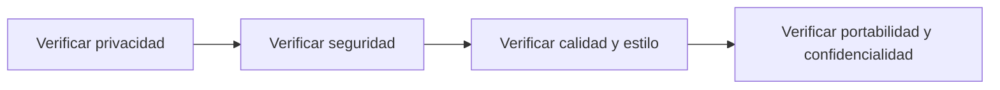

# Feature Specification: X-01 — Requisitos transversales de calidad, privacidad y operación

**Created**: 2026-10-19  
**Status**: draft  
**Flow**: X-01 Requisitos transversales de calidad, privacidad y operación  
**Related Specs**: [F-12 Carga y validación de la configuración](71-f-12-carga-y-validacion-de-la-configuracion.md)  
**Origen (DEC/H)**: DEC-03, DEC-04, DEC-12, DEC-21, DEC-22, DEC-23, DEC-24, DEC-37, H-10, H-12  
**Pruebas (TC)**: TC-01, TC-21, TC-49, TC-50, TC-58  
**Contratos externos**: §2.4 (configuración), §2.3 (registros); FLOW_INVENTORY §4.2 (requisitos transversales)  

## Reglas de este documento

> Este spec es FUNCIONAL, no técnico: describe QUÉ hace el sistema, no CÓMO. Usa lenguaje de negocio; las siete herramientas externas se nombran por su función y se referencian por la sección de `sdd/reports/EXTERNAL_CONTRACTS.md`. Los casos borde se DOCUMENTAN; los valores de configuración se citan por el nombre del parámetro (NFR-012) con su valor por defecto entre paréntesis.

**Alcance**: Reúne los requisitos no funcionales que no pertenecen a un solo flujo (privacidad, seguridad, operabilidad, calidad, estilo de desarrollo, portabilidad y confidencialidad) y declara dónde se materializan y cómo se verifican.

## User Scenarios & Testing *(mandatory)*

### User Story 1 - El producto es privado, seguro, operable y verificable en todos sus flujos (Priority: P1)

Como responsable del proyecto, quiero que las propiedades transversales estén escritas y se verifiquen con pruebas, para que ningún flujo las degrade.

**Why this priority**: Las propiedades transversales se rompen por omisión, no por un error en un flujo concreto.

**Independent Test**: Se prueba con las pruebas de privacidad, de seguridad, de calidad del código y la revisión de los entregables de configuración.

**Acceptance Scenarios**:

1. **Scenario**: Privacidad
   - **Given** los escenarios con datos ficticios
   - **When** se recorren registros, respuestas y pantallas
   - **Then** ningún dato personal aparece fuera de la excepción del nombre de pila

2. **Scenario**: Estilo de desarrollo
   - **Given** el código del servicio
   - **When** se mide
   - **Then** ninguna función excede 10 líneas ni 3 parámetros y el dominio no depende de la tecnología

3. **Scenario**: Calidad
   - **Given** el conjunto de pruebas
   - **When** se ejecuta
   - **Then** los casos TC-01 a TC-56 están automatizados y la cobertura de líneas del dominio es de al menos 85 %

4. **Scenario**: Seguridad de entradas
   - **Given** las consultas, la interfaz y la evaluación
   - **When** se revisan
   - **Then** toda consulta es parametrizada con las consultas en archivos propios, los textos del proveedor se ven como texto plano y la evaluación aplica un límite de tasa

5. **Scenario**: Portabilidad
   - **Given** una instalación limpia
   - **When** se siguen las instrucciones
   - **Then** el sistema corre sin contenedores

6. **Scenario**: Datos ficticios y credencial de servicio (TC-50)
   - **Given** los escenarios de ABC123 con Ana Prueba, su correo ficticio y la clave de servicio válida
   - **When** se buscan en registros, en la respuesta del modo sistema y en la pantalla
   - **Then** ningún dato de Ana Prueba aparece fuera de «Hola, Ana» y la respuesta del sistema no trae datos personales ni acepta una clave incorrecta

7. **Scenario**: Límite de tasa, texto plano y consultas parametrizadas (TC-58)
   - **Given** ABC123 con `EVALUATE_RATE_LIMIT_PER_MINUTE` de 30, una condición de regla con marcado HTML y un identificador de reserva con comillas
   - **When** llega el 31.º `evaluate` del minuto y se muestran los textos del proveedor
   - **Then** el 31.º se rechaza por límite de tasa (igual en aceptar, caso humano y consulta de decisión, por reserva y por origen); el marcado HTML se ve como texto plano y la consulta con comillas no altera el registro

8. **Scenario**: Slice prioritario (TC-01)
   - **Given** el caso base ABC123 (TC-01), TC-01 a TC-20 y el modo sistema (TC-42, TC-43, TC-44, TC-50)
   - **When** se planifica la implementación en 3 horas
   - **Then** se implementan primero esos escenarios con funciones de a lo sumo 10 líneas; los demás TC quedan automatizados solo si alcanza el tiempo

---

### Edge Cases

> Solo se documentan; los marcados MUST-IMPLEMENT se vuelven requisito FR-XXX y se implementan con TDD, los DEFERRED quedan para una iteración posterior.

#### System Errors
- [MUST-IMPLEMENT] Cuando falta un secreto obligatorio → el servicio no arranca (NFR-003)

#### Invalid Data
- [DEFERRED] Riesgo de alcance de NFR-007 (funciones de hasta 10 líneas y 3 parámetros) frente al plazo del reto: se mitiga con las consultas en archivos propios y con objetos de valor (NFR-007)
- [DEFERRED] Riesgo de proporcionalidad: 104 specs y unos 400 escenarios frente a un plazo de 3 horas del reto (REQ-P-01). Slice de implementación prioritario: el caso base (TC-01), TC-01 a TC-20 y el modo sistema (TC-42 a TC-44, TC-50 a TC-52 y TC-55); el resto se implementa solo si alcanza el tiempo (NFR-006)

#### Security & Permissions
- [MUST-IMPLEMENT] Cuando se busca un dato ficticio en registros, base, respuestas y pantalla → no se encuentra (NFR-002)
- [MUST-IMPLEMENT] Cuando se construye una consulta a la base → es parametrizada y no se compone con texto de entrada (NFR-013)
- [MUST-IMPLEMENT] Cuando la evaluación supera `EVALUATE_RATE_LIMIT_PER_MINUTE` por reserva y credencial → rechazo por límite de tasa (NFR-013)
- [MUST-IMPLEMENT] Cuando un texto del proveedor trae marcado HTML → la interfaz lo muestra como texto plano (NFR-013)

## Requirements *(mandatory)*

### Functional Requirements

- **FR-001**: El sistema DEBE operar sobre la sesión autenticada del pasajero y comprobar que la reserva y la decisión solicitadas pertenezcan a esa sesión; una reserva ajena y una inexistente DEBEN producir exactamente la misma respuesta de «no encontrado», sin confirmar la existencia de ninguna. La sesión simulada solo existe con el parámetro `DEV_SESSION_HEADER_ENABLED` (apagado por defecto): en cualquier otro perfil toda petición del pasajero sin sesión DEBE rechazarse por falta de autenticación, y toda petición del sistema DEBE exigir la credencial de servicio (FR-120). Los errores NO DEBEN mostrar trazas ni repetir la entrada, nunca se pide ni se muestra documento de identidad, y el identificador de decisión DEBE ser aleatorio y no adivinable.
- **FR-031**: Está PROHIBIDO ejecutar código dinámico o acceder a atributos arbitrarios al evaluar una condición de política.
- **FR-091**: Solo se persisten campos de una lista cerrada: hechos operacionales no personales, identificadores seudónimos, enumeraciones, números, marcas de tiempo y huellas. NUNCA se guardan cargas completas, nombre, contacto, documento ni edad del menor; los identificadores son seudónimos, no anónimos, y la reserva se trunca en los registros de aplicación.
- **FR-112**: La interfaz NO DEBE mostrar información personal salvo la excepción de FR-003 ni identificadores internos innecesarios; la lista de campos visibles es cerrada.

### Non-Functional and Documentation Requirements

- **NFR-002**: Privacidad: el sistema DEBE minimizar la información personal en todas las fronteras propias; ningún dato personal se entrega a un modelo (si en el futuro se usara, se anonimiza antes).
- **NFR-003**: Seguridad: el analizador de reglas DEBE operar sin ejecución dinámica, las entradas se validan estrictamente, el origen permitido se acota al front y no hay secretos en el repositorio.
- **NFR-005**: Operabilidad: el sistema DEBE configurarse por variables de entorno, emitir registros estructurados sin información personal y contar con un runbook de una página; debe poder operarlo un equipo pequeño.
- **NFR-006**: Calidad: los casos de prueba TC-01 a TC-20 y los añadidos desde TC-21 DEBEN automatizarse, el caso base como prueba de extremo a extremo y la cobertura de líneas del dominio ser de al menos 85 %.
- **NFR-007**: Estilo SDD: el desarrollo DEBE seguir TDD con revisión WTF, funciones de a lo sumo 10 líneas y 3 parámetros (verificado por una prueba que mide el código) y lógica de negocio independiente de la tecnología mediante puertos y adaptadores.
- **NFR-009**: Portabilidad: el sistema DEBE ejecutarse sin contenedores (entorno virtual y gestor de paquetes del front); la composición de contenedores es opcional.
- **NFR-010**: Confidencialidad: el repositorio NO DEBE incluir el enunciado original ni publicarse sin autorización expresa del usuario; los datos de prueba usan información personal ficticia y todo envío a un servicio externo se anota en la bitácora de IA.
- **NFR-012**: Configuración: todos los parámetros de los supuestos S-09 a S-19 DEBEN ser variables configurables (archivo de configuración con sobrescritura por entorno, validadas al arrancar y con valor por defecto documentado) y ninguno puede estar fijado en la lógica; entre ellos `RELEVANT_DELAY_MIN_MINUTES` (1), `MIN_CONNECTION_MINUTES` (0 por aeropuerto), `MCT_UNCERTAINTY_MINUTES` (45), `CLOCK_SKEW_SECONDS` (60), `EVENT_MAX_AGE_SECONDS` (sin límite), `OPERATION_STALE_SECONDS` (120), `REBOOK_MAX_RETRIES` (2), `AUDIT_RETENTION_DAYS` (30), `PARSER_MAX_CONDITION_CHARS` (200), `PARSER_MAX_DEPTH` (10), `REMEDY_RIGHTS`, `COMPENSATION_RIGHTS`, `NOTIFY_ENABLED`, `NOTIFY_COOLDOWN_SECONDS` (86400), `NOTIFY_MAX_RETRIES` (2), `OPERATION_INDETERMINATE_EXPIRY_SECONDS` (900), `EVALUATE_RATE_LIMIT_PER_MINUTE` (30), `CHANGE_RIGHTS`, `SUPPORTED_EVENT_TYPES`, `NOTIFY_ONLY_EVENT_TYPES`, `POLICY_SCENARIOS`, `REASON_PRIORITY`, la tabla de compatibilidad de afirmaciones y los secretos `SERVICE_API_KEY` e `IDEMPOTENCY_SECRET` (solo por entorno). Una prueba cambia cada parámetro y comprueba que cambia el comportamiento. También son configurables los parámetros operativos de `sdd/reports/EXTERNAL_CONTRACTS.md` §2.4 (tiempos de espera, reintentos de lectura, modo de reloj, origen permitido, ubicación del registro y banderas de desarrollo).
- **NFR-013**: Seguridad de entradas: todo acceso al registro persistente DEBE usar consultas parametrizadas (las consultas viven en archivos propios); la interfaz DEBE mostrar los textos del proveedor (condición, derecho, puerta, mensajes) como texto plano, sin insertar marcado HTML; y la evaluación, la aceptación de una opción, el caso humano y la consulta de una decisión DEBEN tener un límite de tasa por reserva y por origen (`EVALUATE_RATE_LIMIT_PER_MINUTE`, 30 por minuto), con los intentos fallidos de credencial de servicio también limitados por origen.

### Key Entities *(include if feature involves data)*

- **Configuración**: Conjunto central de parámetros con valor por defecto, sobrescritura por entorno y validación al arrancar. Campos principales:
  - `name`: nombre del parámetro (p. ej. `RELEVANT_DELAY_MIN_MINUTES`)
  - `default`: valor por defecto documentado
  - `effective_value`: valor tras aplicar el entorno
  - `validation`: tipo, rango, lista no vacía o longitud mínima
  - `is_secret`: booleano (solo por entorno, nunca se muestra)
  - `effect`: comportamiento que cambia
- **Registro de decisión**: Instantánea de auditoría de una evaluación, sin información personal. Campos principales:
  - `decision_id`: identificador
  - `booking_id`: texto seudónimo
  - `created_at`: marca de tiempo UTC
  - `caller`: user | system
  - `fingerprint`: texto
  - `decision_state`: estado | nulo
  - `needs_manual_review`: booleano (campo interno, no se entrega a la sesión del pasajero)
  - `policy_version`: texto | nulo
  - `mct_provided`: booleano
  - `passenger_count`: entero
  - `segments`: lista de {segment_id: texto, state: texto | nulo, delay_minutes: entero | nulo}
  - `message_hash`: texto
  - `messages_blocked`: entero
  - `reads`: lista de {tool: texto, retrieved_at: marca de tiempo | nulo, outcome: OK | FAILED | INVALID | NOT_REQUESTED}
  - `events`: lista de {event_id, segment_id, event_type, disposition: CHOSEN | DISCARDED | NOT_INTERPRETED, reason}
  - `rules`: lista de {rule_id, result, requires_human_approval}
  - `options`: lista de opciones con sus razones de descarte (también las no viables)
  - `notifications`: lista de {reason, kind, status, notification_id} (solo modo sistema; campo interno, no se entrega a la sesión del pasajero)
  - `outcomes`: lista de {kind: REBOOKING | HUMAN_CASE, reference_id: texto | nulo, state: texto, at: marca de tiempo}

## Architectural Attributes *(mandatory)*

| Attribute | Value |
|-----------|-------|
| **Interaction type** | sync-http |
| **Consistency** | strong |
| **Workflow** | multi-step |
| **Read pattern** | simple |
| **Auditability** | full-history |
| **Domain complexity** | high |
| **Modularity** | bounded-context |
| **Deployment** | monolith |

## Success Criteria *(mandatory)*

### Measurable Outcomes

- **SC-001**: El 100 % de las pruebas TC-01 a TC-56 está automatizado.
- **SC-002**: La cobertura de líneas del dominio es de al menos 85 %.
- **SC-003**: El 100 % de las funciones cumple los límites de 10 líneas y 3 parámetros.
- **SC-004**: El repositorio no contiene el enunciado original ni secretos.

## Traceability *(mandatory after implementation)*

> Las columnas de archivo y línea se registran en la verificación de trazabilidad posterior a la implementación; hoy cada criterio queda enlazado a su origen y a las pruebas que lo verifican.

| Criterion | Origen | Prueba (TC) | Source File | Line(s) |
|-----------|--------|-------------|-------------|---------|
| FR-001 | DEC-21 | TC-21 | se registra en la verificación posterior a la implementación | se registra en la verificación posterior a la implementación |
| FR-031 | DEC-12 | TC-01 | se registra en la verificación posterior a la implementación | se registra en la verificación posterior a la implementación |
| FR-091 | DEC-23 | sin TC en el mapa §6 de REQUERIMIENTOS_V1 | se registra en la verificación posterior a la implementación | se registra en la verificación posterior a la implementación |
| FR-112 | DEC-21 | sin TC en el mapa §6 de REQUERIMIENTOS_V1 | se registra en la verificación posterior a la implementación | se registra en la verificación posterior a la implementación |
| NFR-002 | DEC-22 | sin TC en el mapa §6 de REQUERIMIENTOS_V1 | se registra en la verificación posterior a la implementación | se registra en la verificación posterior a la implementación |
| NFR-003 | DEC-12 | sin TC en el mapa §6 de REQUERIMIENTOS_V1 | se registra en la verificación posterior a la implementación | se registra en la verificación posterior a la implementación |
| NFR-005 | DEC-24 | sin TC en el mapa §6 de REQUERIMIENTOS_V1 | se registra en la verificación posterior a la implementación | se registra en la verificación posterior a la implementación |
| NFR-006 | DEC-04, DEC-24 | sin TC en el mapa §6 de REQUERIMIENTOS_V1 | se registra en la verificación posterior a la implementación | se registra en la verificación posterior a la implementación |
| NFR-007 | DEC-03 | sin TC en el mapa §6 de REQUERIMIENTOS_V1 | se registra en la verificación posterior a la implementación | se registra en la verificación posterior a la implementación |
| NFR-009 | DEC-03 | sin TC en el mapa §6 de REQUERIMIENTOS_V1 | se registra en la verificación posterior a la implementación | se registra en la verificación posterior a la implementación |
| NFR-010 | DEC-37 | sin TC en el mapa §6 de REQUERIMIENTOS_V1 | se registra en la verificación posterior a la implementación | se registra en la verificación posterior a la implementación |
| NFR-012 | Usuario (2026-10-19) | TC-49 | se registra en la verificación posterior a la implementación | se registra en la verificación posterior a la implementación |
| NFR-013 | Usuario (2026-10-19) | TC-58 | se registra en la verificación posterior a la implementación | se registra en la verificación posterior a la implementación |
| SC-001 | criterio medible de este spec | TC-01, TC-21, TC-49, TC-50, TC-58 | se registra en la verificación posterior a la implementación | se registra en la verificación posterior a la implementación |
| SC-002 | criterio medible de este spec | TC-01, TC-21, TC-49, TC-50, TC-58 | se registra en la verificación posterior a la implementación | se registra en la verificación posterior a la implementación |
| SC-003 | criterio medible de este spec | TC-01, TC-21, TC-49, TC-50, TC-58 | se registra en la verificación posterior a la implementación | se registra en la verificación posterior a la implementación |
| SC-004 | criterio medible de este spec | TC-01, TC-21, TC-49, TC-50, TC-58 | se registra en la verificación posterior a la implementación | se registra en la verificación posterior a la implementación |

## Business Process (BPM View)

```
Verificar privacidad → Verificar seguridad → Verificar calidad y estilo → Verificar portabilidad y confidencialidad
```



