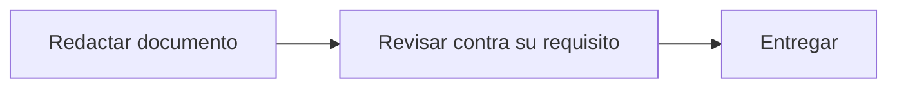

# Feature Specification: X-02 — Entregables de documentación

**Created**: 2026-10-19  
**Status**: draft  
**Flow**: X-02 Entregables de documentación  
**Related Specs**: [X-01 Requisitos transversales de calidad, privacidad y operación](103-x-01-requisitos-transversales-de-calidad-privacidad-y.md)  
**Origen (DEC/H)**: DEC-01, DEC-02, DEC-03, DEC-04, DEC-05, DEC-07, DEC-18, DEC-19, DEC-22, DEC-24, DEC-25, DEC-26, DEC-28, DEC-30, DEC-34, DEC-35, DEC-37, H-05, H-07, H-08, H-12, H-15, H-21  
**Pruebas (TC)**: TC-01  
**Contratos externos**: FLOW_INVENTORY §4.2 (ubicaciones propuestas de los documentos)  

## Reglas de este documento

> Este spec es FUNCIONAL, no técnico: describe QUÉ hace el sistema, no CÓMO. Usa lenguaje de negocio; las siete herramientas externas se nombran por su función y se referencian por la sección de `sdd/reports/EXTERNAL_CONTRACTS.md`. Los casos borde se DOCUMENTAN; los valores de configuración se citan por el nombre del parámetro (NFR-012) con su valor por defecto entre paréntesis.

**Alcance**: Reúne los entregables de documentación del proyecto (README, nota de IA, diseño técnico, decisiones, bitácora, guion, notas obligatorias, información a solicitar, runbook, preguntas a Producto y Legal, diseño de la aprobación humana y extensiones de contrato) y su contenido mínimo.

## User Scenarios & Testing *(mandatory)*

### User Story 1 - El equipo y los evaluadores pueden entender, ejecutar y defender el proyecto (Priority: P1)

Como evaluador, quiero encontrar en el repositorio la explicación del problema, las decisiones, los riesgos y cómo ejecutar y probar la solución.

**Why this priority**: La documentación es parte de la evaluación y deja constancia de los supuestos y los riesgos declarados.

**Independent Test**: Se prueba revisando que cada documento exista, cumpla su extensión máxima y contenga lo exigido.

**Acceptance Scenarios**:

1. **Scenario**: README raíz
   - **Given** el repositorio entregado
   - **When** se abre el README
   - **Then** dice el track elegido y por qué, cómo ejecutar, el alcance, las pruebas y las limitaciones

2. **Scenario**: README de ingeniería
   - **Given** el documento de ingeniería
   - **When** se revisa
   - **Then** ocupa dos páginas como máximo y clasifica cada paso como determinístico, asistido por IA, agéntico o humano con su razón, riesgo y control

3. **Scenario**: Notas y preguntas
   - **Given** los documentos de notas
   - **When** se revisan
   - **Then** incluyen las seis notas obligatorias, la lista de información a solicitar (tiempo mínimo de conexión, campo de causa, semántica de «pendiente de confirmación», definición de menor) y las preguntas para Producto y Legal

4. **Scenario**: Extensiones de contrato
   - **Given** los contratos propuestos
   - **When** se revisan
   - **Then** documentan la reserva y los pasajeros en la solicitud de cambio, el aviso informativo sin referencia de política y el contrato reducido de opciones

5. **Scenario**: Documentos DOC-001 a DOC-013
   - **Given** 13 entregables y el README de ingeniería de 2 páginas
   - **When** se revisan
   - **Then** los 13 existen y el README no excede 2 páginas

---

### Edge Cases

> Solo se documentan; los marcados MUST-IMPLEMENT se vuelven requisito FR-XXX y se implementan con TDD, los DEFERRED quedan para una iteración posterior.

#### Invalid Data
- [MUST-IMPLEMENT] Cuando un envío a un servicio externo ocurre (incluida la revisión externa) → se anota en la bitácora de IA (NFR-010)
- [MUST-IMPLEMENT] Cuando el README de ingeniería excede dos páginas → se recorta (DOC-002)
- [DEFERRED] El flujo operativo de aprobación humana queda solo documentado (DOC-012): no existe en la versión 1 (DOC-012)

## Requirements *(mandatory)*

### Functional Requirements

- **FR-100**: El sistema DEBE definir interfaces para las siete herramientas externas con los contratos del enunciado y simulaciones intercambiables por un adaptador real cuando exista su documentación.
- **FR-101**: La fuente de verdad es el universo del enunciado: los escenarios de prueba reproducen los siete ejemplos (con datos personales claramente ficticios) y las variantes de prueba; los tipos de evento son retraso, cambio de puerta y estado; un test verifica que los datos ficticios no aparecen en registros ni en el historial.

### Non-Functional and Documentation Requirements

- **DOC-001**: Entregable 1: README raíz con el track elegido y por qué, instrucciones de ejecución, alcance implementado, pruebas disponibles y limitaciones.
- **DOC-002**: Entregable 2: README de ingeniería (máximo 2 páginas) con problema, supuestos y alcance, decisiones y alternativas descartadas, clasificación de pasos (determinístico, asistido por IA, agéntico, humano) con razón, riesgo y control, riesgos y próximos pasos, y cómo se validó.
- **DOC-003**: Entregable 3: nota de uso de IA (máximo 1 página).
- **DOC-004**: El diseño técnico (RFC técnico generado por el flujo de trabajo SDD) DEBE entregarse en Markdown como base de la presentación.
- **DOC-005**: Las decisiones tomadas DEBEN quedar explícitas en un documento Markdown dentro del repositorio.
- **DOC-006**: DEBE existir una bitácora paso a paso de las interacciones con la IA, incluidas las revisiones externas.
- **DOC-007**: DEBE existir un guion de presentación de 10 minutos derivado del diseño técnico.
- **DOC-008**: Notas obligatorias: (1) las políticas publicadas no pueden entrar en conflicto con las políticas del sistema y en el desafío valen las de la consulta de política; (2) sería útil un campo de causa; (3) cancelación y adelanto quedan para una segunda etapa; (4) la definición de «menor» debe fijarse por país; (5) idioma neutro sin localización en la versión 1; (6) visión futura más proactiva con notificaciones por evento operacional.
- **DOC-009**: Información a solicitar: lista completa de tipos de evento y documentación de cada servicio; tiempo mínimo de conexión por aeropuerto; campo de causa; semántica de «pendiente de confirmación»; definición de «menor».
- **DOC-010**: DEBE existir un runbook de una página.
- **DOC-011**: Preguntas para Producto y Legal, sin cotejo de umbrales externos: jurisdicción por segmento y campo previsto de jurisdicción; tratamiento de México; reembolso, tarifas no reembolsables y plazos; brechas GAP-01 a GAP-10 convertidas en preguntas; causa del evento.
- **DOC-012**: DEBE documentarse el diseño de la aprobación humana: al aprobar un agente se revalida de nuevo y la aprobación autoriza una decisión, no una ejecución con datos viejos.
- **DOC-013**: DEBEN documentarse las extensiones de contrato propuestas al equipo: reserva y pasajeros en la solicitud de cambio, destinatario y tipo de aviso (informativo sin referencia de política) en la notificación, y contrato reducido en las opciones.
- **NFR-010**: Confidencialidad: el repositorio NO DEBE incluir el enunciado original ni publicarse sin autorización expresa del usuario; los datos de prueba usan información personal ficticia y todo envío a un servicio externo se anota en la bitácora de IA.

### Key Entities *(include if feature involves data)*

- **Entregable de documentación**: Documento que acompaña al producto. Campos principales:
  - `doc_id`: DOC-001 … DOC-013
  - `title`: texto
  - `audience`: texto
  - `max_length`: entero de páginas | sin límite
  - `status`: pendiente | entregado

## Architectural Attributes *(mandatory)*

| Attribute | Value |
|-----------|-------|
| **Interaction type** | batch |
| **Consistency** | strong |
| **Workflow** | single-step |
| **Read pattern** | simple |
| **Auditability** | basic |
| **Domain complexity** | low |
| **Modularity** | bounded-context |
| **Deployment** | monolith |

## Success Criteria *(mandatory)*

### Measurable Outcomes

- **SC-001**: Los 13 entregables DOC-001 a DOC-013 existen y cumplen su extensión máxima.
- **SC-002**: El 100 % de los supuestos provisionales y riesgos declarados (H-xx) figura en la documentación de decisiones.

## Traceability *(mandatory after implementation)*

> Las columnas de archivo y línea se registran en la verificación de trazabilidad posterior a la implementación; hoy cada criterio queda enlazado a su origen y a las pruebas que lo verifican.

| Criterion | Origen | Prueba (TC) | Source File | Line(s) |
|-----------|--------|-------------|-------------|---------|
| FR-100 | DEC-04 | sin TC en el mapa §6 de REQUERIMIENTOS_V1 | se registra en la verificación posterior a la implementación | se registra en la verificación posterior a la implementación |
| FR-101 | DEC-04 | sin TC en el mapa §6 de REQUERIMIENTOS_V1 | se registra en la verificación posterior a la implementación | se registra en la verificación posterior a la implementación |
| DOC-001 | DEC-01, DEC-04 | sin TC en el mapa §6 de REQUERIMIENTOS_V1 | se registra en la verificación posterior a la implementación | se registra en la verificación posterior a la implementación |
| DOC-002 | DEC-02 | sin TC en el mapa §6 de REQUERIMIENTOS_V1 | se registra en la verificación posterior a la implementación | se registra en la verificación posterior a la implementación |
| DOC-003 | DEC-22, DEC-37 | sin TC en el mapa §6 de REQUERIMIENTOS_V1 | se registra en la verificación posterior a la implementación | se registra en la verificación posterior a la implementación |
| DOC-004 | DEC-03 | sin TC en el mapa §6 de REQUERIMIENTOS_V1 | se registra en la verificación posterior a la implementación | se registra en la verificación posterior a la implementación |
| DOC-005 | DEC-37 | sin TC en el mapa §6 de REQUERIMIENTOS_V1 | se registra en la verificación posterior a la implementación | se registra en la verificación posterior a la implementación |
| DOC-006 | DEC-37 | sin TC en el mapa §6 de REQUERIMIENTOS_V1 | se registra en la verificación posterior a la implementación | se registra en la verificación posterior a la implementación |
| DOC-007 | DEC-03 | sin TC en el mapa §6 de REQUERIMIENTOS_V1 | se registra en la verificación posterior a la implementación | se registra en la verificación posterior a la implementación |
| DOC-008 | DEC-05 | sin TC en el mapa §6 de REQUERIMIENTOS_V1 | se registra en la verificación posterior a la implementación | se registra en la verificación posterior a la implementación |
| DOC-009 | DEC-04, DEC-07 | sin TC en el mapa §6 de REQUERIMIENTOS_V1 | se registra en la verificación posterior a la implementación | se registra en la verificación posterior a la implementación |
| DOC-010 | DEC-24 | sin TC en el mapa §6 de REQUERIMIENTOS_V1 | se registra en la verificación posterior a la implementación | se registra en la verificación posterior a la implementación |
| DOC-011 | DEC-25, DEC-26, DEC-28, DEC-30, DEC-34, DEC-35 | sin TC en el mapa §6 de REQUERIMIENTOS_V1 | se registra en la verificación posterior a la implementación | se registra en la verificación posterior a la implementación |
| DOC-012 | DEC-19 | sin TC en el mapa §6 de REQUERIMIENTOS_V1 | se registra en la verificación posterior a la implementación | se registra en la verificación posterior a la implementación |
| DOC-013 | DEC-18 | sin TC en el mapa §6 de REQUERIMIENTOS_V1 | se registra en la verificación posterior a la implementación | se registra en la verificación posterior a la implementación |
| NFR-010 | DEC-37 | sin TC en el mapa §6 de REQUERIMIENTOS_V1 | se registra en la verificación posterior a la implementación | se registra en la verificación posterior a la implementación |
| SC-001 | criterio medible de este spec | TC-01 | se registra en la verificación posterior a la implementación | se registra en la verificación posterior a la implementación |
| SC-002 | criterio medible de este spec | TC-01 | se registra en la verificación posterior a la implementación | se registra en la verificación posterior a la implementación |

## Business Process (BPM View)

```
Redactar documento → Revisar contra su requisito → Entregar
```



