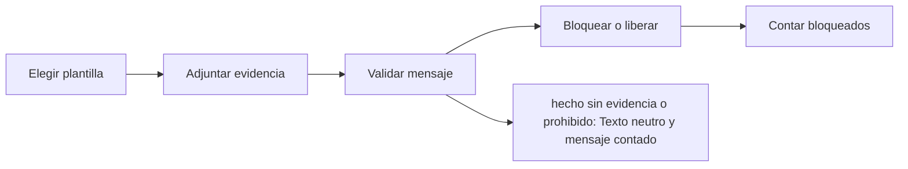

# Feature Specification: SF-01.11 — Construcción y validación de mensajes

**Created**: 2026-10-19  
**Status**: draft  
**Flow**: [F-01 Evaluar viaje como pasajero](01-f-01-evaluar-viaje-como-pasajero.md) (subflujo)  
**Related Specs**: [F-01 Evaluar viaje como pasajero](01-f-01-evaluar-viaje-como-pasajero.md), [SF-01.10 Motivos, soporte y acciones ofrecidas](11-sf-01-10-motivos-soporte-y-acciones-ofrecidas.md), [SF-01.12 Barrido perezoso del ciclo de vida](13-sf-01-12-barrido-perezoso-del-ciclo-de-vida.md)  
**Origen (DEC/H)**: DEC-02, DEC-05, DEC-17, DEC-19, DEC-20, DEC-27, DEC-28, DEC-30, DEC-33, DEC-36, H-21  
**Pruebas (TC)**: TC-01, TC-11, TC-16, TC-45  
**Contratos externos**: §2.1 (herramienta 7: plantilla fija y validación), §1.1 (MessageView)  

## Reglas de este documento

> Este spec es FUNCIONAL, no técnico: describe QUÉ hace el sistema, no CÓMO. Usa lenguaje de negocio; las siete herramientas externas se nombran por su función y se referencian por la sección de `sdd/reports/EXTERNAL_CONTRACTS.md`. Los casos borde se DOCUMENTAN; los valores de configuración se citan por el nombre del parámetro (NFR-012) con su valor por defecto entre paréntesis.

**Alcance**: Arma los mensajes con plantillas determinísticas y evidencia por afirmación, y los somete al validador antes de devolverlos.

## User Scenarios & Testing *(mandatory)*

### User Story 1 - El pasajero nunca lee algo que el sistema no pueda respaldar (Priority: P1)

Como pasajero, quiero que cada mensaje diga qué cambió, qué implica y qué hacer, y que nunca me prometa algo que no está confirmado.

**Why this priority**: Un mensaje falso sobre derechos, montos o cambios consumados es un riesgo legal y de confianza.

**Independent Test**: Se prueba con mensajes que afirman una opción sin referencia de política, que mencionan hotel o montos, y con textos correctos.

**Acceptance Scenarios**:

1. **Scenario**: Mensaje respaldado
   - **Given** un mensaje que afirma la opción propuesta con su referencia de política y su evidencia
   - **When** pasa por el validador
   - **Then** se devuelve al pasajero

2. **Scenario**: Mensaje bloqueado
   - **Given** un mensaje afirma «tu conexión está segura» o menciona hotel, comidas o montos
   - **When** pasa por el validador
   - **Then** se bloquea, se reemplaza por un texto neutro y se cuenta como mensaje bloqueado

3. **Scenario**: Estado informativo
   - **Given** la decisión es INFORMATIVA
   - **When** se arman los mensajes
   - **Then** el texto dice que con la información actual no hay acciones disponibles y que vuelva a consultar más tarde

4. **Scenario**: Mensaje con referencia de política (TC-16)
   - **Given** el mensaje de la opción O1 con POL-DELAY-2026-03 y otro que dice «tu conexión está segura»
   - **When** pasan por el validador
   - **Then** el primero se libera y el segundo se bloquea y se cuenta como mensaje bloqueado

5. **Scenario**: Redacción amable para el pasajero en propuesta, menor y reembolso (TC-01, TC-11)
   - **Given** el caso base ABC123 con O1 LA2412, un menor en el grupo y la vía de reembolso O3
   - **When** se construyen los mensajes
   - **Then** el mensaje de propuesta dice «Te proponemos: Cambiar tu vuelo a LA2412 el 2026-09-16 a las 08:15 sin costo adicional (sujeto a disponibilidad).», el de menor dice «Tu grupo incluye a un menor: esta decisión necesita la validación de uno de nuestros agentes.» y el de reembolso dice «Si prefieres no viajar, un agente puede revisar contigo las alternativas.»; las etiquetas técnicas (`kind`, `policy_ref`) se conservan en la estructura de datos para el panel de soporte/debug y no se incrustan en el texto del cliente

---

### Edge Cases

> Solo se documentan; los marcados MUST-IMPLEMENT se vuelven requisito FR-XXX y se implementan con TDD, los DEFERRED quedan para una iteración posterior.

#### System Errors
- [DEFERRED] Localización a otros idiomas: fuera de la versión 1 (DOC-008) (FR-080)

#### Invalid Data
- [MUST-IMPLEMENT] Cuando un mensaje afirma una opción o un derecho sin referencia de política → se bloquea (FR-081)
- [MUST-IMPLEMENT] Cuando no hay campo de causa → el mensaje es neutro y no afirma ni niega derechos que dependan de la causa (FR-084)
- [MUST-IMPLEMENT] Cuando existe pernocte → el mensaje no incluye cifras ni promete hotel o comidas (FR-058)
- [MUST-IMPLEMENT] Cuando se menciona la vía de reembolso → usa redacción no afirmativa y no lleva monto ni plazo (FR-046)

## Requirements *(mandatory)*

### Functional Requirements

- **FR-039**: Hay política rota si al menos una regla cumplida concede un derecho de remedio (`REMEDY_RIGHTS`; por defecto cambio sin costo, vale de comida y compensación en dinero). Un retraso sin política rota deja la decisión INFORMATIVA: se informa el retraso y se muestran las reglas evaluadas, sin consultar opciones, sin rebooking, compensación, soporte ni notificación de política, hasta que exista política rota. Los derechos que no son de remedio (trato prioritario) modifican el trato pero no rompen la política por sí solos.
- **FR-046**: La vía de reembolso DEBE mencionarse con redacción no afirmativa («si prefieres no viajar, una persona puede revisar contigo las alternativas»): no afirma un derecho y por eso queda exenta de referencia de política; la condición de tarifa «no reembolsable» no se usa para negar.
- **FR-058**: Ante pernocte el mensaje DEBE decir «podrías tener derecho a asistencia; un agente lo confirmará», sin cifras.
- **FR-071**: La vista DEBE mostrar la hora límite (el mínimo de los vencimientos de las opciones mostradas) en UTC y como cuenta regresiva; pasada esa hora, «sujeto a disponibilidad».
- **FR-080**: Los mensajes DEBEN salir de plantillas determinísticas y cada afirmación dinámica referencia su evidencia; el idioma es español neutro sin localización.
- **FR-081**: Un validador propio DEBE revisar todo mensaje dinámico antes de devolverlo y el contrato de notificación: bloquea un hecho sin evidencia vigente o un campo fuera de la lista blanca; exige referencia de política a los mensajes que afirman una opción o un derecho y a toda notificación de política; el aviso informativo de cambio de puerta va sin referencia de política. Los textos estáticos de la interfaz están exentos.
- **FR-082**: El contenido mínimo de un mensaje DEBE ser qué cambió (con la hora de la información), qué implica, el siguiente paso, el aviso de estimación y la vía humana; la referencia de política solo aparece cuando el mensaje afirma una opción o un derecho. Sin plazos legales ni derechos de normas externas.
- **FR-083**: El sistema NUNCA DEBE afirmar «tu conexión está segura» o «llegarás a tiempo», la hora de llegada al destino final, la retención de un segmento posterior, hotel o comidas, montos, causa ni «ya está cambiado».
- **FR-084**: Sin campo de causa el mensaje DEBE ser neutro y no afirmar ni negar derechos que dependan de la causa.

### Non-Functional and Documentation Requirements

- **NFR-001**: Determinismo: con el mismo reloj inyectado y las mismas lecturas el sistema DEBE producir la misma huella de decisión y los mismos mensajes, sin inteligencia artificial ni modelos en ejecución y con costo por interacción en modelos igual a cero.

### Key Entities *(include if feature involves data)*

- **Mensaje validado**: Texto de plantilla con su evidencia, aprobado por el validador antes de mostrarse o enviarse. Campos principales:
  - `message_id`: texto
  - `template_id`: texto del catálogo
  - `kind`: INFO | ESTIMATE | WARNING | NEXT_STEP | DEADLINE
  - `text`: texto en español neutro
  - `evidence_refs`: lista de identificadores
  - `policy_ref`: texto | nulo
  - `blocked`: booleano
- **Vista del viaje**: Respuesta completa para el pasajero; solo contiene campos de la lista blanca. Campos principales:
  - `decision_id`: identificador
  - `generated_at`: marca de tiempo UTC
  - `anomaly_detected`: booleano
  - `decision_state`: INFORMATIVA | AUTOMATICA | PENDIENTE_APROBACION | BLOQUEADA | nulo
  - `holder_first_name`: texto | nulo
  - `passenger_count`: entero
  - `load_status`: {trip_context: OK | INVALID, events: OK | FAILED, policy: OK | FAILED | NOT_REQUESTED, options: OK | FAILED | NOT_REQUESTED}
  - `data_as_of`: {trip_context, events, policy, options: marca de tiempo UTC | nulo}
  - `segments`: lista de estados resueltos con puerta y hora de la puerta
  - `alerts`: lista de {code: texto, severity: INFO | WARNING | CRITICAL, message_id: texto}
  - `derived_variables`: lista de variables derivadas
  - `policy`: política y reglas | nulo
  - `options`: lista de opciones viables
  - `proposed_option_id`: texto | nulo
  - `refund_notice`: mensaje validado | nulo
  - `offer_deadline`: marca de tiempo UTC | nulo
  - `actions`: lista de {action_id: texto, kind: ACCEPT_OPTION | OPEN_HUMAN_CASE, efecto: crear solicitud de cambio | crear caso humano con la opción elegida | crear caso humano, enabled: booleano, offered_reasons: lista de texto}
  - `messages`: lista de mensajes validados
  - `operations`: lista de operaciones activas de la reserva
  - `human_cases`: lista de intentos de caso humano de la situación

## Architectural Attributes *(mandatory)*

| Attribute | Value |
|-----------|-------|
| **Interaction type** | sync-http |
| **Consistency** | strong |
| **Workflow** | single-step |
| **Read pattern** | simple |
| **Auditability** | full-history |
| **Domain complexity** | medium |
| **Modularity** | bounded-context |
| **Deployment** | monolith |

## Success Criteria *(mandatory)*

### Measurable Outcomes

- **SC-001**: El 100 % de los mensajes mostrados pasa por el validador y cumple las prohibiciones de contenido.
- **SC-002**: El número de afirmaciones sin evidencia emitidas es 0 por construcción.
- **SC-003**: Los mensajes bloqueados quedan contados para la métrica de éxito.

## Traceability *(mandatory after implementation)*

> Las columnas de archivo y línea se registran en la verificación de trazabilidad posterior a la implementación; hoy cada criterio queda enlazado a su origen y a las pruebas que lo verifican.

| Criterion | Origen | Prueba (TC) | Source File | Line(s) |
|-----------|--------|-------------|-------------|---------|
| FR-039 | DEC-02, DEC-05 | TC-01, TC-45 | se registra en la verificación posterior a la implementación | se registra en la verificación posterior a la implementación |
| FR-046 | DEC-17, DEC-28 | TC-01, TC-11 | se registra en la verificación posterior a la implementación | se registra en la verificación posterior a la implementación |
| FR-058 | DEC-27 | TC-01 | se registra en la verificación posterior a la implementación | se registra en la verificación posterior a la implementación |
| FR-071 | DEC-19 | sin TC en el mapa §6 de REQUERIMIENTOS_V1 | se registra en la verificación posterior a la implementación | se registra en la verificación posterior a la implementación |
| FR-080 | DEC-02, DEC-36 | sin TC en el mapa §6 de REQUERIMIENTOS_V1 | se registra en la verificación posterior a la implementación | se registra en la verificación posterior a la implementación |
| FR-081 | DEC-20, H-21 | TC-16 | se registra en la verificación posterior a la implementación | se registra en la verificación posterior a la implementación |
| FR-082 | DEC-33 | sin TC en el mapa §6 de REQUERIMIENTOS_V1 | se registra en la verificación posterior a la implementación | se registra en la verificación posterior a la implementación |
| FR-083 | DEC-27, DEC-30 | sin TC en el mapa §6 de REQUERIMIENTOS_V1 | se registra en la verificación posterior a la implementación | se registra en la verificación posterior a la implementación |
| FR-084 | DEC-30 | sin TC en el mapa §6 de REQUERIMIENTOS_V1 | se registra en la verificación posterior a la implementación | se registra en la verificación posterior a la implementación |
| NFR-001 | DEC-02 | sin TC en el mapa §6 de REQUERIMIENTOS_V1 | se registra en la verificación posterior a la implementación | se registra en la verificación posterior a la implementación |
| SC-001 | criterio medible de este spec | TC-01, TC-11, TC-16, TC-45 | se registra en la verificación posterior a la implementación | se registra en la verificación posterior a la implementación |
| SC-002 | criterio medible de este spec | TC-01, TC-11, TC-16, TC-45 | se registra en la verificación posterior a la implementación | se registra en la verificación posterior a la implementación |
| SC-003 | criterio medible de este spec | TC-01, TC-11, TC-16, TC-45 | se registra en la verificación posterior a la implementación | se registra en la verificación posterior a la implementación |

## Business Process (BPM View)

```
Elegir plantilla → Adjuntar evidencia → Validar mensaje → Bloquear o liberar → Contar bloqueados
```



