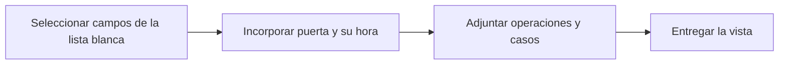

# Feature Specification: SF-01.14 — Ensamblado de la respuesta

**Created**: 2026-10-19  
**Status**: draft  
**Flow**: [F-01 Evaluar viaje como pasajero](01-f-01-evaluar-viaje-como-pasajero.md) (subflujo)  
**Related Specs**: [F-01 Evaluar viaje como pasajero](01-f-01-evaluar-viaje-como-pasajero.md), [SF-01.13 Huella por opción y registro de decisión](14-sf-01-13-huella-por-opcion-y-registro-de-decision.md)  
**Origen (DEC/H)**: DEC-04, DEC-21, DEC-22  
**Pruebas (TC)**: TC-01, TC-51  
**Contratos externos**: §1.1 (TripView y reglas de la evaluación), listas cerradas §3.11 de REQUERIMIENTOS_V1  

## Reglas de este documento

> Este spec es FUNCIONAL, no técnico: describe QUÉ hace el sistema, no CÓMO. Usa lenguaje de negocio; las siete herramientas externas se nombran por su función y se referencian por la sección de `sdd/reports/EXTERNAL_CONTRACTS.md`. Los casos borde se DOCUMENTAN; los valores de configuración se citan por el nombre del parámetro (NFR-012) con su valor por defecto entre paréntesis.

**Alcance**: Compone la vista del viaje con la lista blanca de campos: contexto, puerta con su hora, saludo con nombre de pila, código de reserva, aviso de menor sin edad, operaciones activas y casos existentes.

## User Scenarios & Testing *(mandatory)*

### User Story 1 - El pasajero recibe una vista completa y sin datos de más (Priority: P1)

Como pasajero, quiero ver mi viaje con mi nombre de pila y mi código de reserva, y nada más sobre mí, para sentirme seguro de que no se expone mi información.

**Why this priority**: Es la última barrera de privacidad antes de la pantalla.

**Independent Test**: Se prueba con reservas con y sin adulto, con menor y con operaciones activas.

**Acceptance Scenarios**:

1. **Scenario**: Saludo con nombre de pila
   - **Given** la reserva tiene un primer pasajero adulto
   - **When** se arma la vista
   - **Then** se muestra solo su nombre de pila, el código de reserva y el número de pasajeros

2. **Scenario**: Sin adulto
   - **Given** la reserva no tiene un pasajero adulto
   - **When** se arma la vista
   - **Then** se omite el saludo

3. **Scenario**: Operaciones activas
   - **Given** la reserva tiene una solicitud creada para una opción que ya no se muestra
   - **When** se arma la vista
   - **Then** la solicitud sigue apareciendo entre las operaciones activas, independiente de las opciones mostradas

4. **Scenario**: Saludo con nombre de pila (TC-01, TC-51)
   - **Given** el caso base ABC123 con Ana (adulta) y un niño, y el cambio de puerta 24 informado a las 10:55 UTC
   - **When** se arma la vista
   - **Then** muestra «Hola, Ana», la reserva ABC123, 2 pasajeros y la puerta 24 con su hora, sin edad del menor

5. **Scenario**: Separación de datos para la vista del pasajero y datos para el panel de soporte/debug (TC-01)
   - **Given** la evaluación completa de ABC123
   - **When** se ensambla `TripView`
   - **Then** el payload incluye tanto los campos amigables para la vista superior del cliente (`holder_first_name`, `segments`, `messages`, `options`, `actions`) como los metadatos operacionales que se renderizan exclusivamente en el panel gris inferior de soporte/debug (`decision_id`, `completeness`, `missing_fields`, `chosen_events`, `discarded_events`, `derived_variables`, `policy`, `discarded_options`)

---

### Edge Cases

> Solo se documentan; los marcados MUST-IMPLEMENT se vuelven requisito FR-XXX y se implementan con TDD, los DEFERRED quedan para una iteración posterior.

#### System Errors
- [DEFERRED] Guardar la respuesta para el front cuando la pidió otro sistema: Fase 2 (FR-124)

#### Invalid Data
- [MUST-IMPLEMENT] Cuando el pasajero titular no tiene nombre de pila disponible → se omite el saludo (FR-003)

#### Security & Permissions
- [MUST-IMPLEMENT] Cuando el grupo incluye un menor → se muestra solo el aviso «tu grupo incluye a un menor», sin edad ni nombre (FR-112)
- [MUST-IMPLEMENT] Cuando existen campos fuera de la lista blanca → no se incluyen en la respuesta (FR-112)

## Requirements *(mandatory)*

### Functional Requirements

- **FR-003**: El sistema DEBE mostrar siempre el contexto del viaje: segmentos (origen, destino, fecha, hora programada y estado), número de pasajeros y nombre de pila del titular (el primer pasajero adulto de la reserva; sin adulto se omite el saludo). Es la única excepción de información personal autorizada en pantalla.
- **FR-110**: El servicio DEBE exponer: la evaluación de un viaje con reserva y `caller`, la vista del viaje, la aceptación de una opción, el caso humano, la lectura del registro de decisión y una verificación de vida que responde «pong».
- **FR-112**: La interfaz NO DEBE mostrar información personal salvo la excepción de FR-003 ni identificadores internos innecesarios; la lista de campos visibles es cerrada.

### Non-Functional and Documentation Requirements

- **NFR-002**: Privacidad: el sistema DEBE minimizar la información personal en todas las fronteras propias; ningún dato personal se entrega a un modelo (si en el futuro se usara, se anonimiza antes).

### Key Entities *(include if feature involves data)*

- **Vista del viaje**: Respuesta completa para el pasajero; solo contiene campos de la lista blanca. Campos principales:
  - `decision_id`: identificador
  - `generated_at`: marca de tiempo UTC
  - `anomaly_detected`: booleano
  - `decision_state`: INFORMATIVA | AUTOMATICA | PENDIENTE_APROBACION | BLOQUEADA | nulo
  - `holder_first_name`: texto | nulo
  - `passenger_count`: entero
  - `load_status`: {trip_context: OK | INVALID, events: OK | FAILED, policy: OK | FAILED | NOT_REQUESTED, options: OK | FAILED | NOT_REQUESTED}
  - `data_as_of`: {trip_context, events, policy, options: marca de tiempo UTC | nulo}
  - `segments`: lista de estados resueltos con puerta y hora de la puerta
  - `alerts`: lista de {code: texto, severity: INFO | WARNING | CRITICAL, message_id: texto}
  - `derived_variables`: lista de variables derivadas
  - `policy`: política y reglas | nulo
  - `options`: lista de opciones viables
  - `proposed_option_id`: texto | nulo
  - `refund_notice`: mensaje validado | nulo
  - `offer_deadline`: marca de tiempo UTC | nulo
  - `actions`: lista de {action_id: texto, kind: ACCEPT_OPTION | OPEN_HUMAN_CASE, efecto: crear solicitud de cambio | crear caso humano con la opción elegida | crear caso humano, enabled: booleano, offered_reasons: lista de texto}
  - `messages`: lista de mensajes validados
  - `operations`: lista de operaciones activas de la reserva
  - `human_cases`: lista de intentos de caso humano de la situación
- **Contexto del viaje**: Reserva del pasajero con sus tramos; se reduce de inmediato a lo mínimo necesario (sin correo, teléfono, documento, nombre completo ni edad). Campos principales:
  - `booking_id`: texto de 6 caracteres alfanuméricos
  - `passenger_count`: entero ≥ 1
  - `passengers`: lista de {passenger_id: texto, type: ADULT | CHILD | otro | ausente}
  - `segments`: lista de {segment_id: texto, flight_number: texto, origin: código de aeropuerto, destination: código de aeropuerto, date: fecha, scheduled_departure: hora local HH:MM, scheduled_arrival: hora local HH:MM}
  - `fare_conditions`: {changeable: booleano, refundable: booleano, fare_family: texto, change_penalty_amount: entero | ausente}
  - `retrieved_at`: marca de tiempo UTC
  - `completeness`: enumeración abierta (p. ej. PARTIAL)
  - `missing_fields`: lista de texto

## Architectural Attributes *(mandatory)*

| Attribute | Value |
|-----------|-------|
| **Interaction type** | sync-http |
| **Consistency** | strong |
| **Workflow** | single-step |
| **Read pattern** | simple |
| **Auditability** | full-history |
| **Domain complexity** | medium |
| **Modularity** | bounded-context |
| **Deployment** | monolith |

## Success Criteria *(mandatory)*

### Measurable Outcomes

- **SC-001**: La vista contiene el 100 % de los campos de la lista blanca aplicables y el 0 % de los campos de la lista prohibida.
- **SC-002**: Las operaciones activas de la reserva aparecen en el 100 % de las vistas, aunque su opción ya no se muestre.

## Traceability *(mandatory after implementation)*

> Las columnas de archivo y línea se registran en la verificación de trazabilidad posterior a la implementación; hoy cada criterio queda enlazado a su origen y a las pruebas que lo verifican.

| Criterion | Origen | Prueba (TC) | Source File | Line(s) |
|-----------|--------|-------------|-------------|---------|
| FR-003 | DEC-04, DEC-21 | sin TC en el mapa §6 de REQUERIMIENTOS_V1 | se registra en la verificación posterior a la implementación | se registra en la verificación posterior a la implementación |
| FR-110 | DEC-04 | sin TC en el mapa §6 de REQUERIMIENTOS_V1 | se registra en la verificación posterior a la implementación | se registra en la verificación posterior a la implementación |
| FR-112 | DEC-21 | sin TC en el mapa §6 de REQUERIMIENTOS_V1 | se registra en la verificación posterior a la implementación | se registra en la verificación posterior a la implementación |
| NFR-002 | DEC-22 | sin TC en el mapa §6 de REQUERIMIENTOS_V1 | se registra en la verificación posterior a la implementación | se registra en la verificación posterior a la implementación |
| SC-001 | criterio medible de este spec | TC-01, TC-51 | se registra en la verificación posterior a la implementación | se registra en la verificación posterior a la implementación |
| SC-002 | criterio medible de este spec | TC-01, TC-51 | se registra en la verificación posterior a la implementación | se registra en la verificación posterior a la implementación |

## Business Process (BPM View)

```
Seleccionar campos de la lista blanca → Incorporar puerta y su hora → Adjuntar operaciones y casos → Entregar la vista
```



