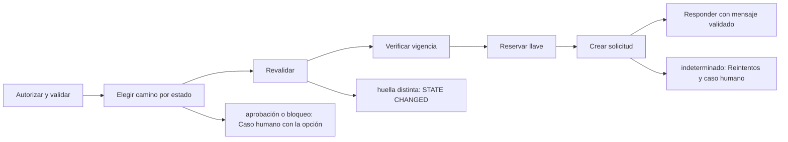

# Feature Specification: F-02 — Aceptar opción

**Created**: 2026-10-19  
**Status**: draft  
**Flow**: F-02 Aceptar opción  
**Related Specs**: [SF-02.1 Autorización y validación](17-sf-02-1-autorizacion-y-validacion.md), [SF-02.2 Bifurcación por estado de la decisión](18-sf-02-2-bifurcacion-por-estado-de-la-decision.md), [SF-02.3 Revalidación](19-sf-02-3-revalidacion.md), [SF-02.4 Vigencia de la opción](20-sf-02-4-vigencia-de-la-opcion.md), [SF-02.5 Llave idempotente y registro de operaciones](21-sf-02-5-llave-idempotente-y-registro-de-operaciones.md), [SF-02.6 Llamada a la solicitud de cambio](22-sf-02-6-llamada-a-la-solicitud-de-cambio.md), [SF-02.7 Reintentos del resultado indeterminado](23-sf-02-7-reintentos-del-resultado-indeterminado.md), [SF-02.8 Derivación tras falla persistente](24-sf-02-8-derivacion-tras-falla-persistente.md), [SF-02.9 Caso humano con la opción elegida](25-sf-02-9-caso-humano-con-la-opcion-elegida.md), [SF-02.10 Mensaje de resultado y registro](26-sf-02-10-mensaje-de-resultado-y-registro.md), [FE-03 Aceptar opción (front)](91-fe-03-aceptar-opcion-front.md), [F-03 Caso humano manual («Hablar con una persona»)](27-f-03-caso-humano-manual-hablar-con-una-persona.md), [F-09 Ciclo de vida de operaciones, intentos de caso y notificaciones (barrido perezoso)](56-f-09-ciclo-de-vida-de-operaciones-intentos-de-caso-y.md)  
**Origen (DEC/H)**: DEC-09, DEC-10, DEC-13, DEC-14, DEC-15, DEC-16, DEC-18, DEC-19, DEC-20, DEC-21, DEC-23, DEC-24, DEC-31, H-21  
**Pruebas (TC)**: TC-01, TC-07, TC-08, TC-14, TC-15, TC-22, TC-27, TC-30, TC-31, TC-33, TC-34, TC-38, TC-40, TC-57  
**Contratos externos**: §1.1 (fila 3: aceptar una opción), §2.1 (herramienta 5: solicitud de cambio de reserva; herramienta 6: caso humano), §2.4 (configuración)  
**Deuda conocida de A1 (no se resuelve aquí)**: DEBT-A1-01  

## Reglas de este documento

> Este spec es FUNCIONAL, no técnico: describe QUÉ hace el sistema, no CÓMO. Usa lenguaje de negocio; las siete herramientas externas se nombran por su función y se referencian por la sección de `sdd/reports/EXTERNAL_CONTRACTS.md`. Los casos borde se DOCUMENTAN; los valores de configuración se citan por el nombre del parámetro (NFR-012) con su valor por defecto entre paréntesis.

**Alcance**: Un clic del pasajero autoriza exactamente una acción: crear la solicitud de cambio si la decisión es automática, o abrir un caso humano con la opción elegida si exige aprobación o está bloqueada.

## User Scenarios & Testing *(mandatory)*

### User Story 1 - El pasajero acepta una opción con un clic y sabe exactamente qué pasa (Priority: P1)

Como pasajero, quiero aceptar la opción propuesta con un solo clic, con un texto previo que me diga qué se va a hacer, y que nunca se cambie mi reserva sin que lo haya autorizado.

**Why this priority**: Es la acción de mayor impacto del producto: cambiar una reserva o derivarla a una persona.

**Independent Test**: Se prueba aceptando la opción del escenario sin menor (se crea la solicitud) y la del caso base (se abre el caso humano), y comparando el efecto declarado con el efecto real.

**Acceptance Scenarios**:

1. **Scenario**: Aceptación automática
   - **Given** la decisión es AUTOMATICA, la huella de la opción coincide y la opción está vigente
   - **When** el pasajero acepta la opción
   - **Then** se crea una única solicitud de cambio con la llave de idempotencia y la vista dice «solicitud registrada, pendiente de confirmación, sujeta a disponibilidad» con su vencimiento, sin afirmar que el vuelo ya cambió

2. **Scenario**: Aceptación con aprobación humana
   - **Given** la decisión es PENDIENTE_APROBACION o BLOQUEADA
   - **When** el pasajero acepta la opción
   - **Then** no se crea la solicitud de cambio: se abre un caso humano con la opción elegida como evidencia, sin revalidar

3. **Scenario**: La situación cambió
   - **Given** entre lo que vio el pasajero y el clic se agotaron los asientos de la opción
   - **When** el pasajero acepta la opción
   - **Then** no se escribe nada y se muestra la vista nueva con el aviso de que la situación cambió

4. **Scenario**: Dos clics simultáneos
   - **Given** el pasajero pulsa dos veces o desde dos pestañas
   - **When** se procesan ambas aceptaciones
   - **Then** se escribe una sola solicitud y la segunda recibe el estado de la primera

5. **Scenario**: Aceptación sin menor (TC-07, TC-30)
   - **Given** dos pasajeros adultos, decisión AUTOMATICA, O1 LA2412 con 4 asientos, huella igual y opción vigente
   - **When** se acepta O1 a las 11:03:00Z
   - **Then** se crea una solicitud (RBK-88231, vence 11:12:00Z) y el mensaje dice «pendiente de confirmación, sujeta a disponibilidad»

6. **Scenario**: Rótulos amables de botones y confirmación de derivación a soporte (TC-01, TC-09)
   - **Given** una decisión `PENDIENTE_APROBACION` con opción propuesta O1, o una decisión `BLOQUEADA` sin opción viable
   - **When** se ofrecen las acciones al pasajero y se ejecuta la derivación
   - **Then** el botón con opción dice «Aceptar opción y contactar a un agente de soporte», el botón sin opción dice «Contactar a un ejecutivo» y el mensaje de confirmación dice «Hemos derivado tu solicitud a uno de nuestros ejecutivos de soporte (tiempo estimado de atención: 45 minutos). Tu reserva aún no se modifica.» (dejando el código de cola `DISRUPTION_L2` para el panel de soporte/debug)

---

### Edge Cases

> Solo se documentan; los marcados MUST-IMPLEMENT se vuelven requisito FR-XXX y se implementan con TDD, los DEFERRED quedan para una iteración posterior.

#### System Errors
- [MUST-IMPLEMENT] Cuando el proveedor de cambios responde con falla temporal o no responde → resultado indeterminado, reintentos con la misma llave y luego caso humano; nunca se informa éxito ni fracaso (FR-054)
- [MUST-IMPLEMENT] Cuando el proveedor rechaza por error no reintentable → no se reintenta, mensaje genérico de fallo y caso humano ofrecido (FR-105)
- [MUST-IMPLEMENT] Cuando una operación indeterminada supera `OPERATION_INDETERMINATE_EXPIRY_SECONDS` (900) → pasa a expirada y se permite una operación nueva con la generación siguiente (FR-064)

#### Invalid Data
- [MUST-IMPLEMENT] Cuando la opción pedida no figura en la decisión → rechazo por opción no ofrecida (FR-065)

#### Race Conditions
- [MUST-IMPLEMENT] Cuando hay una operación en curso, indeterminada o creada sobre el mismo itinerario → no se escribe de nuevo y se devuelve su estado (FR-062)
- [DEFERRED] Dos pestañas con opciones distintas pueden crear dos solicitudes porque la unicidad es por reserva e itinerario: riesgo declarado que decide el usuario (DEBT-A1-01, OQ-A2-06) (FR-053)

#### Security & Permissions
- [MUST-IMPLEMENT] Cuando la decisión pertenece a otra reserva o no existe → la misma respuesta de «no encontrado» (FR-001)

## Requirements *(mandatory)*

### Functional Requirements

- **FR-001**: El sistema DEBE operar sobre la sesión autenticada del pasajero y comprobar que la reserva y la decisión solicitadas pertenezcan a esa sesión; una reserva ajena y una inexistente DEBEN producir exactamente la misma respuesta de «no encontrado», sin confirmar la existencia de ninguna. La sesión simulada solo existe con el parámetro `DEV_SESSION_HEADER_ENABLED` (apagado por defecto): en cualquier otro perfil toda petición del pasajero sin sesión DEBE rechazarse por falta de autenticación, y toda petición del sistema DEBE exigir la credencial de servicio (FR-120). Los errores NO DEBEN mostrar trazas ni repetir la entrada, nunca se pide ni se muestra documento de identidad, y el identificador de decisión DEBE ser aleatorio y no adivinable.
- **FR-017**: El sistema DEBE usar siempre el dato más reciente y respetar la vigencia: las opciones vencen en el instante de su lectura más su vigencia en segundos (en el instante exacto ya están vencidas; sin vigencia declarada el conjunto se considera vencido). Los eventos no vencen por sí mismos (`EVENT_MAX_AGE_SECONDS`, por defecto sin límite). Al vencer se re-consulta una sola vez por acción, sin bucles.
- **FR-038**: Si en cualquier segmento existe `SOURCE_CONFLICT`, `UNSUPPORTED_EVENT_TYPE`, `INCONSISTENT_DELAY`, `MULTIPLE_AFFECTED_SEGMENTS`, `RULE_ERROR`, una regla no evaluable en los términos de FR-033 o una lectura íntegra inválida (FR-066), la decisión DEBE ser BLOQUEADA: ninguna regla cumplida habilita la creación de la solicitud de cambio y aceptar una opción solo puede abrir un caso humano.
- **FR-050**: Toda acción externa (solicitud de cambio, caso humano, notificación) DEBE requerir un clic explícito del pasajero; el sistema solo propone y ofrece. La persistencia interna no es una acción externa. Excepción: en modo sistema se puede enviar la notificación de FR-122 sin clic, con plantilla fija; ninguna otra acción externa se ejecuta en modo sistema. Un clic autoriza exactamente una acción y los textos de los botones lo declaran, incluida la derivación posterior a una falla persistente.
- **FR-051**: Al aceptar una opción cuando la decisión no exige aprobación, el sistema DEBE revalidar (FR-070), obtener la llave de idempotencia y crear la solicitud de cambio.
- **FR-052**: Al aceptar una opción cuando la decisión exige aprobación, es BLOQUEADA o tiene reglas no evaluables, el sistema NO DEBE crear la solicitud de cambio: crea un caso humano con la opción elegida como evidencia.
- **FR-053**: La identidad de una operación de cambio es la reserva más el itinerario de la opción. Al crearla se calcula una llave de idempotencia no adivinable a partir de reserva, vuelo, fecha, salida, versión de política y generación (sin identificador de decisión ni marcas de tiempo), se guarda en el registro de operaciones de forma atómica y única antes de llamar, y toda reevaluación la reutiliza mientras la operación no haya fracasado, aunque cambie la versión de política.
- **FR-054**: Un resultado indeterminado (falla temporal del proveedor, tiempo agotado o respuesta perdida) DEBE reintentarse hasta `REBOOK_MAX_RETRIES` (2) veces con la misma llave; luego se deriva a caso humano (cubierto por el clic de FR-050). Nunca se informa éxito ni fracaso.
- **FR-055**: Un rechazo por duplicado DEBE tratarse como solicitud existente y la vista muestra «ya existe una solicitud en curso para esta opción», sin bucles.
- **FR-056**: Una solicitud creada DEBE mostrarse como «solicitud registrada, pendiente de confirmación, sujeta a disponibilidad» con su vencimiento; la confirmación queda fuera de la versión 1.
- **FR-059**: Al crear un caso humano el sistema DEBE enviar el motivo de mayor prioridad y conservar todos los motivos simultáneos, con evidencia solo de identificadores, enumeraciones y hechos validados (sin información personal), tomada de la decisión guardada si el pasajero indica la decisión que vio y, si no, de una evaluación fresca. La deduplicación local se calcula con reserva, motivos ordenados y huella de decisión, no bloquea el reintento explícito tras un intento fallido o indeterminado, y cada intento y su resultado (creado, fallido, indeterminado) queda registrado. No requiere revalidación.
- **FR-062**: Dos aceptaciones simultáneas, o una aceptación mientras la operación está en curso, indeterminada o creada, DEBEN resultar en una sola escritura; la segunda devuelve el estado de la primera y el botón se deshabilita mientras hay una solicitud en curso.
- **FR-063**: Cada causa se traduce a un motivo con prioridad fija (de mayor a menor: falla indeterminada del proveedor, conflicto de fuentes, evento no soportado, retraso incoherente, varios segmentos afectados, datos parciales bloqueantes, compensación solicitada, datos personales, aprobación de política, ninguna opción cubre al grupo, ninguna opción viable, pernocte y otra ayuda); el motivo del caso es el primero que aplique y se conservan todos los demás (`REASON_PRIORITY`).
- **FR-064**: La operación de cambio DEBE seguir un ciclo de vida: en curso, creada, indeterminada, fallida y expirada. En curso pasa a indeterminada tras `OPERATION_STALE_SECONDS` (120) sin respuesta; creada pasa a expirada en su vencimiento; indeterminada pasa a expirada tras `OPERATION_INDETERMINATE_EXPIRY_SECONDS` (900, mayor que la vigencia de una solicitud) si nada la resuelve. Si la llave no pudo persistirse no se escribe. Expirada o fallida permiten una operación nueva con la generación siguiente; creada, en curso e indeterminada la bloquean y la vista muestra su estado. Un rechazo por duplicado sin operación local se muestra «ya existe una solicitud para esta opción».
- **FR-065**: La solicitud de cambio DEBE llevar además de la opción y la llave la reserva y los identificadores de todos los pasajeros. El cliente nunca aporta el contenido de la opción: envía la decisión y la clave de itinerario y el servidor la resuelve con las opciones recién consultadas.
- **FR-070**: Antes de crear un cambio el sistema DEBE reconsultar contexto, eventos, opciones y política y recalcular la decisión y su huella (estado de cada segmento, reglas cumplidas, derechos, aprobación, versión de política, composición del grupo y, de la opción elegida, itinerario, suficiencia de asientos, diferencia de tarifa y referencia de política). Si la huella difiere de la mostrada, no se escribe y se muestra el nuevo estado; marcas de tiempo, ids de eventos descartados, identificador de opción y confianza no cuentan. La vigencia no entra en la huella: es una condición de ejecución independiente. Los casos humanos no se revalidan.
- **FR-072**: Si las opciones están vencidas al usarlas, el sistema DEBE refrescarlas antes de escribir.
- **FR-081**: Un validador propio DEBE revisar todo mensaje dinámico antes de devolverlo y el contrato de notificación: bloquea un hecho sin evidencia vigente o un campo fuera de la lista blanca; exige referencia de política a los mensajes que afirman una opción o un derecho y a toda notificación de política; el aviso informativo de cambio de puerta va sin referencia de política. Los textos estáticos de la interfaz están exentos.
- **FR-090**: Cada evaluación DEBE generar un registro con identificador de decisión, reserva, lecturas con su instante, eventos elegidos y descartados con razón, versión de política y reglas, variables derivadas con supuestos, opciones viables y descartadas con razón, acción y huella del mensaje.
- **FR-105**: Matriz de errores por herramienta: las lecturas con fallo se reconsultan una vez sin bucles; sin contexto del viaje hay pantalla de «no pudimos cargar tu viaje» con reintento; solo sin eventos se muestra el contexto sin estado ni alerta y con aviso; sin política u opciones queda BLOQUEADA con caso humano ofrecido. Una solicitud de cambio con error no reintentable no se reintenta, muestra un fallo genérico y ofrece caso humano. En el caso humano, un error explícito dice «no pudimos registrar tu solicitud, puedes reintentar»; un tiempo agotado o respuesta perdida es indeterminado («no pudimos confirmar si tu solicitud quedó registrada; puede que ya lo esté»), no se reenvía automáticamente y el reintento exige un segundo clic explícito tras advertir del posible duplicado. Nunca se afirma éxito.

### Non-Functional and Documentation Requirements

- **NFR-004**: Latencia: la vista DEBE responder en menos de 1,5 s (percentil 95) con proveedores simulados de 100 ms fijos; protocolo de aceptación: 50 solicitudes secuenciales del caso base en la máquina de desarrollo, reportando percentiles 50 y 95. La cadena de lecturas es secuencial (contexto, eventos, solo con evento relevante validado la política, y las opciones).
- **DOC-012**: DEBE documentarse el diseño de la aprobación humana: al aprobar un agente se revalida de nuevo y la aprobación autoriza una decisión, no una ejecución con datos viejos.
- **DOC-013**: DEBEN documentarse las extensiones de contrato propuestas al equipo: reserva y pasajeros en la solicitud de cambio, destinatario y tipo de aviso (informativo sin referencia de política) en la notificación, y contrato reducido en las opciones.

### Key Entities *(include if feature involves data)*

- **Resultado de aceptación**: Respuesta a un clic de «Aceptar esta opción». Campos principales:
  - `outcome`: REBOOKING_CREATED | EXISTING_REQUEST | HUMAN_CASE_CREATED | EXISTING_CASE | NEEDS_CONFIRMATION | STATE_CHANGED | FAILED
  - `message`: mensaje validado
  - `operation`: operación | nulo
  - `human_case`: caso humano | nulo
  - `retries`: entero entre 0 y `REBOOK_MAX_RETRIES`
  - `view`: vista del viaje | nulo (solo con STATE_CHANGED)
- **Operación de reprogramación**: Intento de crear una solicitud de cambio, con su llave de idempotencia y su ciclo de vida. Campos principales:
  - `itinerary_key`: texto
  - `idempotency_key`: texto no adivinable
  - `generation`: entero ≥ 1
  - `state`: EN_CURSO | CREADA | INDETERMINADA | FALLIDA | EXPIRADA (INDETERMINADA pasa a EXPIRADA tras `OPERATION_INDETERMINATE_EXPIRY_SECONDS`)
  - `request_id`: texto | nulo
  - `request_status`: enumeración abierta (p. ej. PENDING_CONFIRMATION) | nulo
  - `expires_at`: marca de tiempo UTC | nulo
  - `passenger_ids`: lista de texto con TODO el grupo
  - `minimized`: booleano: verdadero cuando la purga conservó solo la identidad, el estado y la vigencia de la operación (sin itinerario ni pasajeros) para no perder su bloqueo
- **Caso humano**: Escalamiento a una persona; cada intento queda registrado con su resultado. Campos principales:
  - `dedup_key`: texto
  - `attempt`: entero ≥ 1
  - `state`: EN_CURSO | CREADO | FALLIDO | INDETERMINADO
  - `reason`: uno de los 13 motivos cerrados
  - `reasons`: lista ordenada por prioridad
  - `case_id`: texto | nulo
  - `queue`: texto | nulo
  - `sla_minutes`: entero | nulo
  - `option`: {option_id: texto, itinerario y diferencia de tarifa} | nulo
  - `confirm_possible_duplicate`: booleano
- **Opción de reprogramación**: Alternativa candidata entregada por el proveedor; solo las viables se muestran. Campos principales:
  - `option_id`: texto local a la lectura
  - `itinerary_key`: texto que identifica el itinerario entre lecturas
  - `type`: REBOOK | REFUND | otro
  - `flight_number`: texto | nulo
  - `origin`: código de aeropuerto | nulo
  - `destination`: código de aeropuerto | nulo
  - `date`: fecha | nulo
  - `departure`: hora local HH:MM | nulo
  - `fare_difference`: entero sin decimales | nulo
  - `currency`: código de moneda | nulo
  - `seats_available`: entero | nulo
  - `policy_ref`: texto
  - `confidence`: enumeración abierta (HIGH | MEDIUM | LOW | otro)
  - `viable`: booleano
  - `discard_reasons`: lista de INSUFFICIENT_SEATS | FEE_CONFLICT | NO_ENTITLEMENT | POLICY_REF_UNVERIFIED | POLICY_REF_SUPERSEDED | UNSUPPORTED_TYPE | EXPIRED | MISSING_CURRENCY | ITINERARY_MISMATCH
  - `fingerprint`: texto: huella por opción
  - `is_proposed`: booleano
  - `overnight`: booleano | nulo
  - `expires_at`: marca de tiempo UTC
- **Decisión**: Resultado de evaluar la reserva: su estado y las razones que lo explican. Campos principales:
  - `decision_id`: identificador aleatorio no adivinable
  - `decision_state`: INFORMATIVA | AUTOMATICA | PENDIENTE_APROBACION | BLOQUEADA | nulo
  - `anomaly_detected`: booleano
  - `fingerprint`: texto: huella de decisión sin opción
  - `human_case_reasons`: lista ordenada de motivos de caso humano
  - `support_offered`: booleano
  - `compensation_eligible`: booleano
  - `needs_manual_review`: booleano (campo interno: se persiste y no se entrega a la sesión del pasajero, FR-093)

## Architectural Attributes *(mandatory)*

| Attribute | Value |
|-----------|-------|
| **Interaction type** | sync-http |
| **Consistency** | strong |
| **Workflow** | multi-step |
| **Read pattern** | simple |
| **Auditability** | full-history |
| **Domain complexity** | high |
| **Modularity** | bounded-context |
| **Deployment** | monolith |

## Success Criteria *(mandatory)*

### Measurable Outcomes

- **SC-001**: En 100 solicitudes simultáneas sobre la misma opción se escribe exactamente una.
- **SC-002**: El 100 % de los clics que producen una escritura externa lo declaró antes en el texto del botón.
- **SC-003**: Una huella distinta o una opción vencida no resuelta produce 0 escrituras.
- **SC-004**: El peor caso de aceptar con los valores por defecto no excede 40,6 s y el botón permanece deshabilitado todo ese tiempo.

## Traceability *(mandatory after implementation)*

> Las columnas de archivo y línea se registran en la verificación de trazabilidad posterior a la implementación; hoy cada criterio queda enlazado a su origen y a las pruebas que lo verifican.

| Criterion | Origen | Prueba (TC) | Source File | Line(s) |
|-----------|--------|-------------|-------------|---------|
| FR-001 | DEC-21 | sin TC en el mapa §6 de REQUERIMIENTOS_V1 | se registra en la verificación posterior a la implementación | se registra en la verificación posterior a la implementación |
| FR-017 | DEC-10 | TC-01, TC-27 | se registra en la verificación posterior a la implementación | se registra en la verificación posterior a la implementación |
| FR-038 | DEC-09, DEC-13, DEC-31 | TC-01 | se registra en la verificación posterior a la implementación | se registra en la verificación posterior a la implementación |
| FR-050 | DEC-14 | TC-01 | se registra en la verificación posterior a la implementación | se registra en la verificación posterior a la implementación |
| FR-051 | DEC-14, DEC-19 | TC-01, TC-07 | se registra en la verificación posterior a la implementación | se registra en la verificación posterior a la implementación |
| FR-052 | DEC-13, DEC-16 | TC-01 | se registra en la verificación posterior a la implementación | se registra en la verificación posterior a la implementación |
| FR-053 | DEC-18 | TC-01, TC-22, TC-34 | se registra en la verificación posterior a la implementación | se registra en la verificación posterior a la implementación |
| FR-054 | DEC-18 | TC-01, TC-14, TC-33 | se registra en la verificación posterior a la implementación | se registra en la verificación posterior a la implementación |
| FR-055 | DEC-18 | TC-01, TC-15 | se registra en la verificación posterior a la implementación | se registra en la verificación posterior a la implementación |
| FR-056 | DEC-18, DEC-19 | TC-01, TC-30 | se registra en la verificación posterior a la implementación | se registra en la verificación posterior a la implementación |
| FR-059 | DEC-15, DEC-23 | TC-01 | se registra en la verificación posterior a la implementación | se registra en la verificación posterior a la implementación |
| FR-062 | DEC-18 | TC-01, TC-22 | se registra en la verificación posterior a la implementación | se registra en la verificación posterior a la implementación |
| FR-063 | DEC-15 | TC-01 | se registra en la verificación posterior a la implementación | se registra en la verificación posterior a la implementación |
| FR-064 | DEC-18 | TC-38, TC-57 | se registra en la verificación posterior a la implementación | se registra en la verificación posterior a la implementación |
| FR-065 | DEC-16, DEC-18 | TC-40 | se registra en la verificación posterior a la implementación | se registra en la verificación posterior a la implementación |
| FR-070 | DEC-19 | TC-31 | se registra en la verificación posterior a la implementación | se registra en la verificación posterior a la implementación |
| FR-072 | DEC-10, DEC-19 | TC-08, TC-27 | se registra en la verificación posterior a la implementación | se registra en la verificación posterior a la implementación |
| FR-081 | DEC-20, H-21 | sin TC en el mapa §6 de REQUERIMIENTOS_V1 | se registra en la verificación posterior a la implementación | se registra en la verificación posterior a la implementación |
| FR-090 | DEC-23 | sin TC en el mapa §6 de REQUERIMIENTOS_V1 | se registra en la verificación posterior a la implementación | se registra en la verificación posterior a la implementación |
| FR-105 | DEC-15, DEC-18 | TC-33 | se registra en la verificación posterior a la implementación | se registra en la verificación posterior a la implementación |
| NFR-004 | DEC-24 | sin TC en el mapa §6 de REQUERIMIENTOS_V1 | se registra en la verificación posterior a la implementación | se registra en la verificación posterior a la implementación |
| DOC-012 | DEC-19 | sin TC en el mapa §6 de REQUERIMIENTOS_V1 | se registra en la verificación posterior a la implementación | se registra en la verificación posterior a la implementación |
| DOC-013 | DEC-18 | sin TC en el mapa §6 de REQUERIMIENTOS_V1 | se registra en la verificación posterior a la implementación | se registra en la verificación posterior a la implementación |
| SC-001 | criterio medible de este spec | TC-01, TC-07, TC-08, TC-14, TC-15, TC-22, TC-27, TC-30, TC-31, TC-33, TC-34, TC-38, TC-40, TC-57 | se registra en la verificación posterior a la implementación | se registra en la verificación posterior a la implementación |
| SC-002 | criterio medible de este spec | TC-01, TC-07, TC-08, TC-14, TC-15, TC-22, TC-27, TC-30, TC-31, TC-33, TC-34, TC-38, TC-40, TC-57 | se registra en la verificación posterior a la implementación | se registra en la verificación posterior a la implementación |
| SC-003 | criterio medible de este spec | TC-01, TC-07, TC-08, TC-14, TC-15, TC-22, TC-27, TC-30, TC-31, TC-33, TC-34, TC-38, TC-40, TC-57 | se registra en la verificación posterior a la implementación | se registra en la verificación posterior a la implementación |
| SC-004 | criterio medible de este spec | TC-01, TC-07, TC-08, TC-14, TC-15, TC-22, TC-27, TC-30, TC-31, TC-33, TC-34, TC-38, TC-40, TC-57 | se registra en la verificación posterior a la implementación | se registra en la verificación posterior a la implementación |

## Business Process (BPM View)

```
Autorizar y validar → Elegir camino por estado → Revalidar → Verificar vigencia → Reservar llave → Crear solicitud → Responder con mensaje validado
```



### Subprocesses (if applicable)

```
SF-02.1: Autorización y validación
SF-02.2: Bifurcación por estado de la decisión
SF-02.3: Revalidación
SF-02.4: Vigencia de la opción
SF-02.5: Llave idempotente y registro de operaciones
SF-02.6: Llamada a la solicitud de cambio
SF-02.7: Reintentos del resultado indeterminado
SF-02.8: Derivación tras falla persistente
SF-02.9: Caso humano con la opción elegida
SF-02.10: Mensaje de resultado y registro
```
