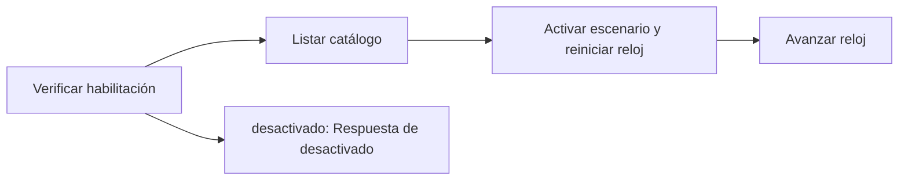

# Feature Specification: F-06 — Escenarios y reloj de desarrollo

**Created**: 2026-10-19  
**Status**: draft  
**Flow**: F-06 Escenarios y reloj de desarrollo  
**Related Specs**: [SF-06.1 Verificación de los flags de desarrollo](43-sf-06-1-verificacion-de-los-flags-de-desarrollo.md), [SF-06.2 Listado del catálogo](44-sf-06-2-listado-del-catalogo.md), [SF-06.3 Activación del escenario y reinicio del reloj](45-sf-06-3-activacion-del-escenario-y-reinicio-del-reloj.md), [SF-06.4 Avance del reloj de escenario](46-sf-06-4-avance-del-reloj-de-escenario.md), [FE-01 Selector de escenario y reloj (solo desarrollo)](77-fe-01-selector-de-escenario-y-reloj-solo-desarrollo.md)  
**Origen (DEC/H)**: DEC-02, DEC-04, DEC-10, DEC-19, DEC-21, DEC-24, DEC-31  
**Pruebas (TC)**: TC-01, TC-08, TC-27, TC-32, TC-49, TC-57, TC-58, TC-59, TC-60  
**Contratos externos**: §1.1 (filas 6 a 8: solo desarrollo), catálogo cerrado de escenarios v1 de §1.1  
**Deuda conocida de A1 (no se resuelve aquí)**: DEBT-A1-02  

## Reglas de este documento

> Este spec es FUNCIONAL, no técnico: describe QUÉ hace el sistema, no CÓMO. Usa lenguaje de negocio; las siete herramientas externas se nombran por su función y se referencian por la sección de `sdd/reports/EXTERNAL_CONTRACTS.md`. Los casos borde se DOCUMENTAN; los valores de configuración se citan por el nombre del parámetro (NFR-012) con su valor por defecto entre paréntesis.

**Alcance**: Solo en desarrollo: lista los escenarios (los siete ejemplos del enunciado con datos personales ficticios y las variantes de prueba), activa uno en las simulaciones de las siete herramientas y gobierna el reloj de escenario, que solo avanza a pedido.

## User Scenarios & Testing *(mandatory)*

### User Story 1 - El equipo demuestra y prueba cada situación sin esperar (Priority: P1)

Como desarrollador o evaluador, quiero elegir un escenario y avanzar el reloj para mostrar, por ejemplo, el vencimiento de las opciones, sin esperar dos minutos reales ni tocar datos reales.

**Why this priority**: Sin escenarios reproducibles no hay demostración ni pruebas de extremo a extremo.

**Independent Test**: Se prueba activando el escenario del caso base, listándolos y avanzando el reloj 120 segundos.

**Acceptance Scenarios**:

1. **Scenario**: Listar escenarios
   - **Given** los funciones de desarrollo están habilitados
   - **When** se pide el catálogo
   - **Then** se devuelven los escenarios, el activo y el reloj; `ui` indica los visibles en el selector

2. **Scenario**: Activar escenario
   - **Given** existe el escenario pedido
   - **When** se activa
   - **Then** las simulaciones sirven sus datos y el reloj vuelve al instante base del escenario

3. **Scenario**: Avanzar reloj
   - **Given** modo de reloj de escenario
   - **When** se avanzan 120 segundos
   - **Then** las opciones del escenario quedan vencidas en el instante exacto y la demostración del vencimiento es posible

4. **Scenario**: Producción
   - **Given** los funciones de desarrollo están apagados (valor por defecto)
   - **When** se piden
   - **Then** responden «desactivado» y rige el reloj del sistema

5. **Scenario**: Activar variantes de TC-57 a TC-60 (AVISO_TITULAR_ADULTO_TC60)
   - **Given** las funciones de desarrollo habilitadas y el catálogo con INDETERMINADA_VENCE_TC57, LIMITE_TASA_TEXTO_PLANO_TC58, DECISION_SESION_SIN_INTERNOS_TC59 y AVISO_TITULAR_ADULTO_TC60
   - **When** se activa cada una sobre ABC123
   - **Then** cada variante se activa y el reloj vuelve a 11:02:35Z con desplazamiento 0

---

### Edge Cases

> Solo se documentan; los marcados MUST-IMPLEMENT se vuelven requisito FR-XXX y se implementan con TDD, los DEFERRED quedan para una iteración posterior.

#### Invalid Data
- [MUST-IMPLEMENT] Cuando el escenario pedido no existe → respuesta de escenario no encontrado (FR-101)
- [MUST-IMPLEMENT] Cuando el avance del reloj no es un entero entre 0 y 86400 → rechazo por validación (FR-017)

#### Race Conditions
- [DEFERRED] Un único escenario y un único reloj por proceso: no apto para uso concurrente de varias personas (AR-09) (FR-101)

#### Security & Permissions
- [MUST-IMPLEMENT] Cuando `DEV_ENDPOINTS_ENABLED` es falso (por defecto) → todo lo de desarrollo responde como desactivado (FR-001)

## Requirements *(mandatory)*

### Functional Requirements

- **FR-001**: El sistema DEBE operar sobre la sesión autenticada del pasajero y comprobar que la reserva y la decisión solicitadas pertenezcan a esa sesión; una reserva ajena y una inexistente DEBEN producir exactamente la misma respuesta de «no encontrado», sin confirmar la existencia de ninguna. La sesión simulada solo existe con el parámetro `DEV_SESSION_HEADER_ENABLED` (apagado por defecto): en cualquier otro perfil toda petición del pasajero sin sesión DEBE rechazarse por falta de autenticación, y toda petición del sistema DEBE exigir la credencial de servicio (FR-120). Los errores NO DEBEN mostrar trazas ni repetir la entrada, nunca se pide ni se muestra documento de identidad, y el identificador de decisión DEBE ser aleatorio y no adivinable.
- **FR-017**: El sistema DEBE usar siempre el dato más reciente y respetar la vigencia: las opciones vencen en el instante de su lectura más su vigencia en segundos (en el instante exacto ya están vencidas; sin vigencia declarada el conjunto se considera vencido). Los eventos no vencen por sí mismos (`EVENT_MAX_AGE_SECONDS`, por defecto sin límite). Al vencer se re-consulta una sola vez por acción, sin bucles.
- **FR-071**: La vista DEBE mostrar la hora límite (el mínimo de los vencimientos de las opciones mostradas) en UTC y como cuenta regresiva; pasada esa hora, «sujeto a disponibilidad».
- **FR-100**: El sistema DEBE definir interfaces para las siete herramientas externas con los contratos del enunciado y simulaciones intercambiables por un adaptador real cuando exista su documentación.
- **FR-101**: La fuente de verdad es el universo del enunciado: los escenarios de prueba reproducen los siete ejemplos (con datos personales claramente ficticios) y las variantes de prueba; los tipos de evento son retraso, cambio de puerta y estado; un test verifica que los datos ficticios no aparecen en registros ni en el historial.
- **FR-102**: Las enumeraciones abiertas DEBEN tolerarse: un valor nuevo degrada a caso humano.
- **FR-103**: Las simulaciones DEBEN respetar los metadatos de lectura y los errores de duplicado, indisponibilidad y validación.
- **FR-111**: El front de prueba DEBE tener el aspecto y la sensación del centro de ayuda de una aerolínea (sin logos ni marcas), verificable con la lista de componentes y la lista de verificación de tokens de `sdd/reports/DESIGN_CONTRACT.md`: selector de escenario, contexto, alerta, reglas cumplidas y no cumplidas, opción propuesta, vía de reembolso, avisos de estimación, hora límite y «sujeto a disponibilidad», y botones de acción.

### Non-Functional and Documentation Requirements

- **NFR-001**: Determinismo: con el mismo reloj inyectado y las mismas lecturas el sistema DEBE producir la misma huella de decisión y los mismos mensajes, sin inteligencia artificial ni modelos en ejecución y con costo por interacción en modelos igual a cero.
- **NFR-006**: Calidad: los casos de prueba TC-01 a TC-20 y los añadidos desde TC-21 DEBEN automatizarse, el caso base como prueba de extremo a extremo y la cobertura de líneas del dominio ser de al menos 85 %.

### Key Entities *(include if feature involves data)*

- **Escenario de desarrollo**: Conjunto de datos simulados de las siete herramientas, activable solo en desarrollo. Campos principales:
  - `scenario_id`: texto
  - `booking_id`: texto
  - `title`: texto en español
  - `description`: texto
  - `ui`: booleano (visible en el selector)
  - `tests`: lista de TC-nn
- **Reloj de escenario**: Reloj controlado de desarrollo: instante base del escenario más un desplazamiento que solo avanza a pedido. Campos principales:
  - `mode`: scenario | system
  - `now`: marca de tiempo UTC
  - `offset_seconds`: entero ≥ 0
  - `advance_seconds`: entero entre 0 y 86400 (entrada)

## Architectural Attributes *(mandatory)*

| Attribute | Value |
|-----------|-------|
| **Interaction type** | sync-http |
| **Consistency** | strong |
| **Workflow** | multi-step |
| **Read pattern** | simple |
| **Auditability** | none |
| **Domain complexity** | high |
| **Modularity** | feature-slice |
| **Deployment** | monolith |

## Success Criteria *(mandatory)*

### Measurable Outcomes

- **SC-001**: El 100 % de los TC-01 a TC-60 tiene un escenario o variante activable (incluidos los de TC-57 a TC-60).
- **SC-002**: Con las funciones de desarrollo apagadas el 100 % de las llamadas de desarrollo responde como desactivado.
- **SC-003**: Los escenarios no contienen datos personales reales.

## Traceability *(mandatory after implementation)*

> Las columnas de archivo y línea se registran en la verificación de trazabilidad posterior a la implementación; hoy cada criterio queda enlazado a su origen y a las pruebas que lo verifican.

| Criterion | Origen | Prueba (TC) | Source File | Line(s) |
|-----------|--------|-------------|-------------|---------|
| FR-001 | DEC-21 | sin TC en el mapa §6 de REQUERIMIENTOS_V1 | se registra en la verificación posterior a la implementación | se registra en la verificación posterior a la implementación |
| FR-017 | DEC-10 | TC-01, TC-27 | se registra en la verificación posterior a la implementación | se registra en la verificación posterior a la implementación |
| FR-071 | DEC-19 | sin TC en el mapa §6 de REQUERIMIENTOS_V1 | se registra en la verificación posterior a la implementación | se registra en la verificación posterior a la implementación |
| FR-100 | DEC-04 | sin TC en el mapa §6 de REQUERIMIENTOS_V1 | se registra en la verificación posterior a la implementación | se registra en la verificación posterior a la implementación |
| FR-101 | DEC-04 | sin TC en el mapa §6 de REQUERIMIENTOS_V1 | se registra en la verificación posterior a la implementación | se registra en la verificación posterior a la implementación |
| FR-102 | DEC-31 | sin TC en el mapa §6 de REQUERIMIENTOS_V1 | se registra en la verificación posterior a la implementación | se registra en la verificación posterior a la implementación |
| FR-103 | DEC-04 | sin TC en el mapa §6 de REQUERIMIENTOS_V1 | se registra en la verificación posterior a la implementación | se registra en la verificación posterior a la implementación |
| FR-111 | DEC-04 | sin TC en el mapa §6 de REQUERIMIENTOS_V1 | se registra en la verificación posterior a la implementación | se registra en la verificación posterior a la implementación |
| NFR-001 | DEC-02 | sin TC en el mapa §6 de REQUERIMIENTOS_V1 | se registra en la verificación posterior a la implementación | se registra en la verificación posterior a la implementación |
| NFR-006 | DEC-04, DEC-24 | sin TC en el mapa §6 de REQUERIMIENTOS_V1 | se registra en la verificación posterior a la implementación | se registra en la verificación posterior a la implementación |
| SC-001 | criterio medible de este spec | TC-01, TC-08, TC-27, TC-32, TC-49, TC-57, TC-58, TC-59, TC-60 | se registra en la verificación posterior a la implementación | se registra en la verificación posterior a la implementación |
| SC-002 | criterio medible de este spec | TC-01, TC-08, TC-27, TC-32, TC-49, TC-57, TC-58, TC-59, TC-60 | se registra en la verificación posterior a la implementación | se registra en la verificación posterior a la implementación |
| SC-003 | criterio medible de este spec | TC-01, TC-08, TC-27, TC-32, TC-49, TC-57, TC-58, TC-59, TC-60 | se registra en la verificación posterior a la implementación | se registra en la verificación posterior a la implementación |

## Business Process (BPM View)

```
Verificar habilitación → Listar catálogo → Activar escenario y reiniciar reloj → Avanzar reloj
```



### Subprocesses (if applicable)

```
SF-06.1: Verificación de los flags de desarrollo
SF-06.2: Listado del catálogo
SF-06.3: Activación del escenario y reinicio del reloj
SF-06.4: Avance del reloj de escenario
```
