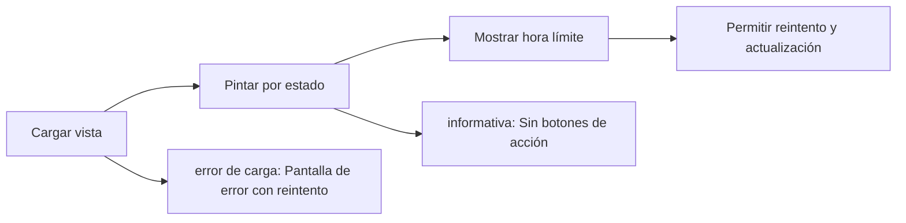

# Feature Specification: FE-02 — Vista de viaje

**Created**: 2026-10-19  
**Status**: draft  
**Flow**: FE-02 Vista de viaje  
**Related Specs**: [FE-02.1 Carga y mensaje de lentitud](83-fe-02-1-carga-y-mensaje-de-lentitud.md), [FE-02.2 Pintado por estado](84-fe-02-2-pintado-por-estado.md), [FE-02.3 Hora límite en UTC y cuenta regresiva](85-fe-02-3-hora-limite-en-utc-y-cuenta-regresiva.md), [FE-02.4 Error de carga con reintento](86-fe-02-4-error-de-carga-con-reintento.md), [FE-02.5 Catálogo de textos y lista blanca de campos](87-fe-02-5-catalogo-de-textos-y-lista-blanca-de-campos.md), [FE-02.6 Botón «Actualizar»](88-fe-02-6-boton-actualizar.md), [FE-02.7 Destino del foco](89-fe-02-7-destino-del-foco.md), [FE-02.8 Cambio de puerta destacado](90-fe-02-8-cambio-de-puerta-destacado.md), [F-01 Evaluar viaje como pasajero](01-f-01-evaluar-viaje-como-pasajero.md), [FE-03 Aceptar opción (front)](91-fe-03-aceptar-opcion-front.md), [FE-04 Hablar con una persona (front)](97-fe-04-hablar-con-una-persona-front.md)  
**Origen (DEC/H)**: DEC-02, DEC-04, DEC-05, DEC-07, DEC-09, DEC-12, DEC-15, DEC-16, DEC-17, DEC-18, DEC-19, DEC-21, DEC-24, DEC-27, DEC-28, DEC-31, DEC-36, H-08, H-13  
**Pruebas (TC)**: TC-01, TC-02, TC-03, TC-09, TC-12, TC-30, TC-45, TC-51, TC-54, TC-58, TC-60  
**Contratos externos**: §1.1 (fila 2: TripView), DESIGN_CONTRACT (inventario de componentes y 10 pantallas)  

## Reglas de este documento

> Este spec es FUNCIONAL, no técnico: describe QUÉ hace el sistema, no CÓMO. Usa lenguaje de negocio; las siete herramientas externas se nombran por su función y se referencian por la sección de `sdd/reports/EXTERNAL_CONTRACTS.md`. Los casos borde se DOCUMENTAN; los valores de configuración se citan por el nombre del parámetro (NFR-012) con su valor por defecto entre paréntesis.

**Alcance**: Pantalla principal para el pasajero: pide la evaluación con el modo pasajero y pinta, según el estado, la carga, la vista sin anomalía, la informativa, el retraso con opción propuesta, el conflicto de fuentes, la ausencia de opción viable, la solicitud registrada, la lectura fallida y el error de carga, con el cambio de puerta siempre destacado.

## User Scenarios & Testing *(mandatory)*

### User Story 1 - El pasajero entiende su situación de un vistazo (Priority: P1)

Como pasajero, quiero abrir la pantalla y ver primero qué pasó, luego qué implica y al final qué puedo hacer, con una sola acción principal.

**Why this priority**: Es la cara del producto; el resto del flujo se juzga desde aquí.

**Independent Test**: Se prueba con las diez pantallas del DESIGN_CONTRACT y comparando textos obligatorios.

**Acceptance Scenarios**:

1. **Scenario**: Retraso con opción propuesta
   - **Given** la evaluación trae retraso, reglas, una opción propuesta y acciones
   - **When** se pinta la vista
   - **Then** se ve el resumen del viaje, las alertas, las reglas plegadas con «Se cumplen X de Y reglas», la opción propuesta, la vía «Si prefieres no viajar», la hora límite con cuenta regresiva y una sola acción primaria

2. **Scenario**: Sin anomalía
   - **Given** la evaluación no trae anomalía
   - **When** se pinta
   - **Then** solo el contexto del viaje con «Estado del vuelo» de cada segmento, sin alertas, reglas, opciones ni botones de acción, y el botón secundario «Actualizar»

3. **Scenario**: Informativa
   - **Given** retraso sin política rota
   - **When** se pinta
   - **Then** alerta informativa del retraso con «Con la información actual, este retraso no da lugar a acciones disponibles para ti. Vuelve a consultar tu viaje más tarde.», la estimación rotulada, las reglas plegadas con «Se cumplen 1 de 5 reglas», la aclaración «Cumplir una regla no siempre da lugar a una acción.», «Actualizar» y sin opciones ni soporte

4. **Scenario**: Solo puerta
   - **Given** el único evento es un cambio de puerta
   - **When** se pinta
   - **Then** cada segmento muestra «Estado del vuelo: Horario programado» sin ícono de estado, la puerta 24 aparte («Puerta 24 (informada a las 10:55 UTC)»), la alerta destacada de puerta, el texto «Con la información actual no hay acciones disponibles para ti. Vuelve a consultar tu viaje más tarde.» y «Actualizar»

5. **Scenario**: Error de carga
   - **Given** el contexto no pudo cargarse
   - **When** se pinta
   - **Then** «No pudimos cargar tu viaje», «Ocurrió un problema al consultar tu reserva. Inténtalo de nuevo en unos segundos.» y «Reintentar», sin soporte

6. **Scenario**: Pantalla 4: sin opción viable (TC-09)
   - **Given** SIN_OPCION_TC09: dos pasajeros adultos (R5 falsa), reglas «Se cumplen 1 de 5 reglas» y solo O2 LA2450 con 1 asiento
   - **When** se pinta
   - **Then** se ven las reglas plegadas, el aviso «No encontramos una opción que cubra a todo tu grupo» con «Las opciones disponibles no tienen asientos para los 2 pasajeros juntos, y no ofrecemos separar al grupo. Una persona puede ayudarte con otras alternativas.», «Una persona revisará tu caso. Esto no cambia tu reserva.» y «Hablar con una persona» de un clic; no se muestra ninguna opción no viable

7. **Scenario**: Pernocte en la pantalla 2 (TC-28)
   - **Given** BASE_TC01 con O1 LA2412 el 16 sep a las 08:15, un día después de la nueva llegada
   - **When** se pinta
   - **Then** además de la tarjeta de la opción aparece la alerta de pernocte, última de las alertas: «Posible asistencia por pernocte» y «Tu nueva salida es al día siguiente: podrías tener derecho a asistencia; un agente lo confirmará.», sin cifras

8. **Scenario**: Orden de las alertas (TC-52)
   - **Given** BASE_TC01 con una alerta crítica de conflicto en otro viaje, retraso de 160 min, puerta 24, conexión en riesgo y pernocte, y GATE_SOLO_TC51 sin retraso
   - **When** se pintan
   - **Then** el orden es críticas, retraso, puerta (justo tras el retraso), conexión y pernocte; sin retraso la puerta va primero

9. **Scenario**: Aviso de menor y reembolso (TC-01, TC-11)
   - **Given** BASE_TC01 con un niño en el grupo y la vía de reembolso (O3 sin respaldo recuperado)
   - **When** se pinta
   - **Then** el aviso «Tu grupo incluye a un menor: esta decisión necesita la validación de uno de nuestros agentes.» acompaña a la propuesta y la vía de reembolso dice «Si prefieres no viajar, un agente puede revisar contigo las alternativas.» sin monto, plazo ni código de política

10. **Scenario**: Pantalla 2 del caso base (TC-01)
   - **Given** BASE_TC01 con retraso de 160 min en LA500, puerta 24 informada a las 10:55 UTC y la opción O1 LA2412
   - **When** se pinta la vista
   - **Then** se ven en la zona superior del cliente el saludo «Hola, Ana», el aviso «Tienes una sugerencia pendiente de aprobación», la sección «Estado de tu viaje», la «Observación: el retraso compromete tu conexión...» destacada, «Te proponemos: Cambiar tu vuelo a LA2412...» y el botón «Aceptar opción y contactar a un agente de soporte»

### User Story 2 - Separación estricta entre la vista limpia del pasajero y el panel gris de soporte/debug operacional (Priority: P1)

Como pasajero quiero ver en la parte superior una interfaz limpia, clara y amable sin códigos técnicos ni jerga operacional que me genere dudas, mientras que como ingeniero o agente de soporte quiero ver en un contenedor gris separado en la parte inferior toda la información operacional, las reglas activadas (`R1..R5`), las referencias de política (`POL-DELAY-2026-03`), la completitud (`PARTIAL`) y las opciones descartadas con sus causas.

**Why this priority**: Evita confundir al pasajero con metadatos internos (`[INFO]`, `[ESTIMATE]`, `[NEXT_STEP]`, `PARTIAL`, `POL-DELAY-2026-03`, `O2`/`O3` descartadas) sin perder la evidencia de trazabilidad y depuración en la demostración.

**Independent Test**: Se prueba inspeccionando la zona superior del cliente (libre de códigos técnicos) y el contenedor gris inferior de soporte/debug en los 6 escenarios.

**Acceptance Scenarios**:

1. **Scenario**: Vista superior del cliente limpia y amable en el caso base (TC-01)
   - **Given** la evaluación del caso base `ABC123` (`BASE_TC01`)
   - **When** se renderiza la zona superior del pasajero
   - **Then** muestra «Hola, Ana», «Tienes una sugerencia pendiente de aprobación» (sin `PARTIAL` ni `decision_id`), la sección «Estado de tu viaje», los mensajes sin prefijos `[INFO]`/`[ESTIMATE]`/`[NEXT_STEP]` ni `(POL-DELAY-2026-03)`, el destaque «Observación: el retraso compromete tu conexión en el aeropuerto de escala (sujeto a tiempo mínimo de conexión).», la propuesta «Te proponemos: Cambiar tu vuelo a LA2412...», la nota «Tu grupo incluye a un menor: esta decisión necesita la validación de uno de nuestros agentes.», «Si prefieres no viajar, un agente puede revisar contigo las alternativas.» y el botón «Aceptar opción y contactar a un agente de soporte» (o «Contactar a un ejecutivo» cuando no hay opción viable)

2. **Scenario**: Panel inferior gris de soporte y debug operacional (TC-01, TC-09)
   - **Given** cualquier evaluación devuelta por el backend
   - **When** se renderiza el contenedor inferior en gris (`Debug Interno`)
   - **Then** agrupa ordenadamente `decision_id`, `decision_state` técnico, `completeness: PARTIAL` (`missing_fields`), eventos elegidos y descartados (`SOURCE_DEGRADED`), variables derivadas, reglas activadas y no activadas de `POL-DELAY-2026-03`, opciones descartadas (`O2`, `O3`) con sus razones técnicas, etiquetas `[INFO]`/`[ESTIMATE]`/`[NEXT_STEP]` con `policy_ref` y el JSON completo

---

### Edge Cases

> Solo se documentan; los marcados MUST-IMPLEMENT se vuelven requisito FR-XXX y se implementan con TDD, los DEFERRED quedan para una iteración posterior.

#### System Errors
- [MUST-IMPLEMENT] Cuando la vista tarda más de 1,5 s → aparece «Esto está tardando más de lo habitual. Seguimos consultando tu viaje.» (FR-111)

#### Invalid Data
- [MUST-IMPLEMENT] Cuando falta el titular adulto → se omite el saludo (FR-003)
- [MUST-IMPLEMENT] Cuando una cadena visible no está en el catálogo → falla la prueba de catálogo (FR-113)
- [MUST-IMPLEMENT] Cuando la conexión perdida es desconocida → la decisión es BLOQUEADA, no hay opciones y se ofrece «Hablar con una persona» de un clic (FR-041)
- [MUST-IMPLEMENT] Cuando se deriva el pernocte → la pantalla incluye la alerta de pernocte con «podrías tener derecho a asistencia; un agente lo confirmará», sin cifras (FR-058)

#### Security & Permissions
- [MUST-IMPLEMENT] Cuando la vista recibe un campo fuera de la lista blanca → no se muestra (FR-112)
- [MUST-IMPLEMENT] Cuando un texto del proveedor (condición, derecho, puerta, mensaje) contiene marcado HTML → se muestra como texto plano, sin interpretarlo (NFR-013)

## Requirements *(mandatory)*

### Functional Requirements

- **FR-VIS-001**: La interfaz DEBE aplicar estilos coherentes con la identidad visual definida: CSS propio alineado con `sdd/reports/DESIGN_CONTRACT.md` (tokens de color, tipografía, espaciado y radios), sin logos ni marcas de terceros.
- **FR-VIS-002**: Está PROHIBIDO entregar HTML sin estilos: cada pantalla y cada estado de este flujo DEBE renderizarse con los estilos de la identidad, nunca con el aspecto por defecto del navegador.
- **FR-VIS-003**: La interfaz DEBE ser consistente con `sdd/reports/DESIGN_CONTRACT.md`: usa solo los componentes de su inventario y solo sus tokens; toda diferencia respecto del contrato es un defecto de la implementación, no del contrato.
- **FR-003**: El sistema DEBE mostrar siempre el contexto del viaje: segmentos (origen, destino, fecha, hora programada y estado), número de pasajeros y nombre de pila del titular (el primer pasajero adulto de la reserva; sin adulto se omite el saludo). Es la única excepción de información personal autorizada en pantalla.
- **FR-004**: Si no hay anomalía (ningún retraso relevante ni cambio de puerta validado y ninguna evidencia anómala), el sistema DEBE mostrar solo el contexto: sin alertas, reglas, opciones ni botones de acción (puede haber un botón «Actualizar» que solo vuelve a consultar y no es una acción externa), y el pasajero ve que todo está en orden. Con un cambio de puerta validado y sin retraso la decisión es INFORMATIVA con la puerta destacada. La evidencia degradada no genera alerta pero aplica FR-014. El soporte humano solo se ofrece cuando hay una acción posible.
- **FR-007**: Ante un evento de tipo desconocido o no soportado (por ejemplo una cancelación), el sistema NO DEBE interpretarlo: muestra un aviso neutro («una persona debe revisar tu vuelo») y ofrece el caso humano con el motivo `UNSUPPORTED_EVENT_TYPE`.
- **FR-008**: Con un retraso relevante validado el sistema DEBE consultar la política de retrasos y evaluar todas sus reglas, mostrando las que se cumplen y las que no con los valores usados. Una política vacía, o una regla cumplida cuyo indicador de aprobación humana falta o no es verdadero/falso, deja la decisión BLOQUEADA y con caso humano ofrecido; un fallo de lectura del contexto o de los eventos no produce decisión; un fallo de lectura de la política o de las opciones deja la decisión BLOQUEADA con soporte ofrecido.
- **FR-014**: Un segmento con solo evidencia degradada DEBE mostrarse como «sin información verificada» (nunca «a tiempo»), sin alerta ni botón. Un segmento sin ningún evento, o solo con eventos que no informan la salida, DEBE mostrar su horario programado sin afirmar estado ni alertar.
- **FR-023**: El tiempo mínimo de conexión es un dato requerido (`MIN_CONNECTION_MINUTES` por aeropuerto, 0 por defecto, rotulado «supuesto, no provisto»). Con tiempo no provisto un «falso» nunca se afirma en el rango incierto, la regla de conexión queda indeterminada y se ofrece el caso humano; un «falso» con tiempo no provisto se rotula «estimada, sujeta al tiempo mínimo de conexión» y la interfaz nunca dice «tu conexión está segura». Se registran los supuestos A1 (el retraso se propaga íntegro), A2 (tiempo mínimo no provisto) y A3 (el segmento siguiente no se retiene), y el dato queda en la lista de datos a solicitar.
- **FR-039**: Hay política rota si al menos una regla cumplida concede un derecho de remedio (`REMEDY_RIGHTS`; por defecto cambio sin costo, vale de comida y compensación en dinero). Un retraso sin política rota deja la decisión INFORMATIVA: se informa el retraso y se muestran las reglas evaluadas, sin consultar opciones, sin rebooking, compensación, soporte ni notificación de política, hasta que exista política rota. Los derechos que no son de remedio (trato prioritario) modifican el trato pero no rompen la política por sí solos.
- **FR-043**: Si se excluyó una opción por no cubrir al grupo o dejar al menor solo, el mensaje DEBE decirlo explícitamente y remitir a soporte.
- **FR-046**: La vía de reembolso DEBE mencionarse con redacción no afirmativa («si prefieres no viajar, una persona puede revisar contigo las alternativas»): no afirma un derecho y por eso queda exenta de referencia de política; la condición de tarifa «no reembolsable» no se usa para negar.
- **FR-047**: Sin opción viable el sistema DEBE mostrar un mensaje claro y ofrecer el caso humano con el motivo `NO_OPTION_COVERS_GROUP` si la causa son los asientos o separar al grupo, o `NO_VIABLE_OPTION` en otro caso.
- **FR-056**: Una solicitud creada DEBE mostrarse como «solicitud registrada, pendiente de confirmación, sujeta a disponibilidad» con su vencimiento; la confirmación queda fuera de la versión 1.
- **FR-058**: Ante pernocte el mensaje DEBE decir «podrías tener derecho a asistencia; un agente lo confirmará», sin cifras.
- **FR-066**: El sistema DEBE verificar la integridad de las lecturas: instante de lectura presente y en UTC, al menos un segmento y un pasajero, segmentos ordenados y encadenados, horas y fechas con formato válido, menor con edad y menor acompañado de adulto; en un retraso, minutos enteros mayores o iguales a 1 y nueva salida presente (un retraso menor o igual a cero es retraso incoherente). Una lectura inválida es lectura fallida (sin decisión, aviso y reintento, sin soporte); cadena rota o menor sin adulto dejan la conexión desconocida y la decisión BLOQUEADA con `BLOCKING_PARTIAL_DATA`; segmentos desordenados se reordenan sin bloqueo.
- **FR-071**: La vista DEBE mostrar la hora límite (el mínimo de los vencimientos de las opciones mostradas) en UTC y como cuenta regresiva; pasada esa hora, «sujeto a disponibilidad».
- **FR-041**: Una opción es viable si (a) los asientos disponibles cubren a todo el grupo junto; (b) existe un derecho concedido que la respalda (`CHANGE_RIGHTS`, por defecto cambio sin costo, y costo cero); (c) su referencia de política coincide con una versión vigente y no superada; (d) su tipo está soportado; (e) no está vencida; (f) es coherente con el itinerario: con conexión perdida parte del origen del segmento siguiente, llega al destino final y sale después de la nueva llegada más el tiempo mínimo de conexión; sin conexión perdida reemplaza al segmento afectado (mismo origen y destino) y sale después de la lectura; con la conexión perdida desconocida no se puede verificar (f): ninguna opción es viable por itinerario incierto, la decisión es BLOQUEADA y se ofrece soporte.
- **FR-111**: El front de prueba DEBE tener el aspecto y la sensación del centro de ayuda de una aerolínea (sin logos ni marcas), verificable con la lista de componentes y la lista de verificación de tokens de `sdd/reports/DESIGN_CONTRACT.md`: selector de escenario, contexto, alerta, reglas cumplidas y no cumplidas, opción propuesta, vía de reembolso, avisos de estimación, hora límite y «sujeto a disponibilidad», y botones de acción.
- **FR-112**: La interfaz NO DEBE mostrar información personal salvo la excepción de FR-003 ni identificadores internos innecesarios; la lista de campos visibles es cerrada.
- **FR-113**: Todo el texto visible DEBE estar en español neutro y salir del catálogo de plantillas: ninguna cadena visible fuera del catálogo, verificado por una prueba que recorre los componentes.
- **FR-114**: La interfaz DEBE separar estrictamente la **Vista del Pasajero** (parte superior limpia y amable: saludo «Hola, {nombre}», estado legible como «Tienes una sugerencia pendiente de aprobación», sección «Estado de tu viaje», mensajes sin prefijos `[INFO]`/`[ESTIMATE]`/`[NEXT_STEP]` ni códigos `POL-DELAY-*`, conexión comprometida destacada como «Observación: ...», propuesta «Te proponemos: Cambiar tu vuelo a ...», nota de menor «esta decisión necesita la validación de uno de nuestros agentes», reembolso «Si prefieres no viajar, un agente puede revisar contigo las alternativas.» y botón «Aceptar opción y contactar a un agente de soporte» o «Contactar a un ejecutivo») del **Panel Gris de Soporte y Debug Operacional** (parte inferior diferenciada en gris donde se muestran `completeness: PARTIAL`, `decision_id`, reglas activadas `R1..R5`, códigos `POL-DELAY-2026-03`, opciones descartadas y el JSON de trazabilidad).

### Non-Functional and Documentation Requirements

- **NFR-011**: Accesibilidad básica: la interfaz DEBE ofrecer roles semánticos, foco visible, navegación por teclado y contraste AA (relación de al menos 4,5:1 verificada sobre los tokens por una prueba que la calcula).
- **NFR-004**: Latencia: la vista DEBE responder en menos de 1,5 s (percentil 95) con proveedores simulados de 100 ms fijos; protocolo de aceptación: 50 solicitudes secuenciales del caso base en la máquina de desarrollo, reportando percentiles 50 y 95. La cadena de lecturas es secuencial (contexto, eventos, solo con evento relevante validado la política, y las opciones).
- **NFR-013**: Seguridad de entradas: todo acceso al registro persistente DEBE usar consultas parametrizadas (las consultas viven en archivos propios); la interfaz DEBE mostrar los textos del proveedor (condición, derecho, puerta, mensajes) como texto plano, sin insertar marcado HTML; y la evaluación, la aceptación de una opción, el caso humano y la consulta de una decisión DEBEN tener un límite de tasa por reserva y por origen (`EVALUATE_RATE_LIMIT_PER_MINUTE`, 30 por minuto), con los intentos fallidos de credencial de servicio también limitados por origen.

### Key Entities *(include if feature involves data)*

- **Pantalla del front de prueba**: Estado visible del front según la vista recibida. Campos principales:
  - `screen_state`: carga | sin anomalía | informativa | solo puerta | retraso con opción | conflicto | sin opción viable | solicitud registrada | lectura fallida | error de carga
  - `components`: lista de componentes del inventario del DESIGN_CONTRACT presentes
  - `texts`: claves del catálogo de textos usadas
  - `focus_target`: elemento que recibe el foco tras una acción
  - `aria_busy`: booleano (verdadero durante la carga)
- **Vista del viaje**: Respuesta completa para el pasajero; solo contiene campos de la lista blanca. Campos principales:
  - `decision_id`: identificador
  - `generated_at`: marca de tiempo UTC
  - `anomaly_detected`: booleano
  - `decision_state`: INFORMATIVA | AUTOMATICA | PENDIENTE_APROBACION | BLOQUEADA | nulo
  - `holder_first_name`: texto | nulo
  - `passenger_count`: entero
  - `load_status`: {trip_context: OK | INVALID, events: OK | FAILED, policy: OK | FAILED | NOT_REQUESTED, options: OK | FAILED | NOT_REQUESTED}
  - `data_as_of`: {trip_context, events, policy, options: marca de tiempo UTC | nulo}
  - `segments`: lista de estados resueltos con puerta y hora de la puerta
  - `alerts`: lista de {code: texto, severity: INFO | WARNING | CRITICAL, message_id: texto}
  - `derived_variables`: lista de variables derivadas
  - `policy`: política y reglas | nulo
  - `options`: lista de opciones viables
  - `proposed_option_id`: texto | nulo
  - `refund_notice`: mensaje validado | nulo
  - `offer_deadline`: marca de tiempo UTC | nulo
  - `actions`: lista de {action_id: texto, kind: ACCEPT_OPTION | OPEN_HUMAN_CASE, efecto: crear solicitud de cambio | crear caso humano con la opción elegida | crear caso humano, enabled: booleano, offered_reasons: lista de texto}
  - `messages`: lista de mensajes validados
  - `operations`: lista de operaciones activas de la reserva
  - `human_cases`: lista de intentos de caso humano de la situación
- **Mensaje validado**: Texto de plantilla con su evidencia, aprobado por el validador antes de mostrarse o enviarse. Campos principales:
  - `message_id`: texto
  - `template_id`: texto del catálogo
  - `kind`: INFO | ESTIMATE | WARNING | NEXT_STEP | DEADLINE
  - `text`: texto en español neutro
  - `evidence_refs`: lista de identificadores
  - `policy_ref`: texto | nulo
  - `blocked`: booleano

## Architectural Attributes *(mandatory)*

| Attribute | Value |
|-----------|-------|
| **Interaction type** | sync-http |
| **Consistency** | strong |
| **Workflow** | multi-step |
| **Read pattern** | simple |
| **Auditability** | basic |
| **Domain complexity** | medium |
| **Modularity** | feature-slice |
| **Deployment** | monolith |

## Success Criteria *(mandatory)*

### Measurable Outcomes

- **SC-001**: El pasajero identifica el estado de su viaje y la acción principal en menos de 10 segundos en las pantallas de prueba.
- **SC-002**: El 100 % del texto visible sale del catálogo.
- **SC-003**: El 100 % de los pares de color de texto y fondo cumple contraste 4,5:1.
- **SC-004**: Ninguna pantalla muestra campos de la lista prohibida.

## UI Constraints *(include for frontend/web projects)*

### Visual Requirements
- **Design system**: propio, definido en `sdd/reports/DESIGN_CONTRACT.md` (CSS propio con tokens de color, tipografía, espaciado y radios; sin librería de componentes ni logos de terceros).
- **Responsive**: sí; una columna con margen lateral de 16 px y ancho máximo de 720 px, sin desplazamiento horizontal desde 320 px; botones a ancho completo en móvil con área táctil mínima de 44 × 44 px.
- **Accessibility**: WCAG 2.1 nivel AA (NFR-011): roles semánticos, foco visible, navegación por teclado, contraste de al menos 4,5:1 en texto y 3:1 en contornos de controles; el color nunca es el único portador de significado.

### Interaction Patterns
- **Loading states**: esqueleto con `aria-busy` verdadero y, pasado 1,5 s, un aviso de lentitud.
- **Error states**: pantalla de error con reintento y sin soporte; lectura fallida con aviso y reintento.
- **Empty states**: viaje sin anomalía: solo el contexto, sin botones; sin segmentos: «No hay tramos para mostrar.».

### Style Constraints
- **Color palette**: tokens de color del DESIGN_CONTRACT (marca índigo para acciones primarias y foco, rojo solo decorativo, tintes para banners y chips); el color nunca es el único portador de significado: siempre va acompañado de texto e ícono.
- **Typography**: tipografía del sistema con escala de 14, 16, 20 y 24 px, interlineado 1,5; códigos de reglas en monoespaciada.
- **Spacing**: escala de espaciado de 4 a 32 px del DESIGN_CONTRACT; radio único de 8 px.

### Visual Spec *(mandatory for web/mobile)*

| Screen | Image | Source | Description |
|--------|-------|--------|-------------|
| Pantalla 1: vista sin anomalía | Wireframe ASCII de `sdd/reports/DESIGN_CONTRACT.md` (§Evidencia Visual); captura de imagen diferida hasta que exista el front | Wireframe de texto (alternativa autorizada cuando no hay imagen) | solo el contexto del viaje, sin botones; botón «Actualizar» |
| Pantalla 2: retraso con opción propuesta y caso humano | Wireframe ASCII de `sdd/reports/DESIGN_CONTRACT.md` (§Evidencia Visual); captura de imagen diferida hasta que exista el front | Wireframe de texto (alternativa autorizada cuando no hay imagen) | alertas, reglas plegadas, opción propuesta, vía de reembolso, acciones con cuenta regresiva y diálogo |
| Pantalla 3: conflicto de fuentes | Wireframe ASCII de `sdd/reports/DESIGN_CONTRACT.md` (§Evidencia Visual); captura de imagen diferida hasta que exista el front | Wireframe de texto (alternativa autorizada cuando no hay imagen) | aviso neutro, sin reglas, caso humano de un clic |
| Pantalla 4: sin opción viable | Wireframe ASCII de `sdd/reports/DESIGN_CONTRACT.md` (§Evidencia Visual); captura de imagen diferida hasta que exista el front | Wireframe de texto (alternativa autorizada cuando no hay imagen) | mensaje de grupo no cubierto y caso humano de un clic |
| Pantalla 5: solicitud registrada | Wireframe ASCII de `sdd/reports/DESIGN_CONTRACT.md` (§Evidencia Visual); captura de imagen diferida hasta que exista el front | Wireframe de texto (alternativa autorizada cuando no hay imagen) | «pendiente de confirmación, sujeta a disponibilidad» con vencimiento, tono informativo |
| Pantalla 6: error de carga | Wireframe ASCII de `sdd/reports/DESIGN_CONTRACT.md` (§Evidencia Visual); captura de imagen diferida hasta que exista el front | Wireframe de texto (alternativa autorizada cuando no hay imagen) | «no pudimos cargar tu viaje» con reintento y sin soporte |
| Pantalla 7: carga | Wireframe ASCII de `sdd/reports/DESIGN_CONTRACT.md` (§Evidencia Visual); captura de imagen diferida hasta que exista el front | Wireframe de texto (alternativa autorizada cuando no hay imagen) | esqueleto y mensaje de lentitud pasado 1,5 s |
| Pantalla 8: segmentos vacíos | Wireframe ASCII de `sdd/reports/DESIGN_CONTRACT.md` (§Evidencia Visual); captura de imagen diferida hasta que exista el front | Wireframe de texto (alternativa autorizada cuando no hay imagen) | lectura inválida con aviso y reintento, sin soporte |
| Pantalla 9: informativa | Wireframe ASCII de `sdd/reports/DESIGN_CONTRACT.md` (§Evidencia Visual); captura de imagen diferida hasta que exista el front | Wireframe de texto (alternativa autorizada cuando no hay imagen) | retraso sin política rota con reglas plegadas y sin botones de acción |
| Pantalla 10: solo cambio de puerta | Wireframe ASCII de `sdd/reports/DESIGN_CONTRACT.md` (§Evidencia Visual); captura de imagen diferida hasta que exista el front | Wireframe de texto (alternativa autorizada cuando no hay imagen) | puerta destacada, horario programado sin ícono de estado, sin política |

## Traceability *(mandatory after implementation)*

> Las columnas de archivo y línea se registran en la verificación de trazabilidad posterior a la implementación; hoy cada criterio queda enlazado a su origen y a las pruebas que lo verifican.

| Criterion | Origen | Prueba (TC) | Source File | Line(s) |
|-----------|--------|-------------|-------------|---------|
| FR-VIS-001 | Usuario (2026-10-19) | sin TC en el mapa §6 de REQUERIMIENTOS_V1 | se registra en la verificación posterior a la implementación | se registra en la verificación posterior a la implementación |
| FR-VIS-002 | Usuario (2026-10-19) | sin TC en el mapa §6 de REQUERIMIENTOS_V1 | se registra en la verificación posterior a la implementación | se registra en la verificación posterior a la implementación |
| FR-VIS-003 | Usuario (2026-10-19) | sin TC en el mapa §6 de REQUERIMIENTOS_V1 | se registra en la verificación posterior a la implementación | se registra en la verificación posterior a la implementación |
| FR-003 | DEC-04, DEC-21 | sin TC en el mapa §6 de REQUERIMIENTOS_V1 | se registra en la verificación posterior a la implementación | se registra en la verificación posterior a la implementación |
| FR-004 | DEC-02 | TC-01, TC-45, TC-54 | se registra en la verificación posterior a la implementación | se registra en la verificación posterior a la implementación |
| FR-007 | DEC-15, DEC-31 | TC-01 | se registra en la verificación posterior a la implementación | se registra en la verificación posterior a la implementación |
| FR-008 | DEC-02, DEC-12 | TC-01 | se registra en la verificación posterior a la implementación | se registra en la verificación posterior a la implementación |
| FR-014 | DEC-09 | TC-01, TC-02, TC-54 | se registra en la verificación posterior a la implementación | se registra en la verificación posterior a la implementación |
| FR-023 | DEC-07, H-08, H-13 | TC-01 | se registra en la verificación posterior a la implementación | se registra en la verificación posterior a la implementación |
| FR-039 | DEC-02, DEC-05 | TC-01, TC-45 | se registra en la verificación posterior a la implementación | se registra en la verificación posterior a la implementación |
| FR-043 | DEC-16 | TC-01 | se registra en la verificación posterior a la implementación | se registra en la verificación posterior a la implementación |
| FR-046 | DEC-17, DEC-28 | TC-01 | se registra en la verificación posterior a la implementación | se registra en la verificación posterior a la implementación |
| FR-047 | DEC-15 | TC-01, TC-09 | se registra en la verificación posterior a la implementación | se registra en la verificación posterior a la implementación |
| FR-056 | DEC-18, DEC-19 | TC-01, TC-30 | se registra en la verificación posterior a la implementación | se registra en la verificación posterior a la implementación |
| FR-058 | DEC-27 | TC-01 | se registra en la verificación posterior a la implementación | se registra en la verificación posterior a la implementación |
| FR-066 | DEC-12, DEC-31 | sin TC en el mapa §6 de REQUERIMIENTOS_V1 | se registra en la verificación posterior a la implementación | se registra en la verificación posterior a la implementación |
| FR-071 | DEC-19 | sin TC en el mapa §6 de REQUERIMIENTOS_V1 | se registra en la verificación posterior a la implementación | se registra en la verificación posterior a la implementación |
| FR-041 | DEC-16, DEC-17 | TC-01, TC-09, TC-60 | se registra en la verificación posterior a la implementación | se registra en la verificación posterior a la implementación |
| FR-111 | DEC-04 | sin TC en el mapa §6 de REQUERIMIENTOS_V1 | se registra en la verificación posterior a la implementación | se registra en la verificación posterior a la implementación |
| FR-112 | DEC-21 | sin TC en el mapa §6 de REQUERIMIENTOS_V1 | se registra en la verificación posterior a la implementación | se registra en la verificación posterior a la implementación |
| FR-113 | DEC-36 | sin TC en el mapa §6 de REQUERIMIENTOS_V1 | se registra en la verificación posterior a la implementación | se registra en la verificación posterior a la implementación |
| NFR-011 | DEC-04 | sin TC en el mapa §6 de REQUERIMIENTOS_V1 | se registra en la verificación posterior a la implementación | se registra en la verificación posterior a la implementación |
| NFR-004 | DEC-24 | sin TC en el mapa §6 de REQUERIMIENTOS_V1 | se registra en la verificación posterior a la implementación | se registra en la verificación posterior a la implementación |
| NFR-013 | Usuario (2026-10-19) | TC-58 | se registra en la verificación posterior a la implementación | se registra en la verificación posterior a la implementación |
| SC-001 | criterio medible de este spec | TC-01, TC-02, TC-03, TC-09, TC-12, TC-30, TC-45, TC-51, TC-54, TC-58, TC-60 | se registra en la verificación posterior a la implementación | se registra en la verificación posterior a la implementación |
| SC-002 | criterio medible de este spec | TC-01, TC-02, TC-03, TC-09, TC-12, TC-30, TC-45, TC-51, TC-54, TC-58, TC-60 | se registra en la verificación posterior a la implementación | se registra en la verificación posterior a la implementación |
| SC-003 | criterio medible de este spec | TC-01, TC-02, TC-03, TC-09, TC-12, TC-30, TC-45, TC-51, TC-54, TC-58, TC-60 | se registra en la verificación posterior a la implementación | se registra en la verificación posterior a la implementación |
| SC-004 | criterio medible de este spec | TC-01, TC-02, TC-03, TC-09, TC-12, TC-30, TC-45, TC-51, TC-54, TC-58, TC-60 | se registra en la verificación posterior a la implementación | se registra en la verificación posterior a la implementación |

## Business Process (BPM View)

```
Cargar vista → Pintar por estado → Mostrar hora límite → Permitir reintento y actualización
```



### Subprocesses (if applicable)

```
FE-02.1: Carga y mensaje de lentitud
FE-02.2: Pintado por estado
FE-02.3: Hora límite en UTC y cuenta regresiva
FE-02.4: Error de carga con reintento
FE-02.5: Catálogo de textos y lista blanca de campos
FE-02.6: Botón «Actualizar»
FE-02.7: Destino del foco
FE-02.8: Cambio de puerta destacado
```
