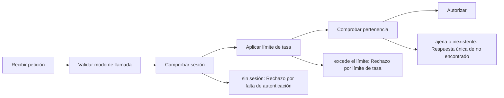

# Feature Specification: SF-01.1 — Validación de cuerpo y autorización de sesión

**Created**: 2026-10-19  
**Status**: draft  
**Flow**: [F-01 Evaluar viaje como pasajero](01-f-01-evaluar-viaje-como-pasajero.md) (subflujo)  
**Related Specs**: [F-01 Evaluar viaje como pasajero](01-f-01-evaluar-viaje-como-pasajero.md), [SF-01.2 Lectura de contexto y eventos](03-sf-01-2-lectura-de-contexto-y-eventos.md)  
**Origen (DEC/H)**: DEC-12, DEC-21  
**Pruebas (TC)**: TC-21, TC-58  
**Contratos externos**: §1.1 (fila 2), catálogo de códigos de error propios (autenticación, límite de tasa y «no encontrado»), §2.4 (`EVALUATE_RATE_LIMIT_PER_MINUTE`)  

## Reglas de este documento

> Este spec es FUNCIONAL, no técnico: describe QUÉ hace el sistema, no CÓMO. Usa lenguaje de negocio; las siete herramientas externas se nombran por su función y se referencian por la sección de `sdd/reports/EXTERNAL_CONTRACTS.md`. Los casos borde se DOCUMENTAN; los valores de configuración se citan por el nombre del parámetro (NFR-012) con su valor por defecto entre paréntesis.

**Alcance**: Comprueba quién pide la evaluación y si puede pedirla: el valor del modo de llamada, la sesión del pasajero y la pertenencia de la reserva.

## User Scenarios & Testing *(mandatory)*

### User Story 1 - Solo el dueño de la sesión ve su reserva (Priority: P1)

Como pasajero, quiero que mi reserva solo pueda abrirse con mi sesión, para que nadie más pueda saber si existe ni ver su contenido.

**Why this priority**: Es la primera barrera de privacidad y condiciona todo el resto del flujo.

**Independent Test**: Se prueba pidiendo la evaluación con la sesión correcta, sin sesión, con la sesión de otra reserva y con una reserva inexistente, y comparando las respuestas.

**Acceptance Scenarios**:

1. **Scenario**: Sesión correcta
   - **Given** el modo de llamada indica pasajero y la sesión coincide con la reserva de la ruta
   - **When** se pide la evaluación
   - **Then** el flujo continúa con la sesión autorizada

2. **Scenario**: Reserva ajena e inexistente indistinguibles
   - **Given** una sesión de la reserva A pide la reserva B (ajena) y luego la reserva Z (inexistente)
   - **When** se comparan ambas respuestas
   - **Then** ambas son la misma respuesta de «no encontrado», con el mismo contenido y sin repetir la entrada

3. **Scenario**: Límite de tasa
   - **Given** la misma reserva y credencial ya hicieron `EVALUATE_RATE_LIMIT_PER_MINUTE` solicitudes en el último minuto
   - **When** llega una más
   - **Then** se rechaza por límite de tasa antes de comprobar la pertenencia y sin consultar herramientas externas

4. **Scenario**: Falta la sesión
   - **Given** la petición no trae sesión o la sesión simulada está apagada
   - **When** se pide la evaluación
   - **Then** el sistema rechaza por falta de autenticación y no consulta ninguna herramienta externa

5. **Scenario**: Reserva ajena e inexistente (TC-21)
   - **Given** la sesión de ABC123 y las reservas XYZ789 (ajena) y ZZZ999 (inexistente)
   - **When** se piden ambas evaluaciones
   - **Then** las dos respuestas son idénticas de «no encontrado», sin repetir el identificador pedido

---

### Edge Cases

> Solo se documentan; los marcados MUST-IMPLEMENT se vuelven requisito FR-XXX y se implementan con TDD, los DEFERRED quedan para una iteración posterior.

#### Invalid Data
- [MUST-IMPLEMENT] Cuando el modo de llamada falta, tiene otro valor distinto de pasajero o el cuerpo trae campos adicionales → el sistema DEBE rechazar por validación, sin repetir la entrada (FR-120)
- [MUST-IMPLEMENT] Cuando el formato de la reserva es inválido y la sesión coincide → el sistema DEBE rechazar por validación; con reserva ajena de formato inválido gana la respuesta de «no encontrado» (FR-001)

#### Security & Permissions
- [MUST-IMPLEMENT] Cuando falta la sesión del pasajero o la sesión simulada está deshabilitada → el sistema DEBE rechazar por falta de autenticación; el modo sistema exige su credencial de servicio (FR-120) (FR-001)
- [MUST-IMPLEMENT] Cuando la reserva es ajena o inexistente → el sistema DEBE responder idéntico en ambos casos (FR-001)
- [MUST-IMPLEMENT] Cuando la misma reserva y credencial superan `EVALUATE_RATE_LIMIT_PER_MINUTE` (30) solicitudes por minuto → rechazo por límite de tasa, comprobado tras la credencial y antes de la pertenencia para no depender de la existencia de la reserva (NFR-013)

## Requirements *(mandatory)*

### Functional Requirements

- **FR-001**: El sistema DEBE operar sobre la sesión autenticada del pasajero y comprobar que la reserva y la decisión solicitadas pertenezcan a esa sesión; una reserva ajena y una inexistente DEBEN producir exactamente la misma respuesta de «no encontrado», sin confirmar la existencia de ninguna. La sesión simulada solo existe con el parámetro `DEV_SESSION_HEADER_ENABLED` (apagado por defecto): en cualquier otro perfil toda petición del pasajero sin sesión DEBE rechazarse por falta de autenticación, y toda petición del sistema DEBE exigir la credencial de servicio (FR-120). Los errores NO DEBEN mostrar trazas ni repetir la entrada, nunca se pide ni se muestra documento de identidad, y el identificador de decisión DEBE ser aleatorio y no adivinable.
- **FR-120**: La evaluación DEBE recibir un parámetro `caller` obligatorio (`user` o `system`): el pasajero exige su sesión (FR-001); otro sistema exige una credencial de servicio (`SERVICE_API_KEY`, apagada por defecto) y NUNCA recibe información personal ni la vista completa, solo el identificador de decisión, el estado de la decisión, el motivo del cambio, el estado de la notificación y si requiere revisión manual.

### Non-Functional and Documentation Requirements

- **NFR-003**: Seguridad: el analizador de reglas DEBE operar sin ejecución dinámica, las entradas se validan estrictamente, el origen permitido se acota al front y no hay secretos en el repositorio.
- **NFR-013**: Seguridad de entradas: todo acceso al registro persistente DEBE usar consultas parametrizadas (las consultas viven en archivos propios); la interfaz DEBE mostrar los textos del proveedor (condición, derecho, puerta, mensajes) como texto plano, sin insertar marcado HTML; y la evaluación, la aceptación de una opción, el caso humano y la consulta de una decisión DEBEN tener un límite de tasa por reserva y por origen (`EVALUATE_RATE_LIMIT_PER_MINUTE`, 30 por minuto), con los intentos fallidos de credencial de servicio también limitados por origen.

### Key Entities *(include if feature involves data)*

- **Sesión y credencial**: Identidad con la que se pide una evaluación: sesión del pasajero o credencial de servicio. Campos principales:
  - `caller`: user | system
  - `session_booking`: texto | ausente (solo modo user)
  - `service_key`: texto | ausente (solo modo system; comparación en tiempo constante)
  - `requests_last_minute`: entero (límite `EVALUATE_RATE_LIMIT_PER_MINUTE`)
  - `authorized`: booleano

## Architectural Attributes *(mandatory)*

| Attribute | Value |
|-----------|-------|
| **Interaction type** | sync-http |
| **Consistency** | strong |
| **Workflow** | single-step |
| **Read pattern** | simple |
| **Auditability** | full-history |
| **Domain complexity** | medium |
| **Modularity** | bounded-context |
| **Deployment** | monolith |

## Success Criteria *(mandatory)*

### Measurable Outcomes

- **SC-001**: El 100 % de las respuestas a una reserva ajena y a una inexistente son idénticas en estado y contenido.
- **SC-002**: El 100 % de las peticiones sin sesión válida se rechaza antes de consultar cualquier herramienta externa.
- **SC-003**: Ningún mensaje de error contiene trazas ni repite la entrada recibida.

## Traceability *(mandatory after implementation)*

> Las columnas de archivo y línea se registran en la verificación de trazabilidad posterior a la implementación; hoy cada criterio queda enlazado a su origen y a las pruebas que lo verifican.

| Criterion | Origen | Prueba (TC) | Source File | Line(s) |
|-----------|--------|-------------|-------------|---------|
| FR-001 | DEC-21 | TC-21 | se registra en la verificación posterior a la implementación | se registra en la verificación posterior a la implementación |
| FR-120 | Usuario (2026-10-19) | sin TC en el mapa §6 de REQUERIMIENTOS_V1 | se registra en la verificación posterior a la implementación | se registra en la verificación posterior a la implementación |
| NFR-003 | DEC-12 | sin TC en el mapa §6 de REQUERIMIENTOS_V1 | se registra en la verificación posterior a la implementación | se registra en la verificación posterior a la implementación |
| NFR-013 | Usuario (2026-10-19) | TC-58 | se registra en la verificación posterior a la implementación | se registra en la verificación posterior a la implementación |
| SC-001 | criterio medible de este spec | TC-21, TC-58 | se registra en la verificación posterior a la implementación | se registra en la verificación posterior a la implementación |
| SC-002 | criterio medible de este spec | TC-21, TC-58 | se registra en la verificación posterior a la implementación | se registra en la verificación posterior a la implementación |
| SC-003 | criterio medible de este spec | TC-21, TC-58 | se registra en la verificación posterior a la implementación | se registra en la verificación posterior a la implementación |

## Business Process (BPM View)

```
Recibir petición → Validar modo de llamada → Comprobar sesión → Aplicar límite de tasa → Comprobar pertenencia → Autorizar
```



