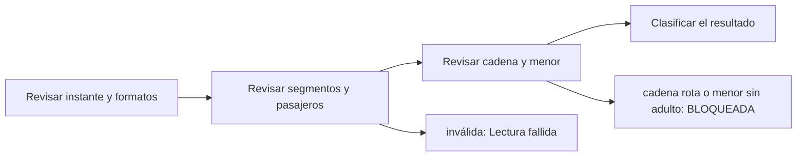

# Feature Specification: SF-01.3 — Integridad de lecturas

**Created**: 2026-10-19  
**Status**: draft  
**Flow**: [F-01 Evaluar viaje como pasajero](01-f-01-evaluar-viaje-como-pasajero.md) (subflujo)  
**Related Specs**: [F-01 Evaluar viaje como pasajero](01-f-01-evaluar-viaje-como-pasajero.md), [SF-01.2 Lectura de contexto y eventos](03-sf-01-2-lectura-de-contexto-y-eventos.md), [SF-01.4 Validación de eventos](05-sf-01-4-validacion-de-eventos.md)  
**Origen (DEC/H)**: DEC-09, DEC-11, DEC-12, DEC-13, DEC-31  
**Pruebas (TC)**: TC-39  
**Contratos externos**: §2.1 (herramienta 1: invariantes que el sistema verifica), matriz de errores de §2.1  

## Reglas de este documento

> Este spec es FUNCIONAL, no técnico: describe QUÉ hace el sistema, no CÓMO. Usa lenguaje de negocio; las siete herramientas externas se nombran por su función y se referencian por la sección de `sdd/reports/EXTERNAL_CONTRACTS.md`. Los casos borde se DOCUMENTAN; los valores de configuración se citan por el nombre del parámetro (NFR-012) con su valor por defecto entre paréntesis.

**Alcance**: Verifica que lo leído sea utilizable: instante de lectura, segmentos y pasajeros presentes, formatos válidos, cadena de segmentos y composición del grupo.

## User Scenarios & Testing *(mandatory)*

### User Story 1 - El sistema distingue una lectura inútil de una situación que exige a una persona (Priority: P1)

Como pasajero, quiero que si los datos de mi viaje llegan incompletos o rotos el sistema no invente conclusiones: o me pide reintentar o me deriva a una persona, según el caso.

**Why this priority**: Una decisión sobre datos corruptos sería peor que ninguna decisión.

**Independent Test**: Se prueba con lecturas que omiten el instante de lectura, con cero segmentos, con cadena rota, con segmentos desordenados y con un menor sin adulto.

**Acceptance Scenarios**:

1. **Scenario**: Lectura inválida
   - **Given** la lectura del contexto no trae instante de lectura o trae cero segmentos
   - **When** se verifica la integridad
   - **Then** es una lectura fallida: sin decisión, con aviso y reintento y sin soporte

2. **Scenario**: Cadena rota o menor sin adulto
   - **Given** el destino de un segmento no coincide con el origen del siguiente, o hay un niño sin adulto en la reserva
   - **When** se verifica la integridad
   - **Then** la conexión queda desconocida y la decisión BLOQUEADA con el motivo de datos parciales bloqueantes

3. **Scenario**: Segmentos desordenados
   - **Given** los segmentos llegan fuera de orden pero encadenan
   - **When** se verifica la integridad
   - **Then** se reordenan por fecha y salida programada y no hay bloqueo

4. **Scenario**: Cadena de segmentos rota (TC-39)
   - **Given** el destino de LA500 es LIM pero el origen del segundo segmento es MEX
   - **When** se verifica la integridad
   - **Then** la conexión queda desconocida y la decisión es BLOQUEADA con datos parciales bloqueantes

---

### Edge Cases

> Solo se documentan; los marcados MUST-IMPLEMENT se vuelven requisito FR-XXX y se implementan con TDD, los DEFERRED quedan para una iteración posterior.

#### System Errors
- [MUST-IMPLEMENT] Cuando la lectura es parcial pero completa para decidir → la indicación de datos parciales es solo contexto y no bloquea (FR-086)

#### Invalid Data
- [MUST-IMPLEMENT] Cuando falta el instante de lectura, no hay segmentos o pasajeros o el formato es inválido → lectura fallida (FR-066)
- [MUST-IMPLEMENT] Cuando un niño no trae edad → lectura inválida (FR-066)
- [MUST-IMPLEMENT] Cuando un retraso trae minutos menores o iguales a cero → retraso incoherente (en realidad sería un adelanto) (FR-066)
- [DEFERRED] Adelantos de vuelo (retraso negativo) como evento propio: se documenta para la segunda etapa (FR-066)

## Requirements *(mandatory)*

### Functional Requirements

- **FR-066**: El sistema DEBE verificar la integridad de las lecturas: instante de lectura presente y en UTC, al menos un segmento y un pasajero, segmentos ordenados y encadenados, horas y fechas con formato válido, menor con edad y menor acompañado de adulto; en un retraso, minutos enteros mayores o iguales a 1 y nueva salida presente (un retraso menor o igual a cero es retraso incoherente). Una lectura inválida es lectura fallida (sin decisión, aviso y reintento, sin soporte); cadena rota o menor sin adulto dejan la conexión desconocida y la decisión BLOQUEADA con `BLOCKING_PARTIAL_DATA`; segmentos desordenados se reordenan sin bloqueo.
- **FR-038**: Si en cualquier segmento existe `SOURCE_CONFLICT`, `UNSUPPORTED_EVENT_TYPE`, `INCONSISTENT_DELAY`, `MULTIPLE_AFFECTED_SEGMENTS`, `RULE_ERROR`, una regla no evaluable en los términos de FR-033 o una lectura íntegra inválida (FR-066), la decisión DEBE ser BLOQUEADA: ninguna regla cumplida habilita la creación de la solicitud de cambio y aceptar una opción solo puede abrir un caso humano.
- **FR-086**: La indicación de datos parciales de una lectura es información de contexto y solo bloquea si falta un campo necesario para decidir. Una lectura fallida o inválida da aviso y reintento sin soporte; el caso humano de datos parciales solo se ofrece si la decisión queda BLOQUEADA por una anomalía que exige validación manual.

### Key Entities *(include if feature involves data)*

- **Contexto del viaje**: Reserva del pasajero con sus tramos; se reduce de inmediato a lo mínimo necesario (sin correo, teléfono, documento, nombre completo ni edad). Campos principales:
  - `booking_id`: texto de 6 caracteres alfanuméricos
  - `passenger_count`: entero ≥ 1
  - `passengers`: lista de {passenger_id: texto, type: ADULT | CHILD | otro | ausente}
  - `segments`: lista de {segment_id: texto, flight_number: texto, origin: código de aeropuerto, destination: código de aeropuerto, date: fecha, scheduled_departure: hora local HH:MM, scheduled_arrival: hora local HH:MM}
  - `fare_conditions`: {changeable: booleano, refundable: booleano, fare_family: texto, change_penalty_amount: entero | ausente}
  - `retrieved_at`: marca de tiempo UTC
  - `completeness`: enumeración abierta (p. ej. PARTIAL)
  - `missing_fields`: lista de texto
- **Decisión**: Resultado de evaluar la reserva: su estado y las razones que lo explican. Campos principales:
  - `decision_id`: identificador aleatorio no adivinable
  - `decision_state`: INFORMATIVA | AUTOMATICA | PENDIENTE_APROBACION | BLOQUEADA | nulo
  - `anomaly_detected`: booleano
  - `fingerprint`: texto: huella de decisión sin opción
  - `human_case_reasons`: lista ordenada de motivos de caso humano
  - `support_offered`: booleano
  - `compensation_eligible`: booleano
  - `needs_manual_review`: booleano (campo interno: se persiste y no se entrega a la sesión del pasajero, FR-093)

## Architectural Attributes *(mandatory)*

| Attribute | Value |
|-----------|-------|
| **Interaction type** | sync-http |
| **Consistency** | strong |
| **Workflow** | single-step |
| **Read pattern** | simple |
| **Auditability** | full-history |
| **Domain complexity** | medium |
| **Modularity** | bounded-context |
| **Deployment** | monolith |

## Success Criteria *(mandatory)*

### Measurable Outcomes

- **SC-001**: El 100 % de las lecturas inválidas termina sin decisión y sin soporte.
- **SC-002**: El 100 % de las cadenas rotas y de los menores sin adulto termina BLOQUEADO con conexión desconocida.
- **SC-003**: Los segmentos desordenados se reordenan en el 100 % de los casos sin generar bloqueo.

## Traceability *(mandatory after implementation)*

> Las columnas de archivo y línea se registran en la verificación de trazabilidad posterior a la implementación; hoy cada criterio queda enlazado a su origen y a las pruebas que lo verifican.

| Criterion | Origen | Prueba (TC) | Source File | Line(s) |
|-----------|--------|-------------|-------------|---------|
| FR-066 | DEC-12, DEC-31 | TC-39 | se registra en la verificación posterior a la implementación | se registra en la verificación posterior a la implementación |
| FR-038 | DEC-09, DEC-13, DEC-31 | sin TC en el mapa §6 de REQUERIMIENTOS_V1 | se registra en la verificación posterior a la implementación | se registra en la verificación posterior a la implementación |
| FR-086 | DEC-11 | sin TC en el mapa §6 de REQUERIMIENTOS_V1 | se registra en la verificación posterior a la implementación | se registra en la verificación posterior a la implementación |
| SC-001 | criterio medible de este spec | TC-39 | se registra en la verificación posterior a la implementación | se registra en la verificación posterior a la implementación |
| SC-002 | criterio medible de este spec | TC-39 | se registra en la verificación posterior a la implementación | se registra en la verificación posterior a la implementación |
| SC-003 | criterio medible de este spec | TC-39 | se registra en la verificación posterior a la implementación | se registra en la verificación posterior a la implementación |

## Business Process (BPM View)

```
Revisar instante y formatos → Revisar segmentos y pasajeros → Revisar cadena y menor → Clasificar el resultado
```



