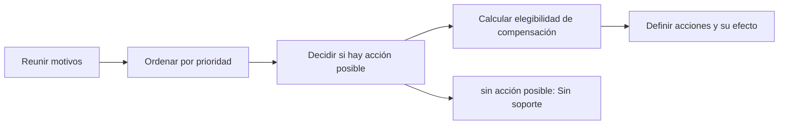

# Feature Specification: SF-01.10 — Motivos, soporte y acciones ofrecidas

**Created**: 2026-10-19  
**Status**: draft  
**Flow**: [F-01 Evaluar viaje como pasajero](01-f-01-evaluar-viaje-como-pasajero.md) (subflujo)  
**Related Specs**: [F-01 Evaluar viaje como pasajero](01-f-01-evaluar-viaje-como-pasajero.md), [SF-01.9 Lectura y filtrado de opciones](10-sf-01-9-lectura-y-filtrado-de-opciones.md), [SF-01.11 Construcción y validación de mensajes](12-sf-01-11-construccion-y-validacion-de-mensajes.md)  
**Origen (DEC/H)**: DEC-02, DEC-09, DEC-13, DEC-14, DEC-15, DEC-18, DEC-27, DEC-29  
**Pruebas (TC)**: TC-01, TC-09, TC-17, TC-19, TC-45, TC-46  
**Contratos externos**: §1.1 (reglas de la evaluación: soporte solo con acción posible), §2.4 (`REASON_PRIORITY`, `COMPENSATION_RIGHTS`)  

## Reglas de este documento

> Este spec es FUNCIONAL, no técnico: describe QUÉ hace el sistema, no CÓMO. Usa lenguaje de negocio; las siete herramientas externas se nombran por su función y se referencian por la sección de `sdd/reports/EXTERNAL_CONTRACTS.md`. Los casos borde se DOCUMENTAN; los valores de configuración se citan por el nombre del parámetro (NFR-012) con su valor por defecto entre paréntesis.

**Alcance**: Reúne los motivos de caso humano aplicables, los prioriza, decide si el soporte se ofrece y calcula la elegibilidad de compensación para el menú.

## User Scenarios & Testing *(mandatory)*

### User Story 1 - El soporte aparece solo cuando hay algo que una persona puede hacer (Priority: P1)

Como pasajero, quiero que el botón «Hablar con una persona» exista cuando realmente hay una acción posible y que sus motivos sean neutros, sin que me sugieran un derecho que quizá no tengo.

**Why this priority**: Un soporte siempre visible genera falsas expectativas y carga operativa.

**Independent Test**: Se prueba con decisiones AUTOMATICA, PENDIENTE_APROBACION, BLOQUEADA e INFORMATIVA, con lectura fallida y con compensación elegible y no elegible.

**Acceptance Scenarios**:

1. **Scenario**: Soporte con acción posible
   - **Given** la decisión es PENDIENTE_APROBACION por el menor
   - **When** se definen las acciones
   - **Then** se ofrecen aceptar la opción (que abrirá un caso humano) y «Hablar con una persona» con los motivos de otra ayuda y datos personales

2. **Scenario**: Sin acción posible
   - **Given** la decisión es INFORMATIVA, o la lectura de contexto o eventos falló, o solo hay evidencia degradada
   - **When** se definen las acciones
   - **Then** no se ofrece soporte ni acciones

3. **Scenario**: Compensación condicionada
   - **Given** una regla de compensación se cumple al fijar la solicitud como verdadera y la decisión no es INFORMATIVA
   - **When** se arma el menú de motivos
   - **Then** se incluye el motivo «Tengo una consulta sobre compensaciones»; si no, el menú no lo ofrece

4. **Scenario**: Operación en curso
   - **Given** ya existe una operación de cambio en curso para la reserva
   - **When** se definen las acciones
   - **Then** la acción de aceptar se muestra deshabilitada con su explicación

5. **Scenario**: Compensación elegible y sin opción (TC-17, TC-46, TC-19)
   - **Given** el caso base con R4 que concede CASH_COMPENSATION, y otra reserva con OPS_CORE degradada en S1
   - **When** se arma el menú de soporte
   - **Then** el caso base ofrece los 3 motivos incluida la compensación y la reserva con OPS_CORE degradada no ofrece soporte

---

### Edge Cases

> Solo se documentan; los marcados MUST-IMPLEMENT se vuelven requisito FR-XXX y se implementan con TDD, los DEFERRED quedan para una iteración posterior.

#### Invalid Data
- [MUST-IMPLEMENT] Cuando se detectan varios motivos a la vez → se conservan todos y el principal es el de mayor prioridad (FR-063)
- [MUST-IMPLEMENT] Cuando solo hay evidencia degradada → se muestra «sin información verificada», sin botón de acción (FR-014)
- [MUST-IMPLEMENT] Cuando no existe opción viable → se ofrece el caso humano con el motivo que corresponda a la causa (FR-047)

#### Race Conditions
- [MUST-IMPLEMENT] Cuando dos aceptaciones simultáneas son posibles → la acción se deshabilita mientras haya una solicitud en curso (FR-062)

#### Security & Permissions
- [MUST-IMPLEMENT] Cuando se arma el menú → no existe campo de texto libre y los rótulos son neutros, sin preselección (FR-060)

## Requirements *(mandatory)*

### Functional Requirements

- **FR-004**: Si no hay anomalía (ningún retraso relevante ni cambio de puerta validado y ninguna evidencia anómala), el sistema DEBE mostrar solo el contexto: sin alertas, reglas, opciones ni botones de acción (puede haber un botón «Actualizar» que solo vuelve a consultar y no es una acción externa), y el pasajero ve que todo está en orden. Con un cambio de puerta validado y sin retraso la decisión es INFORMATIVA con la puerta destacada. La evidencia degradada no genera alerta pero aplica FR-014. El soporte humano solo se ofrece cuando hay una acción posible.
- **FR-014**: Un segmento con solo evidencia degradada DEBE mostrarse como «sin información verificada» (nunca «a tiempo»), sin alerta ni botón. Un segmento sin ningún evento, o solo con eventos que no informan la salida, DEBE mostrar su horario programado sin afirmar estado ni alertar.
- **FR-047**: Sin opción viable el sistema DEBE mostrar un mensaje claro y ofrecer el caso humano con el motivo `NO_OPTION_COVERS_GROUP` si la causa son los asientos o separar al grupo, o `NO_VIABLE_OPTION` en otro caso.
- **FR-050**: Toda acción externa (solicitud de cambio, caso humano, notificación) DEBE requerir un clic explícito del pasajero; el sistema solo propone y ofrece. La persistencia interna no es una acción externa. Excepción: en modo sistema se puede enviar la notificación de FR-122 sin clic, con plantilla fija; ninguna otra acción externa se ejecuta en modo sistema. Un clic autoriza exactamente una acción y los textos de los botones lo declaran, incluida la derivación posterior a una falla persistente.
- **FR-057**: Los motivos de caso humano son un conjunto cerrado de trece códigos (compensación solicitada, datos parciales bloqueantes, conflicto de fuentes, falla indeterminada del proveedor, evento no soportado, ninguna opción cubre al grupo, asistencia por pernocte, petición de datos personales, aprobación de política requerida, varios segmentos afectados, retraso incoherente, ninguna opción viable y otra ayuda). El sistema los ofrece; el caso se crea con el clic.
- **FR-058**: Ante pernocte el mensaje DEBE decir «podrías tener derecho a asistencia; un agente lo confirmará», sin cifras.
- **FR-060**: El botón neutro «Hablar con una persona» DEBE mostrarse solo cuando hay una acción posible, con un motivo de enumeración cerrada (otra ayuda, datos personales y, solo si hay compensación elegible, compensación), con rótulos neutros sin resaltar ni preseleccionar y sin texto libre. La compensación nunca es proactiva ni lleva montos y, al elegirla, fija la solicitud de compensación y abre el caso con el clic.
- **FR-062**: Dos aceptaciones simultáneas, o una aceptación mientras la operación está en curso, indeterminada o creada, DEBEN resultar en una sola escritura; la segunda devuelve el estado de la primera y el botón se deshabilita mientras hay una solicitud en curso.
- **FR-063**: Cada causa se traduce a un motivo con prioridad fija (de mayor a menor: falla indeterminada del proveedor, conflicto de fuentes, evento no soportado, retraso incoherente, varios segmentos afectados, datos parciales bloqueantes, compensación solicitada, datos personales, aprobación de política, ninguna opción cubre al grupo, ninguna opción viable, pernocte y otra ayuda); el motivo del caso es el primero que aplique y se conservan todos los demás (`REASON_PRIORITY`).
- **FR-067**: El motivo de compensación del menú de soporte solo DEBE mostrarse si la política tiene una regla que concede un derecho de compensación (`COMPENSATION_RIGHTS`) que, evaluada con la solicitud de compensación verdadera y las demás variables, resulta verdadera, y la decisión no es INFORMATIVA.

### Key Entities *(include if feature involves data)*

- **Decisión**: Resultado de evaluar la reserva: su estado y las razones que lo explican. Campos principales:
  - `decision_id`: identificador aleatorio no adivinable
  - `decision_state`: INFORMATIVA | AUTOMATICA | PENDIENTE_APROBACION | BLOQUEADA | nulo
  - `anomaly_detected`: booleano
  - `fingerprint`: texto: huella de decisión sin opción
  - `human_case_reasons`: lista ordenada de motivos de caso humano
  - `support_offered`: booleano
  - `compensation_eligible`: booleano
  - `needs_manual_review`: booleano (campo interno: se persiste y no se entrega a la sesión del pasajero, FR-093)
- **Caso humano**: Escalamiento a una persona; cada intento queda registrado con su resultado. Campos principales:
  - `dedup_key`: texto
  - `attempt`: entero ≥ 1
  - `state`: EN_CURSO | CREADO | FALLIDO | INDETERMINADO
  - `reason`: uno de los 13 motivos cerrados
  - `reasons`: lista ordenada por prioridad
  - `case_id`: texto | nulo
  - `queue`: texto | nulo
  - `sla_minutes`: entero | nulo
  - `option`: {option_id: texto, itinerario y diferencia de tarifa} | nulo
  - `confirm_possible_duplicate`: booleano
- **Vista del viaje**: Respuesta completa para el pasajero; solo contiene campos de la lista blanca. Campos principales:
  - `decision_id`: identificador
  - `generated_at`: marca de tiempo UTC
  - `anomaly_detected`: booleano
  - `decision_state`: INFORMATIVA | AUTOMATICA | PENDIENTE_APROBACION | BLOQUEADA | nulo
  - `holder_first_name`: texto | nulo
  - `passenger_count`: entero
  - `load_status`: {trip_context: OK | INVALID, events: OK | FAILED, policy: OK | FAILED | NOT_REQUESTED, options: OK | FAILED | NOT_REQUESTED}
  - `data_as_of`: {trip_context, events, policy, options: marca de tiempo UTC | nulo}
  - `segments`: lista de estados resueltos con puerta y hora de la puerta
  - `alerts`: lista de {code: texto, severity: INFO | WARNING | CRITICAL, message_id: texto}
  - `derived_variables`: lista de variables derivadas
  - `policy`: política y reglas | nulo
  - `options`: lista de opciones viables
  - `proposed_option_id`: texto | nulo
  - `refund_notice`: mensaje validado | nulo
  - `offer_deadline`: marca de tiempo UTC | nulo
  - `actions`: lista de {action_id: texto, kind: ACCEPT_OPTION | OPEN_HUMAN_CASE, efecto: crear solicitud de cambio | crear caso humano con la opción elegida | crear caso humano, enabled: booleano, offered_reasons: lista de texto}
  - `messages`: lista de mensajes validados
  - `operations`: lista de operaciones activas de la reserva
  - `human_cases`: lista de intentos de caso humano de la situación

## Architectural Attributes *(mandatory)*

| Attribute | Value |
|-----------|-------|
| **Interaction type** | sync-http |
| **Consistency** | strong |
| **Workflow** | single-step |
| **Read pattern** | simple |
| **Auditability** | full-history |
| **Domain complexity** | medium |
| **Modularity** | bounded-context |
| **Deployment** | monolith |

## Success Criteria *(mandatory)*

### Measurable Outcomes

- **SC-001**: El soporte se ofrece en el 0 % de las vistas sin acción posible y en el 100 % de las BLOQUEADAS por anomalía que exige validación manual.
- **SC-002**: El motivo de compensación aparece en el 0 % de los menús sin compensación elegible.
- **SC-003**: El motivo principal del caso es el de mayor prioridad en el 100 % de las combinaciones.

## Traceability *(mandatory after implementation)*

> Las columnas de archivo y línea se registran en la verificación de trazabilidad posterior a la implementación; hoy cada criterio queda enlazado a su origen y a las pruebas que lo verifican.

| Criterion | Origen | Prueba (TC) | Source File | Line(s) |
|-----------|--------|-------------|-------------|---------|
| FR-004 | DEC-02 | TC-01, TC-45 | se registra en la verificación posterior a la implementación | se registra en la verificación posterior a la implementación |
| FR-014 | DEC-09 | TC-01, TC-19 | se registra en la verificación posterior a la implementación | se registra en la verificación posterior a la implementación |
| FR-047 | DEC-15 | TC-01, TC-09 | se registra en la verificación posterior a la implementación | se registra en la verificación posterior a la implementación |
| FR-050 | DEC-14 | TC-01 | se registra en la verificación posterior a la implementación | se registra en la verificación posterior a la implementación |
| FR-057 | DEC-13, DEC-15, DEC-27 | TC-01 | se registra en la verificación posterior a la implementación | se registra en la verificación posterior a la implementación |
| FR-058 | DEC-27 | TC-01 | se registra en la verificación posterior a la implementación | se registra en la verificación posterior a la implementación |
| FR-060 | DEC-02, DEC-29 | TC-01, TC-17, TC-46 | se registra en la verificación posterior a la implementación | se registra en la verificación posterior a la implementación |
| FR-062 | DEC-18 | TC-01 | se registra en la verificación posterior a la implementación | se registra en la verificación posterior a la implementación |
| FR-063 | DEC-15 | TC-01 | se registra en la verificación posterior a la implementación | se registra en la verificación posterior a la implementación |
| FR-067 | DEC-29 | TC-46 | se registra en la verificación posterior a la implementación | se registra en la verificación posterior a la implementación |
| SC-001 | criterio medible de este spec | TC-01, TC-09, TC-17, TC-19, TC-45, TC-46 | se registra en la verificación posterior a la implementación | se registra en la verificación posterior a la implementación |
| SC-002 | criterio medible de este spec | TC-01, TC-09, TC-17, TC-19, TC-45, TC-46 | se registra en la verificación posterior a la implementación | se registra en la verificación posterior a la implementación |
| SC-003 | criterio medible de este spec | TC-01, TC-09, TC-17, TC-19, TC-45, TC-46 | se registra en la verificación posterior a la implementación | se registra en la verificación posterior a la implementación |

## Business Process (BPM View)

```
Reunir motivos → Ordenar por prioridad → Decidir si hay acción posible → Calcular elegibilidad de compensación → Definir acciones y su efecto
```



