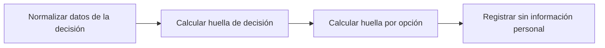

# Feature Specification: SF-01.13 — Huella por opción y registro de decisión

**Created**: 2026-10-19  
**Status**: draft  
**Flow**: [F-01 Evaluar viaje como pasajero](01-f-01-evaluar-viaje-como-pasajero.md) (subflujo)  
**Related Specs**: [F-01 Evaluar viaje como pasajero](01-f-01-evaluar-viaje-como-pasajero.md), [SF-01.12 Barrido perezoso del ciclo de vida](13-sf-01-12-barrido-perezoso-del-ciclo-de-vida.md), [SF-01.14 Ensamblado de la respuesta](15-sf-01-14-ensamblado-de-la-respuesta.md)  
**Origen (DEC/H)**: DEC-02, DEC-19, DEC-22, DEC-23  
**Pruebas (TC)**: TC-31, TC-34, TC-58, TC-59  
**Contratos externos**: §1.1 (campos fingerprint), §2.3 (registro de decisiones)  

## Reglas de este documento

> Este spec es FUNCIONAL, no técnico: describe QUÉ hace el sistema, no CÓMO. Usa lenguaje de negocio; las siete herramientas externas se nombran por su función y se referencian por la sección de `sdd/reports/EXTERNAL_CONTRACTS.md`. Los casos borde se DOCUMENTAN; los valores de configuración se citan por el nombre del parámetro (NFR-012) con su valor por defecto entre paréntesis.

**Alcance**: Calcula la huella de decisión y la huella de cada opción viable, y registra la evaluación completa sin información personal.

## User Scenarios & Testing *(mandatory)*

### User Story 1 - Cada evaluación queda auditada y comparable (Priority: P1)

Como auditor, quiero que cada evaluación deje un registro reproducible, sin datos personales, y que el sistema pueda detectar si la situación cambió entre lo que vio el pasajero y lo que ocurre al aceptar.

**Why this priority**: Sin huella y registro no hay revalidación segura ni auditoría.

**Independent Test**: Se prueba cambiando solo marcas de tiempo (la huella no cambia) y cambiando asientos o itinerario (la huella cambia).

**Acceptance Scenarios**:

1. **Scenario**: Huella estable
   - **Given** dos evaluaciones con las mismas lecturas y distinto reloj de lectura
   - **When** se calcula la huella
   - **Then** ambas huellas son iguales porque marcas de tiempo, identificadores de opción y confianza no cuentan

2. **Scenario**: Huella sensible al cambio real
   - **Given** se agotan los asientos de la opción elegida o se sustituye su itinerario
   - **When** se calcula la huella
   - **Then** la huella cambia

3. **Scenario**: Registro sin información personal
   - **Given** una evaluación completada
   - **When** se registra la decisión
   - **Then** el registro contiene solo identificadores seudónimos, enumeraciones, números, marcas de tiempo y huellas; nunca nombre, contacto, documento ni edad

4. **Scenario**: Huella estable e itinerario cambiado (TC-31, TC-34)
   - **Given** O1 LA2412 con 4 asientos y un segundo cálculo con 0 asientos, y otro con la política POL-DELAY-2026-04
   - **When** se calculan las huellas
   - **Then** con otro reloj la huella no cambia; con 0 asientos o la política nueva la huella cambia

---

### Edge Cases

> Solo se documentan; los marcados MUST-IMPLEMENT se vuelven requisito FR-XXX y se implementan con TDD, los DEFERRED quedan para una iteración posterior.

#### Invalid Data
- [MUST-IMPLEMENT] Cuando una opción no es de vuelo (reembolso) → sus campos de vuelo, costo y asientos quedan vacíos y se conserva con sus razones de descarte (FR-090)
- [MUST-IMPLEMENT] Cuando el orden de las listas cambia → la huella no cambia (FR-070)

#### Security & Permissions
- [MUST-IMPLEMENT] Cuando se arma el registro → nunca se guardan cargas completas, nombre, contacto, documento ni edad del menor (FR-091)
- [MUST-IMPLEMENT] Cuando la sesión del pasajero lee el registro → no recibe la revisión manual ni el detalle de las notificaciones (campos internos que solo se persisten) (FR-093)
- [MUST-IMPLEMENT] Cuando se guarda o se lee el registro → solo con consultas parametrizadas (NFR-013)

## Requirements *(mandatory)*

### Functional Requirements

- **FR-070**: Antes de crear un cambio el sistema DEBE reconsultar contexto, eventos, opciones y política y recalcular la decisión y su huella (estado de cada segmento, reglas cumplidas, derechos, aprobación, versión de política, composición del grupo y, de la opción elegida, itinerario, suficiencia de asientos, diferencia de tarifa y referencia de política). Si la huella difiere de la mostrada, no se escribe y se muestra el nuevo estado; marcas de tiempo, ids de eventos descartados, identificador de opción y confianza no cuentan. La vigencia no entra en la huella: es una condición de ejecución independiente. Los casos humanos no se revalidan.
- **FR-090**: Cada evaluación DEBE generar un registro con identificador de decisión, reserva, lecturas con su instante, eventos elegidos y descartados con razón, versión de política y reglas, variables derivadas con supuestos, opciones viables y descartadas con razón, acción y huella del mensaje.
- **FR-091**: Solo se persisten campos de una lista cerrada: hechos operacionales no personales, identificadores seudónimos, enumeraciones, números, marcas de tiempo y huellas. NUNCA se guardan cargas completas, nombre, contacto, documento ni edad del menor; los identificadores son seudónimos, no anónimos, y la reserva se trunca en los registros de aplicación.
- **FR-093**: El sistema DEBE ofrecer la lectura del registro de una decisión por su identificador, sujeta a FR-001 (solo la reserva dueña de la sesión); la sesión del pasajero NO recibe la marca de revisión manual ni el detalle de las notificaciones, que son campos internos (FR-123).

### Non-Functional and Documentation Requirements

- **NFR-001**: Determinismo: con el mismo reloj inyectado y las mismas lecturas el sistema DEBE producir la misma huella de decisión y los mismos mensajes, sin inteligencia artificial ni modelos en ejecución y con costo por interacción en modelos igual a cero.
- **NFR-002**: Privacidad: el sistema DEBE minimizar la información personal en todas las fronteras propias; ningún dato personal se entrega a un modelo (si en el futuro se usara, se anonimiza antes).
- **NFR-013**: Seguridad de entradas: todo acceso al registro persistente DEBE usar consultas parametrizadas (las consultas viven en archivos propios); la interfaz DEBE mostrar los textos del proveedor (condición, derecho, puerta, mensajes) como texto plano, sin insertar marcado HTML; y la evaluación, la aceptación de una opción, el caso humano y la consulta de una decisión DEBEN tener un límite de tasa por reserva y por origen (`EVALUATE_RATE_LIMIT_PER_MINUTE`, 30 por minuto), con los intentos fallidos de credencial de servicio también limitados por origen.

### Key Entities *(include if feature involves data)*

- **Registro de decisión**: Instantánea de auditoría de una evaluación, sin información personal. Campos principales:
  - `decision_id`: identificador
  - `booking_id`: texto seudónimo
  - `created_at`: marca de tiempo UTC
  - `caller`: user | system
  - `fingerprint`: texto
  - `decision_state`: estado | nulo
  - `needs_manual_review`: booleano (campo interno, no se entrega a la sesión del pasajero)
  - `policy_version`: texto | nulo
  - `mct_provided`: booleano
  - `passenger_count`: entero
  - `segments`: lista de {segment_id: texto, state: texto | nulo, delay_minutes: entero | nulo}
  - `message_hash`: texto
  - `messages_blocked`: entero
  - `reads`: lista de {tool: texto, retrieved_at: marca de tiempo | nulo, outcome: OK | FAILED | INVALID | NOT_REQUESTED}
  - `events`: lista de {event_id, segment_id, event_type, disposition: CHOSEN | DISCARDED | NOT_INTERPRETED, reason}
  - `rules`: lista de {rule_id, result, requires_human_approval}
  - `options`: lista de opciones con sus razones de descarte (también las no viables)
  - `notifications`: lista de {reason, kind, status, notification_id} (solo modo sistema; campo interno, no se entrega a la sesión del pasajero)
  - `outcomes`: lista de {kind: REBOOKING | HUMAN_CASE, reference_id: texto | nulo, state: texto, at: marca de tiempo}
- **Decisión**: Resultado de evaluar la reserva: su estado y las razones que lo explican. Campos principales:
  - `decision_id`: identificador aleatorio no adivinable
  - `decision_state`: INFORMATIVA | AUTOMATICA | PENDIENTE_APROBACION | BLOQUEADA | nulo
  - `anomaly_detected`: booleano
  - `fingerprint`: texto: huella de decisión sin opción
  - `human_case_reasons`: lista ordenada de motivos de caso humano
  - `support_offered`: booleano
  - `compensation_eligible`: booleano
  - `needs_manual_review`: booleano (campo interno: se persiste y no se entrega a la sesión del pasajero, FR-093)
- **Opción de reprogramación**: Alternativa candidata entregada por el proveedor; solo las viables se muestran. Campos principales:
  - `option_id`: texto local a la lectura
  - `itinerary_key`: texto que identifica el itinerario entre lecturas
  - `type`: REBOOK | REFUND | otro
  - `flight_number`: texto | nulo
  - `origin`: código de aeropuerto | nulo
  - `destination`: código de aeropuerto | nulo
  - `date`: fecha | nulo
  - `departure`: hora local HH:MM | nulo
  - `fare_difference`: entero sin decimales | nulo
  - `currency`: código de moneda | nulo
  - `seats_available`: entero | nulo
  - `policy_ref`: texto
  - `confidence`: enumeración abierta (HIGH | MEDIUM | LOW | otro)
  - `viable`: booleano
  - `discard_reasons`: lista de INSUFFICIENT_SEATS | FEE_CONFLICT | NO_ENTITLEMENT | POLICY_REF_UNVERIFIED | POLICY_REF_SUPERSEDED | UNSUPPORTED_TYPE | EXPIRED | MISSING_CURRENCY | ITINERARY_MISMATCH
  - `fingerprint`: texto: huella por opción
  - `is_proposed`: booleano
  - `overnight`: booleano | nulo
  - `expires_at`: marca de tiempo UTC

## Architectural Attributes *(mandatory)*

| Attribute | Value |
|-----------|-------|
| **Interaction type** | sync-http |
| **Consistency** | strong |
| **Workflow** | single-step |
| **Read pattern** | simple |
| **Auditability** | full-history |
| **Domain complexity** | medium |
| **Modularity** | bounded-context |
| **Deployment** | monolith |

## Success Criteria *(mandatory)*

### Measurable Outcomes

- **SC-001**: Con las mismas lecturas la huella es idéntica en el 100 % de las repeticiones.
- **SC-002**: Cualquier cambio en estado, reglas, derechos, grupo, itinerario, asientos, tarifa o referencia de política cambia la huella.
- **SC-003**: Un recorrido de los registros no encuentra ningún dato de la lista prohibida.

## Traceability *(mandatory after implementation)*

> Las columnas de archivo y línea se registran en la verificación de trazabilidad posterior a la implementación; hoy cada criterio queda enlazado a su origen y a las pruebas que lo verifican.

| Criterion | Origen | Prueba (TC) | Source File | Line(s) |
|-----------|--------|-------------|-------------|---------|
| FR-070 | DEC-19 | TC-31 | se registra en la verificación posterior a la implementación | se registra en la verificación posterior a la implementación |
| FR-090 | DEC-23 | sin TC en el mapa §6 de REQUERIMIENTOS_V1 | se registra en la verificación posterior a la implementación | se registra en la verificación posterior a la implementación |
| FR-091 | DEC-23 | sin TC en el mapa §6 de REQUERIMIENTOS_V1 | se registra en la verificación posterior a la implementación | se registra en la verificación posterior a la implementación |
| FR-093 | DEC-23 | TC-59 | se registra en la verificación posterior a la implementación | se registra en la verificación posterior a la implementación |
| NFR-001 | DEC-02 | sin TC en el mapa §6 de REQUERIMIENTOS_V1 | se registra en la verificación posterior a la implementación | se registra en la verificación posterior a la implementación |
| NFR-002 | DEC-22 | sin TC en el mapa §6 de REQUERIMIENTOS_V1 | se registra en la verificación posterior a la implementación | se registra en la verificación posterior a la implementación |
| NFR-013 | Usuario (2026-10-19) | TC-58 | se registra en la verificación posterior a la implementación | se registra en la verificación posterior a la implementación |
| SC-001 | criterio medible de este spec | TC-31, TC-34, TC-58, TC-59 | se registra en la verificación posterior a la implementación | se registra en la verificación posterior a la implementación |
| SC-002 | criterio medible de este spec | TC-31, TC-34, TC-58, TC-59 | se registra en la verificación posterior a la implementación | se registra en la verificación posterior a la implementación |
| SC-003 | criterio medible de este spec | TC-31, TC-34, TC-58, TC-59 | se registra en la verificación posterior a la implementación | se registra en la verificación posterior a la implementación |

## Business Process (BPM View)

```
Normalizar datos de la decisión → Calcular huella de decisión → Calcular huella por opción → Registrar sin información personal
```



