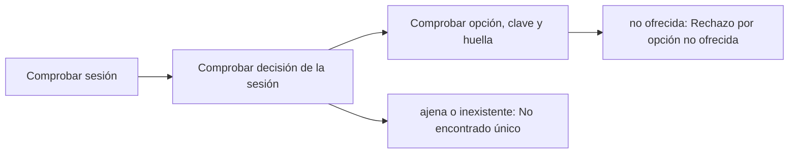

# Feature Specification: SF-02.1 — Autorización y validación

**Created**: 2026-10-19  
**Status**: draft  
**Flow**: [F-02 Aceptar opción](16-f-02-aceptar-opcion.md) (subflujo)  
**Related Specs**: [F-02 Aceptar opción](16-f-02-aceptar-opcion.md), [SF-02.2 Bifurcación por estado de la decisión](18-sf-02-2-bifurcacion-por-estado-de-la-decision.md)  
**Origen (DEC/H)**: DEC-12, DEC-16, DEC-18, DEC-21  
**Pruebas (TC)**: TC-21, TC-40, TC-58  
**Contratos externos**: §1.1 (fila 3), catálogo de códigos de error propios  

## Reglas de este documento

> Este spec es FUNCIONAL, no técnico: describe QUÉ hace el sistema, no CÓMO. Usa lenguaje de negocio; las siete herramientas externas se nombran por su función y se referencian por la sección de `sdd/reports/EXTERNAL_CONTRACTS.md`. Los casos borde se DOCUMENTAN; los valores de configuración se citan por el nombre del parámetro (NFR-012) con su valor por defecto entre paréntesis.

**Alcance**: Comprueba que la sesión pertenece a la reserva, que la decisión es de esa sesión, que la opción fue ofrecida y que la huella e itinerario enviados corresponden a la instantánea guardada.

## User Scenarios & Testing *(mandatory)*

### User Story 1 - El pasajero solo puede aceptar lo que se le ofreció (Priority: P1)

Como pasajero, quiero que solo pueda aceptarse una opción que me mostraron, y que el contenido de la opción lo decida el servidor y no el cliente.

**Why this priority**: Un cliente manipulado no debe poder pedir un cambio distinto del ofrecido.

**Independent Test**: Se prueba con una decisión ajena, una opción no ofrecida, una huella alterada y una petición correcta.

**Acceptance Scenarios**:

1. **Scenario**: Petición correcta
   - **Given** la sesión coincide, la decisión es suya y la opción, la clave de itinerario y la huella corresponden
   - **When** se valida la aceptación
   - **Then** se continúa con el flujo

2. **Scenario**: Decisión ajena
   - **Given** la decisión pertenece a otra reserva
   - **When** se valida la aceptación
   - **Then** la respuesta es la misma de «no encontrado» que para una decisión inexistente

3. **Scenario**: Opción no ofrecida
   - **Given** la opción indicada no figura en la decisión o su huella no coincide con la guardada
   - **When** se valida la aceptación
   - **Then** se rechaza por opción no ofrecida o por validación, sin escribir nada

4. **Scenario**: Decisión ajena y contenido alterado (TC-21, TC-40)
   - **Given** la sesión de ABC123 y una decisión de XYZ789
   - **When** se acepta O1 con esa decisión, o con una huella distinta a la guardada
   - **Then** la primera responde «no encontrado» idéntico y la segunda se rechaza sin escribir; el servidor ignora cualquier contenido de la opción

5. **Scenario**: Límite de tasa al aceptar (TC-58)
   - **Given** ABC123 con `EVALUATE_RATE_LIMIT_PER_MINUTE` de 30 y 30 aceptaciones de O1 en el último minuto desde el mismo origen
   - **When** llega la 31.ª aceptación
   - **Then** se rechaza por límite de tasa sin escribir nada

---

### Edge Cases

> Solo se documentan; los marcados MUST-IMPLEMENT se vuelven requisito FR-XXX y se implementan con TDD, los DEFERRED quedan para una iteración posterior.

#### Invalid Data
- [MUST-IMPLEMENT] Cuando el cuerpo no trae decisión, clave de itinerario y huella válidas → rechazo por validación sin repetir la entrada (FR-001)

#### Security & Permissions
- [MUST-IMPLEMENT] Cuando el cliente intenta enviar el contenido de la opción → se ignora: el servidor la resuelve con la decisión guardada (FR-065)
- [MUST-IMPLEMENT] Cuando falta la sesión → rechazo por falta de autenticación (FR-001)
- [MUST-IMPLEMENT] Cuando la misma reserva y origen superan `EVALUATE_RATE_LIMIT_PER_MINUTE` (30) aceptaciones por minuto → rechazo por límite de tasa (NFR-013)

## Requirements *(mandatory)*

### Functional Requirements

- **FR-001**: El sistema DEBE operar sobre la sesión autenticada del pasajero y comprobar que la reserva y la decisión solicitadas pertenezcan a esa sesión; una reserva ajena y una inexistente DEBEN producir exactamente la misma respuesta de «no encontrado», sin confirmar la existencia de ninguna. La sesión simulada solo existe con el parámetro `DEV_SESSION_HEADER_ENABLED` (apagado por defecto): en cualquier otro perfil toda petición del pasajero sin sesión DEBE rechazarse por falta de autenticación, y toda petición del sistema DEBE exigir la credencial de servicio (FR-120). Los errores NO DEBEN mostrar trazas ni repetir la entrada, nunca se pide ni se muestra documento de identidad, y el identificador de decisión DEBE ser aleatorio y no adivinable.
- **FR-065**: La solicitud de cambio DEBE llevar además de la opción y la llave la reserva y los identificadores de todos los pasajeros. El cliente nunca aporta el contenido de la opción: envía la decisión y la clave de itinerario y el servidor la resuelve con las opciones recién consultadas.

### Non-Functional and Documentation Requirements

- **NFR-003**: Seguridad: el analizador de reglas DEBE operar sin ejecución dinámica, las entradas se validan estrictamente, el origen permitido se acota al front y no hay secretos en el repositorio.
- **NFR-013**: Seguridad de entradas: todo acceso al registro persistente DEBE usar consultas parametrizadas (las consultas viven en archivos propios); la interfaz DEBE mostrar los textos del proveedor (condición, derecho, puerta, mensajes) como texto plano, sin insertar marcado HTML; y la evaluación, la aceptación de una opción, el caso humano y la consulta de una decisión DEBEN tener un límite de tasa por reserva y por origen (`EVALUATE_RATE_LIMIT_PER_MINUTE`, 30 por minuto), con los intentos fallidos de credencial de servicio también limitados por origen.

### Key Entities *(include if feature involves data)*

- **Sesión y credencial**: Identidad con la que se pide una evaluación: sesión del pasajero o credencial de servicio. Campos principales:
  - `caller`: user | system
  - `session_booking`: texto | ausente (solo modo user)
  - `service_key`: texto | ausente (solo modo system; comparación en tiempo constante)
  - `requests_last_minute`: entero (límite `EVALUATE_RATE_LIMIT_PER_MINUTE`)
  - `authorized`: booleano
- **Resultado de aceptación**: Respuesta a un clic de «Aceptar esta opción». Campos principales:
  - `outcome`: REBOOKING_CREATED | EXISTING_REQUEST | HUMAN_CASE_CREATED | EXISTING_CASE | NEEDS_CONFIRMATION | STATE_CHANGED | FAILED
  - `message`: mensaje validado
  - `operation`: operación | nulo
  - `human_case`: caso humano | nulo
  - `retries`: entero entre 0 y `REBOOK_MAX_RETRIES`
  - `view`: vista del viaje | nulo (solo con STATE_CHANGED)

## Architectural Attributes *(mandatory)*

| Attribute | Value |
|-----------|-------|
| **Interaction type** | sync-http |
| **Consistency** | strong |
| **Workflow** | single-step |
| **Read pattern** | simple |
| **Auditability** | full-history |
| **Domain complexity** | medium |
| **Modularity** | bounded-context |
| **Deployment** | monolith |

## Success Criteria *(mandatory)*

### Measurable Outcomes

- **SC-001**: El 100 % de las peticiones con decisión ajena recibe la misma respuesta que con decisión inexistente.
- **SC-002**: El 100 % de las peticiones con contenido de opción distinto del guardado se rechaza sin escritura.

## Traceability *(mandatory after implementation)*

> Las columnas de archivo y línea se registran en la verificación de trazabilidad posterior a la implementación; hoy cada criterio queda enlazado a su origen y a las pruebas que lo verifican.

| Criterion | Origen | Prueba (TC) | Source File | Line(s) |
|-----------|--------|-------------|-------------|---------|
| FR-001 | DEC-21 | TC-21 | se registra en la verificación posterior a la implementación | se registra en la verificación posterior a la implementación |
| FR-065 | DEC-16, DEC-18 | TC-40 | se registra en la verificación posterior a la implementación | se registra en la verificación posterior a la implementación |
| NFR-003 | DEC-12 | sin TC en el mapa §6 de REQUERIMIENTOS_V1 | se registra en la verificación posterior a la implementación | se registra en la verificación posterior a la implementación |
| NFR-013 | Usuario (2026-10-19) | TC-58 | se registra en la verificación posterior a la implementación | se registra en la verificación posterior a la implementación |
| SC-001 | criterio medible de este spec | TC-21, TC-40, TC-58 | se registra en la verificación posterior a la implementación | se registra en la verificación posterior a la implementación |
| SC-002 | criterio medible de este spec | TC-21, TC-40, TC-58 | se registra en la verificación posterior a la implementación | se registra en la verificación posterior a la implementación |

## Business Process (BPM View)

```
Comprobar sesión → Comprobar decisión de la sesión → Comprobar opción, clave y huella
```



