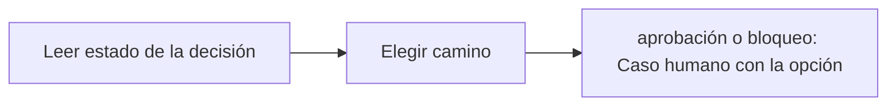

# Feature Specification: SF-02.2 — Bifurcación por estado de la decisión

**Created**: 2026-10-19  
**Status**: draft  
**Flow**: [F-02 Aceptar opción](16-f-02-aceptar-opcion.md) (subflujo)  
**Related Specs**: [F-02 Aceptar opción](16-f-02-aceptar-opcion.md), [SF-02.1 Autorización y validación](17-sf-02-1-autorizacion-y-validacion.md), [SF-02.3 Revalidación](19-sf-02-3-revalidacion.md)  
**Origen (DEC/H)**: DEC-09, DEC-13, DEC-16, DEC-19, DEC-31  
**Pruebas (TC)**: TC-01, TC-07  
**Contratos externos**: §1.1 (fila 3, semántica por estado de decisión)  

## Reglas de este documento

> Este spec es FUNCIONAL, no técnico: describe QUÉ hace el sistema, no CÓMO. Usa lenguaje de negocio; las siete herramientas externas se nombran por su función y se referencian por la sección de `sdd/reports/EXTERNAL_CONTRACTS.md`. Los casos borde se DOCUMENTAN; los valores de configuración se citan por el nombre del parámetro (NFR-012) con su valor por defecto entre paréntesis.

**Alcance**: Decide, según el estado guardado de la decisión, si el clic crea una solicitud de cambio o abre un caso humano con la opción.

## User Scenarios & Testing *(mandatory)*

### User Story 1 - El efecto del clic depende de lo que la política permite (Priority: P1)

Como pasajero, quiero que si mi caso exige aprobación humana mi clic me lleve a una persona, y que si es automático me cambien sin intermediarios.

**Why this priority**: Evita ejecutar cambios que la política reserva a una persona.

**Independent Test**: Se prueba con decisiones AUTOMATICA, PENDIENTE_APROBACION y BLOQUEADA.

**Acceptance Scenarios**:

1. **Scenario**: Camino automático
   - **Given** decisión AUTOMATICA
   - **When** el pasajero acepta
   - **Then** sigue la revalidación para crear la solicitud de cambio

2. **Scenario**: Camino humano
   - **Given** decisión PENDIENTE_APROBACION o BLOQUEADA
   - **When** el pasajero acepta
   - **Then** se abre un caso humano con la opción sin revalidar y sin llamar a la solicitud de cambio

3. **Scenario**: Camino por estado (TC-01, TC-07)
   - **Given** el caso base PENDIENTE_APROBACION con O1 y el escenario sin menor AUTOMATICA
   - **When** se acepta O1 en cada uno
   - **Then** el primero abre un caso humano con O1 sin llamar a la solicitud de cambio; el segundo sigue a la revalidación

---

### Edge Cases

> Solo se documentan; los marcados MUST-IMPLEMENT se vuelven requisito FR-XXX y se implementan con TDD, los DEFERRED quedan para una iteración posterior.

#### System Errors
- [DEFERRED] Flujo operativo de aprobación humana (DOC-012): la aprobación autoriza una decisión y se revalida, fuera de la versión 1 (FR-052)

#### Invalid Data
- [MUST-IMPLEMENT] Cuando existen reglas no evaluables → el clic solo puede abrir caso humano (FR-052)
- [MUST-IMPLEMENT] Cuando hay anomalía global → ninguna regla cumplida habilita la creación del cambio (FR-038)

## Requirements *(mandatory)*

### Functional Requirements

- **FR-038**: Si en cualquier segmento existe `SOURCE_CONFLICT`, `UNSUPPORTED_EVENT_TYPE`, `INCONSISTENT_DELAY`, `MULTIPLE_AFFECTED_SEGMENTS`, `RULE_ERROR`, una regla no evaluable en los términos de FR-033 o una lectura íntegra inválida (FR-066), la decisión DEBE ser BLOQUEADA: ninguna regla cumplida habilita la creación de la solicitud de cambio y aceptar una opción solo puede abrir un caso humano.
- **FR-052**: Al aceptar una opción cuando la decisión exige aprobación, es BLOQUEADA o tiene reglas no evaluables, el sistema NO DEBE crear la solicitud de cambio: crea un caso humano con la opción elegida como evidencia.

### Non-Functional and Documentation Requirements

- **DOC-012**: DEBE documentarse el diseño de la aprobación humana: al aprobar un agente se revalida de nuevo y la aprobación autoriza una decisión, no una ejecución con datos viejos.

### Key Entities *(include if feature involves data)*

- **Decisión**: Resultado de evaluar la reserva: su estado y las razones que lo explican. Campos principales:
  - `decision_id`: identificador aleatorio no adivinable
  - `decision_state`: INFORMATIVA | AUTOMATICA | PENDIENTE_APROBACION | BLOQUEADA | nulo
  - `anomaly_detected`: booleano
  - `fingerprint`: texto: huella de decisión sin opción
  - `human_case_reasons`: lista ordenada de motivos de caso humano
  - `support_offered`: booleano
  - `compensation_eligible`: booleano
  - `needs_manual_review`: booleano (campo interno: se persiste y no se entrega a la sesión del pasajero, FR-093)
- **Resultado de aceptación**: Respuesta a un clic de «Aceptar esta opción». Campos principales:
  - `outcome`: REBOOKING_CREATED | EXISTING_REQUEST | HUMAN_CASE_CREATED | EXISTING_CASE | NEEDS_CONFIRMATION | STATE_CHANGED | FAILED
  - `message`: mensaje validado
  - `operation`: operación | nulo
  - `human_case`: caso humano | nulo
  - `retries`: entero entre 0 y `REBOOK_MAX_RETRIES`
  - `view`: vista del viaje | nulo (solo con STATE_CHANGED)

## Architectural Attributes *(mandatory)*

| Attribute | Value |
|-----------|-------|
| **Interaction type** | sync-http |
| **Consistency** | strong |
| **Workflow** | single-step |
| **Read pattern** | simple |
| **Auditability** | full-history |
| **Domain complexity** | medium |
| **Modularity** | bounded-context |
| **Deployment** | monolith |

## Success Criteria *(mandatory)*

### Measurable Outcomes

- **SC-001**: El 100 % de las decisiones PENDIENTE_APROBACION o BLOQUEADA termina sin solicitud de cambio.
- **SC-002**: El 100 % de las decisiones AUTOMATICA llega a la revalidación.

## Traceability *(mandatory after implementation)*

> Las columnas de archivo y línea se registran en la verificación de trazabilidad posterior a la implementación; hoy cada criterio queda enlazado a su origen y a las pruebas que lo verifican.

| Criterion | Origen | Prueba (TC) | Source File | Line(s) |
|-----------|--------|-------------|-------------|---------|
| FR-038 | DEC-09, DEC-13, DEC-31 | TC-01 | se registra en la verificación posterior a la implementación | se registra en la verificación posterior a la implementación |
| FR-052 | DEC-13, DEC-16 | TC-01 | se registra en la verificación posterior a la implementación | se registra en la verificación posterior a la implementación |
| DOC-012 | DEC-19 | sin TC en el mapa §6 de REQUERIMIENTOS_V1 | se registra en la verificación posterior a la implementación | se registra en la verificación posterior a la implementación |
| SC-001 | criterio medible de este spec | TC-01, TC-07 | se registra en la verificación posterior a la implementación | se registra en la verificación posterior a la implementación |
| SC-002 | criterio medible de este spec | TC-01, TC-07 | se registra en la verificación posterior a la implementación | se registra en la verificación posterior a la implementación |

## Business Process (BPM View)

```
Leer estado de la decisión → Elegir camino
```



