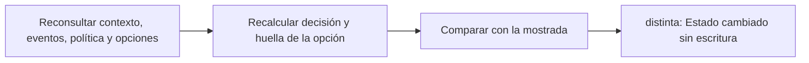

# Feature Specification: SF-02.3 — Revalidación

**Created**: 2026-10-19  
**Status**: draft  
**Flow**: [F-02 Aceptar opción](16-f-02-aceptar-opcion.md) (subflujo)  
**Related Specs**: [F-02 Aceptar opción](16-f-02-aceptar-opcion.md), [SF-02.2 Bifurcación por estado de la decisión](18-sf-02-2-bifurcacion-por-estado-de-la-decision.md), [SF-02.4 Vigencia de la opción](20-sf-02-4-vigencia-de-la-opcion.md)  
**Origen (DEC/H)**: DEC-02, DEC-10, DEC-19  
**Pruebas (TC)**: TC-08, TC-31  
**Contratos externos**: §1.1 (fila 3, revalidación), §2.1 (herramientas 1 a 4)  

## Reglas de este documento

> Este spec es FUNCIONAL, no técnico: describe QUÉ hace el sistema, no CÓMO. Usa lenguaje de negocio; las siete herramientas externas se nombran por su función y se referencian por la sección de `sdd/reports/EXTERNAL_CONTRACTS.md`. Los casos borde se DOCUMENTAN; los valores de configuración se citan por el nombre del parámetro (NFR-012) con su valor por defecto entre paréntesis.

**Alcance**: Antes de crear el cambio reconsulta contexto, eventos, política y opciones, recalcula la decisión y compara la huella de la opción elegida con la mostrada.

## User Scenarios & Testing *(mandatory)*

### User Story 1 - Nada se escribe con datos viejos (Priority: P1)

Como pasajero, quiero que si algo cambió desde que vi mi opción el sistema no aplique un cambio sobre información desactualizada y me muestre lo nuevo.

**Why this priority**: Una escritura con datos obsoletos puede cambiar a un pasajero a un vuelo que ya no existe.

**Independent Test**: Se prueba con cupos agotados, itinerario sustituido y con cambio de solo marcas de tiempo.

**Acceptance Scenarios**:

1. **Scenario**: Huella igual
   - **Given** solo cambiaron marcas de tiempo e identificadores de opción
   - **When** se revalida
   - **Then** la huella coincide y el flujo continúa

2. **Scenario**: Huella distinta
   - **Given** se agotaron los cupos de la opción o se sustituyó su itinerario
   - **When** se revalida
   - **Then** no se escribe nada y se devuelve la vista nueva con el aviso de que la situación cambió

3. **Scenario**: Caso humano no se revalida
   - **Given** el clic abre un caso humano
   - **When** se procesa
   - **Then** no se revalida: el caso lleva la instantánea que el pasajero vio

4. **Scenario**: Cupos agotados (TC-31)
   - **Given** O1 LA2412 tenía 4 asientos al mostrarse y la relectura trae 0
   - **When** se revalida
   - **Then** la huella cambia, no se escribe y se muestra la vista nueva con «la situación cambió»

---

### Edge Cases

> Solo se documentan; los marcados MUST-IMPLEMENT se vuelven requisito FR-XXX y se implementan con TDD, los DEFERRED quedan para una iteración posterior.

#### System Errors
- [MUST-IMPLEMENT] Cuando falla una lectura durante la revalidación → no se escribe (FR-105)

#### Invalid Data
- [MUST-IMPLEMENT] Cuando cambia la composición del grupo o la versión de política → la huella cambia (FR-070)
- [MUST-IMPLEMENT] Cuando la opción ya no es viable en la nueva lectura → estado cambiado (FR-072)

## Requirements *(mandatory)*

### Functional Requirements

- **FR-070**: Antes de crear un cambio el sistema DEBE reconsultar contexto, eventos, opciones y política y recalcular la decisión y su huella (estado de cada segmento, reglas cumplidas, derechos, aprobación, versión de política, composición del grupo y, de la opción elegida, itinerario, suficiencia de asientos, diferencia de tarifa y referencia de política). Si la huella difiere de la mostrada, no se escribe y se muestra el nuevo estado; marcas de tiempo, ids de eventos descartados, identificador de opción y confianza no cuentan. La vigencia no entra en la huella: es una condición de ejecución independiente. Los casos humanos no se revalidan.
- **FR-072**: Si las opciones están vencidas al usarlas, el sistema DEBE refrescarlas antes de escribir.

### Non-Functional and Documentation Requirements

- **NFR-001**: Determinismo: con el mismo reloj inyectado y las mismas lecturas el sistema DEBE producir la misma huella de decisión y los mismos mensajes, sin inteligencia artificial ni modelos en ejecución y con costo por interacción en modelos igual a cero.

### Key Entities *(include if feature involves data)*

- **Decisión**: Resultado de evaluar la reserva: su estado y las razones que lo explican. Campos principales:
  - `decision_id`: identificador aleatorio no adivinable
  - `decision_state`: INFORMATIVA | AUTOMATICA | PENDIENTE_APROBACION | BLOQUEADA | nulo
  - `anomaly_detected`: booleano
  - `fingerprint`: texto: huella de decisión sin opción
  - `human_case_reasons`: lista ordenada de motivos de caso humano
  - `support_offered`: booleano
  - `compensation_eligible`: booleano
  - `needs_manual_review`: booleano (campo interno: se persiste y no se entrega a la sesión del pasajero, FR-093)
- **Opción de reprogramación**: Alternativa candidata entregada por el proveedor; solo las viables se muestran. Campos principales:
  - `option_id`: texto local a la lectura
  - `itinerary_key`: texto que identifica el itinerario entre lecturas
  - `type`: REBOOK | REFUND | otro
  - `flight_number`: texto | nulo
  - `origin`: código de aeropuerto | nulo
  - `destination`: código de aeropuerto | nulo
  - `date`: fecha | nulo
  - `departure`: hora local HH:MM | nulo
  - `fare_difference`: entero sin decimales | nulo
  - `currency`: código de moneda | nulo
  - `seats_available`: entero | nulo
  - `policy_ref`: texto
  - `confidence`: enumeración abierta (HIGH | MEDIUM | LOW | otro)
  - `viable`: booleano
  - `discard_reasons`: lista de INSUFFICIENT_SEATS | FEE_CONFLICT | NO_ENTITLEMENT | POLICY_REF_UNVERIFIED | POLICY_REF_SUPERSEDED | UNSUPPORTED_TYPE | EXPIRED | MISSING_CURRENCY | ITINERARY_MISMATCH
  - `fingerprint`: texto: huella por opción
  - `is_proposed`: booleano
  - `overnight`: booleano | nulo
  - `expires_at`: marca de tiempo UTC
- **Resultado de aceptación**: Respuesta a un clic de «Aceptar esta opción». Campos principales:
  - `outcome`: REBOOKING_CREATED | EXISTING_REQUEST | HUMAN_CASE_CREATED | EXISTING_CASE | NEEDS_CONFIRMATION | STATE_CHANGED | FAILED
  - `message`: mensaje validado
  - `operation`: operación | nulo
  - `human_case`: caso humano | nulo
  - `retries`: entero entre 0 y `REBOOK_MAX_RETRIES`
  - `view`: vista del viaje | nulo (solo con STATE_CHANGED)

## Architectural Attributes *(mandatory)*

| Attribute | Value |
|-----------|-------|
| **Interaction type** | sync-http |
| **Consistency** | strong |
| **Workflow** | single-step |
| **Read pattern** | simple |
| **Auditability** | full-history |
| **Domain complexity** | medium |
| **Modularity** | bounded-context |
| **Deployment** | monolith |

## Success Criteria *(mandatory)*

### Measurable Outcomes

- **SC-001**: El 100 % de las huellas distintas termina sin escritura.
- **SC-002**: Cambiar solo marcas de tiempo, identificadores de opción o confianza no provoca ningún aviso de cambio.

## Traceability *(mandatory after implementation)*

> Las columnas de archivo y línea se registran en la verificación de trazabilidad posterior a la implementación; hoy cada criterio queda enlazado a su origen y a las pruebas que lo verifican.

| Criterion | Origen | Prueba (TC) | Source File | Line(s) |
|-----------|--------|-------------|-------------|---------|
| FR-070 | DEC-19 | TC-31 | se registra en la verificación posterior a la implementación | se registra en la verificación posterior a la implementación |
| FR-072 | DEC-10, DEC-19 | TC-08 | se registra en la verificación posterior a la implementación | se registra en la verificación posterior a la implementación |
| NFR-001 | DEC-02 | sin TC en el mapa §6 de REQUERIMIENTOS_V1 | se registra en la verificación posterior a la implementación | se registra en la verificación posterior a la implementación |
| SC-001 | criterio medible de este spec | TC-08, TC-31 | se registra en la verificación posterior a la implementación | se registra en la verificación posterior a la implementación |
| SC-002 | criterio medible de este spec | TC-08, TC-31 | se registra en la verificación posterior a la implementación | se registra en la verificación posterior a la implementación |

## Business Process (BPM View)

```
Reconsultar contexto, eventos, política y opciones → Recalcular decisión y huella de la opción → Comparar con la mostrada
```



