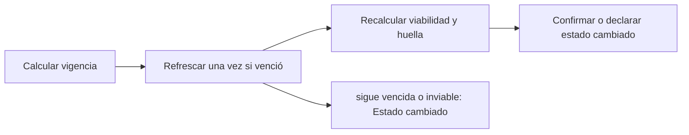

# Feature Specification: SF-02.4 — Vigencia de la opción

**Created**: 2026-10-19  
**Status**: draft  
**Flow**: [F-02 Aceptar opción](16-f-02-aceptar-opcion.md) (subflujo)  
**Related Specs**: [F-02 Aceptar opción](16-f-02-aceptar-opcion.md), [SF-02.3 Revalidación](19-sf-02-3-revalidacion.md), [SF-02.5 Llave idempotente y registro de operaciones](21-sf-02-5-llave-idempotente-y-registro-de-operaciones.md)  
**Origen (DEC/H)**: DEC-10, DEC-16, DEC-17, DEC-19  
**Pruebas (TC)**: TC-08, TC-27  
**Contratos externos**: §2.1 (herramienta 3: vigencia de la respuesta), §2.4 (`READ_MAX_REQUERIES`)  
**Deuda conocida de A1 (no se resuelve aquí)**: DEBT-A1-02  

## Reglas de este documento

> Este spec es FUNCIONAL, no técnico: describe QUÉ hace el sistema, no CÓMO. Usa lenguaje de negocio; las siete herramientas externas se nombran por su función y se referencian por la sección de `sdd/reports/EXTERNAL_CONTRACTS.md`. Los casos borde se DOCUMENTAN; los valores de configuración se citan por el nombre del parámetro (NFR-012) con su valor por defecto entre paréntesis.

**Alcance**: Comprueba que la opción re-consultada está vigente en el instante de escribir y, si venció, la refresca una sola vez recalculando viabilidad y huella.

## User Scenarios & Testing *(mandatory)*

### User Story 1 - Las opciones vencidas no se usan (Priority: P1)

Como pasajero, quiero que mi opción se renueve si caducó mientras decidía, y que si ya no está disponible me lo digan.

**Why this priority**: Las opciones tienen una vigencia corta; ignorarla causa cambios sobre disponibilidad inexistente.

**Independent Test**: Se prueba a 119 s (vigente), a 120 s (vencida) y sin vigencia declarada.

**Acceptance Scenarios**:

1. **Scenario**: Opción vigente
   - **Given** la opción tiene 119 segundos de edad
   - **When** se verifica la vigencia
   - **Then** está vigente y se escribe

2. **Scenario**: Opción vencida refrescable
   - **Given** la opción tiene 120 segundos de edad (instante exacto) y la re-consulta devuelve una opción viable
   - **When** se verifica la vigencia
   - **Then** se refresca una sola vez, se recalculan viabilidad y huella sobre la nueva respuesta y, si coinciden, se escribe

3. **Scenario**: Sigue vencida o inviable
   - **Given** tras el refresco la opción sigue vencida o ya no es viable
   - **When** se verifica la vigencia
   - **Then** no se escribe y se muestra el estado nuevo

4. **Scenario**: Vigencia a 119 s y 120 s (TC-27, TC-08)
   - **Given** opciones leídas a las 11:02:35Z con vigencia de 120 s
   - **When** se acepta a las 11:04:34Z y a las 11:04:35Z
   - **Then** a las 11:04:34Z está vigente; a las 11:04:35Z se refresca una sola vez y, si sigue vencida, estado cambiado

---

### Edge Cases

> Solo se documentan; los marcados MUST-IMPLEMENT se vuelven requisito FR-XXX y se implementan con TDD, los DEFERRED quedan para una iteración posterior.

#### Invalid Data
- [MUST-IMPLEMENT] Cuando el conjunto no declara vigencia → se considera vencido (FR-017)
- [MUST-IMPLEMENT] Cuando la re-consulta devuelve lo mismo vencido → no se reintenta en bucle (FR-017)
- [MUST-IMPLEMENT] Cuando la opción refrescada deja de ser viable → estado cambiado (FR-041)

## Requirements *(mandatory)*

### Functional Requirements

- **FR-017**: El sistema DEBE usar siempre el dato más reciente y respetar la vigencia: las opciones vencen en el instante de su lectura más su vigencia en segundos (en el instante exacto ya están vencidas; sin vigencia declarada el conjunto se considera vencido). Los eventos no vencen por sí mismos (`EVENT_MAX_AGE_SECONDS`, por defecto sin límite). Al vencer se re-consulta una sola vez por acción, sin bucles.
- **FR-041**: Una opción es viable si (a) los asientos disponibles cubren a todo el grupo junto; (b) existe un derecho concedido que la respalda (`CHANGE_RIGHTS`, por defecto cambio sin costo, y costo cero); (c) su referencia de política coincide con una versión vigente y no superada; (d) su tipo está soportado; (e) no está vencida; (f) es coherente con el itinerario: con conexión perdida parte del origen del segmento siguiente, llega al destino final y sale después de la nueva llegada más el tiempo mínimo de conexión; sin conexión perdida reemplaza al segmento afectado (mismo origen y destino) y sale después de la lectura; con la conexión perdida desconocida no se puede verificar (f): ninguna opción es viable por itinerario incierto, la decisión es BLOQUEADA y se ofrece soporte.
- **FR-072**: Si las opciones están vencidas al usarlas, el sistema DEBE refrescarlas antes de escribir.

### Key Entities *(include if feature involves data)*

- **Opción de reprogramación**: Alternativa candidata entregada por el proveedor; solo las viables se muestran. Campos principales:
  - `option_id`: texto local a la lectura
  - `itinerary_key`: texto que identifica el itinerario entre lecturas
  - `type`: REBOOK | REFUND | otro
  - `flight_number`: texto | nulo
  - `origin`: código de aeropuerto | nulo
  - `destination`: código de aeropuerto | nulo
  - `date`: fecha | nulo
  - `departure`: hora local HH:MM | nulo
  - `fare_difference`: entero sin decimales | nulo
  - `currency`: código de moneda | nulo
  - `seats_available`: entero | nulo
  - `policy_ref`: texto
  - `confidence`: enumeración abierta (HIGH | MEDIUM | LOW | otro)
  - `viable`: booleano
  - `discard_reasons`: lista de INSUFFICIENT_SEATS | FEE_CONFLICT | NO_ENTITLEMENT | POLICY_REF_UNVERIFIED | POLICY_REF_SUPERSEDED | UNSUPPORTED_TYPE | EXPIRED | MISSING_CURRENCY | ITINERARY_MISMATCH
  - `fingerprint`: texto: huella por opción
  - `is_proposed`: booleano
  - `overnight`: booleano | nulo
  - `expires_at`: marca de tiempo UTC
- **Resultado de aceptación**: Respuesta a un clic de «Aceptar esta opción». Campos principales:
  - `outcome`: REBOOKING_CREATED | EXISTING_REQUEST | HUMAN_CASE_CREATED | EXISTING_CASE | NEEDS_CONFIRMATION | STATE_CHANGED | FAILED
  - `message`: mensaje validado
  - `operation`: operación | nulo
  - `human_case`: caso humano | nulo
  - `retries`: entero entre 0 y `REBOOK_MAX_RETRIES`
  - `view`: vista del viaje | nulo (solo con STATE_CHANGED)

## Architectural Attributes *(mandatory)*

| Attribute | Value |
|-----------|-------|
| **Interaction type** | sync-http |
| **Consistency** | strong |
| **Workflow** | single-step |
| **Read pattern** | simple |
| **Auditability** | full-history |
| **Domain complexity** | medium |
| **Modularity** | bounded-context |
| **Deployment** | monolith |

## Success Criteria *(mandatory)*

### Measurable Outcomes

- **SC-001**: La opción de 119 s se usa en el 100 % de los casos y la de 120 s siempre se refresca.
- **SC-002**: Se realiza como máximo un refresco por acción.

## Traceability *(mandatory after implementation)*

> Las columnas de archivo y línea se registran en la verificación de trazabilidad posterior a la implementación; hoy cada criterio queda enlazado a su origen y a las pruebas que lo verifican.

| Criterion | Origen | Prueba (TC) | Source File | Line(s) |
|-----------|--------|-------------|-------------|---------|
| FR-017 | DEC-10 | TC-27 | se registra en la verificación posterior a la implementación | se registra en la verificación posterior a la implementación |
| FR-041 | DEC-16, DEC-17 | sin TC en el mapa §6 de REQUERIMIENTOS_V1 | se registra en la verificación posterior a la implementación | se registra en la verificación posterior a la implementación |
| FR-072 | DEC-10, DEC-19 | TC-08, TC-27 | se registra en la verificación posterior a la implementación | se registra en la verificación posterior a la implementación |
| SC-001 | criterio medible de este spec | TC-08, TC-27 | se registra en la verificación posterior a la implementación | se registra en la verificación posterior a la implementación |
| SC-002 | criterio medible de este spec | TC-08, TC-27 | se registra en la verificación posterior a la implementación | se registra en la verificación posterior a la implementación |

## Business Process (BPM View)

```
Calcular vigencia → Refrescar una vez si venció → Recalcular viabilidad y huella → Confirmar o declarar estado cambiado
```



