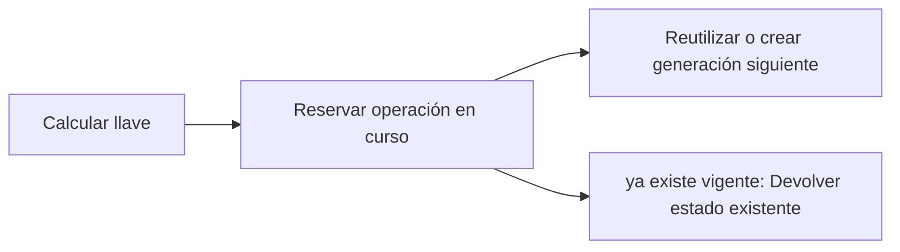

# Feature Specification: SF-02.5 — Llave idempotente y registro de operaciones

**Created**: 2026-10-19  
**Status**: draft  
**Flow**: [F-02 Aceptar opción](16-f-02-aceptar-opcion.md) (subflujo)  
**Related Specs**: [F-02 Aceptar opción](16-f-02-aceptar-opcion.md), [SF-02.4 Vigencia de la opción](20-sf-02-4-vigencia-de-la-opcion.md), [SF-02.6 Llamada a la solicitud de cambio](22-sf-02-6-llamada-a-la-solicitud-de-cambio.md)  
**Origen (DEC/H)**: DEC-18  
**Pruebas (TC)**: TC-22, TC-34, TC-38, TC-57  
**Contratos externos**: §2.1 (herramienta 5: llave idempotente y ciclo de vida de la operación), §2.4 (`IDEMPOTENCY_SECRET`)  
**Deuda conocida de A1 (no se resuelve aquí)**: DEBT-A1-01  

## Reglas de este documento

> Este spec es FUNCIONAL, no técnico: describe QUÉ hace el sistema, no CÓMO. Usa lenguaje de negocio; las siete herramientas externas se nombran por su función y se referencian por la sección de `sdd/reports/EXTERNAL_CONTRACTS.md`. Los casos borde se DOCUMENTAN; los valores de configuración se citan por el nombre del parámetro (NFR-012) con su valor por defecto entre paréntesis.

**Alcance**: Calcula la llave de idempotencia de la operación, la reserva de forma atómica antes de llamar y la reutiliza mientras la operación no haya fracasado.

## User Scenarios & Testing *(mandatory)*

### User Story 1 - Dos clics nunca duplican un cambio (Priority: P1)

Como pasajero, quiero que aunque mi clic llegue dos veces o mi conexión falle, mi reserva se cambie una sola vez.

**Why this priority**: Duplicar un cambio de reserva es una acción de alto impacto difícil de revertir.

**Independent Test**: Se prueba con dos aceptaciones simultáneas, con una operación ya en curso y con operaciones expiradas y fallidas.

**Acceptance Scenarios**:

1. **Scenario**: Reserva atómica
   - **Given** no existe operación activa para la reserva e itinerario
   - **When** se acepta la opción
   - **Then** se registra la operación en curso con su llave antes de llamar al proveedor

2. **Scenario**: Concurrencia
   - **Given** dos aceptaciones llegan a la vez
   - **When** ambas intentan reservar la llave
   - **Then** solo una escribe; la otra recibe el estado de la primera

3. **Scenario**: Generación siguiente
   - **Given** la operación anterior está expirada (incluida una indeterminada vencida) o fallida
   - **When** se acepta de nuevo
   - **Then** se usa la llave de la generación siguiente

4. **Scenario**: Llave no persistible
   - **Given** la llave no puede guardarse
   - **When** se acepta la opción
   - **Then** no se escribe nada

5. **Scenario**: Dos aceptaciones simultáneas (TC-22, TC-34)
   - **Given** O1 LA2412 de ABC123 con política POL-DELAY-2026-03 y otra versión POL-DELAY-2026-04 en la reevaluación
   - **When** dos clics llegan a la vez
   - **Then** se registra una sola operación con una sola llave, reutilizada pese al cambio de versión de política

---

### Edge Cases

> Solo se documentan; los marcados MUST-IMPLEMENT se vuelven requisito FR-XXX y se implementan con TDD, los DEFERRED quedan para una iteración posterior.

#### System Errors
- [MUST-IMPLEMENT] Cuando la llave no puede persistirse → no se escribe (FR-064)
- [DEFERRED] Unicidad por reserva y no por itinerario: riesgo declarado que decide el usuario (DEBT-A1-01, OQ-A2-06) (FR-053)

#### Invalid Data
- [MUST-IMPLEMENT] Cuando cambia la versión de política con una operación vigente → se reutiliza la misma llave (FR-053)

#### Race Conditions
- [MUST-IMPLEMENT] Cuando dos aceptaciones coinciden → una sola escritura (FR-062)

## Requirements *(mandatory)*

### Functional Requirements

- **FR-053**: La identidad de una operación de cambio es la reserva más el itinerario de la opción. Al crearla se calcula una llave de idempotencia no adivinable a partir de reserva, vuelo, fecha, salida, versión de política y generación (sin identificador de decisión ni marcas de tiempo), se guarda en el registro de operaciones de forma atómica y única antes de llamar, y toda reevaluación la reutiliza mientras la operación no haya fracasado, aunque cambie la versión de política.
- **FR-062**: Dos aceptaciones simultáneas, o una aceptación mientras la operación está en curso, indeterminada o creada, DEBEN resultar en una sola escritura; la segunda devuelve el estado de la primera y el botón se deshabilita mientras hay una solicitud en curso.
- **FR-064**: La operación de cambio DEBE seguir un ciclo de vida: en curso, creada, indeterminada, fallida y expirada. En curso pasa a indeterminada tras `OPERATION_STALE_SECONDS` (120) sin respuesta; creada pasa a expirada en su vencimiento; indeterminada pasa a expirada tras `OPERATION_INDETERMINATE_EXPIRY_SECONDS` (900, mayor que la vigencia de una solicitud) si nada la resuelve. Si la llave no pudo persistirse no se escribe. Expirada o fallida permiten una operación nueva con la generación siguiente; creada, en curso e indeterminada la bloquean y la vista muestra su estado. Un rechazo por duplicado sin operación local se muestra «ya existe una solicitud para esta opción».

### Key Entities *(include if feature involves data)*

- **Operación de reprogramación**: Intento de crear una solicitud de cambio, con su llave de idempotencia y su ciclo de vida. Campos principales:
  - `itinerary_key`: texto
  - `idempotency_key`: texto no adivinable
  - `generation`: entero ≥ 1
  - `state`: EN_CURSO | CREADA | INDETERMINADA | FALLIDA | EXPIRADA (INDETERMINADA pasa a EXPIRADA tras `OPERATION_INDETERMINATE_EXPIRY_SECONDS`)
  - `request_id`: texto | nulo
  - `request_status`: enumeración abierta (p. ej. PENDING_CONFIRMATION) | nulo
  - `expires_at`: marca de tiempo UTC | nulo
  - `passenger_ids`: lista de texto con TODO el grupo
  - `minimized`: booleano: verdadero cuando la purga conservó solo la identidad, el estado y la vigencia de la operación (sin itinerario ni pasajeros) para no perder su bloqueo

## Architectural Attributes *(mandatory)*

| Attribute | Value |
|-----------|-------|
| **Interaction type** | sync-http |
| **Consistency** | strong |
| **Workflow** | single-step |
| **Read pattern** | simple |
| **Auditability** | full-history |
| **Domain complexity** | medium |
| **Modularity** | bounded-context |
| **Deployment** | monolith |

## Success Criteria *(mandatory)*

### Measurable Outcomes

- **SC-001**: En 100 intentos simultáneos sobre el mismo itinerario se registra exactamente una operación.
- **SC-002**: La llave no incluye el identificador de decisión ni marcas de tiempo y no es adivinable sin el secreto del servicio.

## Traceability *(mandatory after implementation)*

> Las columnas de archivo y línea se registran en la verificación de trazabilidad posterior a la implementación; hoy cada criterio queda enlazado a su origen y a las pruebas que lo verifican.

| Criterion | Origen | Prueba (TC) | Source File | Line(s) |
|-----------|--------|-------------|-------------|---------|
| FR-053 | DEC-18 | TC-22, TC-34 | se registra en la verificación posterior a la implementación | se registra en la verificación posterior a la implementación |
| FR-062 | DEC-18 | TC-22 | se registra en la verificación posterior a la implementación | se registra en la verificación posterior a la implementación |
| FR-064 | DEC-18 | TC-38, TC-57 | se registra en la verificación posterior a la implementación | se registra en la verificación posterior a la implementación |
| SC-001 | criterio medible de este spec | TC-22, TC-34, TC-38, TC-57 | se registra en la verificación posterior a la implementación | se registra en la verificación posterior a la implementación |
| SC-002 | criterio medible de este spec | TC-22, TC-34, TC-38, TC-57 | se registra en la verificación posterior a la implementación | se registra en la verificación posterior a la implementación |

## Business Process (BPM View)

```
Calcular llave → Reservar operación en curso → Reutilizar o crear generación siguiente
```



