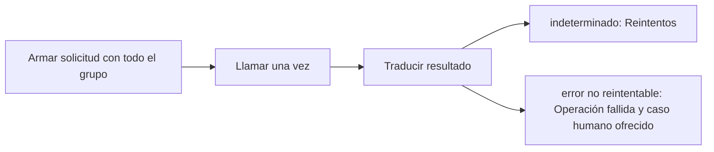

# Feature Specification: SF-02.6 — Llamada a la solicitud de cambio

**Created**: 2026-10-19  
**Status**: draft  
**Flow**: [F-02 Aceptar opción](16-f-02-aceptar-opcion.md) (subflujo)  
**Related Specs**: [F-02 Aceptar opción](16-f-02-aceptar-opcion.md), [SF-02.5 Llave idempotente y registro de operaciones](21-sf-02-5-llave-idempotente-y-registro-de-operaciones.md), [SF-02.7 Reintentos del resultado indeterminado](23-sf-02-7-reintentos-del-resultado-indeterminado.md)  
**Origen (DEC/H)**: DEC-15, DEC-18, DEC-19  
**Pruebas (TC)**: TC-14, TC-15, TC-30, TC-40  
**Contratos externos**: §2.1 (herramienta 5: solicitud de cambio de reserva y sus respuestas)  

## Reglas de este documento

> Este spec es FUNCIONAL, no técnico: describe QUÉ hace el sistema, no CÓMO. Usa lenguaje de negocio; las siete herramientas externas se nombran por su función y se referencian por la sección de `sdd/reports/EXTERNAL_CONTRACTS.md`. Los casos borde se DOCUMENTAN; los valores de configuración se citan por el nombre del parámetro (NFR-012) con su valor por defecto entre paréntesis.

**Alcance**: Una llamada al proveedor de cambios con la opción resuelta por el servidor, la llave, la reserva y todos los pasajeros del grupo, y traducción del resultado.

## User Scenarios & Testing *(mandatory)*

### User Story 1 - El cambio se solicita para todo el grupo y el resultado se explica sin exagerar (Priority: P1)

Como pasajero, quiero que mi solicitud cubra a todos los pasajeros de mi grupo y que me digan que quedó pendiente de confirmación, sin prometer un cambio ya hecho.

**Why this priority**: La confirmación está fuera de la versión 1: afirmar más sería falso.

**Independent Test**: Se prueba con respuesta de creación, de duplicado, de falla temporal y de error no reintentable.

**Acceptance Scenarios**:

1. **Scenario**: Solicitud creada
   - **Given** el proveedor responde con una solicitud pendiente de confirmación y vencimiento
   - **When** se llama
   - **Then** la operación queda creada y el mensaje dice «pendiente de confirmación, sujeta a disponibilidad»

2. **Scenario**: Duplicado
   - **Given** el proveedor indica que ya existe una solicitud
   - **When** se llama
   - **Then** se trata como solicitud existente: «ya existe una solicitud en curso para esta opción», sin bucles

3. **Scenario**: Error no reintentable
   - **Given** el proveedor rechaza por un error no definido
   - **When** se llama
   - **Then** la operación queda fallida, no se reintenta, se muestra un fallo genérico y se ofrece el caso humano

4. **Scenario**: Respuestas del proveedor (TC-30, TC-15, TC-40)
   - **Given** la llamada incluye ABC123 y los pasajeros P1 y P2
   - **When** el proveedor responde creada (RBK-88231, vence 11:12:00Z), duplicado, o rechazo por pasajeros no cubiertos
   - **Then** queda creada con su vencimiento, solicitud existente, o fallida sin reintento

---

### Edge Cases

> Solo se documentan; los marcados MUST-IMPLEMENT se vuelven requisito FR-XXX y se implementan con TDD, los DEFERRED quedan para una iteración posterior.

#### System Errors
- [MUST-IMPLEMENT] Cuando el proveedor tarda más del tiempo de escritura configurado → resultado indeterminado (FR-054)
- [DEFERRED] Confirmación posterior de la solicitud pendiente: fuera de la versión 1 (AR-11) (FR-056)

#### Invalid Data
- [MUST-IMPLEMENT] Cuando la solicitud no cubre a todos los pasajeros → el proveedor simulado la rechaza como no reintentable (FR-065)
- [MUST-IMPLEMENT] Cuando hay duplicado sin operación local → se registra una operación indeterminada con la solicitud devuelta (FR-064)

## Requirements *(mandatory)*

### Functional Requirements

- **FR-054**: Un resultado indeterminado (falla temporal del proveedor, tiempo agotado o respuesta perdida) DEBE reintentarse hasta `REBOOK_MAX_RETRIES` (2) veces con la misma llave; luego se deriva a caso humano (cubierto por el clic de FR-050). Nunca se informa éxito ni fracaso.
- **FR-055**: Un rechazo por duplicado DEBE tratarse como solicitud existente y la vista muestra «ya existe una solicitud en curso para esta opción», sin bucles.
- **FR-056**: Una solicitud creada DEBE mostrarse como «solicitud registrada, pendiente de confirmación, sujeta a disponibilidad» con su vencimiento; la confirmación queda fuera de la versión 1.
- **FR-105**: Matriz de errores por herramienta: las lecturas con fallo se reconsultan una vez sin bucles; sin contexto del viaje hay pantalla de «no pudimos cargar tu viaje» con reintento; solo sin eventos se muestra el contexto sin estado ni alerta y con aviso; sin política u opciones queda BLOQUEADA con caso humano ofrecido. Una solicitud de cambio con error no reintentable no se reintenta, muestra un fallo genérico y ofrece caso humano. En el caso humano, un error explícito dice «no pudimos registrar tu solicitud, puedes reintentar»; un tiempo agotado o respuesta perdida es indeterminado («no pudimos confirmar si tu solicitud quedó registrada; puede que ya lo esté»), no se reenvía automáticamente y el reintento exige un segundo clic explícito tras advertir del posible duplicado. Nunca se afirma éxito.

### Non-Functional and Documentation Requirements

- **DOC-013**: DEBEN documentarse las extensiones de contrato propuestas al equipo: reserva y pasajeros en la solicitud de cambio, destinatario y tipo de aviso (informativo sin referencia de política) en la notificación, y contrato reducido en las opciones.

### Key Entities *(include if feature involves data)*

- **Operación de reprogramación**: Intento de crear una solicitud de cambio, con su llave de idempotencia y su ciclo de vida. Campos principales:
  - `itinerary_key`: texto
  - `idempotency_key`: texto no adivinable
  - `generation`: entero ≥ 1
  - `state`: EN_CURSO | CREADA | INDETERMINADA | FALLIDA | EXPIRADA (INDETERMINADA pasa a EXPIRADA tras `OPERATION_INDETERMINATE_EXPIRY_SECONDS`)
  - `request_id`: texto | nulo
  - `request_status`: enumeración abierta (p. ej. PENDING_CONFIRMATION) | nulo
  - `expires_at`: marca de tiempo UTC | nulo
  - `passenger_ids`: lista de texto con TODO el grupo
  - `minimized`: booleano: verdadero cuando la purga conservó solo la identidad, el estado y la vigencia de la operación (sin itinerario ni pasajeros) para no perder su bloqueo
- **Resultado de aceptación**: Respuesta a un clic de «Aceptar esta opción». Campos principales:
  - `outcome`: REBOOKING_CREATED | EXISTING_REQUEST | HUMAN_CASE_CREATED | EXISTING_CASE | NEEDS_CONFIRMATION | STATE_CHANGED | FAILED
  - `message`: mensaje validado
  - `operation`: operación | nulo
  - `human_case`: caso humano | nulo
  - `retries`: entero entre 0 y `REBOOK_MAX_RETRIES`
  - `view`: vista del viaje | nulo (solo con STATE_CHANGED)

## Architectural Attributes *(mandatory)*

| Attribute | Value |
|-----------|-------|
| **Interaction type** | sync-http |
| **Consistency** | strong |
| **Workflow** | single-step |
| **Read pattern** | simple |
| **Auditability** | full-history |
| **Domain complexity** | medium |
| **Modularity** | bounded-context |
| **Deployment** | monolith |

## Success Criteria *(mandatory)*

### Measurable Outcomes

- **SC-001**: El 100 % de las solicitudes enviadas incluye la reserva y todos los pasajeros.
- **SC-002**: Ninguna respuesta afirma que el vuelo ya cambió.

## Traceability *(mandatory after implementation)*

> Las columnas de archivo y línea se registran en la verificación de trazabilidad posterior a la implementación; hoy cada criterio queda enlazado a su origen y a las pruebas que lo verifican.

| Criterion | Origen | Prueba (TC) | Source File | Line(s) |
|-----------|--------|-------------|-------------|---------|
| FR-054 | DEC-18 | TC-14 | se registra en la verificación posterior a la implementación | se registra en la verificación posterior a la implementación |
| FR-055 | DEC-18 | TC-15 | se registra en la verificación posterior a la implementación | se registra en la verificación posterior a la implementación |
| FR-056 | DEC-18, DEC-19 | TC-30 | se registra en la verificación posterior a la implementación | se registra en la verificación posterior a la implementación |
| FR-105 | DEC-15, DEC-18 | sin TC en el mapa §6 de REQUERIMIENTOS_V1 | se registra en la verificación posterior a la implementación | se registra en la verificación posterior a la implementación |
| DOC-013 | DEC-18 | sin TC en el mapa §6 de REQUERIMIENTOS_V1 | se registra en la verificación posterior a la implementación | se registra en la verificación posterior a la implementación |
| SC-001 | criterio medible de este spec | TC-14, TC-15, TC-30, TC-40 | se registra en la verificación posterior a la implementación | se registra en la verificación posterior a la implementación |
| SC-002 | criterio medible de este spec | TC-14, TC-15, TC-30, TC-40 | se registra en la verificación posterior a la implementación | se registra en la verificación posterior a la implementación |

## Business Process (BPM View)

```
Armar solicitud con todo el grupo → Llamar una vez → Traducir resultado
```



