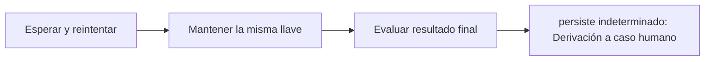

# Feature Specification: SF-02.7 — Reintentos del resultado indeterminado

**Created**: 2026-10-19  
**Status**: draft  
**Flow**: [F-02 Aceptar opción](16-f-02-aceptar-opcion.md) (subflujo)  
**Related Specs**: [F-02 Aceptar opción](16-f-02-aceptar-opcion.md), [SF-02.6 Llamada a la solicitud de cambio](22-sf-02-6-llamada-a-la-solicitud-de-cambio.md), [SF-02.8 Derivación tras falla persistente](24-sf-02-8-derivacion-tras-falla-persistente.md)  
**Origen (DEC/H)**: DEC-18  
**Pruebas (TC)**: TC-14, TC-33, TC-49  
**Contratos externos**: §2.1 (herramienta 5: reintentos), §2.4 (`REBOOK_MAX_RETRIES`, `WRITE_RETRY_BACKOFF_MS`)  

## Reglas de este documento

> Este spec es FUNCIONAL, no técnico: describe QUÉ hace el sistema, no CÓMO. Usa lenguaje de negocio; las siete herramientas externas se nombran por su función y se referencian por la sección de `sdd/reports/EXTERNAL_CONTRACTS.md`. Los casos borde se DOCUMENTAN; los valores de configuración se citan por el nombre del parámetro (NFR-012) con su valor por defecto entre paréntesis.

**Alcance**: Reintenta hasta `REBOOK_MAX_RETRIES` (2) veces con la misma llave y espera creciente; nunca informa éxito ni fracaso mientras sea indeterminado.

## User Scenarios & Testing *(mandatory)*

### User Story 1 - Una falla pasajera no duplica ni pierde el cambio (Priority: P1)

Como pasajero, quiero que si el proveedor tuvo una falla momentánea el sistema reintente solo, sin crear un segundo cambio.

**Why this priority**: La misma llave garantiza que un reintento no duplica.

**Independent Test**: Se prueba con un proveedor que falla una vez, dos veces y siempre.

**Acceptance Scenarios**:

1. **Scenario**: Éxito tras un reintento
   - **Given** el proveedor falla temporalmente una vez y luego responde creada
   - **When** se reintenta con la misma llave
   - **Then** la operación queda creada y los reintentos realizados es 1

2. **Scenario**: Persistencia del indeterminado
   - **Given** el proveedor falla en la llamada inicial y en los dos reintentos
   - **When** se agotan los reintentos
   - **Then** la operación queda indeterminada y se pasa a la derivación a caso humano

3. **Scenario**: Tres llamadas con la misma llave (TC-14)
   - **Given** el proveedor falla con indisponibilidad en la 1.ª llamada y en los 2 reintentos de 200 ms y 400 ms
   - **When** se agotan los reintentos
   - **Then** la operación queda indeterminada tras 3 llamadas con la misma llave

---

### Edge Cases

> Solo se documentan; los marcados MUST-IMPLEMENT se vuelven requisito FR-XXX y se implementan con TDD, los DEFERRED quedan para una iteración posterior.

#### System Errors
- [MUST-IMPLEMENT] Cuando se agotan los reintentos → derivar a caso humano sin informar éxito ni fracaso (FR-054)
- [MUST-IMPLEMENT] Cuando cambia el valor de `REBOOK_MAX_RETRIES` → cambia el número de reintentos (NFR-012)
- [DEFERRED] Interruptor de circuito para el proveedor: se descartó en la versión 1 por no aportar beneficio (FR-054)

## Requirements *(mandatory)*

### Functional Requirements

- **FR-054**: Un resultado indeterminado (falla temporal del proveedor, tiempo agotado o respuesta perdida) DEBE reintentarse hasta `REBOOK_MAX_RETRIES` (2) veces con la misma llave; luego se deriva a caso humano (cubierto por el clic de FR-050). Nunca se informa éxito ni fracaso.

### Non-Functional and Documentation Requirements

- **NFR-012**: Configuración: todos los parámetros de los supuestos S-09 a S-19 DEBEN ser variables configurables (archivo de configuración con sobrescritura por entorno, validadas al arrancar y con valor por defecto documentado) y ninguno puede estar fijado en la lógica; entre ellos `RELEVANT_DELAY_MIN_MINUTES` (1), `MIN_CONNECTION_MINUTES` (0 por aeropuerto), `MCT_UNCERTAINTY_MINUTES` (45), `CLOCK_SKEW_SECONDS` (60), `EVENT_MAX_AGE_SECONDS` (sin límite), `OPERATION_STALE_SECONDS` (120), `REBOOK_MAX_RETRIES` (2), `AUDIT_RETENTION_DAYS` (30), `PARSER_MAX_CONDITION_CHARS` (200), `PARSER_MAX_DEPTH` (10), `REMEDY_RIGHTS`, `COMPENSATION_RIGHTS`, `NOTIFY_ENABLED`, `NOTIFY_COOLDOWN_SECONDS` (86400), `NOTIFY_MAX_RETRIES` (2), `OPERATION_INDETERMINATE_EXPIRY_SECONDS` (900), `EVALUATE_RATE_LIMIT_PER_MINUTE` (30), `CHANGE_RIGHTS`, `SUPPORTED_EVENT_TYPES`, `NOTIFY_ONLY_EVENT_TYPES`, `POLICY_SCENARIOS`, `REASON_PRIORITY`, la tabla de compatibilidad de afirmaciones y los secretos `SERVICE_API_KEY` e `IDEMPOTENCY_SECRET` (solo por entorno). Una prueba cambia cada parámetro y comprueba que cambia el comportamiento. También son configurables los parámetros operativos de `sdd/reports/EXTERNAL_CONTRACTS.md` §2.4 (tiempos de espera, reintentos de lectura, modo de reloj, origen permitido, ubicación del registro y banderas de desarrollo).

### Key Entities *(include if feature involves data)*

- **Operación de reprogramación**: Intento de crear una solicitud de cambio, con su llave de idempotencia y su ciclo de vida. Campos principales:
  - `itinerary_key`: texto
  - `idempotency_key`: texto no adivinable
  - `generation`: entero ≥ 1
  - `state`: EN_CURSO | CREADA | INDETERMINADA | FALLIDA | EXPIRADA (INDETERMINADA pasa a EXPIRADA tras `OPERATION_INDETERMINATE_EXPIRY_SECONDS`)
  - `request_id`: texto | nulo
  - `request_status`: enumeración abierta (p. ej. PENDING_CONFIRMATION) | nulo
  - `expires_at`: marca de tiempo UTC | nulo
  - `passenger_ids`: lista de texto con TODO el grupo
  - `minimized`: booleano: verdadero cuando la purga conservó solo la identidad, el estado y la vigencia de la operación (sin itinerario ni pasajeros) para no perder su bloqueo

## Architectural Attributes *(mandatory)*

| Attribute | Value |
|-----------|-------|
| **Interaction type** | sync-http |
| **Consistency** | strong |
| **Workflow** | single-step |
| **Read pattern** | simple |
| **Auditability** | full-history |
| **Domain complexity** | medium |
| **Modularity** | bounded-context |
| **Deployment** | monolith |

## Success Criteria *(mandatory)*

### Measurable Outcomes

- **SC-001**: Los reintentos usan la misma llave en el 100 % de los casos.
- **SC-002**: El número de reintentos nunca supera `REBOOK_MAX_RETRIES`.

## Traceability *(mandatory after implementation)*

> Las columnas de archivo y línea se registran en la verificación de trazabilidad posterior a la implementación; hoy cada criterio queda enlazado a su origen y a las pruebas que lo verifican.

| Criterion | Origen | Prueba (TC) | Source File | Line(s) |
|-----------|--------|-------------|-------------|---------|
| FR-054 | DEC-18 | TC-14, TC-33 | se registra en la verificación posterior a la implementación | se registra en la verificación posterior a la implementación |
| NFR-012 | Usuario (2026-10-19) | TC-49 | se registra en la verificación posterior a la implementación | se registra en la verificación posterior a la implementación |
| SC-001 | criterio medible de este spec | TC-14, TC-33, TC-49 | se registra en la verificación posterior a la implementación | se registra en la verificación posterior a la implementación |
| SC-002 | criterio medible de este spec | TC-14, TC-33, TC-49 | se registra en la verificación posterior a la implementación | se registra en la verificación posterior a la implementación |

## Business Process (BPM View)

```
Esperar y reintentar → Mantener la misma llave → Evaluar resultado final
```



