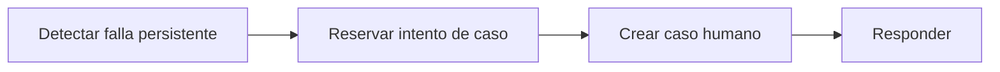

# Feature Specification: SF-02.8 — Derivación tras falla persistente

**Created**: 2026-10-19  
**Status**: draft  
**Flow**: [F-02 Aceptar opción](16-f-02-aceptar-opcion.md) (subflujo)  
**Related Specs**: [F-02 Aceptar opción](16-f-02-aceptar-opcion.md), [SF-02.7 Reintentos del resultado indeterminado](23-sf-02-7-reintentos-del-resultado-indeterminado.md), [SF-02.9 Caso humano con la opción elegida](25-sf-02-9-caso-humano-con-la-opcion-elegida.md)  
**Origen (DEC/H)**: DEC-14, DEC-15, DEC-18  
**Pruebas (TC)**: TC-14  
**Contratos externos**: §2.1 (herramienta 6: caso humano)  

## Reglas de este documento

> Este spec es FUNCIONAL, no técnico: describe QUÉ hace el sistema, no CÓMO. Usa lenguaje de negocio; las siete herramientas externas se nombran por su función y se referencian por la sección de `sdd/reports/EXTERNAL_CONTRACTS.md`. Los casos borde se DOCUMENTAN; los valores de configuración se citan por el nombre del parámetro (NFR-012) con su valor por defecto entre paréntesis.

**Alcance**: Si el resultado sigue indeterminado, abre un caso humano con el motivo de falla indeterminada del proveedor, cubierto por el clic del pasajero.

## User Scenarios & Testing *(mandatory)*

### User Story 1 - Cuando el sistema no puede confirmar, una persona lo resuelve (Priority: P1)

Como pasajero, quiero que si el sistema no puede confirmar mi cambio me deriven a una persona en lugar de dejarme sin respuesta.

**Why this priority**: Una operación indeterminada bloquea nuevos intentos; la persona es la única vía de resolución en la versión 1.

**Independent Test**: Se prueba con un proveedor que falla siempre.

**Acceptance Scenarios**:

1. **Scenario**: Derivación
   - **Given** los reintentos se agotaron
   - **When** se deriva
   - **Then** se crea un caso humano con motivo de falla indeterminada del proveedor y la operación queda indeterminada

2. **Scenario**: Clic cubre la derivación
   - **Given** el botón declaró que, si no podía confirmarse, el caso se derivaría a una persona
   - **When** se deriva
   - **Then** no se pide un segundo clic para esta derivación

3. **Scenario**: Derivación tras falla persistente (TC-14, TC-33)
   - **Given** la operación de O1 quedó indeterminada tras 3 llamadas
   - **When** se deriva
   - **Then** se crea un caso humano con el motivo falla indeterminada (HC-4471, 45 minutos) y la operación sigue indeterminada

---

### Edge Cases

> Solo se documentan; los marcados MUST-IMPLEMENT se vuelven requisito FR-XXX y se implementan con TDD, los DEFERRED quedan para una iteración posterior.

#### System Errors
- [MUST-IMPLEMENT] Cuando también falla la creación del caso → se informa que no pudo registrarse y no se afirma éxito (FR-105)

#### Invalid Data
- [MUST-IMPLEMENT] Cuando el motivo es falla indeterminada → es el de mayor prioridad entre los simultáneos (FR-063)

## Requirements *(mandatory)*

### Functional Requirements

- **FR-050**: Toda acción externa (solicitud de cambio, caso humano, notificación) DEBE requerir un clic explícito del pasajero; el sistema solo propone y ofrece. La persistencia interna no es una acción externa. Excepción: en modo sistema se puede enviar la notificación de FR-122 sin clic, con plantilla fija; ninguna otra acción externa se ejecuta en modo sistema. Un clic autoriza exactamente una acción y los textos de los botones lo declaran, incluida la derivación posterior a una falla persistente.
- **FR-054**: Un resultado indeterminado (falla temporal del proveedor, tiempo agotado o respuesta perdida) DEBE reintentarse hasta `REBOOK_MAX_RETRIES` (2) veces con la misma llave; luego se deriva a caso humano (cubierto por el clic de FR-050). Nunca se informa éxito ni fracaso.
- **FR-063**: Cada causa se traduce a un motivo con prioridad fija (de mayor a menor: falla indeterminada del proveedor, conflicto de fuentes, evento no soportado, retraso incoherente, varios segmentos afectados, datos parciales bloqueantes, compensación solicitada, datos personales, aprobación de política, ninguna opción cubre al grupo, ninguna opción viable, pernocte y otra ayuda); el motivo del caso es el primero que aplique y se conservan todos los demás (`REASON_PRIORITY`).

### Key Entities *(include if feature involves data)*

- **Caso humano**: Escalamiento a una persona; cada intento queda registrado con su resultado. Campos principales:
  - `dedup_key`: texto
  - `attempt`: entero ≥ 1
  - `state`: EN_CURSO | CREADO | FALLIDO | INDETERMINADO
  - `reason`: uno de los 13 motivos cerrados
  - `reasons`: lista ordenada por prioridad
  - `case_id`: texto | nulo
  - `queue`: texto | nulo
  - `sla_minutes`: entero | nulo
  - `option`: {option_id: texto, itinerario y diferencia de tarifa} | nulo
  - `confirm_possible_duplicate`: booleano
- **Operación de reprogramación**: Intento de crear una solicitud de cambio, con su llave de idempotencia y su ciclo de vida. Campos principales:
  - `itinerary_key`: texto
  - `idempotency_key`: texto no adivinable
  - `generation`: entero ≥ 1
  - `state`: EN_CURSO | CREADA | INDETERMINADA | FALLIDA | EXPIRADA (INDETERMINADA pasa a EXPIRADA tras `OPERATION_INDETERMINATE_EXPIRY_SECONDS`)
  - `request_id`: texto | nulo
  - `request_status`: enumeración abierta (p. ej. PENDING_CONFIRMATION) | nulo
  - `expires_at`: marca de tiempo UTC | nulo
  - `passenger_ids`: lista de texto con TODO el grupo
  - `minimized`: booleano: verdadero cuando la purga conservó solo la identidad, el estado y la vigencia de la operación (sin itinerario ni pasajeros) para no perder su bloqueo

## Architectural Attributes *(mandatory)*

| Attribute | Value |
|-----------|-------|
| **Interaction type** | sync-http |
| **Consistency** | strong |
| **Workflow** | single-step |
| **Read pattern** | simple |
| **Auditability** | full-history |
| **Domain complexity** | medium |
| **Modularity** | bounded-context |
| **Deployment** | monolith |

## Success Criteria *(mandatory)*

### Measurable Outcomes

- **SC-001**: El 100 % de las fallas persistentes produce un caso humano o un aviso explícito de que no pudo registrarse.

## Traceability *(mandatory after implementation)*

> Las columnas de archivo y línea se registran en la verificación de trazabilidad posterior a la implementación; hoy cada criterio queda enlazado a su origen y a las pruebas que lo verifican.

| Criterion | Origen | Prueba (TC) | Source File | Line(s) |
|-----------|--------|-------------|-------------|---------|
| FR-050 | DEC-14 | sin TC en el mapa §6 de REQUERIMIENTOS_V1 | se registra en la verificación posterior a la implementación | se registra en la verificación posterior a la implementación |
| FR-054 | DEC-18 | TC-14 | se registra en la verificación posterior a la implementación | se registra en la verificación posterior a la implementación |
| FR-063 | DEC-15 | sin TC en el mapa §6 de REQUERIMIENTOS_V1 | se registra en la verificación posterior a la implementación | se registra en la verificación posterior a la implementación |
| SC-001 | criterio medible de este spec | TC-14 | se registra en la verificación posterior a la implementación | se registra en la verificación posterior a la implementación |

## Business Process (BPM View)

```
Detectar falla persistente → Reservar intento de caso → Crear caso humano → Responder
```



