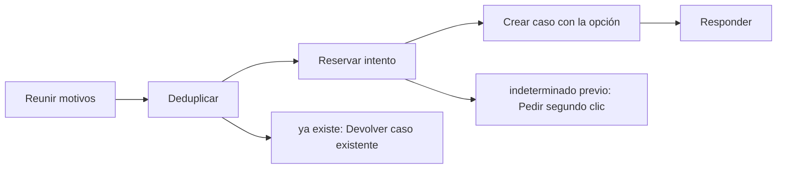

# Feature Specification: SF-02.9 — Caso humano con la opción elegida

**Created**: 2026-10-19  
**Status**: draft  
**Flow**: [F-02 Aceptar opción](16-f-02-aceptar-opcion.md) (subflujo)  
**Related Specs**: [F-02 Aceptar opción](16-f-02-aceptar-opcion.md), [SF-02.8 Derivación tras falla persistente](24-sf-02-8-derivacion-tras-falla-persistente.md), [SF-02.10 Mensaje de resultado y registro](26-sf-02-10-mensaje-de-resultado-y-registro.md)  
**Origen (DEC/H)**: DEC-13, DEC-15, DEC-16, DEC-18, DEC-23  
**Pruebas (TC)**: TC-01, TC-33  
**Contratos externos**: §1.1 (fila 3: resultados de caso humano), §2.1 (herramienta 6: caso humano)  

## Reglas de este documento

> Este spec es FUNCIONAL, no técnico: describe QUÉ hace el sistema, no CÓMO. Usa lenguaje de negocio; las siete herramientas externas se nombran por su función y se referencian por la sección de `sdd/reports/EXTERNAL_CONTRACTS.md`. Los casos borde se DOCUMENTAN; los valores de configuración se citan por el nombre del parámetro (NFR-012) con su valor por defecto entre paréntesis.

**Alcance**: Crea el caso humano con la opción como evidencia, todos los motivos aplicables, reserva atómica y deduplicación local, usando la instantánea guardada.

## User Scenarios & Testing *(mandatory)*

### User Story 1 - La persona recibe el caso con la opción que el pasajero eligió (Priority: P1)

Como pasajero, quiero que al aceptar una opción que requiere aprobación, la persona que me atienda ya sepa cuál elegí y por qué.

**Why this priority**: Evita repetir información y acelera la resolución.

**Independent Test**: Se prueba con decisión PENDIENTE_APROBACION y BLOQUEADA, con caso existente y con intento previo indeterminado.

**Acceptance Scenarios**:

1. **Scenario**: Caso nuevo
   - **Given** no hay caso previo para la misma clave
   - **When** se acepta la opción
   - **Then** se crea el caso con la opción, todos los motivos y sin información personal

2. **Scenario**: Caso existente
   - **Given** ya hay un caso creado con la misma clave o un intento en curso
   - **When** se acepta de nuevo
   - **Then** se devuelve el caso existente sin enviar nada

3. **Scenario**: Posible duplicado
   - **Given** el intento previo quedó indeterminado
   - **When** se acepta sin confirmar el posible duplicado
   - **Then** se pide un segundo clic explícito, conservando la misma opción

4. **Scenario**: Caso con la opción O1 (TC-01)
   - **Given** el caso base con decisión PENDIENTE_APROBACION y los motivos aprobación de política y pernocte
   - **When** se acepta O1 dos veces y el proveedor de casos responde HC-4471
   - **Then** se crea un solo caso HC-4471 con O1 como evidencia y los dos motivos; el segundo clic devuelve el caso existente

---

### Edge Cases

> Solo se documentan; los marcados MUST-IMPLEMENT se vuelven requisito FR-XXX y se implementan con TDD, los DEFERRED quedan para una iteración posterior.

#### System Errors
- [MUST-IMPLEMENT] Cuando el intento previo fue indeterminado → se advierte del posible duplicado y se exige un segundo clic (FR-105)

#### Race Conditions
- [MUST-IMPLEMENT] Cuando hay un intento en curso → un segundo intento concurrente no envía (FR-059)

#### Security & Permissions
- [MUST-IMPLEMENT] Cuando se arma la evidencia → solo contiene identificadores, enumeraciones y hechos validados (FR-059)

## Requirements *(mandatory)*

### Functional Requirements

- **FR-052**: Al aceptar una opción cuando la decisión exige aprobación, es BLOQUEADA o tiene reglas no evaluables, el sistema NO DEBE crear la solicitud de cambio: crea un caso humano con la opción elegida como evidencia.
- **FR-059**: Al crear un caso humano el sistema DEBE enviar el motivo de mayor prioridad y conservar todos los motivos simultáneos, con evidencia solo de identificadores, enumeraciones y hechos validados (sin información personal), tomada de la decisión guardada si el pasajero indica la decisión que vio y, si no, de una evaluación fresca. La deduplicación local se calcula con reserva, motivos ordenados y huella de decisión, no bloquea el reintento explícito tras un intento fallido o indeterminado, y cada intento y su resultado (creado, fallido, indeterminado) queda registrado. No requiere revalidación.
- **FR-063**: Cada causa se traduce a un motivo con prioridad fija (de mayor a menor: falla indeterminada del proveedor, conflicto de fuentes, evento no soportado, retraso incoherente, varios segmentos afectados, datos parciales bloqueantes, compensación solicitada, datos personales, aprobación de política, ninguna opción cubre al grupo, ninguna opción viable, pernocte y otra ayuda); el motivo del caso es el primero que aplique y se conservan todos los demás (`REASON_PRIORITY`).
- **FR-105**: Matriz de errores por herramienta: las lecturas con fallo se reconsultan una vez sin bucles; sin contexto del viaje hay pantalla de «no pudimos cargar tu viaje» con reintento; solo sin eventos se muestra el contexto sin estado ni alerta y con aviso; sin política u opciones queda BLOQUEADA con caso humano ofrecido. Una solicitud de cambio con error no reintentable no se reintenta, muestra un fallo genérico y ofrece caso humano. En el caso humano, un error explícito dice «no pudimos registrar tu solicitud, puedes reintentar»; un tiempo agotado o respuesta perdida es indeterminado («no pudimos confirmar si tu solicitud quedó registrada; puede que ya lo esté»), no se reenvía automáticamente y el reintento exige un segundo clic explícito tras advertir del posible duplicado. Nunca se afirma éxito.

### Key Entities *(include if feature involves data)*

- **Caso humano**: Escalamiento a una persona; cada intento queda registrado con su resultado. Campos principales:
  - `dedup_key`: texto
  - `attempt`: entero ≥ 1
  - `state`: EN_CURSO | CREADO | FALLIDO | INDETERMINADO
  - `reason`: uno de los 13 motivos cerrados
  - `reasons`: lista ordenada por prioridad
  - `case_id`: texto | nulo
  - `queue`: texto | nulo
  - `sla_minutes`: entero | nulo
  - `option`: {option_id: texto, itinerario y diferencia de tarifa} | nulo
  - `confirm_possible_duplicate`: booleano
- **Resultado de aceptación**: Respuesta a un clic de «Aceptar esta opción». Campos principales:
  - `outcome`: REBOOKING_CREATED | EXISTING_REQUEST | HUMAN_CASE_CREATED | EXISTING_CASE | NEEDS_CONFIRMATION | STATE_CHANGED | FAILED
  - `message`: mensaje validado
  - `operation`: operación | nulo
  - `human_case`: caso humano | nulo
  - `retries`: entero entre 0 y `REBOOK_MAX_RETRIES`
  - `view`: vista del viaje | nulo (solo con STATE_CHANGED)

## Architectural Attributes *(mandatory)*

| Attribute | Value |
|-----------|-------|
| **Interaction type** | sync-http |
| **Consistency** | strong |
| **Workflow** | single-step |
| **Read pattern** | simple |
| **Auditability** | full-history |
| **Domain complexity** | medium |
| **Modularity** | bounded-context |
| **Deployment** | monolith |

## Success Criteria *(mandatory)*

### Measurable Outcomes

- **SC-001**: El 100 % de los casos creados por aceptar una opción lleva esa opción como evidencia.
- **SC-002**: Cero casos duplicados por clics concurrentes.

## Traceability *(mandatory after implementation)*

> Las columnas de archivo y línea se registran en la verificación de trazabilidad posterior a la implementación; hoy cada criterio queda enlazado a su origen y a las pruebas que lo verifican.

| Criterion | Origen | Prueba (TC) | Source File | Line(s) |
|-----------|--------|-------------|-------------|---------|
| FR-052 | DEC-13, DEC-16 | TC-01 | se registra en la verificación posterior a la implementación | se registra en la verificación posterior a la implementación |
| FR-059 | DEC-15, DEC-23 | TC-01 | se registra en la verificación posterior a la implementación | se registra en la verificación posterior a la implementación |
| FR-063 | DEC-15 | TC-01 | se registra en la verificación posterior a la implementación | se registra en la verificación posterior a la implementación |
| FR-105 | DEC-15, DEC-18 | TC-33 | se registra en la verificación posterior a la implementación | se registra en la verificación posterior a la implementación |
| SC-001 | criterio medible de este spec | TC-01, TC-33 | se registra en la verificación posterior a la implementación | se registra en la verificación posterior a la implementación |
| SC-002 | criterio medible de este spec | TC-01, TC-33 | se registra en la verificación posterior a la implementación | se registra en la verificación posterior a la implementación |

## Business Process (BPM View)

```
Reunir motivos → Deduplicar → Reservar intento → Crear caso con la opción → Responder
```



