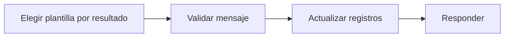

# Feature Specification: SF-02.10 — Mensaje de resultado y registro

**Created**: 2026-10-19  
**Status**: draft  
**Flow**: [F-02 Aceptar opción](16-f-02-aceptar-opcion.md) (subflujo)  
**Related Specs**: [F-02 Aceptar opción](16-f-02-aceptar-opcion.md), [SF-02.9 Caso humano con la opción elegida](25-sf-02-9-caso-humano-con-la-opcion-elegida.md)  
**Origen (DEC/H)**: DEC-15, DEC-18, DEC-19, DEC-20, DEC-23, H-21  
**Pruebas (TC)**: TC-16, TC-30  
**Contratos externos**: §1.1 (fila 3: resultado de aceptación)  

## Reglas de este documento

> Este spec es FUNCIONAL, no técnico: describe QUÉ hace el sistema, no CÓMO. Usa lenguaje de negocio; las siete herramientas externas se nombran por su función y se referencian por la sección de `sdd/reports/EXTERNAL_CONTRACTS.md`. Los casos borde se DOCUMENTAN; los valores de configuración se citan por el nombre del parámetro (NFR-012) con su valor por defecto entre paréntesis.

**Alcance**: Construye el mensaje validado del resultado, actualiza los registros de operaciones y casos y responde con el resultado de aceptación.

## User Scenarios & Testing *(mandatory)*

### User Story 1 - El pasajero recibe un mensaje honesto del resultado (Priority: P1)

Como pasajero, quiero que el mensaje me diga exactamente qué pasó con mi clic, sin prometer más de lo que ocurrió.

**Why this priority**: Cada resultado tiene una redacción obligatoria: afirmar de más es un defecto grave.

**Independent Test**: Se prueba con los siete resultados posibles.

**Acceptance Scenarios**:

1. **Scenario**: Solicitud creada
   - **Given** la operación quedó creada
   - **When** se arma el mensaje
   - **Then** dice «solicitud registrada, pendiente de confirmación, sujeta a disponibilidad»

2. **Scenario**: Fallo genérico
   - **Given** la operación quedó fallida
   - **When** se arma el mensaje
   - **Then** dice que no pudimos procesar la solicitud, sin detalle técnico, y ofrece el caso humano

3. **Scenario**: Texto de solicitud registrada (TC-30)
   - **Given** la operación creada RBK-88231 con vencimiento 11:12:00Z
   - **When** se arma el mensaje
   - **Then** dice «Solicitud registrada, pendiente de confirmación, sujeta a disponibilidad. Vence a las 11:12 UTC.» y no «ya está cambiado»

---

### Edge Cases

> Solo se documentan; los marcados MUST-IMPLEMENT se vuelven requisito FR-XXX y se implementan con TDD, los DEFERRED quedan para una iteración posterior.

#### System Errors
- [DEFERRED] Estado de la solicitud tras su vencimiento: no hay forma de consultarla (AR-11) (FR-056)

#### Invalid Data
- [MUST-IMPLEMENT] Cuando el resultado es de estado cambiado, de necesidad de confirmación o de fallo → el mensaje igual pasa por el validador y se devuelve en el cuerpo de resultado (FR-081)
- [MUST-IMPLEMENT] Cuando se registra el resultado → solo se guardan identificadores y estados, no el texto completo (FR-090)

## Requirements *(mandatory)*

### Functional Requirements

- **FR-056**: Una solicitud creada DEBE mostrarse como «solicitud registrada, pendiente de confirmación, sujeta a disponibilidad» con su vencimiento; la confirmación queda fuera de la versión 1.
- **FR-081**: Un validador propio DEBE revisar todo mensaje dinámico antes de devolverlo y el contrato de notificación: bloquea un hecho sin evidencia vigente o un campo fuera de la lista blanca; exige referencia de política a los mensajes que afirman una opción o un derecho y a toda notificación de política; el aviso informativo de cambio de puerta va sin referencia de política. Los textos estáticos de la interfaz están exentos.
- **FR-090**: Cada evaluación DEBE generar un registro con identificador de decisión, reserva, lecturas con su instante, eventos elegidos y descartados con razón, versión de política y reglas, variables derivadas con supuestos, opciones viables y descartadas con razón, acción y huella del mensaje.
- **FR-105**: Matriz de errores por herramienta: las lecturas con fallo se reconsultan una vez sin bucles; sin contexto del viaje hay pantalla de «no pudimos cargar tu viaje» con reintento; solo sin eventos se muestra el contexto sin estado ni alerta y con aviso; sin política u opciones queda BLOQUEADA con caso humano ofrecido. Una solicitud de cambio con error no reintentable no se reintenta, muestra un fallo genérico y ofrece caso humano. En el caso humano, un error explícito dice «no pudimos registrar tu solicitud, puedes reintentar»; un tiempo agotado o respuesta perdida es indeterminado («no pudimos confirmar si tu solicitud quedó registrada; puede que ya lo esté»), no se reenvía automáticamente y el reintento exige un segundo clic explícito tras advertir del posible duplicado. Nunca se afirma éxito.

### Key Entities *(include if feature involves data)*

- **Resultado de aceptación**: Respuesta a un clic de «Aceptar esta opción». Campos principales:
  - `outcome`: REBOOKING_CREATED | EXISTING_REQUEST | HUMAN_CASE_CREATED | EXISTING_CASE | NEEDS_CONFIRMATION | STATE_CHANGED | FAILED
  - `message`: mensaje validado
  - `operation`: operación | nulo
  - `human_case`: caso humano | nulo
  - `retries`: entero entre 0 y `REBOOK_MAX_RETRIES`
  - `view`: vista del viaje | nulo (solo con STATE_CHANGED)
- **Mensaje validado**: Texto de plantilla con su evidencia, aprobado por el validador antes de mostrarse o enviarse. Campos principales:
  - `message_id`: texto
  - `template_id`: texto del catálogo
  - `kind`: INFO | ESTIMATE | WARNING | NEXT_STEP | DEADLINE
  - `text`: texto en español neutro
  - `evidence_refs`: lista de identificadores
  - `policy_ref`: texto | nulo
  - `blocked`: booleano

## Architectural Attributes *(mandatory)*

| Attribute | Value |
|-----------|-------|
| **Interaction type** | sync-http |
| **Consistency** | strong |
| **Workflow** | single-step |
| **Read pattern** | simple |
| **Auditability** | full-history |
| **Domain complexity** | medium |
| **Modularity** | bounded-context |
| **Deployment** | monolith |

## Success Criteria *(mandatory)*

### Measurable Outcomes

- **SC-001**: Los siete resultados posibles usan una redacción aprobada por el validador en el 100 % de los casos.
- **SC-002**: Ninguno afirma «ya está cambiado».

## Traceability *(mandatory after implementation)*

> Las columnas de archivo y línea se registran en la verificación de trazabilidad posterior a la implementación; hoy cada criterio queda enlazado a su origen y a las pruebas que lo verifican.

| Criterion | Origen | Prueba (TC) | Source File | Line(s) |
|-----------|--------|-------------|-------------|---------|
| FR-056 | DEC-18, DEC-19 | TC-30 | se registra en la verificación posterior a la implementación | se registra en la verificación posterior a la implementación |
| FR-081 | DEC-20, H-21 | TC-16 | se registra en la verificación posterior a la implementación | se registra en la verificación posterior a la implementación |
| FR-090 | DEC-23 | sin TC en el mapa §6 de REQUERIMIENTOS_V1 | se registra en la verificación posterior a la implementación | se registra en la verificación posterior a la implementación |
| FR-105 | DEC-15, DEC-18 | sin TC en el mapa §6 de REQUERIMIENTOS_V1 | se registra en la verificación posterior a la implementación | se registra en la verificación posterior a la implementación |
| SC-001 | criterio medible de este spec | TC-16, TC-30 | se registra en la verificación posterior a la implementación | se registra en la verificación posterior a la implementación |
| SC-002 | criterio medible de este spec | TC-16, TC-30 | se registra en la verificación posterior a la implementación | se registra en la verificación posterior a la implementación |

## Business Process (BPM View)

```
Elegir plantilla por resultado → Validar mensaje → Actualizar registros → Responder
```



