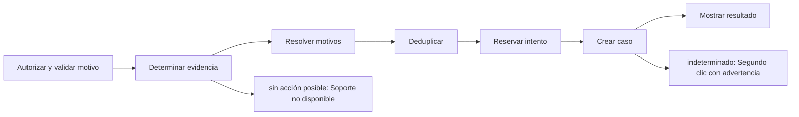

# Feature Specification: F-03 — Caso humano manual («Hablar con una persona»)

**Created**: 2026-10-19  
**Status**: draft  
**Flow**: F-03 Caso humano manual («Hablar con una persona»)  
**Related Specs**: [SF-03.1 Autorización y validación del motivo](28-sf-03-1-autorizacion-y-validacion-del-motivo.md), [SF-03.2 Origen de la evidencia y disponibilidad](29-sf-03-2-origen-de-la-evidencia-y-disponibilidad.md), [SF-03.3 Resolución de motivos](30-sf-03-3-resolucion-de-motivos.md), [SF-03.4 Deduplicación](31-sf-03-4-deduplicacion.md), [SF-03.5 Reserva atómica del intento](32-sf-03-5-reserva-atomica-del-intento.md), [SF-03.6 Llamada al caso humano](33-sf-03-6-llamada-al-caso-humano.md), [SF-03.7 Reintento tras indeterminado](34-sf-03-7-reintento-tras-indeterminado.md), [SF-03.8 Mensaje y registro](35-sf-03-8-mensaje-y-registro.md), [FE-04 Hablar con una persona (front)](97-fe-04-hablar-con-una-persona-front.md), [F-02 Aceptar opción](16-f-02-aceptar-opcion.md)  
**Origen (DEC/H)**: DEC-02, DEC-13, DEC-14, DEC-15, DEC-18, DEC-20, DEC-21, DEC-22, DEC-23, DEC-27, DEC-29, H-21  
**Pruebas (TC)**: TC-17, TC-20, TC-33, TC-46  
**Contratos externos**: §1.1 (fila 4: caso humano manual), §2.1 (herramienta 6: caso humano), §2.4 (`OPERATION_STALE_SECONDS`, `REASON_PRIORITY`, `COMPENSATION_RIGHTS`)  

## Reglas de este documento

> Este spec es FUNCIONAL, no técnico: describe QUÉ hace el sistema, no CÓMO. Usa lenguaje de negocio; las siete herramientas externas se nombran por su función y se referencian por la sección de `sdd/reports/EXTERNAL_CONTRACTS.md`. Los casos borde se DOCUMENTAN; los valores de configuración se citan por el nombre del parámetro (NFR-012) con su valor por defecto entre paréntesis.

**Alcance**: El pasajero pide hablar con una persona eligiendo un motivo de enumeración cerrada, sin texto libre, solo cuando existe una acción posible; el sistema reúne los motivos, aplica la prioridad, evita duplicados y registra cada intento.

## User Scenarios & Testing *(mandatory)*

### User Story 1 - El pasajero abre un caso con una persona sin fricción y sin riesgo de duplicados (Priority: P1)

Como pasajero, quiero pedir ayuda humana con un motivo claro y que mi caso llegue una sola vez, aunque mi conexión falle.

**Why this priority**: Es la salida segura de todo lo que el sistema no puede o no debe decidir.

**Independent Test**: Se prueba creando un caso con cada motivo, repitiendo el clic y simulando un tiempo agotado del proveedor de casos.

**Acceptance Scenarios**:

1. **Scenario**: Caso creado
   - **Given** existe una acción posible y el pasajero elige «Necesito ayuda con mi vuelo»
   - **When** envía la solicitud con la decisión que vio
   - **Then** se crea un caso con el motivo de mayor prioridad entre todos los aplicables y el mensaje informa el plazo de atención devuelto por el proveedor

2. **Scenario**: Caso existente
   - **Given** ya existe un caso creado con la misma clave de deduplicación
   - **When** el pasajero pide hablar con una persona otra vez
   - **Then** se devuelve el caso existente y no se envía nada nuevo

3. **Scenario**: Resultado indeterminado
   - **Given** el proveedor de casos no responde
   - **When** el pasajero pide hablar con una persona
   - **Then** se muestra «no pudimos confirmar si tu solicitud quedó registrada; puede que ya lo esté», no se reenvía solo y un segundo intento exige un segundo clic tras la advertencia del posible duplicado

4. **Scenario**: Sin acción posible
   - **Given** la decisión es INFORMATIVA o no hay anomalía
   - **When** el pasajero intenta pedir soporte
   - **Then** el sistema responde que no hay una acción de soporte disponible

5. **Scenario**: Caso con datos personales y plazo (TC-20)
   - **Given** el caso base con motivos aprobación de política y pernocte, y el pasajero elige «Necesito ayuda con mis datos o documentos»
   - **When** envía la solicitud con la decisión que vio
   - **Then** se crea el caso HC-4471 (cola DISRUPTION_L2, 45 minutos) con el motivo de mayor prioridad y sin ningún dato personal

---

### Edge Cases

> Solo se documentan; los marcados MUST-IMPLEMENT se vuelven requisito FR-XXX y se implementan con TDD, los DEFERRED quedan para una iteración posterior.

#### System Errors
- [MUST-IMPLEMENT] Cuando el proveedor responde con error explícito → «no pudimos registrar tu solicitud, puedes reintentar» y el reintento es libre (FR-105)
- [MUST-IMPLEMENT] Cuando hay tiempo agotado o respuesta perdida → indeterminado, sin reenvío automático (FR-105)

#### Invalid Data
- [MUST-IMPLEMENT] Cuando el motivo no es uno de los tres cerrados o el cuerpo trae texto libre u otro campo → rechazo por validación (FR-060)
- [MUST-IMPLEMENT] Cuando se pide compensación sin que sea elegible → rechazo por motivo no disponible (FR-067)

#### Race Conditions
- [MUST-IMPLEMENT] Cuando dos intentos coinciden → solo uno envía y el otro devuelve el caso en curso (FR-059)

#### Security & Permissions
- [MUST-IMPLEMENT] Cuando se pide la entrega de datos personales → se abre caso humano y la respuesta nunca contiene información personal (FR-061)

## Requirements *(mandatory)*

### Functional Requirements

- **FR-001**: El sistema DEBE operar sobre la sesión autenticada del pasajero y comprobar que la reserva y la decisión solicitadas pertenezcan a esa sesión; una reserva ajena y una inexistente DEBEN producir exactamente la misma respuesta de «no encontrado», sin confirmar la existencia de ninguna. La sesión simulada solo existe con el parámetro `DEV_SESSION_HEADER_ENABLED` (apagado por defecto): en cualquier otro perfil toda petición del pasajero sin sesión DEBE rechazarse por falta de autenticación, y toda petición del sistema DEBE exigir la credencial de servicio (FR-120). Los errores NO DEBEN mostrar trazas ni repetir la entrada, nunca se pide ni se muestra documento de identidad, y el identificador de decisión DEBE ser aleatorio y no adivinable.
- **FR-025**: La solicitud de compensación DEBE ser falsa por defecto y verdadera solo si el pasajero la pide explícitamente.
- **FR-050**: Toda acción externa (solicitud de cambio, caso humano, notificación) DEBE requerir un clic explícito del pasajero; el sistema solo propone y ofrece. La persistencia interna no es una acción externa. Excepción: en modo sistema se puede enviar la notificación de FR-122 sin clic, con plantilla fija; ninguna otra acción externa se ejecuta en modo sistema. Un clic autoriza exactamente una acción y los textos de los botones lo declaran, incluida la derivación posterior a una falla persistente.
- **FR-057**: Los motivos de caso humano son un conjunto cerrado de trece códigos (compensación solicitada, datos parciales bloqueantes, conflicto de fuentes, falla indeterminada del proveedor, evento no soportado, ninguna opción cubre al grupo, asistencia por pernocte, petición de datos personales, aprobación de política requerida, varios segmentos afectados, retraso incoherente, ninguna opción viable y otra ayuda). El sistema los ofrece; el caso se crea con el clic.
- **FR-059**: Al crear un caso humano el sistema DEBE enviar el motivo de mayor prioridad y conservar todos los motivos simultáneos, con evidencia solo de identificadores, enumeraciones y hechos validados (sin información personal), tomada de la decisión guardada si el pasajero indica la decisión que vio y, si no, de una evaluación fresca. La deduplicación local se calcula con reserva, motivos ordenados y huella de decisión, no bloquea el reintento explícito tras un intento fallido o indeterminado, y cada intento y su resultado (creado, fallido, indeterminado) queda registrado. No requiere revalidación.
- **FR-060**: El botón neutro «Hablar con una persona» DEBE mostrarse solo cuando hay una acción posible, con un motivo de enumeración cerrada (otra ayuda, datos personales y, solo si hay compensación elegible, compensación), con rótulos neutros sin resaltar ni preseleccionar y sin texto libre. La compensación nunca es proactiva ni lleva montos y, al elegirla, fija la solicitud de compensación y abre el caso con el clic.
- **FR-061**: El motivo de petición de datos personales NUNCA DEBE devolver información personal: abre un caso humano y la respuesta no contiene ningún campo prohibido.
- **FR-063**: Cada causa se traduce a un motivo con prioridad fija (de mayor a menor: falla indeterminada del proveedor, conflicto de fuentes, evento no soportado, retraso incoherente, varios segmentos afectados, datos parciales bloqueantes, compensación solicitada, datos personales, aprobación de política, ninguna opción cubre al grupo, ninguna opción viable, pernocte y otra ayuda); el motivo del caso es el primero que aplique y se conservan todos los demás (`REASON_PRIORITY`).
- **FR-067**: El motivo de compensación del menú de soporte solo DEBE mostrarse si la política tiene una regla que concede un derecho de compensación (`COMPENSATION_RIGHTS`) que, evaluada con la solicitud de compensación verdadera y las demás variables, resulta verdadera, y la decisión no es INFORMATIVA.
- **FR-081**: Un validador propio DEBE revisar todo mensaje dinámico antes de devolverlo y el contrato de notificación: bloquea un hecho sin evidencia vigente o un campo fuera de la lista blanca; exige referencia de política a los mensajes que afirman una opción o un derecho y a toda notificación de política; el aviso informativo de cambio de puerta va sin referencia de política. Los textos estáticos de la interfaz están exentos.
- **FR-091**: Solo se persisten campos de una lista cerrada: hechos operacionales no personales, identificadores seudónimos, enumeraciones, números, marcas de tiempo y huellas. NUNCA se guardan cargas completas, nombre, contacto, documento ni edad del menor; los identificadores son seudónimos, no anónimos, y la reserva se trunca en los registros de aplicación.
- **FR-105**: Matriz de errores por herramienta: las lecturas con fallo se reconsultan una vez sin bucles; sin contexto del viaje hay pantalla de «no pudimos cargar tu viaje» con reintento; solo sin eventos se muestra el contexto sin estado ni alerta y con aviso; sin política u opciones queda BLOQUEADA con caso humano ofrecido. Una solicitud de cambio con error no reintentable no se reintenta, muestra un fallo genérico y ofrece caso humano. En el caso humano, un error explícito dice «no pudimos registrar tu solicitud, puedes reintentar»; un tiempo agotado o respuesta perdida es indeterminado («no pudimos confirmar si tu solicitud quedó registrada; puede que ya lo esté»), no se reenvía automáticamente y el reintento exige un segundo clic explícito tras advertir del posible duplicado. Nunca se afirma éxito.

### Non-Functional and Documentation Requirements

- **NFR-002**: Privacidad: el sistema DEBE minimizar la información personal en todas las fronteras propias; ningún dato personal se entrega a un modelo (si en el futuro se usara, se anonimiza antes).

### Key Entities *(include if feature involves data)*

- **Resultado de caso humano**: Respuesta a un clic de «Hablar con una persona». Campos principales:
  - `outcome`: HUMAN_CASE_CREATED | EXISTING_CASE | NEEDS_CONFIRMATION | INDETERMINATE | FAILED
  - `message`: mensaje validado
  - `human_case`: caso humano | nulo
  - `decision_id`: identificador de la decisión de la que salió la evidencia
- **Caso humano**: Escalamiento a una persona; cada intento queda registrado con su resultado. Campos principales:
  - `dedup_key`: texto
  - `attempt`: entero ≥ 1
  - `state`: EN_CURSO | CREADO | FALLIDO | INDETERMINADO
  - `reason`: uno de los 13 motivos cerrados
  - `reasons`: lista ordenada por prioridad
  - `case_id`: texto | nulo
  - `queue`: texto | nulo
  - `sla_minutes`: entero | nulo
  - `option`: {option_id: texto, itinerario y diferencia de tarifa} | nulo
  - `confirm_possible_duplicate`: booleano
- **Decisión**: Resultado de evaluar la reserva: su estado y las razones que lo explican. Campos principales:
  - `decision_id`: identificador aleatorio no adivinable
  - `decision_state`: INFORMATIVA | AUTOMATICA | PENDIENTE_APROBACION | BLOQUEADA | nulo
  - `anomaly_detected`: booleano
  - `fingerprint`: texto: huella de decisión sin opción
  - `human_case_reasons`: lista ordenada de motivos de caso humano
  - `support_offered`: booleano
  - `compensation_eligible`: booleano
  - `needs_manual_review`: booleano (campo interno: se persiste y no se entrega a la sesión del pasajero, FR-093)
- **Mensaje validado**: Texto de plantilla con su evidencia, aprobado por el validador antes de mostrarse o enviarse. Campos principales:
  - `message_id`: texto
  - `template_id`: texto del catálogo
  - `kind`: INFO | ESTIMATE | WARNING | NEXT_STEP | DEADLINE
  - `text`: texto en español neutro
  - `evidence_refs`: lista de identificadores
  - `policy_ref`: texto | nulo
  - `blocked`: booleano

## Architectural Attributes *(mandatory)*

| Attribute | Value |
|-----------|-------|
| **Interaction type** | sync-http |
| **Consistency** | strong |
| **Workflow** | multi-step |
| **Read pattern** | simple |
| **Auditability** | full-history |
| **Domain complexity** | high |
| **Modularity** | bounded-context |
| **Deployment** | monolith |

## Success Criteria *(mandatory)*

### Measurable Outcomes

- **SC-001**: El 100 % de los clics repetidos sobre el mismo caso creado devuelve el existente sin envío adicional.
- **SC-002**: Cero respuestas de caso humano contienen un campo de la lista prohibida, incluso con el motivo de datos personales.
- **SC-003**: Un timeout nunca provoca un reenvío automático.

## Traceability *(mandatory after implementation)*

> Las columnas de archivo y línea se registran en la verificación de trazabilidad posterior a la implementación; hoy cada criterio queda enlazado a su origen y a las pruebas que lo verifican.

| Criterion | Origen | Prueba (TC) | Source File | Line(s) |
|-----------|--------|-------------|-------------|---------|
| FR-001 | DEC-21 | sin TC en el mapa §6 de REQUERIMIENTOS_V1 | se registra en la verificación posterior a la implementación | se registra en la verificación posterior a la implementación |
| FR-025 | DEC-29 | sin TC en el mapa §6 de REQUERIMIENTOS_V1 | se registra en la verificación posterior a la implementación | se registra en la verificación posterior a la implementación |
| FR-050 | DEC-14 | sin TC en el mapa §6 de REQUERIMIENTOS_V1 | se registra en la verificación posterior a la implementación | se registra en la verificación posterior a la implementación |
| FR-057 | DEC-13, DEC-15, DEC-27 | sin TC en el mapa §6 de REQUERIMIENTOS_V1 | se registra en la verificación posterior a la implementación | se registra en la verificación posterior a la implementación |
| FR-059 | DEC-15, DEC-23 | sin TC en el mapa §6 de REQUERIMIENTOS_V1 | se registra en la verificación posterior a la implementación | se registra en la verificación posterior a la implementación |
| FR-060 | DEC-02, DEC-29 | TC-17, TC-46 | se registra en la verificación posterior a la implementación | se registra en la verificación posterior a la implementación |
| FR-061 | DEC-15, DEC-22 | TC-20 | se registra en la verificación posterior a la implementación | se registra en la verificación posterior a la implementación |
| FR-063 | DEC-15 | sin TC en el mapa §6 de REQUERIMIENTOS_V1 | se registra en la verificación posterior a la implementación | se registra en la verificación posterior a la implementación |
| FR-067 | DEC-29 | TC-46 | se registra en la verificación posterior a la implementación | se registra en la verificación posterior a la implementación |
| FR-081 | DEC-20, H-21 | sin TC en el mapa §6 de REQUERIMIENTOS_V1 | se registra en la verificación posterior a la implementación | se registra en la verificación posterior a la implementación |
| FR-091 | DEC-23 | sin TC en el mapa §6 de REQUERIMIENTOS_V1 | se registra en la verificación posterior a la implementación | se registra en la verificación posterior a la implementación |
| FR-105 | DEC-15, DEC-18 | TC-33 | se registra en la verificación posterior a la implementación | se registra en la verificación posterior a la implementación |
| NFR-002 | DEC-22 | sin TC en el mapa §6 de REQUERIMIENTOS_V1 | se registra en la verificación posterior a la implementación | se registra en la verificación posterior a la implementación |
| SC-001 | criterio medible de este spec | TC-17, TC-20, TC-33, TC-46 | se registra en la verificación posterior a la implementación | se registra en la verificación posterior a la implementación |
| SC-002 | criterio medible de este spec | TC-17, TC-20, TC-33, TC-46 | se registra en la verificación posterior a la implementación | se registra en la verificación posterior a la implementación |
| SC-003 | criterio medible de este spec | TC-17, TC-20, TC-33, TC-46 | se registra en la verificación posterior a la implementación | se registra en la verificación posterior a la implementación |

## Business Process (BPM View)

```
Autorizar y validar motivo → Determinar evidencia → Resolver motivos → Deduplicar → Reservar intento → Crear caso → Mostrar resultado
```



### Subprocesses (if applicable)

```
SF-03.1: Autorización y validación del motivo
SF-03.2: Origen de la evidencia y disponibilidad
SF-03.3: Resolución de motivos
SF-03.4: Deduplicación
SF-03.5: Reserva atómica del intento
SF-03.6: Llamada al caso humano
SF-03.7: Reintento tras indeterminado
SF-03.8: Mensaje y registro
```
