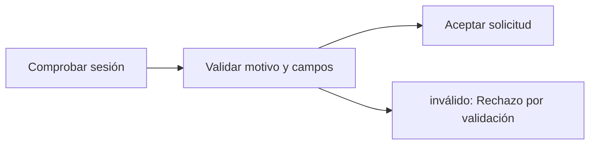

# Feature Specification: SF-03.1 — Autorización y validación del motivo

**Created**: 2026-10-19  
**Status**: draft  
**Flow**: [F-03 Caso humano manual («Hablar con una persona»)](27-f-03-caso-humano-manual-hablar-con-una-persona.md) (subflujo)  
**Related Specs**: [F-03 Caso humano manual («Hablar con una persona»)](27-f-03-caso-humano-manual-hablar-con-una-persona.md), [SF-03.2 Origen de la evidencia y disponibilidad](29-sf-03-2-origen-de-la-evidencia-y-disponibilidad.md)  
**Origen (DEC/H)**: DEC-02, DEC-21, DEC-29  
**Pruebas (TC)**: TC-17, TC-21, TC-58  
**Contratos externos**: §1.1 (fila 4)  

## Reglas de este documento

> Este spec es FUNCIONAL, no técnico: describe QUÉ hace el sistema, no CÓMO. Usa lenguaje de negocio; las siete herramientas externas se nombran por su función y se referencian por la sección de `sdd/reports/EXTERNAL_CONTRACTS.md`. Los casos borde se DOCUMENTAN; los valores de configuración se citan por el nombre del parámetro (NFR-012) con su valor por defecto entre paréntesis.

**Alcance**: Comprueba la sesión y que el motivo pertenezca a la enumeración cerrada, sin campos extra ni texto libre.

## User Scenarios & Testing *(mandatory)*

### User Story 1 - Solo se puede pedir ayuda con motivos cerrados (Priority: P1)

Como pasajero, quiero elegir un motivo de una lista corta y neutra, sin escribir texto, para que mi solicitud sea rápida y no exponga datos.

**Why this priority**: El texto libre abriría la puerta a información personal en los casos.

**Independent Test**: Se prueba con cada motivo válido, con un motivo inventado y con un campo extra.

**Acceptance Scenarios**:

1. **Scenario**: Motivo válido
   - **Given** la sesión coincide con la reserva y el motivo es uno de los tres permitidos
   - **When** se valida
   - **Then** la solicitud continúa

2. **Scenario**: Motivo o campo inválido
   - **Given** el cuerpo trae un motivo fuera de la lista o un campo de texto libre
   - **When** se valida
   - **Then** se rechaza por validación sin repetir la entrada

3. **Scenario**: Botón con motivo conocido
   - **Given** el sistema ya conoce el motivo (conflicto, sin opción)
   - **When** el pasajero pulsa el botón de un clic
   - **Then** se envía «otra ayuda» con la decisión y el sistema fija el motivo principal por prioridad

4. **Scenario**: Motivo inválido y botón de un clic (TC-17)
   - **Given** ABC123 con conflicto de fuentes
   - **When** se envía el motivo «COMPENSATION_REQUESTED» sin compensación elegible, y luego «OTHER_HELP» con la decisión
   - **Then** el primero se rechaza y el segundo crea el caso con el motivo conflicto de fuentes

5. **Scenario**: Límite de tasa del caso humano (TC-58)
   - **Given** ABC123 con 30 solicitudes de caso humano en el último minuto desde el mismo origen
   - **When** llega la 31.ª
   - **Then** se rechaza por límite de tasa sin enviar nada al proveedor de casos

---

### Edge Cases

> Solo se documentan; los marcados MUST-IMPLEMENT se vuelven requisito FR-XXX y se implementan con TDD, los DEFERRED quedan para una iteración posterior.

#### Invalid Data
- [MUST-IMPLEMENT] Cuando existe un campo adicional o texto libre → rechazo por validación (FR-060)

#### Security & Permissions
- [MUST-IMPLEMENT] Cuando la sesión no coincide con la reserva → la misma respuesta de «no encontrado» (FR-001)
- [MUST-IMPLEMENT] Cuando falta la sesión → rechazo por falta de autenticación (FR-001)
- [MUST-IMPLEMENT] Cuando la misma reserva y origen superan `EVALUATE_RATE_LIMIT_PER_MINUTE` (30) solicitudes de caso humano por minuto → rechazo por límite de tasa (NFR-013)

## Requirements *(mandatory)*

### Functional Requirements

- **FR-001**: El sistema DEBE operar sobre la sesión autenticada del pasajero y comprobar que la reserva y la decisión solicitadas pertenezcan a esa sesión; una reserva ajena y una inexistente DEBEN producir exactamente la misma respuesta de «no encontrado», sin confirmar la existencia de ninguna. La sesión simulada solo existe con el parámetro `DEV_SESSION_HEADER_ENABLED` (apagado por defecto): en cualquier otro perfil toda petición del pasajero sin sesión DEBE rechazarse por falta de autenticación, y toda petición del sistema DEBE exigir la credencial de servicio (FR-120). Los errores NO DEBEN mostrar trazas ni repetir la entrada, nunca se pide ni se muestra documento de identidad, y el identificador de decisión DEBE ser aleatorio y no adivinable.
- **FR-060**: El botón neutro «Hablar con una persona» DEBE mostrarse solo cuando hay una acción posible, con un motivo de enumeración cerrada (otra ayuda, datos personales y, solo si hay compensación elegible, compensación), con rótulos neutros sin resaltar ni preseleccionar y sin texto libre. La compensación nunca es proactiva ni lleva montos y, al elegirla, fija la solicitud de compensación y abre el caso con el clic.

### Non-Functional and Documentation Requirements

- **NFR-013**: Seguridad de entradas: todo acceso al registro persistente DEBE usar consultas parametrizadas (las consultas viven en archivos propios); la interfaz DEBE mostrar los textos del proveedor (condición, derecho, puerta, mensajes) como texto plano, sin insertar marcado HTML; y la evaluación, la aceptación de una opción, el caso humano y la consulta de una decisión DEBEN tener un límite de tasa por reserva y por origen (`EVALUATE_RATE_LIMIT_PER_MINUTE`, 30 por minuto), con los intentos fallidos de credencial de servicio también limitados por origen.

### Key Entities *(include if feature involves data)*

- **Resultado de caso humano**: Respuesta a un clic de «Hablar con una persona». Campos principales:
  - `outcome`: HUMAN_CASE_CREATED | EXISTING_CASE | NEEDS_CONFIRMATION | INDETERMINATE | FAILED
  - `message`: mensaje validado
  - `human_case`: caso humano | nulo
  - `decision_id`: identificador de la decisión de la que salió la evidencia
- **Sesión y credencial**: Identidad con la que se pide una evaluación: sesión del pasajero o credencial de servicio. Campos principales:
  - `caller`: user | system
  - `session_booking`: texto | ausente (solo modo user)
  - `service_key`: texto | ausente (solo modo system; comparación en tiempo constante)
  - `requests_last_minute`: entero (límite `EVALUATE_RATE_LIMIT_PER_MINUTE`)
  - `authorized`: booleano

## Architectural Attributes *(mandatory)*

| Attribute | Value |
|-----------|-------|
| **Interaction type** | sync-http |
| **Consistency** | strong |
| **Workflow** | single-step |
| **Read pattern** | simple |
| **Auditability** | full-history |
| **Domain complexity** | medium |
| **Modularity** | bounded-context |
| **Deployment** | monolith |

## Success Criteria *(mandatory)*

### Measurable Outcomes

- **SC-001**: El 100 % de las peticiones con texto libre o motivo fuera de la lista se rechaza.
- **SC-002**: La enumeración cerrada tiene exactamente tres motivos manuales.

## Traceability *(mandatory after implementation)*

> Las columnas de archivo y línea se registran en la verificación de trazabilidad posterior a la implementación; hoy cada criterio queda enlazado a su origen y a las pruebas que lo verifican.

| Criterion | Origen | Prueba (TC) | Source File | Line(s) |
|-----------|--------|-------------|-------------|---------|
| FR-001 | DEC-21 | TC-21 | se registra en la verificación posterior a la implementación | se registra en la verificación posterior a la implementación |
| FR-060 | DEC-02, DEC-29 | TC-17 | se registra en la verificación posterior a la implementación | se registra en la verificación posterior a la implementación |
| NFR-013 | Usuario (2026-10-19) | TC-58 | se registra en la verificación posterior a la implementación | se registra en la verificación posterior a la implementación |
| SC-001 | criterio medible de este spec | TC-17, TC-21, TC-58 | se registra en la verificación posterior a la implementación | se registra en la verificación posterior a la implementación |
| SC-002 | criterio medible de este spec | TC-17, TC-21, TC-58 | se registra en la verificación posterior a la implementación | se registra en la verificación posterior a la implementación |

## Business Process (BPM View)

```
Comprobar sesión → Validar motivo y campos → Aceptar solicitud
```



