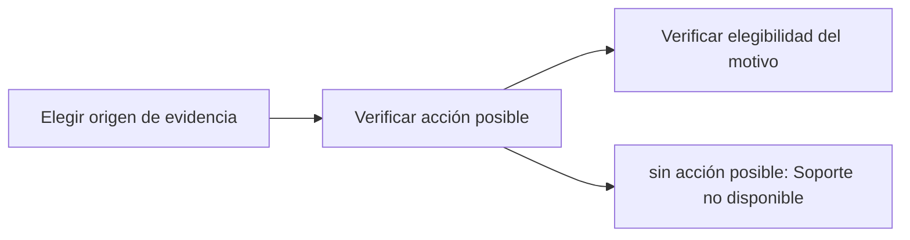

# Feature Specification: SF-03.2 — Origen de la evidencia y disponibilidad

**Created**: 2026-10-19  
**Status**: draft  
**Flow**: [F-03 Caso humano manual («Hablar con una persona»)](27-f-03-caso-humano-manual-hablar-con-una-persona.md) (subflujo)  
**Related Specs**: [F-03 Caso humano manual («Hablar con una persona»)](27-f-03-caso-humano-manual-hablar-con-una-persona.md), [SF-03.1 Autorización y validación del motivo](28-sf-03-1-autorizacion-y-validacion-del-motivo.md), [SF-03.3 Resolución de motivos](30-sf-03-3-resolucion-de-motivos.md)  
**Origen (DEC/H)**: DEC-02, DEC-15, DEC-23, DEC-29  
**Pruebas (TC)**: TC-17, TC-45, TC-46  
**Contratos externos**: §1.1 (fila 4: semántica y soporte solo con acción posible)  

## Reglas de este documento

> Este spec es FUNCIONAL, no técnico: describe QUÉ hace el sistema, no CÓMO. Usa lenguaje de negocio; las siete herramientas externas se nombran por su función y se referencian por la sección de `sdd/reports/EXTERNAL_CONTRACTS.md`. Los casos borde se DOCUMENTAN; los valores de configuración se citan por el nombre del parámetro (NFR-012) con su valor por defecto entre paréntesis.

**Alcance**: Decide de dónde sale la evidencia (decisión guardada o evaluación fresca) y si hay soporte disponible para ese motivo.

## User Scenarios & Testing *(mandatory)*

### User Story 1 - El caso refleja lo que el pasajero vio (Priority: P1)

Como pasajero, quiero que la persona que me atienda vea la misma situación que yo vi, y no una distinta calculada después.

**Why this priority**: Evita inconsistencias entre pantalla y caso.

**Independent Test**: Se prueba con y sin decisión indicada, con decisión informativa y con compensación elegible o no.

**Acceptance Scenarios**:

1. **Scenario**: Con decisión indicada
   - **Given** la petición trae la decisión de la sesión
   - **When** se arma la evidencia
   - **Then** se toma de la decisión guardada y de su proyección mínima, sin releer ni revalidar

2. **Scenario**: Sin decisión indicada
   - **Given** la petición no trae decisión
   - **When** se arma la evidencia
   - **Then** se ejecuta una evaluación fresca y se registra una decisión nueva

3. **Scenario**: Soporte no disponible
   - **Given** la decisión es INFORMATIVA, no hay anomalía, hay solo evidencia degradada o falló la lectura de contexto o eventos
   - **When** se pide soporte
   - **Then** se responde que no hay soporte disponible

4. **Scenario**: Excepción de lectura de política
   - **Given** falló la lectura de la política o de las opciones
   - **When** se pide soporte
   - **Then** el soporte sí se ofrece porque la decisión es BLOQUEADA con anomalía que exige validación manual

5. **Scenario**: Compensación elegible y no elegible (TC-46)
   - **Given** el caso base (R4 concede CASH_COMPENSATION) y una variante sin esa regla
   - **When** se pide compensación con la decisión que vio
   - **Then** en el caso base se acepta y fija la compensación; en la variante se rechaza por motivo no disponible

---

### Edge Cases

> Solo se documentan; los marcados MUST-IMPLEMENT se vuelven requisito FR-XXX y se implementan con TDD, los DEFERRED quedan para una iteración posterior.

#### Invalid Data
- [MUST-IMPLEMENT] Cuando se pide compensación y no es elegible → rechazo por motivo no disponible; si es elegible fija la solicitud de compensación como verdadera (FR-067)
- [DEFERRED] Compensación proactiva o con montos: nunca se ofrece (FR-060)

#### Security & Permissions
- [MUST-IMPLEMENT] Cuando la decisión indicada es ajena → «no encontrado» idéntico (FR-001)

## Requirements *(mandatory)*

### Functional Requirements

- **FR-025**: La solicitud de compensación DEBE ser falsa por defecto y verdadera solo si el pasajero la pide explícitamente.
- **FR-059**: Al crear un caso humano el sistema DEBE enviar el motivo de mayor prioridad y conservar todos los motivos simultáneos, con evidencia solo de identificadores, enumeraciones y hechos validados (sin información personal), tomada de la decisión guardada si el pasajero indica la decisión que vio y, si no, de una evaluación fresca. La deduplicación local se calcula con reserva, motivos ordenados y huella de decisión, no bloquea el reintento explícito tras un intento fallido o indeterminado, y cada intento y su resultado (creado, fallido, indeterminado) queda registrado. No requiere revalidación.
- **FR-060**: El botón neutro «Hablar con una persona» DEBE mostrarse solo cuando hay una acción posible, con un motivo de enumeración cerrada (otra ayuda, datos personales y, solo si hay compensación elegible, compensación), con rótulos neutros sin resaltar ni preseleccionar y sin texto libre. La compensación nunca es proactiva ni lleva montos y, al elegirla, fija la solicitud de compensación y abre el caso con el clic.
- **FR-067**: El motivo de compensación del menú de soporte solo DEBE mostrarse si la política tiene una regla que concede un derecho de compensación (`COMPENSATION_RIGHTS`) que, evaluada con la solicitud de compensación verdadera y las demás variables, resulta verdadera, y la decisión no es INFORMATIVA.
- **FR-090**: Cada evaluación DEBE generar un registro con identificador de decisión, reserva, lecturas con su instante, eventos elegidos y descartados con razón, versión de política y reglas, variables derivadas con supuestos, opciones viables y descartadas con razón, acción y huella del mensaje.

### Key Entities *(include if feature involves data)*

- **Decisión**: Resultado de evaluar la reserva: su estado y las razones que lo explican. Campos principales:
  - `decision_id`: identificador aleatorio no adivinable
  - `decision_state`: INFORMATIVA | AUTOMATICA | PENDIENTE_APROBACION | BLOQUEADA | nulo
  - `anomaly_detected`: booleano
  - `fingerprint`: texto: huella de decisión sin opción
  - `human_case_reasons`: lista ordenada de motivos de caso humano
  - `support_offered`: booleano
  - `compensation_eligible`: booleano
  - `needs_manual_review`: booleano (campo interno: se persiste y no se entrega a la sesión del pasajero, FR-093)
- **Registro de decisión**: Instantánea de auditoría de una evaluación, sin información personal. Campos principales:
  - `decision_id`: identificador
  - `booking_id`: texto seudónimo
  - `created_at`: marca de tiempo UTC
  - `caller`: user | system
  - `fingerprint`: texto
  - `decision_state`: estado | nulo
  - `needs_manual_review`: booleano (campo interno, no se entrega a la sesión del pasajero)
  - `policy_version`: texto | nulo
  - `mct_provided`: booleano
  - `passenger_count`: entero
  - `segments`: lista de {segment_id: texto, state: texto | nulo, delay_minutes: entero | nulo}
  - `message_hash`: texto
  - `messages_blocked`: entero
  - `reads`: lista de {tool: texto, retrieved_at: marca de tiempo | nulo, outcome: OK | FAILED | INVALID | NOT_REQUESTED}
  - `events`: lista de {event_id, segment_id, event_type, disposition: CHOSEN | DISCARDED | NOT_INTERPRETED, reason}
  - `rules`: lista de {rule_id, result, requires_human_approval}
  - `options`: lista de opciones con sus razones de descarte (también las no viables)
  - `notifications`: lista de {reason, kind, status, notification_id} (solo modo sistema; campo interno, no se entrega a la sesión del pasajero)
  - `outcomes`: lista de {kind: REBOOKING | HUMAN_CASE, reference_id: texto | nulo, state: texto, at: marca de tiempo}
- **Caso humano**: Escalamiento a una persona; cada intento queda registrado con su resultado. Campos principales:
  - `dedup_key`: texto
  - `attempt`: entero ≥ 1
  - `state`: EN_CURSO | CREADO | FALLIDO | INDETERMINADO
  - `reason`: uno de los 13 motivos cerrados
  - `reasons`: lista ordenada por prioridad
  - `case_id`: texto | nulo
  - `queue`: texto | nulo
  - `sla_minutes`: entero | nulo
  - `option`: {option_id: texto, itinerario y diferencia de tarifa} | nulo
  - `confirm_possible_duplicate`: booleano

## Architectural Attributes *(mandatory)*

| Attribute | Value |
|-----------|-------|
| **Interaction type** | sync-http |
| **Consistency** | strong |
| **Workflow** | single-step |
| **Read pattern** | simple |
| **Auditability** | full-history |
| **Domain complexity** | medium |
| **Modularity** | bounded-context |
| **Deployment** | monolith |

## Success Criteria *(mandatory)*

### Measurable Outcomes

- **SC-001**: Con decisión indicada se realizan 0 lecturas nuevas.
- **SC-002**: El 0 % de los motivos de compensación se acepta sin compensación elegible.

## Traceability *(mandatory after implementation)*

> Las columnas de archivo y línea se registran en la verificación de trazabilidad posterior a la implementación; hoy cada criterio queda enlazado a su origen y a las pruebas que lo verifican.

| Criterion | Origen | Prueba (TC) | Source File | Line(s) |
|-----------|--------|-------------|-------------|---------|
| FR-025 | DEC-29 | sin TC en el mapa §6 de REQUERIMIENTOS_V1 | se registra en la verificación posterior a la implementación | se registra en la verificación posterior a la implementación |
| FR-059 | DEC-15, DEC-23 | sin TC en el mapa §6 de REQUERIMIENTOS_V1 | se registra en la verificación posterior a la implementación | se registra en la verificación posterior a la implementación |
| FR-060 | DEC-02, DEC-29 | TC-17, TC-46 | se registra en la verificación posterior a la implementación | se registra en la verificación posterior a la implementación |
| FR-067 | DEC-29 | TC-46 | se registra en la verificación posterior a la implementación | se registra en la verificación posterior a la implementación |
| FR-090 | DEC-23 | sin TC en el mapa §6 de REQUERIMIENTOS_V1 | se registra en la verificación posterior a la implementación | se registra en la verificación posterior a la implementación |
| SC-001 | criterio medible de este spec | TC-17, TC-45, TC-46 | se registra en la verificación posterior a la implementación | se registra en la verificación posterior a la implementación |
| SC-002 | criterio medible de este spec | TC-17, TC-45, TC-46 | se registra en la verificación posterior a la implementación | se registra en la verificación posterior a la implementación |

## Business Process (BPM View)

```
Elegir origen de evidencia → Verificar acción posible → Verificar elegibilidad del motivo
```



