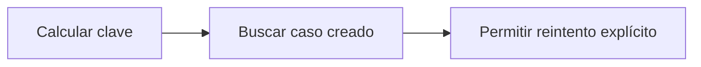

# Feature Specification: SF-03.4 — Deduplicación

**Created**: 2026-10-19  
**Status**: draft  
**Flow**: [F-03 Caso humano manual («Hablar con una persona»)](27-f-03-caso-humano-manual-hablar-con-una-persona.md) (subflujo)  
**Related Specs**: [F-03 Caso humano manual («Hablar con una persona»)](27-f-03-caso-humano-manual-hablar-con-una-persona.md), [SF-03.3 Resolución de motivos](30-sf-03-3-resolucion-de-motivos.md), [SF-03.5 Reserva atómica del intento](32-sf-03-5-reserva-atomica-del-intento.md)  
**Origen (DEC/H)**: DEC-15, DEC-23  
**Pruebas (TC)**: TC-33  
**Contratos externos**: §2.1 (herramienta 6: deduplicación local y riesgo conocido)  

## Reglas de este documento

> Este spec es FUNCIONAL, no técnico: describe QUÉ hace el sistema, no CÓMO. Usa lenguaje de negocio; las siete herramientas externas se nombran por su función y se referencian por la sección de `sdd/reports/EXTERNAL_CONTRACTS.md`. Los casos borde se DOCUMENTAN; los valores de configuración se citan por el nombre del parámetro (NFR-012) con su valor por defecto entre paréntesis.

**Alcance**: Calcula la clave de deduplicación (reserva, motivos ordenados y huella de decisión) y devuelve el caso existente si ya hay uno creado.

## User Scenarios & Testing *(mandatory)*

### User Story 1 - El mismo problema no crea dos casos (Priority: P1)

Como persona que atiende, quiero no recibir casos repetidos de la misma situación.

**Why this priority**: Reduce carga operativa.

**Independent Test**: Se prueba repitiendo el clic y reintentando tras un fallo.

**Acceptance Scenarios**:

1. **Scenario**: Caso ya creado
   - **Given** ya hay un caso creado con la misma clave
   - **When** se pide otro
   - **Then** se devuelve el existente

2. **Scenario**: Reintento tras fallo
   - **Given** el intento anterior fue fallido o indeterminado
   - **When** el pasajero reintenta de forma explícita
   - **Then** la deduplicación no lo bloquea y se registra un intento nuevo

3. **Scenario**: Clave estable y reintento (TC-33)
   - **Given** un caso HC-4471 creado para ABC123 y luego un intento fallido
   - **When** se repite el clic
   - **Then** con el caso creado se devuelve HC-4471 sin enviar; tras el intento fallido se permite un intento nuevo

---

### Edge Cases

> Solo se documentan; los marcados MUST-IMPLEMENT se vuelven requisito FR-XXX y se implementan con TDD, los DEFERRED quedan para una iteración posterior.

#### Invalid Data
- [DEFERRED] Deduplicación contra el proveedor: no existe llave en la herramienta externa, el riesgo residual queda documentado (AR-04) (FR-059)

#### Race Conditions
- [MUST-IMPLEMENT] Cuando una situación cambia (otra huella) → la clave cambia y se permite un caso nuevo (FR-059)

## Requirements *(mandatory)*

### Functional Requirements

- **FR-059**: Al crear un caso humano el sistema DEBE enviar el motivo de mayor prioridad y conservar todos los motivos simultáneos, con evidencia solo de identificadores, enumeraciones y hechos validados (sin información personal), tomada de la decisión guardada si el pasajero indica la decisión que vio y, si no, de una evaluación fresca. La deduplicación local se calcula con reserva, motivos ordenados y huella de decisión, no bloquea el reintento explícito tras un intento fallido o indeterminado, y cada intento y su resultado (creado, fallido, indeterminado) queda registrado. No requiere revalidación.

### Key Entities *(include if feature involves data)*

- **Caso humano**: Escalamiento a una persona; cada intento queda registrado con su resultado. Campos principales:
  - `dedup_key`: texto
  - `attempt`: entero ≥ 1
  - `state`: EN_CURSO | CREADO | FALLIDO | INDETERMINADO
  - `reason`: uno de los 13 motivos cerrados
  - `reasons`: lista ordenada por prioridad
  - `case_id`: texto | nulo
  - `queue`: texto | nulo
  - `sla_minutes`: entero | nulo
  - `option`: {option_id: texto, itinerario y diferencia de tarifa} | nulo
  - `confirm_possible_duplicate`: booleano

## Architectural Attributes *(mandatory)*

| Attribute | Value |
|-----------|-------|
| **Interaction type** | sync-http |
| **Consistency** | strong |
| **Workflow** | single-step |
| **Read pattern** | simple |
| **Auditability** | full-history |
| **Domain complexity** | medium |
| **Modularity** | bounded-context |
| **Deployment** | monolith |

## Success Criteria *(mandatory)*

### Measurable Outcomes

- **SC-001**: Cero casos creados para la misma clave mientras exista uno creado.

## Traceability *(mandatory after implementation)*

> Las columnas de archivo y línea se registran en la verificación de trazabilidad posterior a la implementación; hoy cada criterio queda enlazado a su origen y a las pruebas que lo verifican.

| Criterion | Origen | Prueba (TC) | Source File | Line(s) |
|-----------|--------|-------------|-------------|---------|
| FR-059 | DEC-15, DEC-23 | sin TC en el mapa §6 de REQUERIMIENTOS_V1 | se registra en la verificación posterior a la implementación | se registra en la verificación posterior a la implementación |
| SC-001 | criterio medible de este spec | TC-33 | se registra en la verificación posterior a la implementación | se registra en la verificación posterior a la implementación |

## Business Process (BPM View)

```
Calcular clave → Buscar caso creado → Permitir reintento explícito
```



