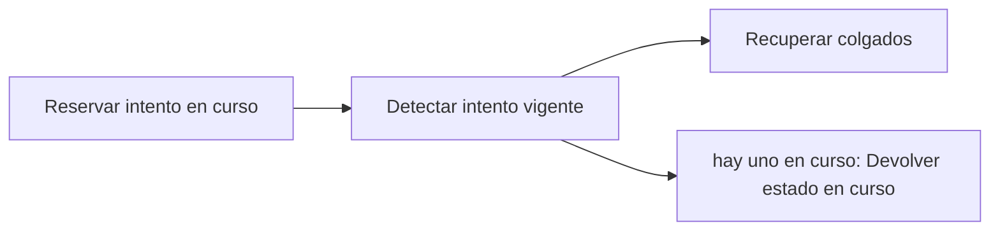

# Feature Specification: SF-03.5 — Reserva atómica del intento

**Created**: 2026-10-19  
**Status**: draft  
**Flow**: [F-03 Caso humano manual («Hablar con una persona»)](27-f-03-caso-humano-manual-hablar-con-una-persona.md) (subflujo)  
**Related Specs**: [F-03 Caso humano manual («Hablar con una persona»)](27-f-03-caso-humano-manual-hablar-con-una-persona.md), [SF-03.4 Deduplicación](31-sf-03-4-deduplicacion.md), [SF-03.6 Llamada al caso humano](33-sf-03-6-llamada-al-caso-humano.md)  
**Origen (DEC/H)**: DEC-15, DEC-18, DEC-23  
**Pruebas (TC)**: TC-22, TC-33, TC-38  
**Contratos externos**: §1.1 (fila 4: reserva atómica y recuperación tras caída)  

## Reglas de este documento

> Este spec es FUNCIONAL, no técnico: describe QUÉ hace el sistema, no CÓMO. Usa lenguaje de negocio; las siete herramientas externas se nombran por su función y se referencian por la sección de `sdd/reports/EXTERNAL_CONTRACTS.md`. Los casos borde se DOCUMENTAN; los valores de configuración se citan por el nombre del parámetro (NFR-012) con su valor por defecto entre paréntesis.

**Alcance**: Registra el intento en curso antes de llamar, con exclusión concurrente, y recupera los intentos colgados.

## User Scenarios & Testing *(mandatory)*

### User Story 1 - Un clic concurrente no envía dos veces (Priority: P1)

Como pasajero, quiero que pulsar dos veces no genere dos casos.

**Why this priority**: El proveedor no admite llave de idempotencia.

**Independent Test**: Se prueba con dos solicitudes simultáneas y con un intento colgado.

**Acceptance Scenarios**:

1. **Scenario**: Concurrencia
   - **Given** hay un intento en curso vigente
   - **When** llega otra solicitud igual
   - **Then** no envía y devuelve el caso con estado en curso

2. **Scenario**: Intento colgado
   - **Given** un intento está en curso hace más de `OPERATION_STALE_SECONDS` (120)
   - **When** se lee el registro
   - **Then** pasa a indeterminado y exige confirmar el posible duplicado

3. **Scenario**: Dos solicitudes simultáneas e intento colgado (TC-22, TC-38)
   - **Given** un intento en curso hace 121 s y otro simultáneo
   - **When** llegan 2 solicitudes
   - **Then** la simultánea no envía y el colgado pasa a indeterminado

---

### Edge Cases

> Solo se documentan; los marcados MUST-IMPLEMENT se vuelven requisito FR-XXX y se implementan con TDD, los DEFERRED quedan para una iteración posterior.

#### System Errors
- [MUST-IMPLEMENT] Cuando la reserva del intento no puede persistirse → no se envía (FR-105)
- [MUST-IMPLEMENT] Cuando el proceso se cae tras enviar → el intento queda indeterminado y no se reenvía solo (FR-064)

#### Race Conditions
- [MUST-IMPLEMENT] Cuando dos intentos coinciden → solo uno envía (FR-059)

## Requirements *(mandatory)*

### Functional Requirements

- **FR-059**: Al crear un caso humano el sistema DEBE enviar el motivo de mayor prioridad y conservar todos los motivos simultáneos, con evidencia solo de identificadores, enumeraciones y hechos validados (sin información personal), tomada de la decisión guardada si el pasajero indica la decisión que vio y, si no, de una evaluación fresca. La deduplicación local se calcula con reserva, motivos ordenados y huella de decisión, no bloquea el reintento explícito tras un intento fallido o indeterminado, y cada intento y su resultado (creado, fallido, indeterminado) queda registrado. No requiere revalidación.
- **FR-064**: La operación de cambio DEBE seguir un ciclo de vida: en curso, creada, indeterminada, fallida y expirada. En curso pasa a indeterminada tras `OPERATION_STALE_SECONDS` (120) sin respuesta; creada pasa a expirada en su vencimiento; indeterminada pasa a expirada tras `OPERATION_INDETERMINATE_EXPIRY_SECONDS` (900, mayor que la vigencia de una solicitud) si nada la resuelve. Si la llave no pudo persistirse no se escribe. Expirada o fallida permiten una operación nueva con la generación siguiente; creada, en curso e indeterminada la bloquean y la vista muestra su estado. Un rechazo por duplicado sin operación local se muestra «ya existe una solicitud para esta opción».
- **FR-105**: Matriz de errores por herramienta: las lecturas con fallo se reconsultan una vez sin bucles; sin contexto del viaje hay pantalla de «no pudimos cargar tu viaje» con reintento; solo sin eventos se muestra el contexto sin estado ni alerta y con aviso; sin política u opciones queda BLOQUEADA con caso humano ofrecido. Una solicitud de cambio con error no reintentable no se reintenta, muestra un fallo genérico y ofrece caso humano. En el caso humano, un error explícito dice «no pudimos registrar tu solicitud, puedes reintentar»; un tiempo agotado o respuesta perdida es indeterminado («no pudimos confirmar si tu solicitud quedó registrada; puede que ya lo esté»), no se reenvía automáticamente y el reintento exige un segundo clic explícito tras advertir del posible duplicado. Nunca se afirma éxito.

### Key Entities *(include if feature involves data)*

- **Caso humano**: Escalamiento a una persona; cada intento queda registrado con su resultado. Campos principales:
  - `dedup_key`: texto
  - `attempt`: entero ≥ 1
  - `state`: EN_CURSO | CREADO | FALLIDO | INDETERMINADO
  - `reason`: uno de los 13 motivos cerrados
  - `reasons`: lista ordenada por prioridad
  - `case_id`: texto | nulo
  - `queue`: texto | nulo
  - `sla_minutes`: entero | nulo
  - `option`: {option_id: texto, itinerario y diferencia de tarifa} | nulo
  - `confirm_possible_duplicate`: booleano

## Architectural Attributes *(mandatory)*

| Attribute | Value |
|-----------|-------|
| **Interaction type** | sync-http |
| **Consistency** | strong |
| **Workflow** | single-step |
| **Read pattern** | simple |
| **Auditability** | full-history |
| **Domain complexity** | medium |
| **Modularity** | bounded-context |
| **Deployment** | monolith |

## Success Criteria *(mandatory)*

### Measurable Outcomes

- **SC-001**: Con 100 solicitudes simultáneas se envía exactamente una.

## Traceability *(mandatory after implementation)*

> Las columnas de archivo y línea se registran en la verificación de trazabilidad posterior a la implementación; hoy cada criterio queda enlazado a su origen y a las pruebas que lo verifican.

| Criterion | Origen | Prueba (TC) | Source File | Line(s) |
|-----------|--------|-------------|-------------|---------|
| FR-059 | DEC-15, DEC-23 | sin TC en el mapa §6 de REQUERIMIENTOS_V1 | se registra en la verificación posterior a la implementación | se registra en la verificación posterior a la implementación |
| FR-064 | DEC-18 | TC-38 | se registra en la verificación posterior a la implementación | se registra en la verificación posterior a la implementación |
| FR-105 | DEC-15, DEC-18 | TC-33 | se registra en la verificación posterior a la implementación | se registra en la verificación posterior a la implementación |
| SC-001 | criterio medible de este spec | TC-22, TC-33, TC-38 | se registra en la verificación posterior a la implementación | se registra en la verificación posterior a la implementación |

## Business Process (BPM View)

```
Reservar intento en curso → Detectar intento vigente → Recuperar colgados
```



