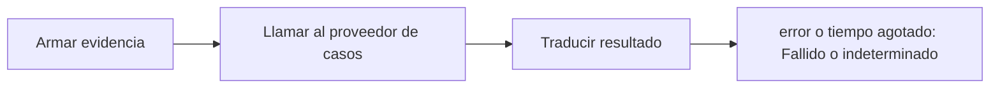

# Feature Specification: SF-03.6 — Llamada al caso humano

**Created**: 2026-10-19  
**Status**: draft  
**Flow**: [F-03 Caso humano manual («Hablar con una persona»)](27-f-03-caso-humano-manual-hablar-con-una-persona.md) (subflujo)  
**Related Specs**: [F-03 Caso humano manual («Hablar con una persona»)](27-f-03-caso-humano-manual-hablar-con-una-persona.md), [SF-03.5 Reserva atómica del intento](32-sf-03-5-reserva-atomica-del-intento.md), [SF-03.7 Reintento tras indeterminado](34-sf-03-7-reintento-tras-indeterminado.md)  
**Origen (DEC/H)**: DEC-15, DEC-18, DEC-22, DEC-23  
**Pruebas (TC)**: TC-20, TC-33  
**Contratos externos**: §2.1 (herramienta 6: caso humano)  

## Reglas de este documento

> Este spec es FUNCIONAL, no técnico: describe QUÉ hace el sistema, no CÓMO. Usa lenguaje de negocio; las siete herramientas externas se nombran por su función y se referencian por la sección de `sdd/reports/EXTERNAL_CONTRACTS.md`. Los casos borde se DOCUMENTAN; los valores de configuración se citan por el nombre del parámetro (NFR-012) con su valor por defecto entre paréntesis.

**Alcance**: Una llamada al proveedor de casos con evidencia sin información personal, y traducción del resultado: creado, fallido o indeterminado.

## User Scenarios & Testing *(mandatory)*

### User Story 1 - El resultado se comunica con honestidad (Priority: P1)

Como pasajero, quiero saber si mi solicitud se registró, falló o no se pudo confirmar, sin que me digan que funcionó cuando no lo sé.

**Why this priority**: Afirmar un éxito no confirmado puede dejar al pasajero sin atención.

**Independent Test**: Se prueba con respuesta creada, error explícito y tiempo agotado.

**Acceptance Scenarios**:

1. **Scenario**: Creado
   - **Given** el proveedor devuelve caso, cola y plazo
   - **When** se llama
   - **Then** el intento queda creado y el mensaje cita el plazo devuelto

2. **Scenario**: Error explícito
   - **Given** el proveedor responde con error
   - **When** se llama
   - **Then** el intento queda fallido y el mensaje dice «puedes reintentar»

3. **Scenario**: Tiempo agotado
   - **Given** el proveedor no responde
   - **When** se llama
   - **Then** el intento queda indeterminado y no se reenvía

4. **Scenario**: Error y tiempo agotado del proveedor (TC-33)
   - **Given** el proveedor de casos responde HC-4471, o un error, o no responde en 5 s
   - **When** se llama
   - **Then** creado con 45 minutos, fallido «puedes reintentar» e indeterminado sin reenvío

---

### Edge Cases

> Solo se documentan; los marcados MUST-IMPLEMENT se vuelven requisito FR-XXX y se implementan con TDD, los DEFERRED quedan para una iteración posterior.

#### System Errors
- [MUST-IMPLEMENT] Cuando el resultado es indeterminado → nunca se afirma éxito (FR-105)

#### Security & Permissions
- [MUST-IMPLEMENT] Cuando el motivo es datos personales → la respuesta no contiene ningún campo prohibido (FR-061)
- [MUST-IMPLEMENT] Cuando se arma la evidencia → no contiene nombre, contacto, documento ni edad (FR-059)

## Requirements *(mandatory)*

### Functional Requirements

- **FR-059**: Al crear un caso humano el sistema DEBE enviar el motivo de mayor prioridad y conservar todos los motivos simultáneos, con evidencia solo de identificadores, enumeraciones y hechos validados (sin información personal), tomada de la decisión guardada si el pasajero indica la decisión que vio y, si no, de una evaluación fresca. La deduplicación local se calcula con reserva, motivos ordenados y huella de decisión, no bloquea el reintento explícito tras un intento fallido o indeterminado, y cada intento y su resultado (creado, fallido, indeterminado) queda registrado. No requiere revalidación.
- **FR-061**: El motivo de petición de datos personales NUNCA DEBE devolver información personal: abre un caso humano y la respuesta no contiene ningún campo prohibido.
- **FR-105**: Matriz de errores por herramienta: las lecturas con fallo se reconsultan una vez sin bucles; sin contexto del viaje hay pantalla de «no pudimos cargar tu viaje» con reintento; solo sin eventos se muestra el contexto sin estado ni alerta y con aviso; sin política u opciones queda BLOQUEADA con caso humano ofrecido. Una solicitud de cambio con error no reintentable no se reintenta, muestra un fallo genérico y ofrece caso humano. En el caso humano, un error explícito dice «no pudimos registrar tu solicitud, puedes reintentar»; un tiempo agotado o respuesta perdida es indeterminado («no pudimos confirmar si tu solicitud quedó registrada; puede que ya lo esté»), no se reenvía automáticamente y el reintento exige un segundo clic explícito tras advertir del posible duplicado. Nunca se afirma éxito.

### Key Entities *(include if feature involves data)*

- **Caso humano**: Escalamiento a una persona; cada intento queda registrado con su resultado. Campos principales:
  - `dedup_key`: texto
  - `attempt`: entero ≥ 1
  - `state`: EN_CURSO | CREADO | FALLIDO | INDETERMINADO
  - `reason`: uno de los 13 motivos cerrados
  - `reasons`: lista ordenada por prioridad
  - `case_id`: texto | nulo
  - `queue`: texto | nulo
  - `sla_minutes`: entero | nulo
  - `option`: {option_id: texto, itinerario y diferencia de tarifa} | nulo
  - `confirm_possible_duplicate`: booleano
- **Resultado de caso humano**: Respuesta a un clic de «Hablar con una persona». Campos principales:
  - `outcome`: HUMAN_CASE_CREATED | EXISTING_CASE | NEEDS_CONFIRMATION | INDETERMINATE | FAILED
  - `message`: mensaje validado
  - `human_case`: caso humano | nulo
  - `decision_id`: identificador de la decisión de la que salió la evidencia

## Architectural Attributes *(mandatory)*

| Attribute | Value |
|-----------|-------|
| **Interaction type** | sync-http |
| **Consistency** | strong |
| **Workflow** | single-step |
| **Read pattern** | simple |
| **Auditability** | full-history |
| **Domain complexity** | medium |
| **Modularity** | bounded-context |
| **Deployment** | monolith |

## Success Criteria *(mandatory)*

### Measurable Outcomes

- **SC-001**: El 0 % de las evidencias enviadas contiene información personal.
- **SC-002**: El 0 % de los timeouts se reenvía sin segundo clic.

## Traceability *(mandatory after implementation)*

> Las columnas de archivo y línea se registran en la verificación de trazabilidad posterior a la implementación; hoy cada criterio queda enlazado a su origen y a las pruebas que lo verifican.

| Criterion | Origen | Prueba (TC) | Source File | Line(s) |
|-----------|--------|-------------|-------------|---------|
| FR-059 | DEC-15, DEC-23 | sin TC en el mapa §6 de REQUERIMIENTOS_V1 | se registra en la verificación posterior a la implementación | se registra en la verificación posterior a la implementación |
| FR-061 | DEC-15, DEC-22 | TC-20 | se registra en la verificación posterior a la implementación | se registra en la verificación posterior a la implementación |
| FR-105 | DEC-15, DEC-18 | TC-33 | se registra en la verificación posterior a la implementación | se registra en la verificación posterior a la implementación |
| SC-001 | criterio medible de este spec | TC-20, TC-33 | se registra en la verificación posterior a la implementación | se registra en la verificación posterior a la implementación |
| SC-002 | criterio medible de este spec | TC-20, TC-33 | se registra en la verificación posterior a la implementación | se registra en la verificación posterior a la implementación |

## Business Process (BPM View)

```
Armar evidencia → Llamar al proveedor de casos → Traducir resultado
```



