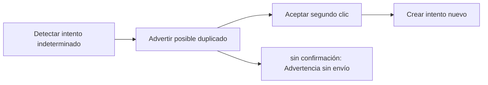

# Feature Specification: SF-03.7 — Reintento tras indeterminado

**Created**: 2026-10-19  
**Status**: draft  
**Flow**: [F-03 Caso humano manual («Hablar con una persona»)](27-f-03-caso-humano-manual-hablar-con-una-persona.md) (subflujo)  
**Related Specs**: [F-03 Caso humano manual («Hablar con una persona»)](27-f-03-caso-humano-manual-hablar-con-una-persona.md), [SF-03.6 Llamada al caso humano](33-sf-03-6-llamada-al-caso-humano.md), [SF-03.8 Mensaje y registro](35-sf-03-8-mensaje-y-registro.md)  
**Origen (DEC/H)**: DEC-14, DEC-15, DEC-18  
**Pruebas (TC)**: TC-33  
**Contratos externos**: §1.1 (fila 4: respuesta de necesidad de confirmación)  

## Reglas de este documento

> Este spec es FUNCIONAL, no técnico: describe QUÉ hace el sistema, no CÓMO. Usa lenguaje de negocio; las siete herramientas externas se nombran por su función y se referencian por la sección de `sdd/reports/EXTERNAL_CONTRACTS.md`. Los casos borde se DOCUMENTAN; los valores de configuración se citan por el nombre del parámetro (NFR-012) con su valor por defecto entre paréntesis.

**Alcance**: Tras un intento indeterminado exige un segundo clic explícito, con advertencia del posible duplicado, para crear un intento nuevo.

## User Scenarios & Testing *(mandatory)*

### User Story 1 - El pasajero decide con información si reenviar (Priority: P1)

Como pasajero, quiero que me avisen de que mi solicitud anterior podría haberse registrado, y elegir si reenviarla.

**Why this priority**: Evita duplicados por un reintento a ciegas.

**Independent Test**: Se prueba con un intento indeterminado y el reenvío con y sin confirmación.

**Acceptance Scenarios**:

1. **Scenario**: Sin confirmación
   - **Given** el intento previo fue indeterminado
   - **When** el pasajero reenvía sin confirmar el posible duplicado
   - **Then** no se envía y se muestra la advertencia

2. **Scenario**: Con confirmación
   - **Given** el pasajero confirma el posible duplicado
   - **When** reenvía
   - **Then** se crea un intento nuevo con la misma opción como evidencia

3. **Scenario**: Reintento tras indeterminado (TC-33)
   - **Given** el intento anterior de ABC123 quedó indeterminado
   - **When** se reenvía sin y con confirmación del posible duplicado
   - **Then** sin confirmar no se envía; con confirmar se crea el intento 2 con la misma opción O1

---

### Edge Cases

> Solo se documentan; los marcados MUST-IMPLEMENT se vuelven requisito FR-XXX y se implementan con TDD, los DEFERRED quedan para una iteración posterior.

#### Invalid Data
- [MUST-IMPLEMENT] Cuando falta la confirmación → no se reenvía (FR-105)
- [MUST-IMPLEMENT] Cuando el segundo clic usa la advertencia → el texto del botón lo declara (FR-050)

## Requirements *(mandatory)*

### Functional Requirements

- **FR-050**: Toda acción externa (solicitud de cambio, caso humano, notificación) DEBE requerir un clic explícito del pasajero; el sistema solo propone y ofrece. La persistencia interna no es una acción externa. Excepción: en modo sistema se puede enviar la notificación de FR-122 sin clic, con plantilla fija; ninguna otra acción externa se ejecuta en modo sistema. Un clic autoriza exactamente una acción y los textos de los botones lo declaran, incluida la derivación posterior a una falla persistente.
- **FR-105**: Matriz de errores por herramienta: las lecturas con fallo se reconsultan una vez sin bucles; sin contexto del viaje hay pantalla de «no pudimos cargar tu viaje» con reintento; solo sin eventos se muestra el contexto sin estado ni alerta y con aviso; sin política u opciones queda BLOQUEADA con caso humano ofrecido. Una solicitud de cambio con error no reintentable no se reintenta, muestra un fallo genérico y ofrece caso humano. En el caso humano, un error explícito dice «no pudimos registrar tu solicitud, puedes reintentar»; un tiempo agotado o respuesta perdida es indeterminado («no pudimos confirmar si tu solicitud quedó registrada; puede que ya lo esté»), no se reenvía automáticamente y el reintento exige un segundo clic explícito tras advertir del posible duplicado. Nunca se afirma éxito.

### Key Entities *(include if feature involves data)*

- **Caso humano**: Escalamiento a una persona; cada intento queda registrado con su resultado. Campos principales:
  - `dedup_key`: texto
  - `attempt`: entero ≥ 1
  - `state`: EN_CURSO | CREADO | FALLIDO | INDETERMINADO
  - `reason`: uno de los 13 motivos cerrados
  - `reasons`: lista ordenada por prioridad
  - `case_id`: texto | nulo
  - `queue`: texto | nulo
  - `sla_minutes`: entero | nulo
  - `option`: {option_id: texto, itinerario y diferencia de tarifa} | nulo
  - `confirm_possible_duplicate`: booleano
- **Resultado de caso humano**: Respuesta a un clic de «Hablar con una persona». Campos principales:
  - `outcome`: HUMAN_CASE_CREATED | EXISTING_CASE | NEEDS_CONFIRMATION | INDETERMINATE | FAILED
  - `message`: mensaje validado
  - `human_case`: caso humano | nulo
  - `decision_id`: identificador de la decisión de la que salió la evidencia

## Architectural Attributes *(mandatory)*

| Attribute | Value |
|-----------|-------|
| **Interaction type** | sync-http |
| **Consistency** | strong |
| **Workflow** | single-step |
| **Read pattern** | simple |
| **Auditability** | full-history |
| **Domain complexity** | medium |
| **Modularity** | bounded-context |
| **Deployment** | monolith |

## Success Criteria *(mandatory)*

### Measurable Outcomes

- **SC-001**: El 100 % de los reintentos tras indeterminado exige la confirmación explícita.

## Traceability *(mandatory after implementation)*

> Las columnas de archivo y línea se registran en la verificación de trazabilidad posterior a la implementación; hoy cada criterio queda enlazado a su origen y a las pruebas que lo verifican.

| Criterion | Origen | Prueba (TC) | Source File | Line(s) |
|-----------|--------|-------------|-------------|---------|
| FR-050 | DEC-14 | sin TC en el mapa §6 de REQUERIMIENTOS_V1 | se registra en la verificación posterior a la implementación | se registra en la verificación posterior a la implementación |
| FR-105 | DEC-15, DEC-18 | TC-33 | se registra en la verificación posterior a la implementación | se registra en la verificación posterior a la implementación |
| SC-001 | criterio medible de este spec | TC-33 | se registra en la verificación posterior a la implementación | se registra en la verificación posterior a la implementación |

## Business Process (BPM View)

```
Detectar intento indeterminado → Advertir posible duplicado → Aceptar segundo clic → Crear intento nuevo
```



