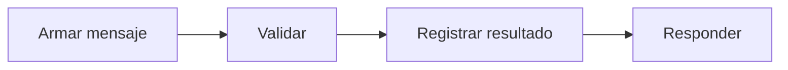

# Feature Specification: SF-03.8 — Mensaje y registro

**Created**: 2026-10-19  
**Status**: draft  
**Flow**: [F-03 Caso humano manual («Hablar con una persona»)](27-f-03-caso-humano-manual-hablar-con-una-persona.md) (subflujo)  
**Related Specs**: [F-03 Caso humano manual («Hablar con una persona»)](27-f-03-caso-humano-manual-hablar-con-una-persona.md), [SF-03.7 Reintento tras indeterminado](34-sf-03-7-reintento-tras-indeterminado.md)  
**Origen (DEC/H)**: DEC-20, DEC-23, H-21  
**Pruebas (TC)**: TC-16, TC-20  
**Contratos externos**: §1.1 (fila 4: resultado de caso humano)  

## Reglas de este documento

> Este spec es FUNCIONAL, no técnico: describe QUÉ hace el sistema, no CÓMO. Usa lenguaje de negocio; las siete herramientas externas se nombran por su función y se referencian por la sección de `sdd/reports/EXTERNAL_CONTRACTS.md`. Los casos borde se DOCUMENTAN; los valores de configuración se citan por el nombre del parámetro (NFR-012) con su valor por defecto entre paréntesis.

**Alcance**: Construye el mensaje validado con el plazo de atención devuelto, persiste el resultado del intento y responde con el resultado de caso humano.

## User Scenarios & Testing *(mandatory)*

### User Story 1 - El pasajero recibe un mensaje claro y el sistema deja constancia (Priority: P1)

Como pasajero, quiero un mensaje que me diga que una persona me contactará dentro del plazo informado.

**Why this priority**: Evita promesas de plazos distintos del devuelto.

**Independent Test**: Se prueba con los cinco resultados.

**Acceptance Scenarios**:

1. **Scenario**: Creado
   - **Given** el caso quedó creado con plazo de atención
   - **When** se arma el mensaje
   - **Then** cita únicamente el plazo devuelto

2. **Scenario**: Intento registrado
   - **Given** cualquier resultado
   - **When** se registra
   - **Then** queda el intento con su estado, sin texto libre ni información personal

3. **Scenario**: Mensaje con el plazo devuelto (TC-20)
   - **Given** el caso HC-4471 con 45 minutos, pedido con el motivo «Necesito ayuda con mis datos o documentos»
   - **When** se arma el mensaje
   - **Then** cita 45 minutos, nunca otro plazo, y no incluye ningún dato personal

---

### Edge Cases

> Solo se documentan; los marcados MUST-IMPLEMENT se vuelven requisito FR-XXX y se implementan con TDD, los DEFERRED quedan para una iteración posterior.

#### Invalid Data
- [MUST-IMPLEMENT] Cuando el resultado es de necesidad de confirmación, fallo o indeterminado → se devuelve igual el cuerpo de resultado con mensaje validado (FR-081)

#### Security & Permissions
- [MUST-IMPLEMENT] Cuando se persiste → solo campos de la lista cerrada (FR-091)

## Requirements *(mandatory)*

### Functional Requirements

- **FR-081**: Un validador propio DEBE revisar todo mensaje dinámico antes de devolverlo y el contrato de notificación: bloquea un hecho sin evidencia vigente o un campo fuera de la lista blanca; exige referencia de política a los mensajes que afirman una opción o un derecho y a toda notificación de política; el aviso informativo de cambio de puerta va sin referencia de política. Los textos estáticos de la interfaz están exentos.
- **FR-091**: Solo se persisten campos de una lista cerrada: hechos operacionales no personales, identificadores seudónimos, enumeraciones, números, marcas de tiempo y huellas. NUNCA se guardan cargas completas, nombre, contacto, documento ni edad del menor; los identificadores son seudónimos, no anónimos, y la reserva se trunca en los registros de aplicación.

### Key Entities *(include if feature involves data)*

- **Resultado de caso humano**: Respuesta a un clic de «Hablar con una persona». Campos principales:
  - `outcome`: HUMAN_CASE_CREATED | EXISTING_CASE | NEEDS_CONFIRMATION | INDETERMINATE | FAILED
  - `message`: mensaje validado
  - `human_case`: caso humano | nulo
  - `decision_id`: identificador de la decisión de la que salió la evidencia
- **Mensaje validado**: Texto de plantilla con su evidencia, aprobado por el validador antes de mostrarse o enviarse. Campos principales:
  - `message_id`: texto
  - `template_id`: texto del catálogo
  - `kind`: INFO | ESTIMATE | WARNING | NEXT_STEP | DEADLINE
  - `text`: texto en español neutro
  - `evidence_refs`: lista de identificadores
  - `policy_ref`: texto | nulo
  - `blocked`: booleano

## Architectural Attributes *(mandatory)*

| Attribute | Value |
|-----------|-------|
| **Interaction type** | sync-http |
| **Consistency** | strong |
| **Workflow** | single-step |
| **Read pattern** | simple |
| **Auditability** | full-history |
| **Domain complexity** | medium |
| **Modularity** | bounded-context |
| **Deployment** | monolith |

## Success Criteria *(mandatory)*

### Measurable Outcomes

- **SC-001**: El 100 % de los mensajes de resultado pasa por el validador y no cita plazos distintos del devuelto.

## Traceability *(mandatory after implementation)*

> Las columnas de archivo y línea se registran en la verificación de trazabilidad posterior a la implementación; hoy cada criterio queda enlazado a su origen y a las pruebas que lo verifican.

| Criterion | Origen | Prueba (TC) | Source File | Line(s) |
|-----------|--------|-------------|-------------|---------|
| FR-081 | DEC-20, H-21 | TC-16 | se registra en la verificación posterior a la implementación | se registra en la verificación posterior a la implementación |
| FR-091 | DEC-23 | sin TC en el mapa §6 de REQUERIMIENTOS_V1 | se registra en la verificación posterior a la implementación | se registra en la verificación posterior a la implementación |
| SC-001 | criterio medible de este spec | TC-16, TC-20 | se registra en la verificación posterior a la implementación | se registra en la verificación posterior a la implementación |

## Business Process (BPM View)

```
Armar mensaje → Validar → Registrar resultado → Responder
```



