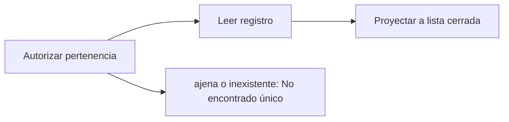

# Feature Specification: F-04 — Consulta de decisión

**Created**: 2026-10-19  
**Status**: draft  
**Flow**: F-04 Consulta de decisión  
**Related Specs**: [SF-04.1 Autorización de pertenencia](37-sf-04-1-autorizacion-de-pertenencia.md), [SF-04.2 Lectura del registro](38-sf-04-2-lectura-del-registro.md), [SF-04.3 Proyección a la lista cerrada de campos](39-sf-04-3-proyeccion-a-la-lista-cerrada-de-campos.md), [F-01 Evaluar viaje como pasajero](01-f-01-evaluar-viaje-como-pasajero.md)  
**Origen (DEC/H)**: DEC-17, DEC-21, DEC-22, DEC-23  
**Pruebas (TC)**: TC-21, TC-59  
**Contratos externos**: §1.1 (fila 5: lectura del registro de decisión), §2.3 (registro de decisiones)  

## Reglas de este documento

> Este spec es FUNCIONAL, no técnico: describe QUÉ hace el sistema, no CÓMO. Usa lenguaje de negocio; las siete herramientas externas se nombran por su función y se referencian por la sección de `sdd/reports/EXTERNAL_CONTRACTS.md`. Los casos borde se DOCUMENTAN; los valores de configuración se citan por el nombre del parámetro (NFR-012) con su valor por defecto entre paréntesis.

**Alcance**: Devuelve el registro de auditoría de una decisión, solo si pertenece a la reserva de la sesión, con los campos de la lista cerrada, las opciones no viables con todas sus razones de descarte y, en evaluaciones del sistema, el llamante; la sesión del pasajero no recibe la revisión manual ni el detalle de las notificaciones (campos internos).

## User Scenarios & Testing *(mandatory)*

### User Story 1 - El dueño de la reserva (o el equipo de revisión con su sesión) puede ver por qué se decidió algo (Priority: P1)

Como auditor de la reserva, quiero consultar el registro de una decisión para entender qué datos se leyeron, qué reglas se evaluaron y qué opciones se descartaron y por qué.

**Why this priority**: La trazabilidad es un requisito del reto y la base de la métrica de éxito.

**Independent Test**: Se prueba consultando una decisión propia, una ajena y una inexistente.

**Acceptance Scenarios**:

1. **Scenario**: Decisión propia
   - **Given** una decisión de la reserva de la sesión
   - **When** se consulta por su identificador
   - **Then** se devuelve el registro con la lista cerrada de campos y todas las opciones, también las no viables, con sus razones de descarte

2. **Scenario**: Decisión ajena o inexistente
   - **Given** la decisión es de otra reserva o no existe
   - **When** se consulta
   - **Then** la respuesta es idéntica de «no encontrado»

3. **Scenario**: Decisión del sistema
   - **Given** la decisión se originó en una evaluación del sistema
   - **When** se consulta
   - **Then** incluye el llamante, pero no la revisión manual ni el detalle de las notificaciones, que son campos internos

4. **Scenario**: Registro propio y ajeno (TC-21, TC-59)
   - **Given** una decisión de ABC123 evaluada por el sistema y otra de XYZ789
   - **When** la sesión de ABC123 lee ambas
   - **Then** la propia devuelve el registro con O3 descartada y sin revisión manual ni notificaciones; la ajena responde «no encontrado» idéntico

---

### Edge Cases

> Solo se documentan; los marcados MUST-IMPLEMENT se vuelven requisito FR-XXX y se implementan con TDD, los DEFERRED quedan para una iteración posterior.

#### Invalid Data
- [MUST-IMPLEMENT] Cuando el identificador no tiene formato válido → rechazo por validación (FR-001)

#### Security & Permissions
- [MUST-IMPLEMENT] Cuando el identificador es de otra reserva → respuesta idéntica a la de un identificador inexistente (FR-001)
- [MUST-IMPLEMENT] Cuando el registro contiene datos → nunca incluye nombre, contacto, documento, edad ni cargas completas (FR-091)
- [MUST-IMPLEMENT] Cuando la lectura la hace la sesión del pasajero → nunca incluye la revisión manual ni el detalle de las notificaciones (campos internos que solo se persisten) (FR-093)

## Requirements *(mandatory)*

### Functional Requirements

- **FR-001**: El sistema DEBE operar sobre la sesión autenticada del pasajero y comprobar que la reserva y la decisión solicitadas pertenezcan a esa sesión; una reserva ajena y una inexistente DEBEN producir exactamente la misma respuesta de «no encontrado», sin confirmar la existencia de ninguna. La sesión simulada solo existe con el parámetro `DEV_SESSION_HEADER_ENABLED` (apagado por defecto): en cualquier otro perfil toda petición del pasajero sin sesión DEBE rechazarse por falta de autenticación, y toda petición del sistema DEBE exigir la credencial de servicio (FR-120). Los errores NO DEBEN mostrar trazas ni repetir la entrada, nunca se pide ni se muestra documento de identidad, y el identificador de decisión DEBE ser aleatorio y no adivinable.
- **FR-042**: Las opciones no viables NO DEBEN mostrarse; se registran con todas sus razones de descarte (por ejemplo asientos insuficientes y conflicto de costo a la vez).
- **FR-090**: Cada evaluación DEBE generar un registro con identificador de decisión, reserva, lecturas con su instante, eventos elegidos y descartados con razón, versión de política y reglas, variables derivadas con supuestos, opciones viables y descartadas con razón, acción y huella del mensaje.
- **FR-091**: Solo se persisten campos de una lista cerrada: hechos operacionales no personales, identificadores seudónimos, enumeraciones, números, marcas de tiempo y huellas. NUNCA se guardan cargas completas, nombre, contacto, documento ni edad del menor; los identificadores son seudónimos, no anónimos, y la reserva se trunca en los registros de aplicación.
- **FR-093**: El sistema DEBE ofrecer la lectura del registro de una decisión por su identificador, sujeta a FR-001 (solo la reserva dueña de la sesión); la sesión del pasajero NO recibe la marca de revisión manual ni el detalle de las notificaciones, que son campos internos (FR-123).

### Non-Functional and Documentation Requirements

- **NFR-002**: Privacidad: el sistema DEBE minimizar la información personal en todas las fronteras propias; ningún dato personal se entrega a un modelo (si en el futuro se usara, se anonimiza antes).

### Key Entities *(include if feature involves data)*

- **Registro de decisión**: Instantánea de auditoría de una evaluación, sin información personal. Campos principales:
  - `decision_id`: identificador
  - `booking_id`: texto seudónimo
  - `created_at`: marca de tiempo UTC
  - `caller`: user | system
  - `fingerprint`: texto
  - `decision_state`: estado | nulo
  - `needs_manual_review`: booleano (campo interno, no se entrega a la sesión del pasajero)
  - `policy_version`: texto | nulo
  - `mct_provided`: booleano
  - `passenger_count`: entero
  - `segments`: lista de {segment_id: texto, state: texto | nulo, delay_minutes: entero | nulo}
  - `message_hash`: texto
  - `messages_blocked`: entero
  - `reads`: lista de {tool: texto, retrieved_at: marca de tiempo | nulo, outcome: OK | FAILED | INVALID | NOT_REQUESTED}
  - `events`: lista de {event_id, segment_id, event_type, disposition: CHOSEN | DISCARDED | NOT_INTERPRETED, reason}
  - `rules`: lista de {rule_id, result, requires_human_approval}
  - `options`: lista de opciones con sus razones de descarte (también las no viables)
  - `notifications`: lista de {reason, kind, status, notification_id} (solo modo sistema; campo interno, no se entrega a la sesión del pasajero)
  - `outcomes`: lista de {kind: REBOOKING | HUMAN_CASE, reference_id: texto | nulo, state: texto, at: marca de tiempo}

## Architectural Attributes *(mandatory)*

| Attribute | Value |
|-----------|-------|
| **Interaction type** | sync-http |
| **Consistency** | strong |
| **Workflow** | multi-step |
| **Read pattern** | simple |
| **Auditability** | full-history |
| **Domain complexity** | high |
| **Modularity** | bounded-context |
| **Deployment** | monolith |

## Success Criteria *(mandatory)*

### Measurable Outcomes

- **SC-001**: El 100 % de las consultas ajenas e inexistentes recibe una respuesta idéntica.
- **SC-002**: El registro devuelto contiene el 0 % de campos de la lista prohibida.
- **SC-003**: La consulta responde en menos de 200 ms (percentil 95) en una lectura local.

## Traceability *(mandatory after implementation)*

> Las columnas de archivo y línea se registran en la verificación de trazabilidad posterior a la implementación; hoy cada criterio queda enlazado a su origen y a las pruebas que lo verifican.

| Criterion | Origen | Prueba (TC) | Source File | Line(s) |
|-----------|--------|-------------|-------------|---------|
| FR-001 | DEC-21 | TC-21 | se registra en la verificación posterior a la implementación | se registra en la verificación posterior a la implementación |
| FR-042 | DEC-17 | sin TC en el mapa §6 de REQUERIMIENTOS_V1 | se registra en la verificación posterior a la implementación | se registra en la verificación posterior a la implementación |
| FR-090 | DEC-23 | sin TC en el mapa §6 de REQUERIMIENTOS_V1 | se registra en la verificación posterior a la implementación | se registra en la verificación posterior a la implementación |
| FR-091 | DEC-23 | sin TC en el mapa §6 de REQUERIMIENTOS_V1 | se registra en la verificación posterior a la implementación | se registra en la verificación posterior a la implementación |
| FR-093 | DEC-23 | TC-21, TC-59 | se registra en la verificación posterior a la implementación | se registra en la verificación posterior a la implementación |
| NFR-002 | DEC-22 | sin TC en el mapa §6 de REQUERIMIENTOS_V1 | se registra en la verificación posterior a la implementación | se registra en la verificación posterior a la implementación |
| SC-001 | criterio medible de este spec | TC-21, TC-59 | se registra en la verificación posterior a la implementación | se registra en la verificación posterior a la implementación |
| SC-002 | criterio medible de este spec | TC-21, TC-59 | se registra en la verificación posterior a la implementación | se registra en la verificación posterior a la implementación |
| SC-003 | criterio medible de este spec | TC-21, TC-59 | se registra en la verificación posterior a la implementación | se registra en la verificación posterior a la implementación |

## Business Process (BPM View)

```
Autorizar pertenencia → Leer registro → Proyectar a lista cerrada
```



### Subprocesses (if applicable)

```
SF-04.1: Autorización de pertenencia
SF-04.2: Lectura del registro
SF-04.3: Proyección a la lista cerrada de campos
```
