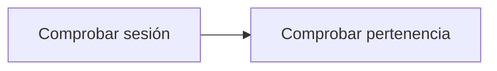

# Feature Specification: SF-04.1 — Autorización de pertenencia

**Created**: 2026-10-19  
**Status**: draft  
**Flow**: [F-04 Consulta de decisión](36-f-04-consulta-de-decision.md) (subflujo)  
**Related Specs**: [F-04 Consulta de decisión](36-f-04-consulta-de-decision.md), [SF-04.2 Lectura del registro](38-sf-04-2-lectura-del-registro.md)  
**Origen (DEC/H)**: DEC-21, DEC-23  
**Pruebas (TC)**: TC-21, TC-58  
**Contratos externos**: §1.1 (fila 5)  

## Reglas de este documento

> Este spec es FUNCIONAL, no técnico: describe QUÉ hace el sistema, no CÓMO. Usa lenguaje de negocio; las siete herramientas externas se nombran por su función y se referencian por la sección de `sdd/reports/EXTERNAL_CONTRACTS.md`. Los casos borde se DOCUMENTAN; los valores de configuración se citan por el nombre del parámetro (NFR-012) con su valor por defecto entre paréntesis.

**Alcance**: Comprueba que la sesión es la dueña de la reserva a la que pertenece la decisión pedida.

## User Scenarios & Testing *(mandatory)*

### User Story 1 - Nadie lee decisiones ajenas (Priority: P1)

Como pasajero, quiero que solo yo pueda consultar los registros de mis decisiones.

**Why this priority**: Los registros contienen la historia de la reserva.

**Independent Test**: Se prueba con una decisión propia, otra ajena y otra inexistente.

**Acceptance Scenarios**:

1. **Scenario**: Propia
   - **Given** la decisión pertenece a la reserva de la sesión
   - **When** se consulta
   - **Then** se permite la lectura

2. **Scenario**: Ajena
   - **Given** la decisión pertenece a otra reserva
   - **When** se consulta
   - **Then** se responde exactamente igual que a una inexistente

3. **Scenario**: Decisión ajena (TC-21)
   - **Given** la sesión de ABC123 y una decisión de XYZ789
   - **When** se consulta
   - **Then** se responde igual que a una inexistente

4. **Scenario**: Límite de tasa de la consulta de decisión (TC-58)
   - **Given** la sesión de ABC123 con 30 consultas de decisión en el último minuto desde el mismo origen
   - **When** llega la 31.ª
   - **Then** se rechaza por límite de tasa

---

### Edge Cases

> Solo se documentan; los marcados MUST-IMPLEMENT se vuelven requisito FR-XXX y se implementan con TDD, los DEFERRED quedan para una iteración posterior.

#### Security & Permissions
- [MUST-IMPLEMENT] Cuando falta la sesión → rechazo por falta de autenticación (FR-001)
- [MUST-IMPLEMENT] Cuando el identificador es adivinable → nunca: es aleatorio y no adivinable (FR-001)
- [MUST-IMPLEMENT] Cuando la misma reserva y origen superan `EVALUATE_RATE_LIMIT_PER_MINUTE` (30) consultas de decisión por minuto → rechazo por límite de tasa (NFR-013)

## Requirements *(mandatory)*

### Functional Requirements

- **FR-001**: El sistema DEBE operar sobre la sesión autenticada del pasajero y comprobar que la reserva y la decisión solicitadas pertenezcan a esa sesión; una reserva ajena y una inexistente DEBEN producir exactamente la misma respuesta de «no encontrado», sin confirmar la existencia de ninguna. La sesión simulada solo existe con el parámetro `DEV_SESSION_HEADER_ENABLED` (apagado por defecto): en cualquier otro perfil toda petición del pasajero sin sesión DEBE rechazarse por falta de autenticación, y toda petición del sistema DEBE exigir la credencial de servicio (FR-120). Los errores NO DEBEN mostrar trazas ni repetir la entrada, nunca se pide ni se muestra documento de identidad, y el identificador de decisión DEBE ser aleatorio y no adivinable.
- **FR-093**: El sistema DEBE ofrecer la lectura del registro de una decisión por su identificador, sujeta a FR-001 (solo la reserva dueña de la sesión); la sesión del pasajero NO recibe la marca de revisión manual ni el detalle de las notificaciones, que son campos internos (FR-123).

### Non-Functional and Documentation Requirements

- **NFR-013**: Seguridad de entradas: todo acceso al registro persistente DEBE usar consultas parametrizadas (las consultas viven en archivos propios); la interfaz DEBE mostrar los textos del proveedor (condición, derecho, puerta, mensajes) como texto plano, sin insertar marcado HTML; y la evaluación, la aceptación de una opción, el caso humano y la consulta de una decisión DEBEN tener un límite de tasa por reserva y por origen (`EVALUATE_RATE_LIMIT_PER_MINUTE`, 30 por minuto), con los intentos fallidos de credencial de servicio también limitados por origen.

### Key Entities *(include if feature involves data)*

- **Sesión y credencial**: Identidad con la que se pide una evaluación: sesión del pasajero o credencial de servicio. Campos principales:
  - `caller`: user | system
  - `session_booking`: texto | ausente (solo modo user)
  - `service_key`: texto | ausente (solo modo system; comparación en tiempo constante)
  - `requests_last_minute`: entero (límite `EVALUATE_RATE_LIMIT_PER_MINUTE`)
  - `authorized`: booleano

## Architectural Attributes *(mandatory)*

| Attribute | Value |
|-----------|-------|
| **Interaction type** | sync-http |
| **Consistency** | strong |
| **Workflow** | single-step |
| **Read pattern** | simple |
| **Auditability** | full-history |
| **Domain complexity** | medium |
| **Modularity** | bounded-context |
| **Deployment** | monolith |

## Success Criteria *(mandatory)*

### Measurable Outcomes

- **SC-001**: El 100 % de las lecturas ajenas se responde igual que las inexistentes.

## Traceability *(mandatory after implementation)*

> Las columnas de archivo y línea se registran en la verificación de trazabilidad posterior a la implementación; hoy cada criterio queda enlazado a su origen y a las pruebas que lo verifican.

| Criterion | Origen | Prueba (TC) | Source File | Line(s) |
|-----------|--------|-------------|-------------|---------|
| FR-001 | DEC-21 | TC-21 | se registra en la verificación posterior a la implementación | se registra en la verificación posterior a la implementación |
| FR-093 | DEC-23 | TC-21 | se registra en la verificación posterior a la implementación | se registra en la verificación posterior a la implementación |
| NFR-013 | Usuario (2026-10-19) | TC-58 | se registra en la verificación posterior a la implementación | se registra en la verificación posterior a la implementación |
| SC-001 | criterio medible de este spec | TC-21, TC-58 | se registra en la verificación posterior a la implementación | se registra en la verificación posterior a la implementación |

## Business Process (BPM View)

```
Comprobar sesión → Comprobar pertenencia
```



