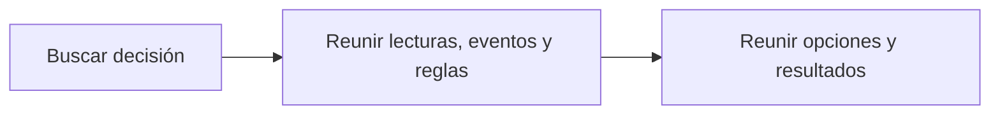

# Feature Specification: SF-04.2 — Lectura del registro

**Created**: 2026-10-19  
**Status**: draft  
**Flow**: [F-04 Consulta de decisión](36-f-04-consulta-de-decision.md) (subflujo)  
**Related Specs**: [F-04 Consulta de decisión](36-f-04-consulta-de-decision.md), [SF-04.1 Autorización de pertenencia](37-sf-04-1-autorizacion-de-pertenencia.md), [SF-04.3 Proyección a la lista cerrada de campos](39-sf-04-3-proyeccion-a-la-lista-cerrada-de-campos.md)  
**Origen (DEC/H)**: DEC-17, DEC-23  
**Pruebas (TC)**: TC-01  
**Contratos externos**: §1.1 (fila 5: registro de decisión)  

## Reglas de este documento

> Este spec es FUNCIONAL, no técnico: describe QUÉ hace el sistema, no CÓMO. Usa lenguaje de negocio; las siete herramientas externas se nombran por su función y se referencian por la sección de `sdd/reports/EXTERNAL_CONTRACTS.md`. Los casos borde se DOCUMENTAN; los valores de configuración se citan por el nombre del parámetro (NFR-012) con su valor por defecto entre paréntesis.

**Alcance**: Recupera el registro guardado de la decisión, con sus lecturas, eventos, reglas, variables, opciones, acciones y resultados.

## User Scenarios & Testing *(mandatory)*

### User Story 1 - El registro cuenta la historia completa de la decisión (Priority: P1)

Como auditor, quiero ver todo lo que sustentó la decisión, incluidas las opciones descartadas y sus razones.

**Why this priority**: Sin eso no se puede explicar por qué una opción no se mostró.

**Independent Test**: Se prueba con el caso base (la opción de reembolso descartada con su razón).

**Acceptance Scenarios**:

1. **Scenario**: Opciones descartadas visibles
   - **Given** una decisión con una opción de reembolso sin respaldo
   - **When** se lee el registro
   - **Then** la opción aparece como no viable con todas sus razones de descarte

2. **Scenario**: Resultados
   - **Given** se creó una solicitud o un caso
   - **When** se lee el registro
   - **Then** aparecen sus estados y referencias

3. **Scenario**: Opciones descartadas (TC-01)
   - **Given** la decisión del caso base con O3 sin respaldo recuperado
   - **When** se lee el registro
   - **Then** O3 figura como no viable con sus razones y O1 como propuesta

---

### Edge Cases

> Solo se documentan; los marcados MUST-IMPLEMENT se vuelven requisito FR-XXX y se implementan con TDD, los DEFERRED quedan para una iteración posterior.

#### System Errors
- [MUST-IMPLEMENT] Cuando el registro fue purgado por retención → responde como inexistente (FR-092)

#### Invalid Data
- [MUST-IMPLEMENT] Cuando una opción es de reembolso → sus campos de vuelo, costo y cupos quedan vacíos (FR-090)

## Requirements *(mandatory)*

### Functional Requirements

- **FR-042**: Las opciones no viables NO DEBEN mostrarse; se registran con todas sus razones de descarte (por ejemplo asientos insuficientes y conflicto de costo a la vez).
- **FR-090**: Cada evaluación DEBE generar un registro con identificador de decisión, reserva, lecturas con su instante, eventos elegidos y descartados con razón, versión de política y reglas, variables derivadas con supuestos, opciones viables y descartadas con razón, acción y huella del mensaje.
- **FR-093**: El sistema DEBE ofrecer la lectura del registro de una decisión por su identificador, sujeta a FR-001 (solo la reserva dueña de la sesión); la sesión del pasajero NO recibe la marca de revisión manual ni el detalle de las notificaciones, que son campos internos (FR-123).

### Key Entities *(include if feature involves data)*

- **Registro de decisión**: Instantánea de auditoría de una evaluación, sin información personal. Campos principales:
  - `decision_id`: identificador
  - `booking_id`: texto seudónimo
  - `created_at`: marca de tiempo UTC
  - `caller`: user | system
  - `fingerprint`: texto
  - `decision_state`: estado | nulo
  - `needs_manual_review`: booleano (campo interno, no se entrega a la sesión del pasajero)
  - `policy_version`: texto | nulo
  - `mct_provided`: booleano
  - `passenger_count`: entero
  - `segments`: lista de {segment_id: texto, state: texto | nulo, delay_minutes: entero | nulo}
  - `message_hash`: texto
  - `messages_blocked`: entero
  - `reads`: lista de {tool: texto, retrieved_at: marca de tiempo | nulo, outcome: OK | FAILED | INVALID | NOT_REQUESTED}
  - `events`: lista de {event_id, segment_id, event_type, disposition: CHOSEN | DISCARDED | NOT_INTERPRETED, reason}
  - `rules`: lista de {rule_id, result, requires_human_approval}
  - `options`: lista de opciones con sus razones de descarte (también las no viables)
  - `notifications`: lista de {reason, kind, status, notification_id} (solo modo sistema; campo interno, no se entrega a la sesión del pasajero)
  - `outcomes`: lista de {kind: REBOOKING | HUMAN_CASE, reference_id: texto | nulo, state: texto, at: marca de tiempo}
- **Opción de reprogramación**: Alternativa candidata entregada por el proveedor; solo las viables se muestran. Campos principales:
  - `option_id`: texto local a la lectura
  - `itinerary_key`: texto que identifica el itinerario entre lecturas
  - `type`: REBOOK | REFUND | otro
  - `flight_number`: texto | nulo
  - `origin`: código de aeropuerto | nulo
  - `destination`: código de aeropuerto | nulo
  - `date`: fecha | nulo
  - `departure`: hora local HH:MM | nulo
  - `fare_difference`: entero sin decimales | nulo
  - `currency`: código de moneda | nulo
  - `seats_available`: entero | nulo
  - `policy_ref`: texto
  - `confidence`: enumeración abierta (HIGH | MEDIUM | LOW | otro)
  - `viable`: booleano
  - `discard_reasons`: lista de INSUFFICIENT_SEATS | FEE_CONFLICT | NO_ENTITLEMENT | POLICY_REF_UNVERIFIED | POLICY_REF_SUPERSEDED | UNSUPPORTED_TYPE | EXPIRED | MISSING_CURRENCY | ITINERARY_MISMATCH
  - `fingerprint`: texto: huella por opción
  - `is_proposed`: booleano
  - `overnight`: booleano | nulo
  - `expires_at`: marca de tiempo UTC

## Architectural Attributes *(mandatory)*

| Attribute | Value |
|-----------|-------|
| **Interaction type** | sync-http |
| **Consistency** | strong |
| **Workflow** | single-step |
| **Read pattern** | simple |
| **Auditability** | full-history |
| **Domain complexity** | medium |
| **Modularity** | bounded-context |
| **Deployment** | monolith |

## Success Criteria *(mandatory)*

### Measurable Outcomes

- **SC-001**: El registro del caso base incluye las tres opciones con sus razones de descarte cuando corresponde.

## Traceability *(mandatory after implementation)*

> Las columnas de archivo y línea se registran en la verificación de trazabilidad posterior a la implementación; hoy cada criterio queda enlazado a su origen y a las pruebas que lo verifican.

| Criterion | Origen | Prueba (TC) | Source File | Line(s) |
|-----------|--------|-------------|-------------|---------|
| FR-042 | DEC-17 | TC-01 | se registra en la verificación posterior a la implementación | se registra en la verificación posterior a la implementación |
| FR-090 | DEC-23 | sin TC en el mapa §6 de REQUERIMIENTOS_V1 | se registra en la verificación posterior a la implementación | se registra en la verificación posterior a la implementación |
| FR-093 | DEC-23 | sin TC en el mapa §6 de REQUERIMIENTOS_V1 | se registra en la verificación posterior a la implementación | se registra en la verificación posterior a la implementación |
| SC-001 | criterio medible de este spec | TC-01 | se registra en la verificación posterior a la implementación | se registra en la verificación posterior a la implementación |

## Business Process (BPM View)

```
Buscar decisión → Reunir lecturas, eventos y reglas → Reunir opciones y resultados
```



