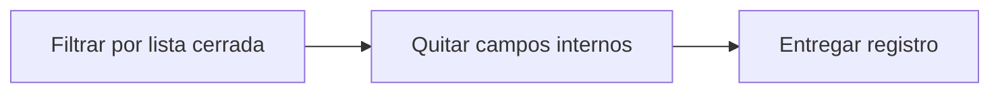

# Feature Specification: SF-04.3 — Proyección a la lista cerrada de campos

**Created**: 2026-10-19  
**Status**: draft  
**Flow**: [F-04 Consulta de decisión](36-f-04-consulta-de-decision.md) (subflujo)  
**Related Specs**: [F-04 Consulta de decisión](36-f-04-consulta-de-decision.md), [SF-04.2 Lectura del registro](38-sf-04-2-lectura-del-registro.md)  
**Origen (DEC/H)**: DEC-22, DEC-23  
**Pruebas (TC)**: TC-21, TC-59  
**Contratos externos**: §1.1 (fila 5: lista cerrada de campos y campos internos)  

## Reglas de este documento

> Este spec es FUNCIONAL, no técnico: describe QUÉ hace el sistema, no CÓMO. Usa lenguaje de negocio; las siete herramientas externas se nombran por su función y se referencian por la sección de `sdd/reports/EXTERNAL_CONTRACTS.md`. Los casos borde se DOCUMENTAN; los valores de configuración se citan por el nombre del parámetro (NFR-012) con su valor por defecto entre paréntesis.

**Alcance**: Entrega solo los campos de la lista cerrada de FR-091, sin información personal.

## User Scenarios & Testing *(mandatory)*

### User Story 1 - La auditoría nunca filtra información personal (Priority: P1)

Como responsable de privacidad, quiero que la consulta del registro no pueda devolver datos personales ni cargas completas.

**Why this priority**: Los registros son seudónimos, no anónimos.

**Independent Test**: Se prueba buscando datos ficticios de los escenarios en la respuesta.

**Acceptance Scenarios**:

1. **Scenario**: Sin datos personales
   - **Given** las lecturas originales contenían nombre y contacto ficticios
   - **When** se consulta el registro
   - **Then** ninguno aparece

2. **Scenario**: Campos permitidos
   - **Given** cualquier decisión
   - **When** se consulta
   - **Then** solo hechos operacionales, identificadores seudónimos, enumeraciones, números, marcas de tiempo y huellas

3. **Scenario**: Campos internos fuera (TC-59)
   - **Given** una evaluación del sistema con revisión manual y 2 notificaciones
   - **When** la sesión de ABC123 lee la decisión
   - **Then** no aparecen la revisión manual ni las notificaciones y no hay ningún dato de Ana

---

### Edge Cases

> Solo se documentan; los marcados MUST-IMPLEMENT se vuelven requisito FR-XXX y se implementan con TDD, los DEFERRED quedan para una iteración posterior.

#### Security & Permissions
- [MUST-IMPLEMENT] Cuando un campo no está en la lista cerrada → no se devuelve (FR-091)
- [MUST-IMPLEMENT] Cuando la lectura es de la sesión del pasajero → se omiten la revisión manual y el detalle de las notificaciones, que son internos (FR-093)

## Requirements *(mandatory)*

### Functional Requirements

- **FR-091**: Solo se persisten campos de una lista cerrada: hechos operacionales no personales, identificadores seudónimos, enumeraciones, números, marcas de tiempo y huellas. NUNCA se guardan cargas completas, nombre, contacto, documento ni edad del menor; los identificadores son seudónimos, no anónimos, y la reserva se trunca en los registros de aplicación.
- **FR-093**: El sistema DEBE ofrecer la lectura del registro de una decisión por su identificador, sujeta a FR-001 (solo la reserva dueña de la sesión); la sesión del pasajero NO recibe la marca de revisión manual ni el detalle de las notificaciones, que son campos internos (FR-123).

### Non-Functional and Documentation Requirements

- **NFR-002**: Privacidad: el sistema DEBE minimizar la información personal en todas las fronteras propias; ningún dato personal se entrega a un modelo (si en el futuro se usara, se anonimiza antes).

### Key Entities *(include if feature involves data)*

- **Registro de decisión**: Instantánea de auditoría de una evaluación, sin información personal. Campos principales:
  - `decision_id`: identificador
  - `booking_id`: texto seudónimo
  - `created_at`: marca de tiempo UTC
  - `caller`: user | system
  - `fingerprint`: texto
  - `decision_state`: estado | nulo
  - `needs_manual_review`: booleano (campo interno, no se entrega a la sesión del pasajero)
  - `policy_version`: texto | nulo
  - `mct_provided`: booleano
  - `passenger_count`: entero
  - `segments`: lista de {segment_id: texto, state: texto | nulo, delay_minutes: entero | nulo}
  - `message_hash`: texto
  - `messages_blocked`: entero
  - `reads`: lista de {tool: texto, retrieved_at: marca de tiempo | nulo, outcome: OK | FAILED | INVALID | NOT_REQUESTED}
  - `events`: lista de {event_id, segment_id, event_type, disposition: CHOSEN | DISCARDED | NOT_INTERPRETED, reason}
  - `rules`: lista de {rule_id, result, requires_human_approval}
  - `options`: lista de opciones con sus razones de descarte (también las no viables)
  - `notifications`: lista de {reason, kind, status, notification_id} (solo modo sistema; campo interno, no se entrega a la sesión del pasajero)
  - `outcomes`: lista de {kind: REBOOKING | HUMAN_CASE, reference_id: texto | nulo, state: texto, at: marca de tiempo}

## Architectural Attributes *(mandatory)*

| Attribute | Value |
|-----------|-------|
| **Interaction type** | sync-http |
| **Consistency** | strong |
| **Workflow** | single-step |
| **Read pattern** | simple |
| **Auditability** | full-history |
| **Domain complexity** | medium |
| **Modularity** | bounded-context |
| **Deployment** | monolith |

## Success Criteria *(mandatory)*

### Measurable Outcomes

- **SC-001**: Una búsqueda de los datos ficticios en la respuesta no encuentra ninguno.
- **SC-002**: La respuesta a la sesión del pasajero no contiene la revisión manual ni el detalle de las notificaciones en el 100 % de los casos.

## Traceability *(mandatory after implementation)*

> Las columnas de archivo y línea se registran en la verificación de trazabilidad posterior a la implementación; hoy cada criterio queda enlazado a su origen y a las pruebas que lo verifican.

| Criterion | Origen | Prueba (TC) | Source File | Line(s) |
|-----------|--------|-------------|-------------|---------|
| FR-091 | DEC-23 | sin TC en el mapa §6 de REQUERIMIENTOS_V1 | se registra en la verificación posterior a la implementación | se registra en la verificación posterior a la implementación |
| FR-093 | DEC-23 | TC-21, TC-59 | se registra en la verificación posterior a la implementación | se registra en la verificación posterior a la implementación |
| NFR-002 | DEC-22 | sin TC en el mapa §6 de REQUERIMIENTOS_V1 | se registra en la verificación posterior a la implementación | se registra en la verificación posterior a la implementación |
| SC-001 | criterio medible de este spec | TC-21, TC-59 | se registra en la verificación posterior a la implementación | se registra en la verificación posterior a la implementación |
| SC-002 | criterio medible de este spec | TC-21, TC-59 | se registra en la verificación posterior a la implementación | se registra en la verificación posterior a la implementación |

## Business Process (BPM View)

```
Filtrar por lista cerrada → Quitar campos internos → Entregar registro
```



