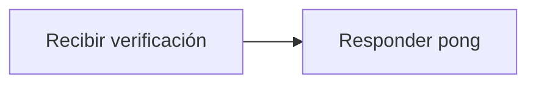

# Feature Specification: F-05 — Ping

**Created**: 2026-10-19  
**Status**: draft  
**Flow**: F-05 Ping  
**Related Specs**: [SF-05.1 Respuesta fija](41-sf-05-1-respuesta-fija.md), [F-12 Carga y validación de la configuración](71-f-12-carga-y-validacion-de-la-configuracion.md)  
**Origen (DEC/H)**: DEC-04, DEC-24  
**Pruebas (TC)**: TC-01  
**Contratos externos**: §1.1 (fila 1: verificación de vida)  

## Reglas de este documento

> Este spec es FUNCIONAL, no técnico: describe QUÉ hace el sistema, no CÓMO. Usa lenguaje de negocio; las siete herramientas externas se nombran por su función y se referencian por la sección de `sdd/reports/EXTERNAL_CONTRACTS.md`. Los casos borde se DOCUMENTAN; los valores de configuración se citan por el nombre del parámetro (NFR-012) con su valor por defecto entre paréntesis.

**Alcance**: Verificación de vida del servicio: responde «pong» en texto plano y no requiere sesión.

## User Scenarios & Testing *(mandatory)*

### User Story 1 - El equipo de operación sabe si el servicio responde (Priority: P1)

Como operador, quiero una verificación sencilla que me diga si el servicio está vivo.

**Why this priority**: Permite monitoreo y pruebas de arranque.

**Independent Test**: Se prueba pidiendo la verificación sin sesión y comprobando la respuesta.

**Acceptance Scenarios**:

1. **Scenario**: Servicio vivo
   - **Given** el servicio está en marcha
   - **When** se hace la verificación de vida
   - **Then** responde «pong» en texto plano sin pedir sesión

2. **Scenario**: Sin datos personales
   - **Given** cualquier llamada
   - **When** se hace la verificación de vida
   - **Then** la respuesta no revela información de reservas ni de configuración

3. **Scenario**: Respuesta rápida
   - **Given** el servicio en marcha sin sesión
   - **When** se hace la verificación de vida
   - **Then** responde «pong» en menos de 50 ms

---

### Edge Cases

> Solo se documentan; los marcados MUST-IMPLEMENT se vuelven requisito FR-XXX y se implementan con TDD, los DEFERRED quedan para una iteración posterior.

#### System Errors
- [MUST-IMPLEMENT] Cuando el servicio no responde en 2 s → el monitoreo lo considera caído (FR-110)

#### Invalid Data
- [DEFERRED] Verificación de salud profunda (proveedores y registro): fuera de la versión 1 (FR-110)

#### Security & Permissions
- [MUST-IMPLEMENT] Cuando se llama sin sesión → responde igualmente (FR-110)

## Requirements *(mandatory)*

### Functional Requirements

- **FR-110**: El servicio DEBE exponer: la evaluación de un viaje con reserva y `caller`, la vista del viaje, la aceptación de una opción, el caso humano, la lectura del registro de decisión y una verificación de vida que responde «pong».

### Non-Functional and Documentation Requirements

- **NFR-005**: Operabilidad: el sistema DEBE configurarse por variables de entorno, emitir registros estructurados sin información personal y contar con un runbook de una página; debe poder operarlo un equipo pequeño.

### Key Entities *(include if feature involves data)*

- **Escenario de desarrollo**: Conjunto de datos simulados de las siete herramientas, activable solo en desarrollo. Campos principales:
  - `scenario_id`: texto
  - `booking_id`: texto
  - `title`: texto en español
  - `description`: texto
  - `ui`: booleano (visible en el selector)
  - `tests`: lista de TC-nn

## Architectural Attributes *(mandatory)*

| Attribute | Value |
|-----------|-------|
| **Interaction type** | sync-http |
| **Consistency** | strong |
| **Workflow** | single-step |
| **Read pattern** | simple |
| **Auditability** | none |
| **Domain complexity** | low |
| **Modularity** | feature-slice |
| **Deployment** | monolith |

## Success Criteria *(mandatory)*

### Measurable Outcomes

- **SC-001**: La verificación responde en menos de 50 ms (percentil 99).
- **SC-002**: La respuesta es exactamente «pong» en el 100 % de los casos.

## Traceability *(mandatory after implementation)*

> Las columnas de archivo y línea se registran en la verificación de trazabilidad posterior a la implementación; hoy cada criterio queda enlazado a su origen y a las pruebas que lo verifican.

| Criterion | Origen | Prueba (TC) | Source File | Line(s) |
|-----------|--------|-------------|-------------|---------|
| FR-110 | DEC-04 | sin TC en el mapa §6 de REQUERIMIENTOS_V1 | se registra en la verificación posterior a la implementación | se registra en la verificación posterior a la implementación |
| NFR-005 | DEC-24 | sin TC en el mapa §6 de REQUERIMIENTOS_V1 | se registra en la verificación posterior a la implementación | se registra en la verificación posterior a la implementación |
| SC-001 | criterio medible de este spec | TC-01 | se registra en la verificación posterior a la implementación | se registra en la verificación posterior a la implementación |
| SC-002 | criterio medible de este spec | TC-01 | se registra en la verificación posterior a la implementación | se registra en la verificación posterior a la implementación |

## Business Process (BPM View)

```
Recibir verificación → Responder pong
```



### Subprocesses (if applicable)

```
SF-05.1: Respuesta fija
```
