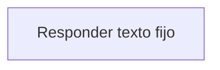

# Feature Specification: SF-05.1 — Respuesta fija

**Created**: 2026-10-19  
**Status**: draft  
**Flow**: [F-05 Ping](40-f-05-ping.md) (subflujo)  
**Related Specs**: [F-05 Ping](40-f-05-ping.md)  
**Origen (DEC/H)**: DEC-04  
**Pruebas (TC)**: TC-01  
**Contratos externos**: §1.1 (fila 1)  

## Reglas de este documento

> Este spec es FUNCIONAL, no técnico: describe QUÉ hace el sistema, no CÓMO. Usa lenguaje de negocio; las siete herramientas externas se nombran por su función y se referencian por la sección de `sdd/reports/EXTERNAL_CONTRACTS.md`. Los casos borde se DOCUMENTAN; los valores de configuración se citan por el nombre del parámetro (NFR-012) con su valor por defecto entre paréntesis.

**Alcance**: Devuelve el texto fijo «pong» sin depender de la sesión ni de los proveedores externos.

## User Scenarios & Testing *(mandatory)*

### User Story 1 - La verificación no depende de nada más (Priority: P1)

Como operador, quiero que la verificación de vida funcione aunque los proveedores externos estén caídos.

**Why this priority**: Un monitoreo que depende de terceros da falsas alarmas.

**Independent Test**: Se prueba con todos los proveedores simulados caídos.

**Acceptance Scenarios**:

1. **Scenario**: Sin dependencias
   - **Given** todos los proveedores están caídos
   - **When** se hace la verificación
   - **Then** responde «pong»

2. **Scenario**: Con proveedores caídos
   - **Given** los 7 proveedores simulados caídos
   - **When** se hace la verificación de vida
   - **Then** responde «pong» igualmente

---

### Edge Cases

> Solo se documentan; los marcados MUST-IMPLEMENT se vuelven requisito FR-XXX y se implementan con TDD, los DEFERRED quedan para una iteración posterior.

#### System Errors
- [MUST-IMPLEMENT] Cuando los proveedores fallan → la verificación igual responde (FR-110)

#### Invalid Data
- [MUST-IMPLEMENT] Cuando se envía cuerpo o parámetros → se ignoran (FR-110)

## Requirements *(mandatory)*

### Functional Requirements

- **FR-110**: El servicio DEBE exponer: la evaluación de un viaje con reserva y `caller`, la vista del viaje, la aceptación de una opción, el caso humano, la lectura del registro de decisión y una verificación de vida que responde «pong».

### Key Entities *(include if feature involves data)*

- **Escenario de desarrollo**: Conjunto de datos simulados de las siete herramientas, activable solo en desarrollo. Campos principales:
  - `scenario_id`: texto
  - `booking_id`: texto
  - `title`: texto en español
  - `description`: texto
  - `ui`: booleano (visible en el selector)
  - `tests`: lista de TC-nn

## Architectural Attributes *(mandatory)*

| Attribute | Value |
|-----------|-------|
| **Interaction type** | sync-http |
| **Consistency** | strong |
| **Workflow** | single-step |
| **Read pattern** | simple |
| **Auditability** | none |
| **Domain complexity** | low |
| **Modularity** | feature-slice |
| **Deployment** | monolith |

## Success Criteria *(mandatory)*

### Measurable Outcomes

- **SC-001**: La respuesta es idéntica en cada llamada.

## Traceability *(mandatory after implementation)*

> Las columnas de archivo y línea se registran en la verificación de trazabilidad posterior a la implementación; hoy cada criterio queda enlazado a su origen y a las pruebas que lo verifican.

| Criterion | Origen | Prueba (TC) | Source File | Line(s) |
|-----------|--------|-------------|-------------|---------|
| FR-110 | DEC-04 | sin TC en el mapa §6 de REQUERIMIENTOS_V1 | se registra en la verificación posterior a la implementación | se registra en la verificación posterior a la implementación |
| SC-001 | criterio medible de este spec | TC-01 | se registra en la verificación posterior a la implementación | se registra en la verificación posterior a la implementación |

## Business Process (BPM View)

```
Responder texto fijo
```



