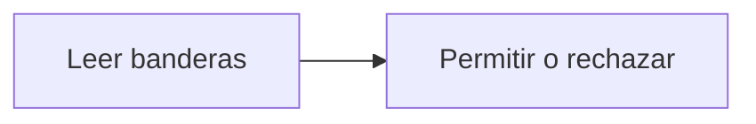

# Feature Specification: SF-06.1 — Verificación de los flags de desarrollo

**Created**: 2026-10-19  
**Status**: draft  
**Flow**: [F-06 Escenarios y reloj de desarrollo](42-f-06-escenarios-y-reloj-de-desarrollo.md) (subflujo)  
**Related Specs**: [F-06 Escenarios y reloj de desarrollo](42-f-06-escenarios-y-reloj-de-desarrollo.md), [SF-06.2 Listado del catálogo](44-sf-06-2-listado-del-catalogo.md)  
**Origen (DEC/H)**: DEC-12, DEC-21  
**Pruebas (TC)**: TC-21, TC-49  
**Contratos externos**: §2.4 (`DEV_ENDPOINTS_ENABLED`, `DEV_SESSION_HEADER_ENABLED`, `CLOCK_MODE`)  

## Reglas de este documento

> Este spec es FUNCIONAL, no técnico: describe QUÉ hace el sistema, no CÓMO. Usa lenguaje de negocio; las siete herramientas externas se nombran por su función y se referencian por la sección de `sdd/reports/EXTERNAL_CONTRACTS.md`. Los casos borde se DOCUMENTAN; los valores de configuración se citan por el nombre del parámetro (NFR-012) con su valor por defecto entre paréntesis.

**Alcance**: Comprueba que los funciones de desarrollo y la sesión simulada estén habilitados antes de atender.

## User Scenarios & Testing *(mandatory)*

### User Story 1 - Lo de desarrollo no existe en producción (Priority: P1)

Como responsable de seguridad, quiero que nada de desarrollo funcione si no se habilitó explícitamente.

**Why this priority**: Un selector de escenario expuesto en producción permitiría manipular los datos.

**Independent Test**: Se prueba con las dos variables apagadas y encendidas.

**Acceptance Scenarios**:

1. **Scenario**: Apagado
   - **Given** `DEV_ENDPOINTS_ENABLED` es falso
   - **When** se llama
   - **Then** responde «desactivado»

2. **Scenario**: Sesión simulada
   - **Given** `DEV_SESSION_HEADER_ENABLED` es falso
   - **When** se usa la sesión simulada
   - **Then** toda consulta de negocio se rechaza por falta de autenticación

3. **Scenario**: Perfil por defecto (TC-49)
   - **Given** `DEV_ENDPOINTS_ENABLED` y `DEV_SESSION_HEADER_ENABLED` sin definir
   - **When** se piden el catálogo y la sesión simulada de ABC123
   - **Then** ambas responden como desactivadas

---

### Edge Cases

> Solo se documentan; los marcados MUST-IMPLEMENT se vuelven requisito FR-XXX y se implementan con TDD, los DEFERRED quedan para una iteración posterior.

#### Invalid Data
- [MUST-IMPLEMENT] Cuando el reloj de escenario no está en modo escenario → el avance del reloj responde como desactivado (FR-017)

#### Security & Permissions
- [MUST-IMPLEMENT] Cuando las variables no están definidas → quedan apagadas (FR-001)

## Requirements *(mandatory)*

### Functional Requirements

- **FR-001**: El sistema DEBE operar sobre la sesión autenticada del pasajero y comprobar que la reserva y la decisión solicitadas pertenezcan a esa sesión; una reserva ajena y una inexistente DEBEN producir exactamente la misma respuesta de «no encontrado», sin confirmar la existencia de ninguna. La sesión simulada solo existe con el parámetro `DEV_SESSION_HEADER_ENABLED` (apagado por defecto): en cualquier otro perfil toda petición del pasajero sin sesión DEBE rechazarse por falta de autenticación, y toda petición del sistema DEBE exigir la credencial de servicio (FR-120). Los errores NO DEBEN mostrar trazas ni repetir la entrada, nunca se pide ni se muestra documento de identidad, y el identificador de decisión DEBE ser aleatorio y no adivinable.

### Non-Functional and Documentation Requirements

- **NFR-003**: Seguridad: el analizador de reglas DEBE operar sin ejecución dinámica, las entradas se validan estrictamente, el origen permitido se acota al front y no hay secretos en el repositorio.

### Key Entities *(include if feature involves data)*

- **Configuración**: Conjunto central de parámetros con valor por defecto, sobrescritura por entorno y validación al arrancar. Campos principales:
  - `name`: nombre del parámetro (p. ej. `RELEVANT_DELAY_MIN_MINUTES`)
  - `default`: valor por defecto documentado
  - `effective_value`: valor tras aplicar el entorno
  - `validation`: tipo, rango, lista no vacía o longitud mínima
  - `is_secret`: booleano (solo por entorno, nunca se muestra)
  - `effect`: comportamiento que cambia

## Architectural Attributes *(mandatory)*

| Attribute | Value |
|-----------|-------|
| **Interaction type** | sync-http |
| **Consistency** | strong |
| **Workflow** | single-step |
| **Read pattern** | simple |
| **Auditability** | full-history |
| **Domain complexity** | medium |
| **Modularity** | bounded-context |
| **Deployment** | monolith |

## Success Criteria *(mandatory)*

### Measurable Outcomes

- **SC-001**: En el perfil por defecto el 100 % de las llamadas de desarrollo y de sesión simulada se rechaza.

## Traceability *(mandatory after implementation)*

> Las columnas de archivo y línea se registran en la verificación de trazabilidad posterior a la implementación; hoy cada criterio queda enlazado a su origen y a las pruebas que lo verifican.

| Criterion | Origen | Prueba (TC) | Source File | Line(s) |
|-----------|--------|-------------|-------------|---------|
| FR-001 | DEC-21 | TC-21 | se registra en la verificación posterior a la implementación | se registra en la verificación posterior a la implementación |
| NFR-003 | DEC-12 | sin TC en el mapa §6 de REQUERIMIENTOS_V1 | se registra en la verificación posterior a la implementación | se registra en la verificación posterior a la implementación |
| SC-001 | criterio medible de este spec | TC-21, TC-49 | se registra en la verificación posterior a la implementación | se registra en la verificación posterior a la implementación |

## Business Process (BPM View)

```
Leer banderas → Permitir o rechazar
```



